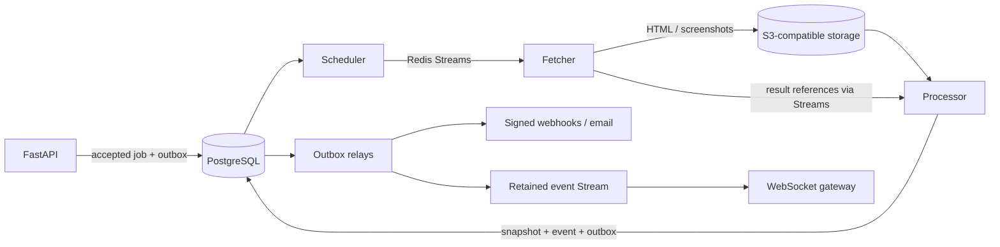

# WARDEN

### Distributed web-change detection & rule-based alerting

**Track meaningful changes. Control when to crawl. Make alerts recoverable.**

WARDEN monitors webpages for price drops, new listings, and content updates.
It compares successive versions, evaluates user-defined rules, and schedules
webhook or email alerts. Authenticated WebSockets deliver events with reconnect
replay, while a feedback-driven classifier learns tenant-specific preferences.

**Python 3.12+ · FastAPI · PostgreSQL · Redis Streams · Selenium Grid · Docker**

[Architecture](#how-it-works) · [Measured results](#measured-results) ·
[Getting started](#getting-started) · [Engineering guide](docs/reports/algo_explanations.md)

## What you can build with it

Watch a product page, extract its price, and express the notification policy:

```text
when price.drop_percent >= 10
  and price.current < 1000
  and count(changes, 24h) < 3
then webhook("price-alerts") + tag("bargain")
cooldown 6h
```

This schedules a webhook and tags the monitor when the conditions match, then
suppresses further matches for six hours. `price-alerts` names an owned destination;
prices use the monitor's configured currency. See the [rule language](docs/dsl.md).

- **Focused monitoring:** CSS/XPath scoping, HTTP fetching, and optional browser rendering.
- **Multiple comparison signals:** Myers text diff, Merkle DOM hashing, SimHash,
  TF-IDF, and SSIM screenshot analysis help distinguish content edits from noise.
- **Adaptive crawling:** estimated change rates and constrained optimization allocate
  a fixed crawl budget; timing wheels and bounded-load hashing schedule and route work.
- **Reliable delivery:** transactional outboxes, retries, circuit breakers,
  signed webhooks, delivery logs, and manual redelivery preserve actionable history.
- **Personalized decisions:** online logistic regression, versioned models, shadow
  scoring, held-out promotion gates, and rollback support controlled model changes.

## How it works



PostgreSQL records accepted work and committed effects. Redis Streams track
delivery and pending work; workers acknowledge after their durable handoff.
Stable job identities and transactional receipts make repeated deliveries safe
for committed effects. The fetcher has **no PostgreSQL credentials or driver**;
the comparison library stays network-independent. Large payloads travel through
**SeaweedFS's S3-compatible storage**, keeping queue messages small.

## Measured results

Every result links to its recorded evidence; these are scoped experiments.

| Experiment | Result |
| --- | --- |
| [Live worker-crash recovery](docs/reports/part-1-gate2.json) | **500/500 jobs completed** across **12 worker kills**, with zero lost jobs or duplicate durable effects. |
| [Crawl-budget simulation](docs/reports/part-1-numbers.json) | **37.7% less stale time** than fixed-interval polling at the same crawl budget. |
| [Rule-language fuzzing](docs/reports/part-2-fuzz.json) | **60,000 programs**, zero unexpected exceptions or hangs. |
| [PostgreSQL query tuning](docs/reports/part-3-query-plans.json) | Up to **99.6% lower query execution time** on fixture data containing 150,002 crawl rows. |
| [Personalization benchmark](docs/reports/part-3-learning-curve.json) | F1 **0.671 → 1.000** on **600 synthetic held-out examples** under a price-drop preference policy. |

## Getting started

From the repository root, with Python 3.12+ and `uv` installed:

```bash
uv sync --frozen
make check
```

`make check` runs Ruff, strict mypy, and the default pytest selection. The latest
run passed **490 tests**; **21 skipped** because live test prerequisites were
unavailable, and **53 were deselected** by infrastructure markers. This command
does not start the full application stack.

For a local deployment, follow [credential and service setup](docs/PART1_SETUP.md)
and [network preflight](docs/DOCKER_NETWORK_RECOVERY.md) before creating Docker
networks. Local published ports bind to `127.0.0.1`. Once the API is running,
explore its [interactive API documentation](http://127.0.0.1:18000/docs).
The [Parts 2/3 setup guide](docs/PART23_SETUP.md) covers their additional prerequisites.

## Project status

**Active development; API-first, with no hosted public demo.** The core pipeline
has passed the live recovery experiment above. Rules, alerting, and online learning
have implementation and scoped integration proofs; their updated deployment remains
pending. Django/DRF analytics, deployed replica/PgBouncer integration, and full live
tracing/SLO demonstrations are unfinished. OpenTelemetry instrumentation and
Prometheus/Grafana/Jaeger/Alertmanager configuration are present.

See the [execution status and remaining work](docs/PART23_STATUS.md) for the exact
boundary between source, tested behavior, and deployed services.

## Explore the engineering

- [Algorithms & systems guide](docs/reports/algo_explanations.md): derivations,
  worked examples, failure walkthroughs, and understanding checks.
- [Part 1 report](docs/reports/part-1.md): architecture choices, source tour,
  benchmarks, and crash-recovery evidence.
- [Parts 2/3 report](docs/reports/parts-2-3.md): rule compilation, alert delivery,
  online learning, database experiments, and observability.
- [Authorship](docs/AUTHORSHIP.md): transparent attribution of AI-assisted work.
