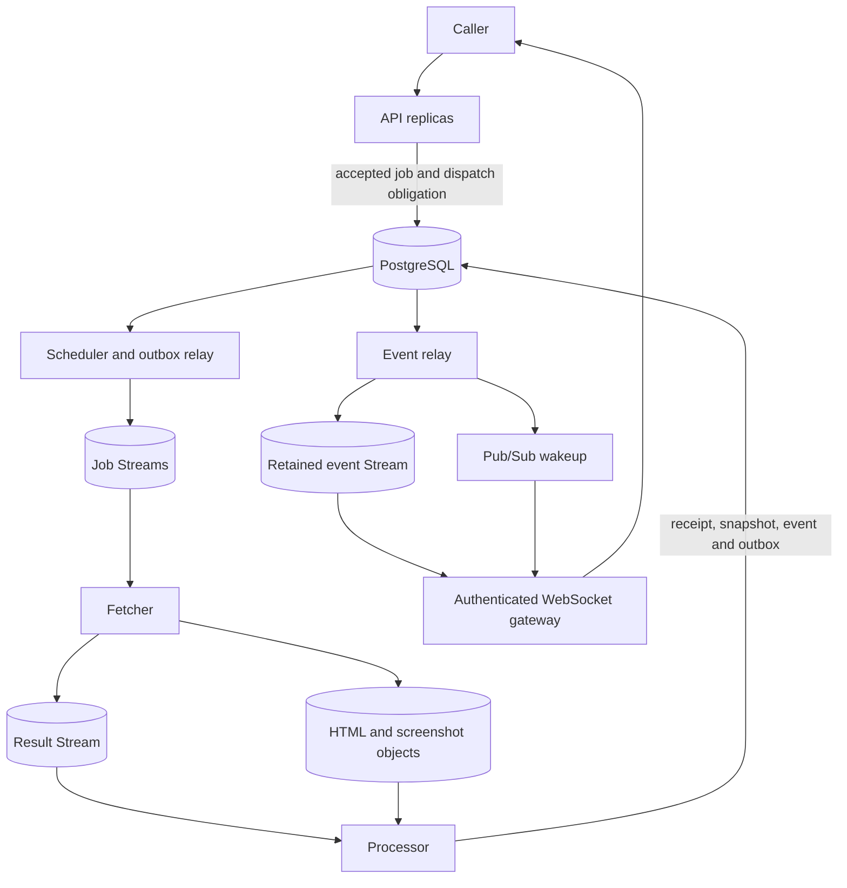

# WARDEN: algorithms and systems explained

This is a standalone, expanded explanation of every concept family in Part 1's “Concepts from scratch” section. It explains the algorithms, the reasoning behind their implementation, the failure cases they address, and the choices a stronger production design would need to make. It is intended to let you reason about the system independently of the names used in the code.

Read for a causal chain: **what input we have, what decision we need, what state we retain, what steps change that state, and what conclusion those steps justify**. The worked examples use deliberately small inputs so every intermediate state is visible. They are calculations and execution traces, not performance measurements.

The guide distinguishes three kinds of statement. **General mechanism** describes how the algorithm or protocol works under its assumptions. **WARDEN implementation** describes the inspected source. **Further requirements** describe capabilities or controls that must not be assumed present just because they would be useful. The repository has progressed beyond Part 1, so current source and the original checkpoint are not identical; later learning and rule-delivery systems have their own reports.

The original `part-1.md` is preserved. This document expands the explanations without changing the application's behavior or the recorded proof results.

## Contents

- [Foundations for reading the algorithms](#foundations)
- [1. Processes, services, libraries and replicas](#chapter-1)
- [2. Durable state, accepted work and HTTP 202](#chapter-2)
- [3. Transactions, row locks, constraints and migrations](#chapter-3)
- [4. The dual-write problem and transactional outbox](#chapter-4)
- [5. Idempotency, repeated delivery and committed effects](#chapter-5)
- [6. Bloom filters: probabilistic membership and exact verification](#chapter-6)
- [7. Counting Bloom filters: deletion and counter correctness](#chapter-7)
- [8. Hierarchical timing wheels: scheduling many deadlines](#chapter-8)
- [9. Wall time, monotonic time and schedule recovery](#chapter-9)
- [10. Poisson observations and what the crawler actually measures](#chapter-10)
- [11. Maximum likelihood, MAP and the Gamma prior](#chapter-11)
- [12. Safeguarded Newton iteration and numerical stability](#chapter-12)
- [13. Crawl-budget optimization, Lagrange multipliers and interval bounds](#chapter-13)
- [14. Consistent hashing and virtual nodes](#chapter-14)
- [15. Bounded-load assignment and what its bound actually means](#chapter-15)
- [16. Redis state, Lua scripts, atomicity and durability](#chapter-16)
- [17. LRU eviction, TTL freshness and metadata consistency](#chapter-17)
- [18. GCRA rate limiting across API replicas](#chapter-18)
- [19. Leader leases, ownership and fencing tokens](#chapter-19)
- [20. Membership heartbeats and in-flight work heartbeats](#chapter-20)
- [21. Redis Streams, consumer groups, pending entries and acknowledgement](#chapter-21)
- [22. Delayed retries, backoff, circuit breakers and overload](#chapter-22)
- [23. Claim-check messages, content addressing and snapshot representation](#chapter-23)
- [24. Pub/Sub notifications, replay logs and the subscribe gap](#chapter-24)
- [25. Authentication, authorization, SSRF and capability boundaries](#chapter-25)
- [26. Comparison algorithms: representations, exact differences and similarity](#chapter-26)
- [27. Static classification, feature policy and probability](#chapter-27)
- [28. Containers, image boundaries, ports and host routes](#chapter-28)
- [29. Tests, independent oracles, benchmarks and proof limits](#chapter-29)
- [30. Turning implementation knowledge into engineering judgment](#chapter-30)
- [31. Connection pools, deadlines, backpressure and shutdown](#chapter-31)
- [32. Serialization, runtime validation and evolving contracts](#chapter-32)
- [Complete check and failure walkthrough](#complete-walkthrough)
- [Understanding checks with model answers](#understanding-checks)
- [Source map and study path](#source-map)
- [Document provenance and handoff](#handoff)

<a id="foundations"></a>
## Foundations for reading the algorithms

### A value needs a meaning, a unit and a scope

`rate=0.01` is incomplete until we know whether that means changes per second, requests per millisecond or a fraction of examples. `timeout=5` needs a time unit and the operation it bounds. `load=20` needs to say whether it counts queued jobs, pending jobs, active requests or estimated CPU work.

In this guide, `λ` is a change rate, `T` is an observation interval, `I` is a chosen crawl interval, and `f=1/I` is crawl frequency. The product `λT` is dimensionless. The sum of frequencies has the same unit as the shared crawl budget. Dimensional checks catch many errors before any test runs.

Scope is equally important. A per-process limit is multiplied by process replication unless coordinated. A per-monitor lock does not serialize every monitor. A receipt for one job does not deduplicate every future check of the same URL. Always attach a scope to words such as shared, unique, atomic, ordered and limited.

### State, invariant and transition

**State** is the information retained between operations: a bit array, a timer bucket, a Redis key or a database row. A **transition** changes that state in response to an input. An **invariant** is a condition that must remain true after every valid transition.

For a timer, one invariant is that a valid active handle has one scheduling location. For an accepted job, one invariant is that its terminal receipt and committed effects agree. For the budget solver, the returned intervals must satisfy every declared bound and not overspend a feasible budget. The invariant tells us what the implementation must preserve; the data structure tells us how it can preserve it efficiently.

Also distinguish a **precondition**, which the caller must establish before an operation, from a **postcondition**, which the operation promises afterward. Counting-Bloom removal requires an outstanding insertion of that exact item. Passing a probabilistic membership test cannot establish that precondition. A function can perform all its arithmetic correctly while being used outside its valid contract.

### Exactness, approximation and uncertainty

Exact equality of two byte strings, approximate similarity of two documents and probability of a latent page change are different questions. A cryptographic digest represents identity under a collision assumption. SimHash deliberately loses information to summarize similarity. A Poisson model estimates behavior from partial observations under statistical assumptions. Replacing one with another because they all output a number is a category error.

A probability describes a model's uncertainty, while an error bound or false-positive target describes the behavior of a procedure under its assumptions. Neither is automatically a measured guarantee on arbitrary website traffic. The guide explains where approximations enter so you can identify the situations in which they become poor.

### Complexity with the actual input size

`O(log N)` means growth proportional to the logarithm of an identified input size, up to constant factors in the stated model. It is not a latency measurement. Hashing a long key still costs time even when a subsequent lookup is expected constant time. Writing a database row has I/O and contention costs even when a surrounding loop has few iterations.

**Worst-case** bounds cover the most expensive allowed input or execution. **Expected** bounds depend on a probability model, such as hash distribution. **Amortized** bounds describe total cost across a sequence of operations divided over that sequence. Union-find's near-constant amortized operations do not mean every individual find is one array lookup. A growing timing wheel's insertion is not unconditionally constant when it may allocate a new level.

Space complexity also needs its scope. A packed Bloom bit array may be small while an exact auxiliary set dominates memory. A screenshot component algorithm can allocate arrays for every pixel even if few pixels changed. A queue can have bounded processing batches and still grow without bound in total retention.

### The mathematical tools used here

A derivative measures how an objective changes for a small parameter adjustment. Setting it to zero identifies a candidate interior optimum; convexity or concavity helps decide whether that candidate is globally useful. The second derivative measures how the slope changes, which gives Newton iteration its local update.

A logarithm converts products into sums and makes very small likelihoods easier to handle. It does not repair a wrong probability model or remove every floating-point problem. Bisection uses a monotonic sign or feasibility boundary to repeatedly halve a valid interval. Lagrange multipliers express the effect of a shared constraint and lead to the optimizer's square-root allocation.

You do not need to memorize every derivative. You should be able to explain what is being optimized, which variables are free, what each constraint means, why the update heads toward a solution, and what happens at the boundary.

### The pipeline and its authorities



PostgreSQL is authoritative for accepted obligations and committed business effects. Object storage holds the referenced bytes. Redis coordinates transport, recovery and shared operational state. The timing wheel, local Bloom filter and local breaker state are useful process state, but must not become the sole durable record of accepted user work.


<a id="chapter-1"></a>
## 1. Processes, services, libraries and replicas

A **process** is a running program with its own address space, event loop, open connections and failure state. A Python object stored in one process is not automatically visible in another. Starting two API processes therefore creates two separate sets of local caches, counters and locks. Importing the same module in both processes does not create shared memory.

A **service** is a runtime responsibility with an interface and an operational lifecycle. WARDEN separates accepting authenticated requests, deciding when to crawl, fetching external content, and processing results. These responsibilities can run in different processes, fail independently and have different credentials. They communicate using database records and serialized messages rather than ordinary Python function calls across process boundaries.

A **library** is code imported by a process. `warden_core` provides algorithms and contracts; `warden_redis` provides Redis-backed mechanisms; `warden_compare` provides comparison logic. A library does not become a service because several services import it. Keeping comparison algorithms in a library makes it possible to test them with explicit inputs without starting the API, a browser or a database.

An **API replica** is another running instance of the same API application. Replicas can handle different requests concurrently, normally behind a load balancer. They reduce the load on one process and provide redundancy, but do not make one ordinary request execute on all replicas. They also do not automatically multiply database capacity: all replicas may still contend for the same database connections and rows.

A useful architectural distinction is between **stateless request handling** and **stateful system behavior**. A stateless API replica keeps durable user and monitor state outside its own memory, allowing another replica to serve the next request. The whole application still has substantial state in PostgreSQL, Redis and object storage. A local login counter would violate the intended shared policy because requests distributed over multiple replicas could consume separate allowances.

WARDEN uses multiple cooperating services in one repository, with shared libraries and a shared relational schema. That is a service-oriented deployment, but it does not achieve every form of microservice independence: schema changes and message contracts still require coordination. The split is justified principally by workload and trust boundaries. External crawling needs different resource limits and permissions from authenticated database operations.

Concurrency also differs from parallelism. Async I/O lets a process work on another task while waiting for a network response. It does not make a CPU-heavy Python diff stop occupying the event-loop thread. Multiple processes can execute CPU work in parallel; a process pool or dedicated CPU workers are other possibilities. Choosing between these requires measuring the actual bottleneck. Adding API replicas helps a saturated API process, but cannot directly fix an overloaded comparison algorithm or a slow target website.

**Implementation boundary:** the fetcher must not receive PostgreSQL credentials or drivers, while `warden_compare` must not acquire a network-capable dependency. These boundaries are properties of dependencies, images and supplied capabilities, not properties of folder names alone.

### Choosing boundaries from requirements

The first architecture decision is the unit of failure, scaling and authority. Those three units need not be identical. One repository can produce several images; one image can run many replicas; one service can use several libraries. A library boundary changes imports, a process boundary changes memory and failure behavior, and a credential boundary changes what actions a process is authorized to perform.

Consider three deployment choices for WARDEN:

| Choice | Useful properties | Costs and risks |
| --- | --- | --- |
| One application process handling requests, fetches and comparisons | Simple calls, simple local debugging, few deployment pieces | Slow or hostile crawling competes with API work; all code may receive broad credentials; a process crash affects everything |
| One codebase with API plus asynchronous worker processes | Independent resource allocation and background recovery while retaining shared development conventions | Still requires messages, retries and schema compatibility; shared storage can remain a bottleneck |
| Separately owned services with independent storage and release cycles | Stronger team autonomy and independently evolved domains | Distributed consistency, duplicated data, network contracts and operations become substantially more complicated |

WARDEN's current design is closest to the middle arrangement with several explicitly separated service responsibilities. Calling it “microservices” does not remove its shared-schema coupling. Calling it a “monorepo” does not mean it is a monolithic runtime. Those words describe different dimensions.

Async execution is best understood with a timeline. Task A sends an HTTP request and awaits its response. While A is suspended, task B can parse an API request or send a database query. If A instead performs a long synchronous diff without yielding, B cannot use the same event-loop thread until that work finishes. The `async` keyword does not change that CPU fact. Move expensive computation to an appropriate execution resource only after deciding how inputs, cancellation and result ownership will work.

Adding replicas also changes aggregate limits. If one API process has a 15-connection upper bound, four replicas can demand 60 database connections. If one fetcher enforces a local two-request domain limit, four fetchers do not automatically preserve a global limit of two. Every local limit should be labeled with its scope.

<a id="chapter-2"></a>
## 2. Durable state, accepted work and HTTP 202

A request that starts background work has at least two distinct outcomes: **the system accepted responsibility for the work**, and **the work finished successfully**. HTTP `202 Accepted` describes the first. Returning it before recording a recoverable obligation would allow a process crash to erase work that the client reasonably believes was accepted.

WARDEN's manual-check endpoint therefore creates a stable job ID and stages two records together: a `CrawlJob` with status `queued`, and an outbox row containing the fetch message. `stage_check` in `libs/warden_db/src/warden_db/dispatch.py` performs the staging; the endpoint in `services/api/src/warden_api/monitors/router.py` commits before returning. If the commit fails, the operation has not been durably accepted. If Redis is unavailable after the commit, dispatch can wait for a relay to recover.

The job ID identifies the logical check across queue deliveries and retries. A Redis Stream entry ID identifies one transport publication. Republishing the same logical job can create a second Stream entry, so those identities must not be confused. A retry attempt number describes delivery or execution history; it should not create a new logical business operation unless that is explicitly intended.

The database receipt is also useful after acceptance. A job can move from queued to completed or failed, with references to the resulting snapshot and event. Failure is a valid recorded outcome, not evidence that the original acceptance was dishonest. The important distinction is between a durable failed outcome and an accepted job silently disappearing.

There is an unavoidable response ambiguity: the database can commit and the API can crash before the client receives `202`. A client cannot determine from that lost response alone whether the operation committed. A stable request-level idempotency key can let the client retry the same request safely. The stable internal job ID solves duplicate processing of that job, but does not by itself deduplicate two separate HTTP requests that each generate a fresh job ID. Do not claim the latter unless a request-key protocol is implemented.

Durability is conditional on the storage system's own guarantees: transaction commits, persistence configuration, backups and recovery. A Python `dict` is not a durable job ledger, and an ordinary in-process background task is not a substitute for one. Conversely, durable acceptance does not imply immediate execution, a maximum completion time, or successful delivery during a permanent outage. Those require capacity, retries, monitoring and an operational policy for stuck work.

A practical way to design such an endpoint is to specify four things independently: what is committed before the response, how the caller identifies the operation, which component resumes unfinished work, and how success or failure becomes visible. That contract is more useful than describing the endpoint merely as “asynchronous.”

### One request traced through acceptance

Suppose a caller submits a manual check for monitor M:

| Step | Database state | Client-visible interpretation |
| --- | --- | --- |
| Validate authentication, ownership and active state | No new job yet | Request can still be rejected normally |
| Allocate job J and stage receipt plus outbox | Writes are uncommitted | Work has not yet been durably accepted |
| Commit | J and its dispatch obligation exist together | The server can now honestly acknowledge acceptance |
| Return `202` with J | Same committed state | Caller has an identity for the accepted operation |
| Relay publishes J | Dispatch is progressing | Completion is still pending |
| Processor records a terminal result | Outcome is committed | Completion or failure can be reported separately |

A process crash before commit leaves no accepted job, assuming transaction rollback. A crash after commit but before the HTTP response creates an ambiguous client outcome, but the obligation itself survives. These are different failures and need different solutions.

A request-level idempotency protocol could associate `(user, idempotency_key)` with a hash of the request and the committed response identity. Retrying the same key and same request returns the same job J. Reusing the key with different input must be rejected rather than accidentally returning an unrelated operation. The database must serialize simultaneous claims on that key. This is a full protocol to design, not something automatically supplied by a UUID inside the worker message.

The result resource should also distinguish states carefully. `queued` can mean accepted but not yet fetched; `completed` can mean the check ended without a meaningful change; `failed` can mean attempts were exhausted. Absence of a ChangeEvent is not proof that the check was lost. A baseline snapshot, a robots denial and a no-change response may legitimately create different subsets of records.

<a id="chapter-3"></a>
## 3. Transactions, row locks, constraints and migrations

A **database transaction** groups reads and writes into a unit that either commits or rolls back. For WARDEN, a processed crawl may need a job receipt update, a snapshot, a ChangeEvent and an outbox row. If those are one logical operation, committing only some of them would create contradictory history. A transaction makes the intended state transition atomic inside PostgreSQL.

Atomicity is distinct from **isolation**. Two transactions can both read the same old value and make incompatible decisions unless the database operations prevent it. PostgreSQL's ordinary `READ COMMITTED` behavior does not automatically serialize a sequence of application-level reads and writes. A read followed by a later write is not one indivisible decision merely because both appear in an async function.

WARDEN uses `SELECT ... FOR UPDATE` when processing a monitor's history and accepted job. The row lock lasts until the transaction ends. Another transaction attempting a conflicting update or lock must wait, then examine the state that actually exists after the first transaction. Ordinary readers generally continue through PostgreSQL's multiversion concurrency control; this is not a global database freeze. The relevant conflict rules are documented in [PostgreSQL's explicit-locking reference](https://www.postgresql.org/docs/17/explicit-locking.html).

The processor locks the monitor before deciding which previous snapshot to compare against. It also checks the durable job status under the transaction. This prevents two concurrent deliveries of one accepted job from both committing effects, and serializes updates to one monitor's history. It does not order different crawl results by the time they were originally fetched: a slower earlier crawl may arrive after a newer one. Correct observation ordering requires an explicit sequence or timestamp policy if chronological comparison is required.

**Constraints** enforce invariants independently of application branches. A foreign key prevents a reference to a nonexistent row; a unique constraint can prevent duplicate stable identities; a check constraint can restrict a column's valid values. Application validation provides clear errors, but database constraints are still necessary when several code paths or service versions write the same tables.

Locks also have costs. Holding a monitor row lock while reading blobs and computing a diff lengthens the transaction and delays other work for that monitor. Taking locks in inconsistent orders can cause deadlocks. A production design may compute expensive candidate results outside the transaction and then verify that the predecessor is still current before committing, retrying if necessary. That reduces lock time but adds an optimistic-concurrency protocol. Part 1's simpler locked approach prioritizes an understandable correctness boundary.

A **migration** is a versioned transformation of the database schema or data. Editing an ORM model does not alter an existing database. Safe rolling changes often follow expand–migrate–contract: add compatible fields, deploy code that can work with both shapes, backfill data, and remove old fields only after old readers are gone. Migration existence, migration execution and application compatibility are separate facts. A repository can contain a new migration while a running database still uses an earlier revision.

### Isolation examined with two concurrent processors

Imagine two consumers receive duplicate publications for job J. Without locking, both can read `status=queued`, both build a snapshot, and both insert an event. Their individual transactions can each be atomic while the overall behavior is wrong. Atomicity within a transaction does not serialize the application's decision across transactions.

With the current locking protocol, consumer A locks the monitor and J. Consumer B waits for the relevant lock. A creates the effect, marks J terminal and commits. B then examines the current locked receipt, finds it terminal and returns. The decisive property is that **the check and the transition are protected together**, and the effects commit with that transition.

PostgreSQL's MVCC keeps versions of rows so readers can view a consistent committed state without blocking every writer. Under `READ COMMITTED`, each command obtains a fresh statement snapshot; two separate queries in one transaction can therefore see different newly committed data. Stronger isolation levels provide different guarantees but can require transaction retries. Changing isolation is not a substitute for identifying the invariant being protected.

A conditional update offers another useful pattern: change a row only if its old state or version still matches, and inspect whether an affected row was returned. This is compare-and-set expressed in SQL. It can be preferable for short claims, but a claim alone does not commit the later effect. A claim that outlives a transaction needs expiry and stale-owner protection.

Indexes affect the cost of finding and locking rows, not the business meaning of the lock. An index on pending status or due time can avoid scanning irrelevant records. Too many indexes add write and storage costs because inserts and updates maintain them. Use query plans and realistic selectivity to justify the index rather than adding every filter column independently.

Deadlocks remain possible if one code path locks monitor A then B while another locks B then A. A consistent lock order reduces this risk; database deadlock detection prevents indefinite circular waiting by aborting a participant. The caller still needs a bounded retry policy for the aborted transaction.

<a id="chapter-4"></a>
## 4. The dual-write problem and transactional outbox

PostgreSQL and Redis are separate systems. An application cannot obtain an ordinary PostgreSQL transaction that also atomically commits an arbitrary Redis publication. Trying to “write the database and enqueue the job” as two unguarded operations creates a crash window regardless of their order.

If the database write happens first, a crash before enqueueing leaves accepted work without a queue message. If enqueueing happens first, a worker can receive work whose database transaction later rolls back. Sending an event before committing its ChangeEvent similarly exposes an event that the authoritative database may never contain.

The **transactional outbox** resolves this by putting the business write and an intent-to-publish row in the same database transaction. The outbox payload contains enough information to publish later, including a stable logical identity. A separate relay reads committed unsent rows, publishes them, and marks successful handoffs. The durable row survives a crash of the API or processor that originally created it.

Part 1 uses this pattern twice: accepted checks create fetch-dispatch rows; committed changes create event-publication rows. These are separate handoffs with separate downstream consumers. An outbox records that a handoff remains owed; it does not itself execute a crawl or send a browser frame.

A typical relay selects a bounded batch with `FOR UPDATE SKIP LOCKED`. Locked rows are skipped so competing relay transactions can work on different rows. This is suitable for queue-like work distribution; it does not provide a complete or fair snapshot for arbitrary business queries. Long-held locks can delay particular rows, so age-of-oldest-pending monitoring matters. [PostgreSQL's SELECT reference](https://www.postgresql.org/docs/current/sql-select.html) describes these locking semantics.

The critical ordering is **publish before recording “sent.”** If the relay marks a row sent and crashes before publishing, the obligation is lost. Publishing first instead admits duplicates:

| Failure point | Recoverable state |
| --- | --- |
| Before business transaction commits | Neither business effect nor publication obligation is committed. |
| After commit, before publication | The unsent outbox row remains available. |
| After publication, before sent status commits | The relay may publish again. |
| After sent status commits | The recorded handoff is complete; downstream processing still has its own receipt and recovery protocol. |

This trades an unacceptable lost obligation for a manageable repeated delivery. Consumers must therefore be idempotent. The current relay awaits Redis while holding its database transaction, which simplifies the protocol but ties database lock duration to Redis latency. An alternative uses a short database claim with an expiring claim token, publishes outside the transaction, and conditionally finishes the claim; that needs a second lease/fencing design.

The outbox also does not make Redis permanent. Once a row is marked sent, losing the acknowledged Redis data can require reconciliation from retained database receipts or outbox history. Persistence and disaster recovery remain part of the complete design. The honest guarantee is a recoverable publication protocol under the stated storage assumptions, not unconditional end-to-end delivery under every possible infrastructure loss.

### Why no ordering of two independent writes is sufficient

Assume `D` means committing the business record and `Q` means publishing its message. With no shared transaction, there are only two simple orders:

```text
D then Q: crash after D leaves no Q.
Q then D: crash or rollback after Q leaves no D.
```

Adding an exception handler does not cover a process kill, machine loss or lost network response. Adding a second attempt after timeout does not tell you whether the first command succeeded. The outbox changes the shape of the problem: it makes “D plus a durable obligation to perform Q” one transaction, then deliberately permits repeating Q.

The outbox row's status represents a handoff, not a final outcome. “Published” means the broker accepted the relay's publication under the selected broker durability assumptions. It does not mean a fetcher read it, a processor committed it, a gateway delivered it or a user saw it. Those require additional receipts or progress records at the corresponding boundaries.

Polling is sufficient for correctness when the pending rows remain durable. Notifications can reduce the interval before a relay wakes up, but a notification must not become the only evidence of work: a relay disconnected at notification time must still discover pending rows. This is the same separation between a durable record and a wakeup signal that appears in event replay.

A production outbox needs a lifecycle policy: batch size, ordering requirements, attempt metadata, maximum tolerated pending age, poison-row treatment and safe archival. Per-row retries should not let one malformed payload permanently block unrelated rows. Conversely, blindly marking malformed rows sent hides lost obligations. A terminal failure or quarantine state should remain observable.

<a id="chapter-5"></a>
## 5. Idempotency, repeated delivery and committed effects

An operation is **idempotent** when repeating it has the same intended effect as performing it once. Setting a job's terminal status after verifying its stable identity can be idempotent. Incrementing a counter, inserting another snapshot with a new identity, or charging a payment usually is not automatically idempotent.

Distributed workers must expect repeated delivery. A worker can finish its database transaction and die before acknowledging the queue entry. The queue then correctly offers the entry again because it has no proof that the effect committed. A timeout can also leave a publisher unsure whether its command succeeded. Avoiding every duplicate execution is therefore a much harder and often unnecessary goal than preventing duplicate committed effects.

WARDEN's processor uses the accepted `CrawlJob` as a durable receipt. Under locks, it verifies that the job exists, belongs to the supplied monitor, and matches the monitor URL. If the receipt is already terminal, processing returns without creating another snapshot or event. Otherwise, the receipt transition and resulting effects commit in one transaction. A retry after that commit observes the terminal status and becomes a no-op.

The transaction is essential. Recording “processed” before the effects would lose effects after a crash. Recording it afterward in a separate transaction would allow a crash after the effects but before the receipt, producing duplicates on retry. The receipt and effects must share the atomic boundary.

This gives a useful separation:

- **At-least-once delivery:** a message may be offered repeatedly until acknowledged, subject to retention, persistence and recovery assumptions.
- **At-most-once committed effect per accepted job:** the durable receipt prevents two deliveries of that job from creating the effect twice.
- **Exactly-once execution:** the handler itself runs precisely once. Part 1 does not promise this, and repeated HTTP fetching may still occur.

Idempotency has a scope and retention period. A job ID protects one logical check; it does not declare that all future checks of the same URL are duplicates. An event ID protects one event publication, while a client cursor identifies progress in a transport log. If deduplication records expire before the maximum replay period, old duplicates can become effective again.

Concurrency must also be addressed. A check of `if not processed` followed by a write is unsafe when two workers can pass the check simultaneously. A database lock, a unique constraint, or a conditional compare-and-set transition must serialize the decision. An in-memory set is insufficient across processes and disappears on restart.

Finally, idempotency is not input authenticity. A malicious fetcher must not be able to choose an arbitrary existing job ID and attach unrelated content. Receipt validation and object-hash verification reduce that risk, but a correctly addressed blob can still contain misleading data. Duplicate prevention and trust validation solve different problems.

### Identity selection determines the deduplication guarantee

There are several legitimate identities in one check:

| Identity | What it distinguishes | What it must not be used to imply |
| --- | --- | --- |
| HTTP request idempotency key | Repetitions of one caller command | Every check of the same monitor is identical |
| Job ID | One accepted logical crawl | The handler executes only once |
| Stream entry ID | One published transport record | A new entry always means new business work |
| Content digest | One byte representation | The same content cannot recur in a later meaningful transition |
| Event ID | One committed interpretation of a change | The client has durably applied the event |
| Replay cursor | Position in one retained stream | Permanent uniqueness or infinite history |

A→B→A is the decisive counterexample to deduplicating business history solely by content hash. The final A has been seen before, but its transition from B is new. Likewise, two independent scheduled checks may download identical content and still need separate receipts to account for accepted work.

An idempotent handler can still consume CPU and make network requests twice. Its guarantee concerns the protected effect. If the side effect is external, such as a webhook, the receiver must participate using a stable event/delivery identity; a local database transaction cannot undo a request the receiver already acted on.

When deduplication is bounded by TTL, choose that lifetime in relation to the maximum retry, retention and manual-redelivery policy. An old message arriving after the receipt is deleted can become effective again. Permanent effect records or an explicitly finite guarantee are the two honest alternatives; “we store a key for a while” is not an unbounded exactly-once guarantee.

<a id="chapter-6"></a>
## 6. Bloom filters: probabilistic membership and exact verification

A **Bloom filter** represents approximate set membership using an array of `m` bits and `k` hash-derived positions per item. Insertion sets all of those bits. A lookup returns “definitely absent” if any position is zero, or “possibly present” if all are one. Several inserted items can collectively set the positions of an item never inserted, causing a false positive.

For a conventional insert-only filter with intact storage and the same hash configuration, an inserted item has no false negative: its insertion set every required bit, and later insertions never clear bits. This guarantee depends on those conditions. Deletion, corrupted state, a changed hash seed, or using a different serialization can invalidate it.

The sizing equations use the expected number of distinct inserted items `n` and desired false-positive probability `p`:

```text
m ≈ -n ln(p) / (ln 2)^2
k ≈ (m/n) ln 2
```

To see why, approximately a fraction `exp(-kn/m)` of bits remain zero after insertion under the usual uniform-hash model. A query's `k` positions are therefore all one with probability approximately `(1 - exp(-kn/m))^k`. Minimizing this approximation with respect to `k` gives the expression above. These are model-based estimates, not an exact promise for every correlated hash family and input distribution.

`libs/warden_core/src/warden_core/bloomfilter.py` rounds the bit count upward, enforces a minimum size, and chooses at least one probe. Bits are packed in a byte array: position `j` uses byte `j // 8` and mask `1 << (j % 8)`. This gives approximately `m/8` bytes of bit storage, excluding object overhead.

The implementation obtains a 128-bit BLAKE2b digest and derives two 64-bit values. Probe `i` uses `(h1 + i*h2) mod m`; the second value is made odd. This **double hashing** avoids computing a full separate digest for every probe. It approximates multiple hashes; making the step odd does not prove it is coprime to every possible `m`, nor make the positions statistically independent. Hashing the input costs time proportional to its byte length, followed by `O(k)` bit operations.

For example, sizing for 100,000 items at 1% gives roughly 958,506 bits, about 117 KiB of packed storage, with about seven probes. The expected capacity is not an enforced maximum. Inserting far more distinct items progressively saturates the filter and increases the false-positive rate; the structure does not reject the extra items.

WARDEN's processor uses a local Bloom filter keyed by monitor identity and content hash. Crucially, a positive result is paired with an exact comparison to the previous snapshot's hash before taking the unchanged path. The probabilistic answer never authorizes discarding a change on its own. Also, “seen sometime before” would not imply “same as the immediately previous version”: a page can change from A to B and back to A.

The filter is an advisory optimization, and process restart can safely empty it because the authoritative history is elsewhere. Its actual benefit over directly comparing an already available previous hash has not been established by the structure's existence. A useful optimization must save a measurable expensive operation while preserving the same result; low memory consumption alone does not establish that it improves this path.

### Deriving the space–error trade-off

For a particular bit, one uniform probe avoids it with probability `1-1/m`. After `kn` probes, its probability of remaining zero is approximately `(1-1/m)^(kn)`, which tends toward `exp(-kn/m)`. The probability it is one is therefore approximately `1-exp(-kn/m)`. Treating the query positions as suitably independent gives the familiar false-positive estimate:

```text
p ≈ (1-exp(-kn/m))^k
```

At the optimum, roughly half the bits are set. More hashes initially help by making a nonmember satisfy more conditions, but beyond the optimum they saturate the bit array too quickly. Thus “more hash functions” is not always better. Substituting `k≈(m/n)ln2` yields the sizing equation in the main explanation.

A small concrete state makes false positives visible. Let an illustrative 12-bit filter use three positions per key. Insert A at `{1,4,8}` and B at `{2,4,9}`. A query C at `{1,2,9}` returns positive even if C was never inserted, because those bits were set collectively. A query D at `{1,3,9}` returns negative because bit 3 is zero. No single stored item needs to have C's complete position set for the false positive to occur.

“Definitely absent” refers to the set represented by this filter instance. If a processor restarted and its local filter is empty, a negative says nothing about the database's entire past history. The system can safely use that negative to take a slower exact path, but cannot use it to assert that the content has never existed anywhere.

Hashing before insertion also requires a stable input representation. Concatenating two variable strings without a delimiter can make different tuples identical before hashing. WARDEN's monitor/content key construction includes a delimiter and fixed-form identities. More general composite keys should use explicit structured encoding or length prefixes.

A filter's memory benefit is strongest when an exact external membership check is expensive and most queries are for absent items. If the exact answer is already in memory, adding probabilistic state may save nothing. Choose the mechanism from avoided cost, observed query mix and tolerated false-positive overhead.

<a id="chapter-7"></a>
## 7. Counting Bloom filters: deletion and counter correctness

A **counting Bloom filter** replaces each bit with a small integer counter. Inserting an item increments each of its probe positions; lookup requires all relevant counters to be positive; removing an item decrements those positions. It supports approximate membership with deletion, at a greater memory cost and with a stronger caller contract.

The important deletion precondition is that the exact item really has an outstanding insertion. A positive membership result cannot establish that precondition because it may be a false positive. Removing an item that was never inserted can reduce counters belonging to other items and introduce false negatives. A counting Bloom filter is therefore not an exact set with a reliable `remove-if-present` operation.

`CountingBloomFilter` uses one-byte counters in `bloomfilter.py`. Its counter storage occupies approximately `m` bytes instead of the ordinary filter's `m/8` bytes, before overhead. Each counter can represent values from 0 through 255. Repeated insertion, hash collisions and repeated probe positions can exhaust that range.

A subtle implementation detail is **probe multiplicity**. Suppose one item's derived positions are `[4, 9, 4]`. Its insertion adds two at position 4 and one at position 9; its removal must undo exactly those amounts. Treating positions as a set would silently change the update contract. The implementation counts occurrences before applying updates.

It also preflights the entire operation. Before insertion, every affected counter must have enough room for its full increment. Before removal, every counter must be at least its required decrement. Only after all checks pass are counters changed. Without preflight, an overflow or underflow encountered halfway through could leave a partially applied item and break future membership decisions.

Rejecting overflow preserves a clear invariant; saturating at 255 would lose insertion counts and make later deletion unsafe unless the structure had a separate overflow strategy. Similarly, an underflow error is evidence of an inconsistent operation, not a reason to clamp the counter to zero and continue.

A complete deletion-capable membership system must decide where exact insertion/removal ownership comes from. It might keep an authoritative external set, associate removals with durable lifecycle records, use reference counts, or rebuild the filter from known live members. If every item also needs a large exact in-memory record, some of the approximate structure's space advantage can disappear. The appropriate choice depends on whether the filter is a cheap front-end to expensive external storage.

In WARDEN, this primitive is implemented and tested, but fetcher membership uses expiring Redis keys rather than this filter. Describing the counting filter as an available algorithm is accurate; describing it as the mechanism that currently decides live fetcher membership would be inaccurate. This distinction between a completed primitive and a connected subsystem applies throughout the project.

### A deletion failure worked through

Suppose inserted item A uses counters `{1,4}`, and inserted item B uses `{4,7}`. After both insertions, the relevant counters are `1→1`, `4→2`, `7→1`. Removing A gives `1→0`, `4→1`, `7→1`; B remains present because its shared counter retained B's contribution.

Now imagine nonmember C hashes to `{4,7}` as well. A positive lookup cannot distinguish C from B. Removing C decrements those counters and makes B appear absent. Counter underflow did not occur, and every arithmetic operation was locally valid; the violation was semantic ownership of the removal.

Repeated insertion requires an equally clear contract. If A is added twice and removed once, one insertion remains represented. A caller wanting set rather than multiset behavior must prevent duplicate additions or track reference ownership elsewhere. Counter state alone cannot identify which logical component owns an increment.

For byte counters, one item whose positions repeat can require an increment greater than one at a position. A preflight must compare `current + multiplicity` against 255, not merely check `current < 255`. The same all-or-nothing preflight is needed before decrements. This is local atomicity achieved by validation and update ordering; the class itself is not a cross-thread or cross-process concurrent data structure.

<a id="chapter-8"></a>
## 8. Hierarchical timing wheels: scheduling many deadlines

A scheduler needs to answer “which timers are due now?” without repeatedly sorting every timer. A binary heap gives ordered access to the earliest deadline and generally `O(log N)` insertion and removal. A **timing wheel** instead groups deadlines into time buckets. It is especially useful when many timers share a bounded time resolution and exact total ordering is unnecessary.

Let one tick represent `Δ` milliseconds. The wheel tracks an integer current tick. A timer's deadline is rounded upward to a deadline tick so that quantization does not intentionally emit it before its requested deadline. A single level with `S` slots can distinguish the next `S` ticks directly; deadlines farther away require additional range information or coarser levels.

WARDEN's hierarchical wheel in `libs/warden_core/src/warden_core/timingwheel.py` starts with four levels of 64 slots and a 100 ms scheduler tick. Level spans are 1, 64, 4,096 and 262,144 ticks per slot. Together the initial levels cover roughly 19.4 days. The implementation can add further levels for longer delays instead of silently wrapping distant timers into the near future.

Insertion follows these steps:

1. Convert the requested delay into an absolute deadline relative to the wheel's latest observed time. Round the resulting absolute timestamp upward to a tick; rounding only the delay would mishandle calls between tick boundaries.
2. Find the finest level whose total range can contain the remaining distance.
3. Calculate the slot as `(deadline_tick // level_span) % number_of_slots`.
4. Store a handle containing the deadline, its level and slot, an identity, and its owning wheel.

As time advances, the wheel visits elapsed fine ticks. At a coarse boundary it **cascades** timers from the corresponding higher-level bucket into finer levels according to their remaining distance. Coarser levels are handled before finer ones at a shared boundary. Due timers are emitted from the fine level; a timer not yet due is placed again rather than emitted prematurely.

The handle makes cancellation efficient: the implementation can remove the timer from its known dictionary bucket instead of searching every bucket. Foreign handles and already inactive handles are rejected without changing unrelated timers. Zero-delay timers have a ready collection and become visible on advancement, including an advancement to the same timestamp.

For a small illustration, with 10 ms ticks and eight fine slots, a deadline 250 ms away is too distant for the fine level's 80 ms range. It initially occupies a coarser bucket. When the relevant coarse boundary arrives, the timer moves closer to the fine level, which ultimately emits it at the appropriate tick. This is direct deadline partitioning, not repeated comparison with all other deadlines.

Complexity must be stated honestly. With a fixed small number of levels, insertion has a small bound, but this implementation searches levels and can allocate more. Cancellation uses expected constant-time dictionary operations. Advancing costs work proportional to elapsed ticks, cascaded handles and emitted timers; a process paused for hours can have catch-up work. Timers with equal deadlines do not have a promised stable order.

The wheel is an in-memory acceleration structure, not durable scheduling state. WARDEN persists `next_due_at` in PostgreSQL and rebuilds timers after restart. A more scalable deployment would also consider phased deadlines to avoid synchronized bursts and incremental reconciliation instead of repeatedly rebuilding every active timer.

### A timer's exact bucket transitions

Use an illustrative wheel with 10 ms ticks and levels of eight slots. The fine level has span one tick and range eight ticks; the next level has span eight ticks and range 64 ticks. At current time zero, schedule deadline 250 ms, or absolute tick 25.

| Stage | Calculation | Location or outcome |
| --- | --- | --- |
| Insert | Distance 25 does not fit fine range 8, but fits coarse range 64 | Coarse slot `floor(25/8) mod 8 = 3` |
| Advance to tick 8 | Coarse slot 1 cascades | Timer stays in slot 3 |
| Advance to tick 16 | Coarse slot 2 cascades | Timer stays in slot 3 |
| Advance to tick 24 | Coarse slot 3 cascades; remaining distance is 1 | Reinsert into fine slot `25 mod 8 = 1` |
| Advance to tick 25 | Fine slot 1 is examined | Deadline is due; emit once and deactivate handle |

Bucket coordinates wrap, but the stored absolute deadline does not. That is what prevents confusing a future revolution with the current one. Cascading selects a finer representation of the same deadline; it does not create a new requested delay.

Subtick time matters. With 10 ms ticks, after advancing to 3 ms, a requested delay of 8 ms has an absolute deadline of 11 ms. It rounds upward to tick 2, or 20 ms. Rounding the delay alone to one tick and adding the current floor tick would incorrectly emit at 10 ms. The implementation bases scheduling on its last observed millisecond time.

Cancellation is safe only while the handle is active and belongs to this wheel. Once an emitted timer's callback ID has been returned to the caller, cancellation cannot retroactively stop work the caller has already started. Business cancellation therefore still needs the database active/due check, and possibly an execution-time cancellation policy.

Choose a heap when precise earliest-deadline ordering, low timer counts or large sparse time jumps dominate. Choose a wheel when many timers can share resolution and bucketed progression is efficient. An algorithm is appropriate because of its workload shape, not because its asymptotic slogan sounds faster.

<a id="chapter-9"></a>
## 9. Wall time, monotonic time and schedule recovery

**Wall time** names an instant on a shared calendar, such as a UTC timestamp stored in PostgreSQL. **Monotonic time** measures elapsed duration within a running system without ordinary backward wall-clock adjustments. A persistent “crawl after this UTC instant” belongs in wall time; a local “wait another 300 ms” belongs in elapsed time.

Subtracting two wall-clock readings is not always a reliable duration measurement. Clock synchronization or administrative changes can move wall time backward or forward. Conversely, a monotonic reading cannot normally be persisted and interpreted as a universal timestamp by a new process on another machine. Its reference point is not the application's shared calendar.

WARDEN stores a monitor's `next_due_at` durably. On rebuilding the local schedule, it computes a remaining duration from that timestamp and the current UTC time, clamps an overdue duration to zero, and schedules the corresponding local timer. The scheduler advances its wheel using elapsed monotonic time. Before staging an actual due check, it rechecks the database state and due timestamp under the protected transaction.

That final check is necessary because the local wheel can be stale: a user can pause a monitor, another operation can change its schedule, or a previous local timer can no longer match the durable record. A timer firing is permission to inspect authoritative state, not unconditional permission to create a crawl.

Restart recovery needs an explicit **missed-deadline policy**. One approach runs every missed period, which can create a huge burst after downtime. Another coalesces missed periods into one check and schedules the next one from the current time. WARDEN follows the latter general behavior: it does not replay a crawl for every elapsed interval. This is appropriate when the product observes the current page rather than reconstructing unobserved historical versions, but it means an outage leaves a genuine observation gap.

Periodic reconstruction also repairs local omissions. The scheduler currently refreshes active monitor timers at a short reconciliation cadence and recomputes budgets less frequently. That improves recovery simplicity but introduces database scans and scheduling overhead. At larger scale, shard-local reconciliation, incremental changes and a durable due-work query can reduce repeated full rebuilding.

There is no universal zero-drift schedule. Tick quantization, event-loop delays, database lock contention, fetch capacity and clock differences all affect when work actually starts. A 100 ms timing-wheel resolution does not promise 100 ms end-to-end crawl accuracy. Measure at least intended due time, dispatch time, fetch start and completion separately to locate the source of delay.

Clock choice should follow the data's role. Token expiry and persisted retry eligibility need a comparable wall-clock policy; a local circuit-breaker cooldown uses monotonic duration. Redis-server time can coordinate a shared limiter but still has clock and failover assumptions. Naming the clock explicitly prevents subtle errors when an otherwise correct algorithm is moved between processes or persisted across restarts.

### Recovery is a scheduling decision, not just deserialization

Suppose a monitor is due every minute and the scheduler is down for 20 minutes. Three distinct policies are possible: run 20 historical obligations, run one current observation, or skip immediately to the next future deadline. For ordinary page monitoring, the first option cannot recreate the 19 missing intermediate page states, so it can add load without recovering information.

WARDEN coalesces missed cadence into current work and persists the next due decision. That does not recover what the website displayed during downtime. The UI and reporting should distinguish a continuous run of unchanged observations from a period with no observations.

Monotonic timestamps should not be sent as absolute deadlines to another host. A value such as `84213.2` seconds only has meaning relative to the originating clock's reference. Persist a UTC due timestamp for shared scheduling, or send a duration with a clearly defined interpretation and receipt time. On restart, recompute the mapping rather than reusing the old process's monotonic epoch.

Timezone representation and clock source are also different issues. UTC avoids ambiguity in persisted instants, but it does not make the machine's clock perfectly accurate. Monotonic time improves local elapsed measurements, but does not make them universally comparable. Both choices must follow the operation's semantics.

<a id="chapter-10"></a>
## 10. Poisson observations and what the crawler actually measures

The crawl-budget optimizer needs an estimate of how frequently each page changes. Part 1 models changes as a **Poisson process** with rate `λ` changes per second. Over an interval of length `T`, the number of changes `N(T)` has probability `P(N(T)=k)=exp(-λT)(λT)^k/k!`. The model assumes a roughly stationary rate over the fitted history and independent increments over disjoint intervals.

Those assumptions are approximations for websites. A product page may change much more often during a sale, several fields may update together, and human publishing schedules can be periodic. The model is useful because it turns sparse observations into a tractable scheduling estimate; it does not establish that real page updates are literally memoryless.

The crawler generally cannot observe `N(T)`. It sees a previous version and a later version, producing a binary observation `y`: visibly unchanged or visibly changed. Under the additional approximation that at least one relevant change produces a visible difference, the observation probabilities are:

```text
P(y = 0 | λ,T) = exp(-λT)
P(y = 1 | λ,T) = 1 - exp(-λT)
```

This distinction changes the estimation problem. If a page is checked after ten hours and is different, it may have changed once or a hundred times. Treating that observation as exactly one event underestimates high rates. Conversely, dividing the number of changed checks by total elapsed time is only a small-interval approximation, not the correct general estimator for these censored observations.

With equal-length intervals, let `q` be the fraction of checks that observe a change. The maximum-likelihood estimate, when `0 < q < 1`, satisfies `q = 1 - exp(-λT)`, giving `λ = -ln(1-q)/T`. If `q=0.5` for hourly checks, the estimate is approximately `0.693` changes per hour, rather than `0.5`. With unequal intervals, each observation has a different probability and the implementation solves a one-dimensional optimization problem.

There are two important edge cases. Observing no changes at all pushes the unregularized estimate to zero. Observing a difference after every check pushes the equal-interval unregularized estimate without a finite upper bound. Neither extreme gives a comfortable scheduling policy from a small sample. A prior, explained next, keeps cold-start and sparse-history decisions finite and explicit.

**What “changed” means is part of the model.** A page can change A→B→A between checks and appear unchanged. A timestamp-only update may count as raw change but not meaningful change. WARDEN's scheduler consumes the stored job `changed` observation, and the processor currently sets that flag from normalized text inequality; it is not automatically the same as the classifier's meaningful/noise label. Structural or visual changes with equal extracted text need particular care when interpreting the estimated rate.

Successful HTTP outcomes that do not provide an actual new comparable observation also need careful treatment. A trustworthy conditional `304` may support an unchanged observation; a robots denial is not evidence of unchanged page content. Failed or missing observations should not silently be treated as measured no-change intervals. The current completed-job history and its outcome flags do not constitute a fully general missing-data model. Improving observation semantics is a separate integration task from correctly solving the statistical objective.

### Probability, rate and interval are different quantities

A rate of two changes per hour is not a probability of two. The dimensionless quantity controlling the observation probability is `λT`. For `λ=2/hour`, checking after 15 minutes gives `λT=0.5` and change probability about `0.393`; checking after an hour gives probability about `0.865`.

The Poisson process also implies exponentially distributed waiting time between latent changes. Its survival probability is `P(wait > T)=exp(-λT)`, giving mean wait `1/λ`. A mean wait is not a fixed period: some changes arrive close together and some gaps are long. That is why a deterministic hourly timer and a Poisson process with rate one per hour describe different behavior.

An observation probability near one contains weak information about the exact size of a large rate. At `λT=5`, the changed probability is about 0.993; at `λT=10`, it is about 0.99995. Both histories mostly report “changed.” More frequent observations can make the rate more identifiable, but consume the very budget being allocated. Estimation and measurement policy interact.

For this project, the observation's timestamp should correspond as closely as possible to the actual measured page state. Job completion time includes queue and processing delay; it is not necessarily fetch time. The current history construction uses completed timestamps, which is another approximation. Accurate rate learning requires defining the observation instant and excluding outcomes that did not actually inspect comparable content.

Adaptive sampling is not automatically invalid, but the likelihood must condition on the intervals actually selected and use a coherent observation model. Decisions based only on past data can still produce useful inference. Treating failed attempts as unchanged data, mixing different selection policies without tracking configuration, or confusing latent events with observed differences creates a deeper modeling error than simply using unequal intervals.

<a id="chapter-11"></a>
## 11. Maximum likelihood, MAP and the Gamma prior

**Maximum likelihood estimation (MLE)** chooses the parameter that makes the observed data most likely. For observations `(T_j,y_j)`, the log likelihood is a sum because the model treats the intervals as independent:

```text
log L(λ) = Σ[y_j = 1] log(1 - exp(-λT_j))
           - λ Σ[y_j = 0] T_j
```

Working with logs avoids multiplying many tiny probabilities and converts products into sums. It does not remove the need to handle numerical cancellation in `1 - exp(-λT)`.

**Maximum a posteriori estimation (MAP)** adds a prior distribution and chooses the mode of the posterior. WARDEN uses a Gamma prior with shape `α` and rate `β`, whose density is proportional to `λ^(α-1) exp(-βλ)`. Here `β` is a rate parameter, not the reciprocal scale parameter used in some libraries. Since `λ` has units of inverse seconds, `β` has units of seconds.

Ignoring constants that do not depend on `λ`, the objective becomes:

```text
J(λ) = (α - 1) log λ
       - λ (β + Σ[unchanged] T_j)
       + Σ[changed] log(1 - exp(-λT_j))
```

The prior contributes two controls. The logarithmic term discourages rates close to zero when `α > 1`; the linear penalty discourages arbitrarily large rates. With no observations and `α > 1`, the MAP rate is the prior mode `(α-1)/β`. It is not the prior mean `α/β`.

The scheduler uses `α=2` and `β=3600` seconds. Its no-history MAP estimate is therefore one change per hour. That is a cold-start policy encoded mathematically, not a measured property of an unseen page. The corresponding prior mean is two changes per hour, but that is not the value returned by this MAP calculation.

If every observation is unchanged, the objective has a simple optimum:

```text
λ_MAP = (α - 1) / (β + total_unchanged_time)
```

As repeated no-change exposure accumulates, the estimated rate falls gradually. For `α=1`, the optimum in this all-unchanged case lies at the boundary zero. The implementation supports this case directly rather than trying to take `log(0)` during an iterative solve.

When there are changed observations, this is **not** the ordinary fully observed Gamma–Poisson conjugate update. If actual event counts were known, the posterior shape would add the count and its rate would add all exposure. Here each positive observation only says “one or more,” so the likelihood contains `log(1-exp(-λT))`; a numerical solve is needed. Calling both models “Poisson” does not make their estimators interchangeable.

The implementation requires finite positive observation intervals, `α ≥ 1`, and `β > 0`. These restrictions support a well-behaved concave objective on positive rates. The scheduler fits a bounded recent history rather than storing an infinite sufficient statistic for an actually stationary process. That bounds work and allows older behavior to stop dominating, but the history length and window policy become modeling choices.

MAP produces a point estimate, not a confidence interval. Two pages can share the same fitted rate while one has much less evidence. A fuller scheduler could use uncertainty for exploration, fit seasonal rates, or distinguish change categories. Those additions are valuable only if their more complicated policy improves measured freshness and does not obscure the meaning of the underlying observations.

### Reading the objective one observation at a time

A changed observation contributes `log(1-exp(-λT))`. This increases with λ: larger rates make at least one change more plausible. An unchanged observation contributes `-λT`. This decreases with λ: a long no-change interval is strong evidence against a high rate. The prior balances sparse evidence rather than replacing it.

Suppose all intervals are one hour and two of four observations report a change. Without a prior, the log likelihood is:

```text
2 log(1-exp(-λ)) - 2λ
```

Here λ is measured per hour. Its derivative is `2/(exp(λ)-1)-2`, which becomes zero at `λ=ln2≈0.693/hour`. The observed changed-check fraction is one-half, but the estimated latent event rate is not one-half per hour.

Add a Gamma prior with `α=2`, `β=1 hour`. The new objective includes `log λ - λ`. Its derivative becomes:

```text
g(λ) = 1/λ - 3 + 2/(exp(λ)-1)
```

The new mode is between the unregularized estimate and the prior mode of one per hour. If the same observation proportion is supported by far more data, the data terms grow while the one prior contribution remains fixed, so the prior has less influence. This is the reason a sensible cold-start prior need not permanently dominate a well-observed monitor.

The parameter β is sometimes described informally as exposure-like regularization, but it is not literally a secret stored history of unchanged checks. Similarly, α is not literally the number of observed changes in this censored model. Interpret the prior through its density, mode and effect on the objective; avoid importing count-data conjugacy where the likelihood is different.

Choosing the MAP rate also does not say how cautious the scheduler is about uncertainty. A posterior mean, an upper credible estimate and an exploration policy can produce different schedules from the same observations. Those are distinct decision rules. WARDEN's chosen point estimate makes the optimization simple and explainable, while leaving uncertainty-aware allocation for later work.

<a id="chapter-12"></a>
## 12. Safeguarded Newton iteration and numerical stability

The MAP problem has one unknown, `λ`. Its first derivative is:

```text
g(λ) = (α-1)/λ - E
       + Σ[changed] T_j exp(-λT_j) / (1-exp(-λT_j))

E = β + Σ[unchanged] T_j
```

Its second derivative is:

```text
h(λ) = -(α-1)/λ²
       - Σ[changed] T_j² exp(-λT_j) / (1-exp(-λT_j))²
```

Under the implemented parameter restrictions, `h(λ)` is nonpositive, and with positive changed observations it is strictly negative. The objective is concave and its gradient decreases with the rate. Finding the zero of `g` therefore finds the unique interior maximum when that maximum exists.

**Newton's method** locally approximates the gradient by a straight line. From a current estimate, it proposes `λ_new = λ - g(λ)/h(λ)`. Near the solution this can converge quickly. But an unconstrained step can become negative, jump far outside the useful region, or be unreliable when the curvature is tiny. A mathematically correct update formula is not by itself a robust numerical algorithm.

WARDEN combines Newton iteration with **bracketing** in `libs/warden_core/src/warden_core/budget.py`:

1. Handle the no-positive-observation case analytically.
2. Start with a positive upper candidate derived from the exposure and observation count.
3. Expand that candidate until its gradient is nonpositive. With a positive changed observation, the gradient is positive near zero, so this establishes a bracket around the root.
4. Evaluate the current point and tighten the lower or upper bound according to the gradient's sign.
5. Accept the Newton proposal only if it is finite and lies strictly inside the bracket. Otherwise use the midpoint.
6. Stop on a sufficiently small bracket width, with a finite iteration cap as a final guard.

Bisection contributes predictable progress even when Newton's local approximation is poor. The algorithm never needs to evaluate the singular derivative at exactly zero. The source uses a maximum of 150 iterations and a tight rate-relative bracket criterion; these are engineering termination controls, not proof that every input has a meaningful statistical interpretation.

The implementation also uses `expm1`. For very small `x`, computing `1 - exp(-x)` subtracts two nearly equal floating-point numbers and loses relative accuracy. Computing `-expm1(-x)` directly evaluates the small difference more accurately. Writing terms using `exp(-x)` avoids evaluating `exp(x)` at a huge positive argument, which could overflow. Extremely large intervals or rates can still stress floating-point range, so finite input checks and extreme-value tests remain necessary.

A numerical test should verify more than agreement on a few outputs. Useful properties include a rate that decreases with added no-change exposure, finite behavior on sparse histories, agreement with the equal-interval closed form where applicable, and a gradient close to zero for an interior optimum. Independent scalar optimization or high-precision arithmetic can provide an oracle on carefully selected cases.

The broader lesson is that implementation robustness comes from the domain, bracket, stable formulas and termination conditions together. Merely naming a sophisticated numerical method explains little unless the reader knows what happens when its ideal assumptions are not met.

### Following the signs in a root solve

Use the preceding example with gradient `g(λ)=1/λ-3+2/(exp(λ)-1)`. A positive gradient means increasing λ improves the objective; a negative gradient means decreasing it improves the objective. The solver uses those signs to retain a root-containing interval.

| Trial rate per hour | Approximate gradient | Safe conclusion |
| --- | --- | --- |
| 0.5 | 2.083 | The optimum is above 0.5 |
| 1.0 | -0.836 | The optimum is below 1.0 |
| 0.75 | 0.124 | The optimum is above 0.75 |
| 0.80 | -0.118 | The optimum is below 0.80 |

At 0.75, the second derivative is about -5.17, so a Newton proposal is `0.75 - 0.124/(-5.17) ≈ 0.774`. This is inside the bracket and closer to the root. If the proposal had been negative or outside the valid bracket, the midpoint would be used instead. That fallback preserves progress without trusting local curvature globally.

Why solve the derivative rather than search every possible rate? The gradient's monotonicity gives one-dimensional structure: its sign tells which side of the current point contains the optimum. Concavity also lets us connect a zero derivative with a global maximum. Without that structure, a root finder could locate a local stationary point that is not the desired answer.

A small change in the rate is not always a good stopping criterion. A numerically bad method can make tiny steps while still far from a root. Bracket width is more informative here because both endpoints retain a geometric meaning. Residual size is also useful for testing, but its scale depends on the units and amount of exposure.

Units must stay consistent throughout the iteration. Changing from seconds to hours changes λ, β, interval magnitudes and derivative scales together. A rate value without its unit is incomplete data. Converting only the output label while leaving the input intervals unchanged can produce a mathematically smooth but completely wrong answer.

<a id="chapter-13"></a>
## 13. Crawl-budget optimization, Lagrange multipliers and interval bounds

Estimating a change rate does not decide how often to crawl. The scheduler must allocate limited crawl capacity across monitors with different rates and possibly different priorities. Let `I_i` be monitor `i`'s interval in seconds, `λ_i` its estimated change rate, `w_i` its importance, and `B` the available mean crawls per second.

Part 1 solves this constrained problem:

```text
minimize    Σ_i w_i λ_i I_i / 2
subject to  Σ_i 1/I_i ≤ B
            lower_i ≤ I_i ≤ upper_i
```

The objective is a **freshness surrogate**. With periodic checking and the Poisson model, average freshness over one period is `(1-exp(-λI))/(λI)`. The stale fraction is one minus that value, which expands to `λI/2` when `λI` is small. Thus the implemented objective approximates weighted stale time in the regime where checks are reasonably frequent relative to changes. It is not the exact stale-probability objective at arbitrary rates.

There is a related but distinct statement: if an event occurs uniformly within a check interval, its expected detection delay is `I/2`. Multiplying by a change rate gives the same-looking expression, but detection delay, snapshot freshness and elapsed age are different metrics. A defensible design names the actual objective rather than treating all three as interchangeable.

To derive the unconstrained interior allocation, introduce a nonnegative multiplier `μ` for the shared budget:

```text
L = Σ_i w_i λ_i I_i / 2 + μ(Σ_i 1/I_i - B)

∂L/∂I_i = w_i λ_i/2 - μ/I_i² = 0
I_i = sqrt(2μ / (w_i λ_i))
```

Consequently, crawl frequency is proportional to `sqrt(w_i λ_i)` before bounds become active. A page estimated to change four times as often receives twice the frequency at equal weight. Allocating frequency directly proportional to the rate would solve a different policy, not this objective.

For a numeric example, consider two monitors with rate ratio 4:1, equal weights, no active bounds, and a total budget of six crawls per hour. Their optimal frequencies have ratio 2:1, giving four and two crawls per hour: intervals of 15 and 30 minutes. Absolute rates must use consistent units; the rate ratio alone suffices for this relative example.

The bounds matter operationally. A plan may forbid checking faster than a minimum interval, while a maximum interval ensures slow-changing pages are still revisited. The solution clamps each proposed interval **inside** the budget solve:

```text
I_i(μ) = clamp(sqrt(2μ/(w_i λ_i)), lower_i, upper_i)
```

If intervals were optimized first and clamped only afterward, the final result could violate the budget or waste capacity without reallocating it. A zero-rate monitor uses its maximum interval because the surrogate gains nothing from additional checks.

A helpful reformulation uses frequency `f_i=1/I_i`. The objective becomes `Σ_i a_i/f_i`, with `a_i=w_i λ_i/2`, a linear budget `Σ_i f_i≤B`, and box constraints `1/upper_i≤f_i≤1/lower_i`. For positive `a_i`, the objective is convex in positive frequencies. This explains why the multiplier solution with active bounds is globally meaningful rather than merely a guessed local update.

The implementation first checks feasibility. Even the slowest permitted schedule costs `Σ_i 1/upper_i`; if that exceeds `B`, no valid solution exists. It also checks whether the fastest useful schedule already fits, in which case leaving capacity unused is acceptable. Otherwise it bisects `μ`: increasing it lengthens intervals and decreases total frequency. Each iteration evaluates all monitors with their bounds; the solver keeps the feasible side and uses 120 iterations. Its core work is `O(NK)` for `N` monitors and `K` bisection steps, excluding history queries and persistence.

**Integration limits:** the current scheduler supplies equal monitor weights, applies plan and monitor interval bounds, and defaults to a configured mean budget. The optimizer does not enforce instantaneous admission, per-domain politeness or tenant fairness. Many deadlines can coincide even when their long-run frequency sum fits. Lowering a budget also does not instantly undo already staged jobs or every earlier due timestamp. Production enforcement needs pacing, bounded worker concurrency, backpressure, per-domain limits and a policy for overloaded or infeasible tenants. The optimizer allocates desirable intervals; those other controls ensure the system can safely execute them.

### Deriving the objective from expected freshness

Immediately after a successful check, assume the stored copy matches the website. At elapsed time `t`, the probability of no latent change is `exp(-λt)`. Averaging that probability over one periodic interval gives:

```text
average freshness = (1/I) ∫ from 0 to I exp(-λt) dt
                  = (1-exp(-λI))/(λI)

average stale fraction = 1 - (1-exp(-λI))/(λI)
```

Expand `exp(-x)=1-x+x²/2-…`. Substituting `x=λI` gives stale fraction `x/2-x²/6+…`; keeping the leading term produces the implemented surrogate `λI/2`. This derivation explains both the objective and its limit. For `λI=10`, the surrogate is five, while a real stale fraction cannot exceed one. It must not be interpreted literally outside the approximation's useful regime.

### The marginal-allocation interpretation

Let `a_i=w_iλ_i/2` and `f_i=1/I_i`. A monitor's surrogate cost is `a_i/f_i`. Increasing frequency has marginal reduction `a_i/f_i²`. At an interior optimum, every monitor receiving freely adjustable budget has the same marginal benefit, μ. Otherwise, transferring a small amount of frequency from a lower-benefit monitor to a higher-benefit one would improve the objective.

This gives `a_i/f_i²=μ`, or `f_i=sqrt(a_i/μ)`. The multiplier is the marginal value of additional shared budget in this surrogate model. It is not a billing price, an arbitrary tuning constant or a measured target-site property. It is solved so the allocation respects the available budget.

For monitors at a bound, equal marginal benefit need not hold. A high-value page already at its fastest permitted interval cannot consume more capacity even if its marginal benefit remains high. The remaining budget is allocated among unconstrained monitors. These are the complementary-slackness conditions behind the clipped formula.

### A concrete allocation and the effect of a bound

Take rates `0.004/second` and `0.001/second`, equal weights and budget `0.15 crawls/second`. With inactive interval bounds, frequencies are in ratio 2:1, producing `0.10` and `0.05` crawls/second, or intervals 10 and 20 seconds. Their small `λI` values also make the surrogate more reasonable than an arbitrary high-rate example.

Now forbid the first monitor from checking more often than once every 15 seconds. Its frequency becomes at most `1/15≈0.0667`. The second can use the remaining `0.0833` and run every 12 seconds, if its own bounds permit that. The slower-changing page can become more frequently checked because the higher-value page is constrained. “Higher rate always means shorter final interval” is false when heterogeneous bounds apply.

Suppose both monitors must be checked at least once every 60 seconds. Their minimum unavoidable frequency is `2/60≈0.0333`. A budget of `0.02` is infeasible even though a numerical method could return some intervals. The correct behavior is to report incompatible requirements, then choose an explicit product policy such as reducing the admitted monitor set or changing plan bounds. Silently violating a maximum interval or overspending changes the contract.

### Why bisection is sufficient

For fixed μ, each clipped interval is nondecreasing in μ, so total frequency is nonincreasing. There can be flat regions when many intervals hit bounds, but monotonicity still supports bisection. The implementation's upper bracket makes all positive-rate monitors reach their slowest bounds. It evaluates candidate frequencies, moves toward greater μ if over budget, and retains feasible candidates otherwise.

The output is a schedule recommendation in continuous seconds. Rounding intervals, arranging timer phases, per-domain restrictions and finite worker capacity can alter the executable schedule. If rounding makes every interval slightly shorter, it can overspend the computed budget. A full deployment should check the final discretized allocation and observe realized dispatch rates, not stop at the continuous solution.

<a id="chapter-14"></a>
## 14. Consistent hashing and virtual nodes

The scheduler also needs to choose a fetcher for each domain. A naïve mapping `hash(key) mod M` distributes keys among `M` workers, but changing `M` changes the modulus and remaps a large portion of the keyspace. Frequent worker churn would therefore disrupt domain affinity and local caches even when only one worker changed.

**Consistent hashing** places both worker positions and keys in one fixed circular coordinate space. WARDEN uses a 64-bit BLAKE2b-derived coordinate. To locate a key, hash it, find the first worker position at or after that coordinate, and wrap to the first position if the search reaches the end. Each position owns the interval immediately preceding it on the circle.

If worker positions are `10, 40, 80` in a simplified 0–99 space, key 52 goes to position 80. Adding a new position at 60 changes ownership of keys in `(40,60]`; unrelated intervals retain their owner. Removing position 60 returns that interval to its clockwise successor. This local ownership change is the essential property.

One position per worker can yield very uneven intervals. **Virtual nodes** give each real worker multiple positions by hashing names such as `worker-A:0`, `worker-A:1`, and so on. The worker owns the union of those intervals. Many independently spread positions reduce random ownership variance, although they do not ensure equal request volume when keys have unequal traffic.

`libs/warden_core/src/warden_core/hashring.py` uses 256 virtual nodes per member by default and stores sorted `(coordinate, member_id)` pairs. A binary search finds the nominal successor. All participants need the same hash function, virtual-node construction and membership set to compute the same nominal mapping; Python's ordinary randomized `hash()` would be inappropriate for a stable cross-process mapping.

With `V` virtual-node positions, ordinary lookup is `O(log V)` for the binary search. This implementation adds a member by appending positions and sorting the full list, and removes one by filtering the list. Those update costs are properties of this representation, not inherent constant-time properties of consistent hashing.

In an ideal equal-position ordinary ring, adding a new equally sized worker remaps an expected share around `1/(M+1)`, rather than a large majority. Real measurements depend on finite virtual-node placement and the key distribution. Bounded-load fallback, described next, can move additional assignments; the ordinary-ring remapping expectation should not be presented as a guarantee for that different policy.

WARDEN hashes domains to preserve useful affinity: requests to the same domain usually start with the same nominal worker, potentially reusing local state and keeping domain-related behavior together. But affinity is not an authorization boundary or a global politeness lock. An overloaded worker can be bypassed, old queued jobs retain their assigned streams, and several workers may contact the same domain during recovery. Changing a ring does not migrate existing queue contents; dead-worker adoption is a separate recovery mechanism.

### Mapping and remapping with actual intervals

Use a 0–99 ring with these illustrative positions: A at 10 and 70, B at 40 and 90. A owns `(90,10]` with wraparound and `(40,70]`; B owns `(10,40]` and `(70,90]`. Key 52 goes to A at 70, and key 95 wraps to A at 10.

Add C at 60. Only `(40,60]` changes from A to C under ordinary successor mapping; key 52 moves to C, while key 65 remains with A. Remove B at 90 and `(70,90]` moves to the next surviving position at 10. With multiple virtual nodes, repeat this reasoning for each added or removed position.

Virtual-node count controls a space/update-cost versus distribution-variance trade-off. More positions make random interval ownership smoother but enlarge the sorted array and membership update work. They do not split one hot domain key across workers. If a single domain contributes most traffic, no amount of hashing its unchanged key into one owner can equalize that traffic by itself.

The hash function serves stable distribution here, not password protection or an integrity claim about the domain. Using the same cryptographic library for Bloom probes, object identities and ring coordinates does not make those uses semantically identical. Ring coordinates can tolerate negligible collisions through deterministic tuple ordering; object identities carry a stronger integrity role.

Other assignment policies solve different trade-offs. Rendezvous hashing scores a key against each member and selects the highest score, giving simple deterministic membership behavior at a straightforward `O(M)` scoring cost. Random or least-loaded dispatch can react to load with less affinity. A central queue avoids per-member queue routing but changes contention and locality. The ring is a deliberate balance for domain affinity, not the only scalable option.

<a id="chapter-15"></a>
## 15. Bounded-load assignment and what its bound actually means

Ordinary consistent hashing optimizes mapping stability, not actual runtime balance. A worker can own a small number of exceptionally busy domains, and a newly added worker can be idle while others retain large backlogs. WARDEN therefore combines nominal ring placement with a capacity-aware fallback.

Let `load_i` be a reported outstanding-job estimate, `c_i` a positive capacity weight, and `L=Σ load_i`. For an incoming assignment, the implementation computes:

```text
cap_i = ceil((1+ε) (L+1) c_i / Σ c_j)
```

The `+1` includes the assignment currently being considered. The ceiling keeps small integer workloads from producing unusable fractional limits. The default `ε=0.25` permits a controlled amount of imbalance in the assignment policy.

Lookup starts at the nominal clockwise position. If its member has `load_i < cap_i`, that member is eligible. Otherwise the code continues clockwise, considering each distinct member only once, until it finds one below its projected cap. After a successful publication, the caller records the added assignment. `get_member()` itself does not increment the load; forgetting that caller responsibility would make repeated choices operate on stale counts.

Capacity weights affect these load caps. In this implementation they **do not** change the number of virtual nodes per member. Thus a worker with twice the capacity receives a larger admissible load, but its ordinary nominal ownership is not automatically doubled. Conflating weighted capacity with weighted ring placement would misdescribe the code.

For equal-weight members, if `L+1=12` and `ε=0.25` across three workers, each projected cap is five. A nominal worker already at load five is skipped for that assignment, while another at load three remains eligible. This is a local decision about the next job. It does not reach backward and move existing jobs away from an already overloaded worker.

The scheduler derives its load estimate from Redis consumer-group pending work plus stream lag, then updates it as it publishes. This is better than assuming every worker is empty, but an outstanding job count is not a work-duration estimate. A browser-rendering job can be much more expensive than a simple HTTP fetch. Failed observations, stale membership and completion between measurement and publication also make the estimate approximate.

The guarantee is therefore narrower than “all workers are always within 25% of optimal load.” The counts are caller-supplied, old assignments may already exceed a new cap, and the system does not atomically reserve globally coordinated capacity for every concurrent producer. Nor should this implementation be assigned all theoretical guarantees of a published bounded-load hashing algorithm merely because it uses a similar idea.

Complexity is also different from ordinary lookup. After the binary search, a bounded-load search can inspect the ring positions, while computing total loads and weights requires member-level work. In the worst case this implementation is not simply `O(log V)`. A more demanding deployment could use weighted cost estimates, explicit capacity reservations, admission control and rebalancing. Each improves a different weakness and adds coordination cost; stable mapping and balanced instantaneous execution cannot both be obtained merely by increasing the virtual-node count.

### Capacity weights and stale counts worked through

Suppose workers A and B have capacity weights 2 and 1. With projected total load 12 and ε=0.25, their caps are `ceil(1.25×12×2/3)=10` and `ceil(1.25×12×1/3)=5`. These are per-assignment eligibility thresholds, not target counts that must sum to exactly 12. Slack and ceiling can make the sum larger than the current workload.

If A has load 10 and B has load 1, a new job nominally assigned to A will probe onward to B if its projected cap permits it. The method preserves nominal ownership when reasonable and relaxes it when necessary. It never moves the ten jobs already assigned to A.

Now suppose the scheduler's stored load for A is ten, but eight jobs finished since the last measurement. Dispatch can unnecessarily bypass A until counts refresh. If instead four unobserved jobs arrived elsewhere, A's apparent spare capacity can be false. A local estimate is useful for steering but not a strict admission proof.

Counting jobs equally also assumes comparable cost. One browser-rendered task may consume more resources than many small HTTP fetches. A more refined policy might estimate outstanding work in weighted cost units, but then those estimates need calibration and recovery behavior. Complexity in the load model is worthwhile only if it improves measured tail latency or utilization.

Completing work also changes the accounting. A caller using the standalone ring must release or refresh reported load; lookup does not know when a worker finishes. The scheduler refreshes from queue state rather than treating one in-memory counter as permanent truth. This is why the ring's data structure and the application's load-observation protocol must be explained separately.

<a id="chapter-16"></a>
## 16. Redis state, Lua scripts, atomicity and durability

Redis provides shared data structures that multiple processes can address through a common server. This makes it useful for a cross-replica limiter, a lease, a recency index or a job stream. Moving state into Redis solves process-local inconsistency only if the operation on that state is itself coordinated correctly.

Consider a limit stored as a number. Two clients can both read four, both decide a fifth request is allowed, and both write five. Each individual command is serialized, but the multi-command decision is not. A pipeline reduces network round trips; it does not by itself make the dependent read–decide–write sequence indivisible.

A **Lua script** executes that sequence inside Redis. Other clients' commands do not interleave with the script's execution, so the decision can use a consistent state and update it as one server-side operation. WARDEN uses scripts for GCRA admission, lease ownership checks, cache updates, pending-message renewal, event append deduplication and delayed-retry movement. This is the execution isolation promised in [Redis's scripting documentation](https://redis.io/docs/latest/develop/programmability/eval-intro/).

Three different guarantees must remain separate:

- **Atomic execution/isolation:** other client commands do not interrupt the script's sequence.
- **Rollback:** earlier writes are undone if a later operation fails.
- **Durability:** acknowledged changes survive the failures being considered.

Redis scripting does not turn arbitrary sequences into PostgreSQL-style rollback transactions. A runtime command error can leave writes that already succeeded. The code must validate inputs and key types before destructive updates and choose an order whose failure consequences are recoverable. Redis also documents the absence of general transaction rollback in its [transaction reference](https://redis.io/docs/latest/develop/using-commands/transactions/).

For example, the retry mover appends a due job before removing its delayed-set entry. If failure occurs after append, another pass can repeat the publication. Reversing that order could remove the only recoverable obligation before publication. The selected order intentionally favors duplication over loss, with downstream receipts handling duplicates.

Atomic scripts also block other command execution while they run. A script that scans a very large collection can degrade unrelated queue, lease and limiter operations. Bounded batches, bounded namespaces and latency measurements are therefore part of correct operational use, not optional optimizations after choosing Lua.

Persistence is a separate layer. Redis can acknowledge an in-memory operation before the desired disk or replica durability boundary, depending on configuration. A lease counter that resets after data loss can invalidate assumptions made by a database fencing protocol; a stream lost after its outbox row is marked sent can require reconciliation. “Redis is atomic” answers neither recovery question.

Finally, Redis Cluster adds key-placement constraints: multi-key scripts generally need their participating keys in the same hash slot. WARDEN's current single-server scripts and key naming should not be described as automatically ready for a distributed Redis Cluster. A complete scale-out design must review each multi-key operation and its partitioning scheme.

### Linearization points and error ordering

A concurrent operation often needs one point at which it becomes logically effective. For a GCRA decision, the script's state transition is that point. For a committed job effect, the database commit is that point. For a lease takeover protected in PostgreSQL, acceptance of the new fence term under its transaction determines the relevant ordering.

A Lua script makes its Redis commands appear uninterrupted to other clients, but its remote caller can still time out without learning whether the operation completed. Atomicity on the server and certainty at the caller are different properties. If a retry is not idempotent, this ambiguity can create a repeated mutation even though each individual execution was atomic.

Script validation should precede writes whenever possible. A wrong-type key discovered after earlier writes is not repaired by saying the script is atomic. Likewise, an ACL permission error on a later command can leave earlier writes intact. Tests should cover partial-progress possibilities and verify that retries do not destroy the remaining obligation.

The number of network round trips and the amount of server work are separate costs. Replacing ten client round trips with one script can reduce latency, while a full unbounded scan inside that script can make shared Redis less responsive. The appropriate optimization reduces total critical work or bounds it; it does not merely hide that work behind one command.

For a future cluster, hashing all keys into one slot preserves multi-key script locality but can concentrate load on one shard. Spreading keys improves partitioning but can remove the ability to atomically operate on them together. The partition key should follow the consistency boundary, not be chosen independently and patched later.

<a id="chapter-17"></a>
## 17. LRU eviction, TTL freshness and metadata consistency

A cache needs to decide both **whether a value is still usable** and **which value to remove when space is constrained**. A TTL addresses age; least-recently-used eviction addresses recency of access. A recently accessed value can still be too old, and a fresh value can still be an eviction candidate when other fresh values were used more recently.

WARDEN's `libs/warden_redis/src/warden_redis/cache.py` uses three forms of Redis state per namespace: individual value keys with expiry, a sorted set indexing recency, and an incrementing sequence number. Keys are transformed into stable hashed components so arbitrary caller text does not directly become an uncontrolled key suffix.

On a cache hit, a Lua script reads the value, increments the shared sequence and updates its sorted-set score. A sequence gives a distinct monotonic recency order even when multiple operations occur in the same clock unit. The script also keeps metadata alive long enough to track surviving values. It does **not** restart the cached value's TTL on each read. Thus popularity cannot make obsolete robots policy live forever merely through repeated access.

On a miss caused by expiry, the script removes the stale recency entry. On insertion, it cleans index entries whose value keys have disappeared, writes the new value with TTL, assigns a new sequence, and removes the least-recent entries if the namespace exceeds its configured entry count. Deleting a recency member must also delete its value key; otherwise the apparent capacity limit would not bound retained entries.

The metadata requires care because Redis expiration affects keys independently. A value can expire while its recency member remains. If the metadata expires first while values survive, the index can lose knowledge of those values and cease to represent the namespace's capacity. Extending metadata expiry appropriately and cleaning stale members addresses the intended lifecycle, but independent server eviction policies and unexpected key deletion remain failure considerations.

This is application-level LRU, not a claim about Redis's own global eviction algorithm. The configured limit is a number of entries, not a byte budget. Ten very large values can use more memory than thousands of small ones. If memory is the operational constraint, value-size limits or weighted eviction would be required as well.

The implementation's insertion cleanup examines the namespace's recency entries. That means writes can cost work proportional to namespace size in addition to sorted-set operations. It should not be advertised as an unqualified constant-time cache. Namespaces must remain sensibly bounded so a single cleanup script does not stall shared Redis traffic.

A cache should be removable without losing authoritative state. Robots policy can be fetched again; monitor and receipt history must remain in the database. Cache failure behavior still needs an explicit policy: a miss that causes a repeat fetch is a performance consequence, while serving stale policy can alter allowed behavior. TTL selection follows that policy, not merely the desire to increase a hit-rate metric.

### LRU and TTL traced through a small cache

Let a namespace hold at most three entries. Insert A, B and C; its least-to-most-recent order is A,B,C. Read A and the order becomes B,C,A. Insert D and B is evicted. This order should reflect access, not merely insertion; otherwise it would be FIFO rather than LRU.

Now give A a 30-second TTL at insertion. Reading A at second 25 makes it recent, but its freshness expiry remains second 30. At second 31, a read must miss even if A was most recently used. A cache with expire-after-access would behave differently and could keep a popular stale value indefinitely. These are alternative expiration policies, not interchangeable terminology.

If A's value expires while its sorted-set member survives, the next relevant read or insertion cleans stale metadata. Counting stale members without cleanup could evict a live value unnecessarily. Expiration and recency updates happen atomically within the scripts so concurrent callers do not separately compute conflicting eviction choices.

Other missing controls include **cache stampede prevention**. If a popular robots entry expires and many fetchers miss simultaneously, they may all request the policy. A short refresh lease, early refresh or controlled stale-while-revalidate policy can reduce that duplicated work. Each requires a safe rule for what callers do while a refresh is pending. The current LRU+TTL primitive does not automatically supply any of them.

<a id="chapter-18"></a>
## 18. GCRA rate limiting across API replicas

The **Generic Cell Rate Algorithm (GCRA)** represents a rate limit as a schedule of permitted arrivals. Instead of storing a whole request history, it stores a theoretical arrival time, `TAT`, that summarizes accumulated request debt. All API replicas consult the same Redis key, so the allowance belongs to the shared identity rather than to one process.

For sustained rate `r` requests per second, let `τ=1/r` be the interval between arrivals. Let `b` be the total immediate burst size. WARDEN applies this rule:

```text
allow_at = TAT - (b-1)τ
reject if now < allow_at
otherwise set TAT = max(TAT, now) + τ
```

A missing key starts with `TAT=now`. The burst parameter means the total number of arrivals that can be admitted immediately from an idle state. With `b=3`, it admits three such arrivals, not four. Rejected requests return the remaining wait time and do not add more time debt.

For a simple example, take one request per second and a burst of three. At time 0, three arrivals move `TAT` successively to 1, 2 and 3 seconds. A fourth arrival at time 0 sees `allow_at=1` and is rejected. At time 1 another arrival becomes admissible. After a sufficiently long idle interval, `max(TAT,now)` discards old debt naturally.

The Lua implementation in `libs/warden_redis/src/warden_redis/ratelimit.py` uses Redis `TIME` in microseconds. Reading the clock and updating the stored schedule in one script prevents two replicas from independently consuming the same remaining allowance. Server time also avoids differences between API-machine clocks, though it is still wall time with clock-adjustment and failover assumptions, not an abstract perfectly monotonic global clock.

The key expires only after its outstanding debt has elapsed. Expiring it too early would let a caller obtain a fresh burst while still owing time under the previous schedule. The implementation calculates a millisecond TTL from the new TAT and rounds upward. This expiry also removes idle identities without needing a permanent per-user counter.

Login admission checks both the source IP and normalized account email, hashing the identifying string into the key suffix. The current policy is a sustained five attempts per 300 seconds with an immediate burst of five. Limiting only by IP penalizes shared networks and permits distributed account attacks; limiting only by email permits account-targeted denial. Two dimensions provide a more deliberate compromise, though they cannot solve every abuse pattern.

Each dimension is an atomic decision, but the pair is not one combined atomic reservation. If the IP allowance is consumed and the email check then rejects, the first allowance is not rolled back. That can be an acceptable conservative security policy, provided it is understood. Also, hashing an email is not encryption against guessing; its purpose here includes deterministic, bounded key construction.

On rejection the API returns `429` and a rounded-up `Retry-After`. Successful login does not reset the debt. A complete deployment must also decide how limiter outages behave, how trusted proxies identify the real client IP, and how administrative recovery works. Shared atomic state prevents replica multiplication of the quota; it does not define those policies automatically.

### Shared arrival debt in actual time units

For the login policy, five attempts per 300 seconds means `τ=60 seconds`, with an immediate burst of five. Starting idle at time zero:

| Arrival time | Stored TAT before decision | Earliest allowed time | Decision and next TAT |
| --- | --- | --- | --- |
| 0, first request | 0 | -240 | Allow; TAT 60 |
| 0, second | 60 | -180 | Allow; TAT 120 |
| 0, third | 120 | -120 | Allow; TAT 180 |
| 0, fourth | 180 | -60 | Allow; TAT 240 |
| 0, fifth | 240 | 0 | Allow; TAT 300 |
| 0, sixth | 300 | 60 | Reject; wait 60 seconds; TAT unchanged |
| 60, next request | 300 | 60 | Allow; TAT 360 |

This is a sustained-rate-plus-burst policy. It is **not** a strict rule that every arbitrary rolling 300-second window contains at most five attempts. Burst capacity allows concentrated arrivals on top of the long-run rate. If the product requires an exact rolling-window count, use a different algorithm and accept its state and computation costs.

Compared with a fixed-window counter, GCRA avoids the boundary case where a caller consumes one whole quota just before a window reset and another immediately afterward. Compared with storing every timestamp, it summarizes the debt in one value. A token bucket expresses a closely related sustained-rate/burst policy using available token balance rather than theoretical time; either representation still needs atomic shared updates.

The TTL after five immediate requests must cover the remaining TAT debt. Resetting the key after only one interval would let the caller obtain another fresh burst too soon. Waiting long enough makes old debt irrelevant because the update uses `max(TAT,now)`. The expiration is a state-reclamation optimization that must preserve that timing invariant.

<a id="chapter-19"></a>
## 19. Leader leases, ownership and fencing tokens

A replicated scheduler needs one active decision-maker for protected scheduling work. If two schedulers independently advance the same monitor, they can create duplicate logical checks even if each later queue delivery is idempotent. A **lease** gives one holder temporary ownership, but a lease alone cannot stop code that continues running after its ownership expires.

WARDEN stores a scheduler lease in Redis with a short TTL. Acquisition uses a unique holder identity for that acquisition, and renewal extends the TTL only if the stored holder still matches. Release likewise deletes only the caller's own lease. A plain unconditional `DEL` would be unsafe: an old scheduler could delete a newer scheduler's lease after a pause.

The dangerous case is a stalled owner. Scheduler A acquires a lease, then pauses long enough for it to expire. Scheduler B acquires the next lease. When A resumes, it can still possess database connections and execute Python code. Checking ownership shortly before a write leaves another pause between check and write; it does not prove continued ownership at the actual storage boundary.

A **fencing token** addresses this by assigning increasing acquisition numbers. Redis increments a persistent counter when it grants a new lease. PostgreSQL stores the accepted scheduler term in a `SchedulerFence` row. On takeover, the new leader locks that row and advances the accepted term. Each protected transaction locks it again and verifies that its token equals the accepted term before proceeding.

For example, A holds term 41 and B later establishes term 42. A transaction presenting 41 is rejected after 42 has become authoritative. The check is performed by the system that owns the protected state, rather than trusting A to notice that it is stale. The implementation is split between `libs/warden_redis/src/warden_redis/coordination.py` and `libs/warden_db/src/warden_db/dispatch.py`.

There is a precise concurrency boundary. If A already holds the database fence-row lock inside a transaction, B's takeover must wait for that transaction to end. A may finish before the newer term is installed. Fencing prevents an older term from being accepted after the newer one is established; it does not retroactively erase valid work that preceded that point.

The lease is currently renewed on a seconds-scale cadence, with a 15-second TTL and a three-second intended renewal interval. Long database work or event-loop stalls can exceed that lease, which is why the database fence is needed even when routine renewals usually succeed. Every operation requiring exclusive leadership must actually participate in the protected protocol; one correctly fenced function does not protect an unrelated unfenced write.

The counter must not reset independently of the database high-water mark. If Redis loses its counter and begins returning low tokens, the database rejects them. Automatically accepting those lower tokens would undermine the protection. Operator recovery must restore a consistent term policy rather than silently guessing.

Fencing also has a destination scope. A PostgreSQL row lock cannot make an arbitrary external HTTP request reject an old leader, and an already sent Redis command cannot be rolled back by a later database error. Stable job identities, outbox recovery and idempotent processing address those handoffs. A lease chooses a temporary owner; fencing restricts stale writes at a cooperating destination; receipts handle repeated delivery. None replaces the others.

### The stale-leader failure as a timeline

| Time | Scheduler A | Scheduler B | Protected database state |
| --- | --- | --- | --- |
| t0 | Acquires lease, token 41 | Waiting | Accepted term 41 |
| t1 | Pauses; lease expires | Waiting | Still term 41 |
| t2 | Still paused | Acquires token 42; commits takeover | Accepted term 42 |
| t3 | Resumes and attempts protected work with 41 | Active | Reject 41 as stale |

The unique holder identity and the fencing token have different jobs. Holder identity proves which acquisition may renew or release the current Redis lease. Token order lets the protected destination reject an older generation. A random UUID alone provides uniqueness but no older/newer order; an increasing counter alone does not prove the caller owns the current lease unless its acquisition protocol ties them together.

Now change the timeline: A begins its database transaction and locks the fence row before t2. B's takeover waits. A can commit under term 41, then B installs 42. This behavior is consistent because there is an unambiguous storage order. It would be wrong to claim that the expiry of Redis's TTL instantaneously cancels an in-progress PostgreSQL transaction.

The database fence row also creates serialization and contention. Every protected transaction touching the same row shares that bottleneck. For one logical scheduler leader this can be acceptable; a sharded design would need independent ownership and fencing scopes, with explicit rules about operations spanning shards. Partitioning the row without partitioning the invariant would remove necessary protection.

If the scheduler loses Redis connectivity, renewal uncertainty should stop it taking new leadership-dependent work. A fence remains a final defense, but deliberately relying on it while continuing indefinitely under an uncertain lease makes the protocol harder to reason about. Availability and safety during a partition must be chosen explicitly.

<a id="chapter-20"></a>
## 20. Membership heartbeats and in-flight work heartbeats

The scheduler needs to know which fetchers are available, while workers need to prove that individual messages are still being processed. These are separate observations with different identities and consequences.

A **membership heartbeat** refreshes a short-lived Redis key for a fetcher instance. WARDEN refreshes on a seconds-scale cadence and uses a TTL so an abruptly killed process eventually disappears from the live-member view. The scheduler enumerates candidate keys with `SCAN`, checks that they still exist, deduplicates member names and builds its ring from the resulting set.

TTL membership is a failure detector, not proof of life or death. A healthy but overloaded worker can miss heartbeats; a recently dead worker can remain listed until expiry. Enumeration and expiration happen concurrently, so the discovered set is not one atomic global snapshot. `SCAN` avoids a single blocking `KEYS` scan, but its weakly consistent iteration semantics must be accommodated.

An **in-flight heartbeat** concerns one pending Stream entry, not the worker as a whole. If a browser fetch legitimately takes longer than the reclaim threshold, another worker must not steal it simply because its original delivery is old. WARDEN periodically resets that entry's pending idle time while the handler runs.

The renewal script first checks that the expected consumer still owns the exact entry, then uses a same-owner `XCLAIM ... IDLE 0 JUSTID`. An old worker must not reset another consumer's idle clock after ownership has moved. The renewal interval is chosen around one-third of the idle threshold, leaving room for ordinary scheduling delays.

These two signals permit different recovery decisions. If a member vanishes, other fetchers can adopt its job streams and delayed-retry sets. If a specific entry becomes idle, another consumer can reclaim that pending delivery. A worker might remain a member while one of its handlers is stuck, or disappear from membership while some network request is still executing. Treating a single “heartbeat” as proof of both would hide those cases.

Heartbeat ownership is still not a business-effect fence. After a pending claim is transferred, the old handler may continue; the current renewal logic does not forcibly interrupt every lost-owner computation. Database receipts prevent duplicate committed processor effects, while repeated outbound fetches can still happen. Cancellation and a durable effect boundary need their own policy.

Time thresholds should be selected from actual latency distributions. Too short causes unnecessary reclamation and duplicate work under load; too long delays recovery after a crash. A heartbeat reduces the need to choose a threshold greater than every possible task duration, but depends on an event loop that can continue scheduling the renewal. CPU work blocking that loop is therefore a recovery concern as well as a performance concern.

Membership discovery can also reveal key names even when value access is restricted. Redis ACL namespace restrictions and permission to `SCAN` need deliberate review; command authorization is not automatically full metadata isolation. The practical contract here is an eventually refreshed routing view plus recoverable queued work, not a consensus service that proves exactly which machines exist.

### Why a timeout cannot prove death

The same missing heartbeat can result from a process kill, a long garbage-collection pause, CPU starvation, an event-loop stall, packet delay or Redis unavailability. The observer sees missing messages, not the hidden cause. A timeout is an operational threshold for recovery, not logical proof that the former worker cannot still execute.

That uncertainty explains why membership and idempotency must coexist. Removing a worker from the ring prevents new nominal assignments, while adoption recovers its existing queues. If the original process later resumes, both it and the adopter may still attempt some work. Stable job identities and durable receipts keep that overlap from creating repeated committed effects.

A useful monitoring distinction is: membership present, handler progressing, dependency responsive, and useful business outcomes completing. A process can heartbeat indefinitely while every fetch fails. A worker can complete one long task while its membership update is delayed. Report these signals separately rather than compressing them into one “healthy” Boolean.

The message heartbeat likewise needs an ownership check at the destination. A delayed renewal from an old consumer must not make a newly owned entry look active on the old consumer's behalf. The Lua check and idle reset occur together for that reason.

<a id="chapter-21"></a>
## 21. Redis Streams, consumer groups, pending entries and acknowledgement

A **Redis Stream** is an ordered collection of entries with transport IDs. A **consumer group** adds delivery progress for a set of consumers. `XREADGROUP ... >` requests entries not yet delivered to that group; delivery records the entry in the group's pending entries list, or PEL. A pending entry records that delivery occurred but successful processing has not yet been acknowledged.

The Stream and the PEL are distinct. `XACK` removes the pending obligation for that group; it does not delete the underlying Stream entry. A group cursor records which entries have been handed out, not which business transactions successfully committed. Looking only at new-entry reads therefore misses unfinished work already assigned before a crash.

WARDEN creates groups from the beginning of their stream with `MKSTREAM`, tolerating only the expected “group already exists” condition. It does not treat arbitrary connection or permission errors as successful initialization. The wrappers in `libs/warden_redis/src/warden_redis/queue.py` distinguish nonblocking reads from Redis's special `BLOCK 0` meaning of indefinite blocking.

Recovery uses `XAUTOCLAIM` to transfer sufficiently idle pending entries to a live consumer. The command returns a scan cursor as well as claimed entries. An empty claimed batch does not necessarily mean the scan has reached the end: recently renewed entries can fill a scan page before an older abandoned entry appears. WARDEN preserves the returned cursor across calls so recovery progresses instead of repeatedly starting at the beginning. This follows the cursor and idle semantics in the [Redis XAUTOCLAIM reference](https://redis.io/docs/latest/commands/xautoclaim/).

The worker protocol is:

1. Obtain a new or reclaimed claim and decode its bounded payload.
2. Renew pending ownership while handling the message.
3. Complete the stage-specific durable handoff or effect.
4. Acknowledge only after that handler succeeds.

For a fetcher, success means it published the result or durably scheduled the retry; it does not mean the processor already committed an event. For a processor, success includes committing the receipt and effects. An exception leaves the entry pending for later recovery. Each stage acknowledges its own responsibility, not the entire pipeline.

Malformed payloads need a different path from ordinary transient errors. Retrying invalid bytes forever will not repair them. WARDEN retains the raw payload, publishes it to a dead-letter stream, and then acknowledges the original. A crash between those two operations can duplicate the dead-letter entry, but publishing before acknowledgement avoids silently losing the invalid input.

The job streams are not automatically trimmed. Arbitrary `MAXLEN` trimming can remove entries whose work remains pending and make recovery impossible. But never trimming is not a complete production retention strategy either: acknowledged historical entries accumulate because acknowledgement does not delete them. Safe garbage collection must account for every relevant group's progress, pending entries, retention requirements and reconciliation source.

Redis persistence remains a prerequisite for the intended recovery guarantee. Streams are durable relative to an ordinary ephemeral message notification, but actual survival across process, machine or storage loss depends on configuration. Consumer groups provide a delivery protocol; the database receipt provides duplicate-effect control; neither one alone proves unconditional exactly-once execution.

### The difference between new reads and recovery reads

Consider one Stream with entries E1, E2 and E3 and a group G. Consumer A receives E1 and E2; both become pending. A acknowledges E1 and crashes while handling E2. Consumer B reads with `>` and can receive E3, but does not automatically receive E2: E2 was already delivered to this group. A separate pending/reclaim path must recover it.

After the idle threshold, B uses `XAUTOCLAIM` and becomes E2's pending owner. If A had committed E2's effect before crashing, B's durable receipt check returns without repeating the effect. If A had not committed, B finishes it. The same queue recovery is correct in both cases because the receipt decides which business state actually survived.

A consumer group divides work; several separate groups each maintain their own delivery progress. This distinction matters when designing broadcast versus competing-worker behavior. Adding another worker to group G helps process G's work. Creating a new group can cause the same historical entries to be delivered again to that different group, depending on its start position.

Creating a group at the beginning enables preexisting messages to be processed. Creating it at the latest position intentionally skips prior entries. WARDEN chooses the beginning for work queues because messages published before worker startup must remain obligations. That initialization choice is part of correctness, not merely a convenience flag.

A pending entry can be active without producing output, and an acknowledged entry can remain in the Stream. Queue depth, pending count and stream length therefore measure different things. The scheduler estimates outstanding load using pending work plus not-yet-delivered lag, rather than interpreting all retained historical entries as unfinished jobs.

### Reclaim cursor progress

Suppose the first pending page contains only entries whose heartbeats were just renewed, while an abandoned entry is farther along. A scan can return no claimed jobs and a nonzero next cursor. Restarting from zero every time continually rescans the active front page and can starve the abandoned entry. The next cursor is progress information even when the result set is empty. This pattern appears in many incremental scan APIs, not just Redis.

<a id="chapter-22"></a>
## 22. Delayed retries, backoff, circuit breakers and overload

A **retry** schedules another attempt at an operation that may succeed later. A **circuit breaker** temporarily stops attempts against a dependency showing sustained failure. Retrying addresses a particular failed job; breaking a circuit protects capacity and the dependency across many jobs. Applying one without considering the other can amplify an outage.

WARDEN stores delayed retries in a Redis sorted set. The member is a serialized job payload, and the score is its due timestamp. A mover reads a bounded number of due members, appends each to the appropriate job stream and then removes it from the delayed set. A failed handoff favors duplicate publication over deleting the only retry obligation. Since sorted-set members are unique byte strings, identical retry payloads can coalesce rather than representing multiple independent entries.

The fetcher increases the attempt number for ordinary transient failures and uses exponential delays capped at 300 seconds. The current Part 1 delay is `min(300, 2^attempt)` seconds; it does not add jitter. Jitter is the usual production addition that spreads retries across time so many workers recovering from the same outage do not create synchronized bursts. It should be described as an improvement here, not falsely credited to this fetch loop.

A maximum attempt count bounds automatic retries, after which the fetcher publishes a failed outcome for durable recording. Statuses such as `429` and server-side `5xx` are treated as transient in this path. A complete policy should distinguish retryable network failures, permanent request errors, policy denials and malformed data; it should also honor appropriate `Retry-After` signals and enforce an overall retry age or deadline.

The domain-local breaker in `libs/warden_core/src/warden_core/circuitbreaker.py` has three conceptual states:

- **Closed:** allow requests and retain recent success/failure observations.
- **Open:** deny new attempts for a cooldown after enough recent failures cross the configured ratio.
- **Half-open:** after the cooldown, permit one probe; close on success or reopen on failure.

Its defaults use a 60-second observation window, at least five samples, a failure ratio of 0.6 and a 15-second cooldown. The minimum sample count prevents one isolated failure from immediately opening the circuit. The single half-open probe avoids letting every queued request test the recovering domain simultaneously.

When a breaker denies a job, the fetcher delays it without consuming an ordinary execution attempt. That prevents the attempt budget being exhausted merely because the system intentionally chose not to call the site. Breaker state is local to the process, so two fetchers can have different opinions about the same domain; it is not a global domain health service.

The general half-open design must also handle a probe that never reports a result, including cancellation or process failure. Local process restart clears state; a more persistent implementation needs a bounded probe lease or equivalent recovery. Retry timestamps likewise need a coherent clock: scheduling uses server time in one path while promotion accepts a worker-supplied current time, leaving clock-skew considerations.

Retries create extra load during the conditions when capacity may already be lowest. Backoff, jitter, a breaker, bounded concurrency, queue limits and admission control address different parts of that feedback loop. A robust system monitors retry age and volume rather than treating a growing retry set as evidence that work is safely progressing.

### Retry policy is part of the operation's semantics

A useful retry decision considers at least the error category, attempt count, total age, target health, idempotency and remaining deadline. An arbitrary exception is not sufficient evidence that repeating the operation is safe. For a read-only fetch, duplicated execution is usually tolerable; for a notification with an external effect, the receiver must deduplicate.

Exponential backoff produces delays `base×2^attempt` until a cap. The increasing wait avoids constantly hitting an unavailable site. If 1,000 workers fail together and use exactly that schedule, they can retry together at every step. Full jitter would instead choose a delay within a growing range; other jitter policies preserve a floor or part of the previous delay. These are choices for a future fetch-policy improvement, not features already present in the Part 1 loop.

A circuit-breaker ratio also depends on the sampling window. Six failures out of ten recent outcomes differ from six failures spread across a day. The rolling window retains only relevant recent evidence, and a minimum count prevents a tiny sample from triggering the ratio too easily. After opening, refusing calls reduces the observations available; the half-open probe deliberately reintroduces a limited measurement.

Retries and breakers can otherwise interact badly. A breaker-denied job should not be counted as another actual target failure, since no target call occurred. A retry system should also prevent one failing domain from monopolizing all worker slots or retry storage. Per-domain scheduling and total retry-age limits would complement the current primitives.

A dead-letter queue preserves work that requires inspection or manual policy. It is not a successful delivery and should not become a permanent unnoticed archive. A useful operator view includes reason category, stable identity, original timing, attempts and safe redrive controls. Redriving must retain the operation's deduplication identity unless the human explicitly requests a new logical action.

<a id="chapter-23"></a>
## 23. Claim-check messages, content addressing and snapshot representation

HTML and screenshots can be much larger than job metadata. Embedding those bytes in every Redis message would increase queue memory, replication traffic, serialization work and the cost of repeated delivery. A **claim-check message** instead stores the large object in object storage and sends a compact reference through the queue.

WARDEN's fetcher writes raw HTML and, when present, a screenshot through the object-storage adapter. The result message contains their SHA-256 references along with the stable job and monitor IDs, fetch status and outcome flags. The processor retrieves the bytes separately. This separates message coordination from bulk-data transfer.

**Content addressing** derives the object reference from its bytes rather than from a mutable filename. Identical bytes have the same digest under the hash assumption, enabling deduplication and repeatable verification. The processor recomputes the HTML digest and rejects a mismatch before treating it as the supplied object. This detects inconsistent bytes and references; it does not prove that the fetcher honestly obtained the bytes from the claimed site.

The handoff ordering should be “make the object available, then publish its reference.” Publishing first permits a consumer to receive a reference that does not yet resolve. Writing first admits an orphan if the fetcher crashes before publishing. Orphans are preferable to an accepted result that can never be read, but require lifecycle management: a later collector needs a grace period and must check database and in-flight references before deleting objects.

Storage authorization follows the workflow. The fetcher needs limited write capability; the processor needs read capability. The processor intentionally does not upload comparison output into raw-snapshot storage. A shared object store does not require shared credentials with identical permissions. Endpoint TLS, object size bounds, encryption and backup policy are additional controls, not consequences of choosing a SHA-256 key.

A **snapshot** is the database's record of a version: monitor, observation metadata, content identity and object references. It differs from an event, which describes a comparison or interpretation between versions. A first snapshot establishes a baseline; it cannot by itself establish a change from a previous observation that does not exist.

The repository also includes a keyframe/delta codec in `libs/warden_compare/src/warden_compare/snapshot_store.py`. A keyframe stores a full compressed representation. A delta stores an edit script relative to a previous version, and reconstruction applies the chain in order. The codec chooses a fresh keyframe on bootstrap, at a configured interval, or when a compressed delta exceeds half the compressed full representation. It uses Zstandard compression; no fixed speed or compression ratio is guaranteed for arbitrary inputs.

That codec is not the live raw-snapshot storage policy. The current processor records immutable raw object references as keyframes; the codec is separately implemented and tested. Integrating it would require storing chain dependencies, codec versions, bounded reconstruction length and integrity checks. Deleting a base keyframe while retaining dependent deltas destroys reconstructability. A delta can reduce storage while increasing read amplification, corruption impact and retention complexity.

Representation matters too: the codec's text path splits and rejoins UTF-8 lines. It should not be presented as a universal arbitrary-binary delta format. For a production transition, the format must state exact encoding, newline handling, operation validation and resource limits. “We have a delta algorithm” and “our durable storage can safely depend on delta chains” are different claims.

### Object storage, queue state and database state do not share a transaction

There are three independently failing resources in a result handoff: the object, its queue reference and the database snapshot that will eventually refer to it. A useful failure analysis is:

| Failure | Surviving state | Required response |
| --- | --- | --- |
| Object upload fails before publication | No accepted object reference | Retry or report fetch failure |
| Upload succeeds, then fetcher dies before result publication | Unreferenced object may remain | Job recovery republishes/repeats fetch; later safe orphan cleanup |
| Result publishes, processor cannot temporarily read object | Pending result and object reference | Retry without pretending content is absent |
| Object is genuinely missing | Invalid reference for this result | Record the explicit failed outcome/quarantine policy; do not block unrelated work forever |
| Database commits, processor dies before queue ack | Snapshot and receipt survive | Reclaim sees terminal receipt and performs no duplicate effect |

Distinguishing missing objects from permission, bucket or transient errors matters. Treating a temporary access problem as permanent missing data can destroy a recoverable job's outcome. Treating a permanent poison result as endlessly transient can starve unrelated valid results. The repository has an explicit missing-object recovery path; its scope must remain narrow.

Content identity also has two levels. Raw HTML hashes identify exact downloaded bytes. Normalized text hashes, if introduced, would identify a chosen interpretation after loss of some fields. Using the normalized digest as a raw-object key without changing the contract could merge distinct raw pages. Every digest should name what representation it hashes.

For deltas, an operation script must be applied to the exact intended predecessor. A valid script for base A is not a valid transformation of arbitrary base B. Store predecessor identity and verify reconstruction output if the format is used durably. A maximum chain length bounds read work and limits how many versions depend on one base, while periodic keyframes provide independent restart points.

<a id="chapter-24"></a>
## 24. Pub/Sub notifications, replay logs and the subscribe gap

Redis **Pub/Sub** delivers a message to subscribers connected at publication time. It does not retain a subscriber-specific history for disconnected clients. That makes it suitable for low-latency wakeups but insufficient as the only record of user-visible changes. A WebSocket disconnect, gateway restart or missed publication would otherwise create a permanent observation gap.

WARDEN separates an event's retained transport history from its wakeup signal. The event relay appends to a Redis event Stream and then publishes a notification. The gateway treats the Stream as the replay source and Pub/Sub as a reason to check it. It also reads periodically, so an append followed by a crash before `PUBLISH` can still be discovered without a client reconnect.

There is a race when switching from replay to live observation. Reading history first and subscribing second allows an event to appear between those operations: it is too late for the completed replay and too early for the new subscription. The gateway instead subscribes, waits for the subscription confirmation, and then reads retained history after the client's cursor. Events created during setup are either present in replay or cause another read. All actual delivery still comes from the log after the cursor, avoiding a separate live-payload ordering problem.

The cursor is a Stream ID interpreted as two integer components, not an arbitrary string to compare lexicographically. Replay requests use an exclusive lower bound: strictly after the last processed cursor. The gateway reads bounded pages of 500, continues immediately for a full page, and waits briefly or for a wakeup when caught up. It advances the cursor across irrelevant events as well, so a client subscribed to a small subset can make progress through a shared event log.

Logical identity and transport position remain separate. The event relay uses a stable event ID to avoid appending the same event again during normal retries, with a finite deduplication TTL. The gateway also keeps a bounded recent-event-ID set to suppress nearby duplicate effects. A cursor identifies where the transport reader has reached; it is not a permanent global uniqueness guarantee for an event.

Retention bounds recovery. Event append uses approximate length retention, so the number of retained entries is not a strict wall-clock history guarantee. If the requested cursor predates retained history, the gateway reports `resync_required` instead of pretending that replay was complete. The client must then obtain a current authoritative view and restart from an appropriate cursor.

Deduplication expiry and Stream trimming interact. A remembered event-to-cursor mapping can outlive the corresponding trimmed entry; retrying the same event may return its old cursor rather than recreate lost history. The system must therefore treat the replay window as finite. Neither a seven-day deduplication key nor an approximate maximum length proves seven days of recoverable events at every traffic rate.

The WebSocket has bounded setup and send waits, validates its subscription, checks token expiry and revocation, and filters events to the authenticated owner's allowed monitors. A slow client should not retain unlimited buffered work. Long-term processing guarantees also require the client to persist a cursor only after applying the event, or make its own effects idempotent; receiving bytes on a socket does not prove the browser durably processed them.

This architecture provides low-latency notifications with bounded replay and explicit resynchronization. It does not turn WebSockets or Pub/Sub into a permanent user inbox, and it does not make every client-side effect exactly once.

### Subscribe-first replay traced across the race

Let a reconnecting client have cursor 100. Event 101 can be created at any point during setup:

| Event timing | Why it remains discoverable |
| --- | --- |
| Before the gateway subscribes | It is already in the retained log when replay begins |
| After confirmed subscription but before replay starts | It is in replay and may also produce a wakeup |
| During a replay page | A subsequent exclusive read discovers it if not already included |
| After replay catches up | Its wakeup or the periodic read triggers another log read |
| Append succeeds but publication is missed | Periodic log reading still discovers the retained entry |

This argument relies on retained log availability, not on exactly one notification. Several wakeups can safely trigger the same “read after cursor” logic. A lost wakeup delays observation but need not lose the event. Ordering all actual sends through one cursor avoids combining independent replay and live-payload sequences incorrectly.

There are two distinct client acknowledgements: the server sent a frame, and the client applied it to its own durable state. A connection failure between those points creates replay ambiguity. Clients normally persist the cursor after their application action and make repeated event IDs harmless. A server-side send call cannot establish a browser database commit.

A cursor can also become stale during a very slow replay if retention advances. The existing initial retention check handles the ordinary reconnect case, but a complete long-lived backlog protocol should reason about trimming while a reader is active. The correct response to an unrecoverable gap is explicit resynchronization, not silently jumping the cursor forward.

Authorization filtering and cursor advancement are intentionally separate. An irrelevant event still advances transport progress, but must not leak another user's data. Sending a global cursor can expose coarse transport activity characteristics, so a stronger tenant-isolation design might use tenant streams or opaque scoped cursors if the threat model requires it. Such partitioning also changes fanout, retention and operational cost.

<a id="chapter-25"></a>
## 25. Authentication, authorization, SSRF and capability boundaries

**Authentication** establishes an identity. **Authorization** determines what that identity may do to a particular resource. A valid token is not permission to read another user's monitor, and a worker's ability to publish a result is not permission to write arbitrary database rows.

WARDEN's access tokens are JWTs signed with Ed25519. A signature protects integrity and issuer authenticity under the key assumptions; it does not encrypt the payload. The verifier fixes the accepted algorithm rather than trusting the token header to choose one, checks required claims and expiry, and applies revocation and database-user checks. Possession of a valid bearer token is sufficient to use it, so keeping it out of URLs and logs matters.

The WebSocket receives the token in its initial frame. It verifies explicitly requested monitor ownership and expands tags through owner-scoped queries, then filters replay by user and allowed monitor IDs. An Origin allowlist adds protection in browser contexts but is not identity: non-browser clients can omit or forge Origin. Monitor/tag authorization is expanded at subscription time; changing tag membership or resource ownership does not automatically rebuild every existing subscription. A fully dynamic authorization policy needs explicit refresh or disconnect behavior.

Refresh tokens follow a different lifecycle from short-lived access tokens. The server stores a SHA-256 hash of a high-entropy random refresh token, claims a token once with a conditional database update, and issues a child token in the same family. Reuse of an already consumed token can revoke the family. Hashing is appropriate here because the input is a generated high-entropy secret; human passwords instead need a deliberately expensive password-hashing function. Cookie flags and CSRF checks address browser request behavior, but do not make an application immune to XSS.

**SSRF**, or server-side request forgery, arises because the server can access network destinations that an external user cannot. A monitor URL can be crafted to target loopback, private services, cloud metadata or another protected address. Accepting only `https` would not prevent this: an HTTPS URL can still point to an internal host.

The existing `warden_net` guard canonicalizes the URL, restricts schemes, rejects userinfo, resolves hostnames, checks every returned address against the blocked policy and revalidates redirect destinations. Bounded response reads, timeouts and redirect limits address additional resource risks. Canonicalization also provides stable URL identity by normalizing hosts, ports, fragments, paths and query representation.

Canonicalization is itself a policy with semantic trade-offs. Sorting repeated query parameters or normalizing path segments can change meaning for servers that interpret their original order or encoding specially. A canonical identity scheme must state these assumptions; matching hashes does not establish universal URL equivalence.

A complete SSRF defense must bind validation to the actual connection. Validating DNS and then allowing an HTTP client to resolve the hostname again leaves a time-of-check/time-of-use opportunity if answers change. A hardened transport connects only to validated addresses while preserving the correct HTTP Host and TLS server-name checks, validates every redirect, and constrains browser subrequests as well as initial navigation. The ordinary `safe_get` path shown in `ssrf_check.py` performs preflight validation before the client's request; that alone is not proof of DNS pinning. Browser rendering expands the attack surface because pages can load scripts, images, frames and other resources. These are requirements of the full design, not controls to infer merely from the presence of a URL-check function.

Service credentials limit blast radius. The fetcher receives no PostgreSQL URL or driver; startup checks and dependency tests enforce those boundaries. `warden_compare` receives bytes and has no network-capable dependency, while the trusted processor performs its surrounding I/O. Sharing a Docker network is not a packet-filter sandbox, and a compromised fetcher can still misuse capabilities it legitimately holds.

Redis ACLs restrict command and key access by service role. Redis 7 selectors matter because a flat union of broad commands and broad key patterns can unintentionally grant combinations that were never intended. Object-storage permissions likewise distinguish writing from reading. Logs must avoid secrets embedded in connection URLs and raw exceptions. Hash integrity, limited credentials and message validation are complementary controls; none proves that untrusted fetched content is truthful or safe to interpret without bounds.

### Security controls answer different questions

| Control | Question it answers | What it does not establish |
| --- | --- | --- |
| JWT signature verification | Were these claims signed under an accepted key? | Is the bearer authorized for this monitor right now? |
| Resource ownership query | May this user access this resource? | Is every outbound URL safe? |
| CSRF token and cookie policy | Is a cookie-authenticated state change consistent with the intended browser request policy? | Is injected same-origin script harmless? |
| SSRF destination guard | Is this requested connection destination permitted? | Is the returned page content trustworthy? |
| Object digest verification | Do these bytes match this reference? | Were the bytes honestly fetched from the claimed website? |
| Service ACLs and restricted credentials | What capabilities does this component possess? | Can it never misuse its allowed capabilities? |
| Runtime bounds | Is one operation prevented from consuming unlimited declared resources? | Is the application globally immune to overload? |

A JWT normally has readable encoded header and payload plus a signature. Encryption would require a separate design. The verifier chooses trusted algorithms and keys; it must not accept an algorithm merely because an untrusted header requested it. Key rotation needs a policy for which key IDs are accepted and for how long old tokens remain valid. Including a `kid` field alone does not implement a complete rotating key registry.

Token revocation introduces a shared state lookup. A denylist can expire entries when the corresponding tokens could no longer be valid. If revocation storage fails, the system must choose a documented fail-open or fail-closed policy appropriate to the operation. A stateless token format does not imply a stateless authorization system once immediate revocation and user-state checks are required.

Canonical URL identity, safe destination selection and actual transport behavior must align. The component validating an IP must know that the eventual connection uses that approved IP. Proxies, redirects, secondary browser loads and IPv4/IPv6 representation differences can create paths around an incomplete check. The existing guard is reused at trust boundaries; the complete design must review every actual network-capable path rather than validate only a stored input string.

Trust zones should be enforced with negative tests as well as code review. Verify that the fetcher rejects a database URL in its environment, that its dependency closure lacks the database layer, and that comparison imports remain network-independent. These tests preserve architectural intent through later feature additions. They cannot replace operating-system containment or prove that a compromised process cannot issue raw network traffic.

<a id="chapter-26"></a>
## 26. Comparison algorithms: representations, exact differences and similarity

There is no single universally correct definition of “this page changed.” Raw bytes, visible text, DOM structure and rendered pixels answer different questions. Part 1 computes complementary signals and combines them through an explicit classifier. Understanding the representation comes before understanding the scoring policy.

### 26.1 Fetching and normalization determine the comparison input

The fetcher supports a normal HTTP tier and an explicitly requested browser-rendering tier. HTTP fetching is cheaper and can use conditional validators such as ETag and Last-Modified when supplied. Browser rendering executes JavaScript and can capture screenshots, but costs more CPU, memory and network requests. The current orchestration routes from `needs_render`; automatic detection and escalation of JavaScript-dependent pages is not completed merely because both tiers exist.

A `304 Not Modified` is meaningful only relative to the previous validator sent for that resource. The fetching library accepts validator inputs, but the current distributed fetcher constructs its specification from the job URL and render flag rather than carrying a complete validator history. Support in a low-level client must not be confused with an end-to-end conditional-fetch optimization. Robots policy is checked before the page fetch and can be cached with bounded lifetime; it is a crawling policy mechanism, not a substitute for SSRF checks or transport limits.

Normalization in `libs/warden_compare/src/warden_compare/normalize.py` parses HTML, removes scripts, styles, noscript blocks and comments, strips configured volatile attributes, sorts remaining attributes, optionally narrows to a CSS/XPath selection, and collapses extracted text whitespace. It returns both text and a DOM so later algorithms can work at different levels.

This transformation intentionally loses information. A new CSP nonce should usually not count as a content change, but stripping every attribute whose name contains `token` can also hide a legitimate attribute change. The source comment's broad noise-reduction estimate should not be read as measured universal accuracy. Whitespace collapse removes formatting distinctions, and DOM parsing can repair malformed markup in parser-specific ways.

Selector semantics deserve explicit attention. The current implementation uses selected elements when there are matches, but falls back to the broader tree when a configured selector matches nothing. That is a policy with consequences: a missing price element does not automatically become an empty selected value. A fuller design should distinguish “selector valid,” “selector matched,” and “selected content disappeared,” because users may want an alert for that disappearance rather than a full-page comparison.

A monitor's interpretation can also change when its selector or normalization rules change. To compare historically meaningful representations, a production schema should retain relevant configuration or a normalizer version with snapshots/events. Otherwise the same stored bytes can produce different features after a code upgrade, even though the website itself did not change again.

### 26.2 Myers shortest edit script

Myers diff finds a shortest sequence of insertions and deletions that transforms one token sequence into another. Matching tokens can be kept at zero edit cost. A substitution is represented as a deletion plus an insertion; this is not the version of Levenshtein distance in which substitution costs one.

Let the source have length `n` and target length `m`. A position `(x,y)` means `x` source tokens and `y` target tokens have been consumed. A deletion advances `x`, an insertion advances `y`, and a matching pair advances both. Define a diagonal by `k=x-y`. Matching runs stay on one diagonal.

For each edit count `d`, the algorithm stores the furthest reachable source position `V[k]` on each reachable diagonal. To enter diagonal `k`, it either deletes from `k-1`, reaching `V[k-1]+1`, or inserts from `k+1`, reaching `V[k+1]`. It selects the farther-reaching candidate and extends through every following matching token. The first frontier reaching `(n,m)` establishes the minimum edit count because all smaller edit counts were already explored.

Keeping only the furthest position is the key reduction: on the same diagonal and at the same edit count, a position farther through equal prefixes dominates one behind it for reachability. This avoids filling every cell of an `n×m` dynamic-programming table when the actual edit distance is small.

`libs/warden_compare/src/warden_compare/textdiff.py` stores frontier history so it can backtrack from the endpoint. Backtracking reconstructs individual keeps, inserts and deletes, then merges adjacent operations into compact `Keep(n)`, `Delete(n)` and `Insert(items)` blocks. Applying the script must reproduce the target exactly. For `['A','B','C']` to `['A','X','C']`, the useful script keeps A, deletes B, inserts X, and keeps C: edit distance two under this cost model.

The classical running-time bound is `O((n+m)D)` for edit distance `D`, with the identical-input scan also requiring linear work. The current stored-history strategy uses frontier history growing as `O(D²)` plus input/output storage; it is not the linear-space refinement of the algorithm. Long unrelated documents can therefore require substantial time and memory. Large input bounds, work budgets or a coarse fallback are production considerations. The algorithm family and its refinements originate in [Myers's paper](https://www.janelia.org/publication/ond-difference-algorithm-and-its-variations).

Tokenization changes the meaning and cost. Lines produce a source-code-style diff; words give a more useful content-change ratio for prose; characters give fine detail at larger sequence lengths. The processor's feature extractor invokes the generic algorithm on whitespace-split words, even though the library also supports line-oriented storage scripts. Shortest edit scripts need not be unique, so tests should require correct reconstruction and minimal cost rather than one arbitrary tie-breaking sequence.

### 26.3 SimHash and near-duplicate fingerprints

An ordinary cryptographic content hash deliberately changes drastically when its input changes. That makes it useful for exact byte identity and inappropriate for estimating similarity. **SimHash** compresses a weighted feature vector into a bit fingerprint intended to preserve a notion of similarity approximately.

WARDEN collapses text whitespace and forms overlapping character shingles, four characters long by default. A shingle's weight is its occurrence count. Each distinct shingle is hashed deterministically to a bit pattern. For each bit position, the algorithm adds the weight for a one and subtracts it for a zero. The final bit is one if the accumulated vote is positive; ties become zero. Empty normalized text produces fingerprint zero.

For example, if three features with weights 2, 1 and 1 vote `+,-,+` at one bit, the total is `2-1+1=2`, so that output bit is one. A feature affects every bit, and common weighted features tend to produce similar vote signs across related documents. This is why a small content adjustment can leave many fingerprint bits unchanged, unlike SHA-256.

The comparison is **Hamming distance**, `popcount(hash_a XOR hash_b)`. For the default 64-bit fingerprints, it ranges from zero to 64. A low distance is evidence of near-duplication under the chosen representation, not proof of identical text or equal meaning. A one-digit price change can be semantically important while barely affecting a long page's fingerprint.

With `U` distinct shingles and `b` fingerprint bits, the voting work is approximately `O(Ub)`, plus text processing and hashing; memory includes the shingle counter and the `b` votes. Repeated shingles matter through frequency weights rather than repeated full hashing. Changing shingle size, normalization, hash width or tie policy changes the fingerprint contract and should be versioned if fingerprints are persisted.

SimHash is a feature, not a safe reason by itself to discard an alert. Long boilerplate can dominate a small meaningful edit, and unrelated texts can collide in a fixed-size fingerprint. WARDEN feeds the distance into classification alongside other signals; exact content identity remains a different check.

### 26.4 Merkle hashing and structural DOM diff

A **Merkle tree** makes a parent's hash depend on its own normalized fields and the hashes of its children. If any included descendant changes, the ancestor hash changes under the collision assumption. Equal subtree hashes let a diff skip recursively comparing unchanged contents.

`hash_tree` in `libs/warden_compare/src/warden_compare/treediff.py` hashes an unambiguous JSON representation containing the tag, sorted attributes, text, tail text and ordered child hashes with SHA-256. Tail text matters in HTML: text following a child element can change while the child's own `.text` stays the same. Simply concatenating fields without boundaries would be unsafe because different field sequences can concatenate to the same byte string.

Hashing is bottom-up. The algorithm must compute all child hashes before the parent's hash, so constructing hashes for two previously unhashed trees still costs a full traversal of their represented content. Hash equality accelerates the subsequent comparison; it does not make the initial reading and hashing of both documents free. Persisted subtree hashes could change that trade-off, at the cost of versioned storage and invalidation.

The diff first skips equal roots. If tags differ, it emits a replacement. Otherwise it compares attributes, text and tail, then matches child subtrees with equal hashes. A hash-to-queue-of-positions structure tracks duplicate children independently. A hash-to-single-position map would lose repeated siblings and could miss changes adjacent to moved nodes.

Matched children at different positions produce move records. Remaining unmatched children are paired in order for recursive comparison; leftovers become inserts or deletes. This is an understandable structural heuristic, **not** a globally minimal tree-edit-distance algorithm. Duplicate equal subtrees can make move identity ambiguous, and a large insertion before existing siblings can shift many positional paths.

The output is also not automatically a fully replayable DOM patch. Some insertion records carry limited fields, and positional paths can refer to coordinates interpreted during comparison rather than stable persistent node identities. It serves as change evidence for features and explanation. A true patch format would need complete inserted subtrees, explicit path semantics, application ordering and reconstruction tests.

Merkle equality assumes a fixed normalizer and negligible cryptographic collisions. The normalization policy may already have removed changes before hashing. A production implementation must also guard deeply nested or unusually large trees against recursion and resource exhaustion. Cryptographic hashing addresses content identity, not algorithmic input bounds.

### 26.5 TF-IDF and cosine similarity

A bag-of-words vector records token counts without preserving word order. **TF-IDF** adjusts those counts so a term common throughout a reference corpus contributes less relative emphasis than a rarer term. WARDEN uses raw term frequency and smoothed inverse document frequency:

```text
idf(t) = ln((1+N)/(1+df(t))) + 1
vector_document(t) = count_document(t) × idf(t)
```

`N` is the number of documents in the supplied corpus. `df(t)` counts how many corpus documents contain the term, not its total occurrence count. The implementation counts each term at most once per corpus document when building that statistic. Terms outside the corpus vocabulary do not create dimensions in the evaluated vectors.

**Cosine similarity** is `dot(a,b)/(norm(a)norm(b))`. It compares vector direction rather than raw length: repeating every word twice preserves the direction. Values near one indicate similar weighted token composition. Empty or entirely unknown-token vectors have no usable direction, and this implementation returns zero instead of dividing by zero.

The feature extractor normally supplies the two documents themselves as the corpus unless another corpus is provided. This is a pair-relative comparison, not a permanently trained vocabulary or a domain-wide semantic model. Adding or changing the reference corpus changes IDF weights and can change the score for the same pair. Tokenization is currently simple whitespace splitting rather than a full language-aware pipeline.

TF-IDF cannot distinguish two sentences with the same token counts but different word order. It is also not an understanding of meaning: synonym replacement can lower similarity even when meaning is preserved, while rearranging a negation can preserve much of the vector while reversing meaning. WARDEN uses `1-cosine_similarity` as one dissimilarity signal, not as the only definition of meaningful change.

### 26.6 SSIM, local similarity maps and connected regions

**Structural Similarity (SSIM)** compares local image statistics rather than merely counting unequal pixels. For corresponding windows `x` and `y`, a common combined form is:

```text
SSIM(x,y) = ((2μxμy+C1)(2σxy+C2))
            / ((μx²+μy²+C1)(σx²+σy²+C2))
```

The means describe local brightness, variances describe local contrast and covariance describes how the patterns vary together. Constants stabilize low-variance windows. The library returns an aggregate score and a map of local scores; SSIM is not a percentage probability that two pages are equivalent. Its underlying image-quality rationale is described in the [original SSIM paper](https://www.cns.nyu.edu/pub/eero/wang03-reprint.pdf).

`libs/warden_compare/src/warden_compare/visualdiff.py` decodes screenshots, converts them to grayscale and crops both to their common width and height. It requests an SSIM map and marks positions below 0.9 as changed by default. Coverage is the fraction of true positions in that thresholded map. It is not necessarily the fraction of literally unequal pixel values: each map position reflects a local window's comparison.

Grayscale discards color-only information. Cropping avoids stretching but also excludes any extra page area outside the intersection, so newly added content at the bottom can be ignored by this comparison. Tiny images may not satisfy the library's default window requirements. Stable viewport, fonts, device scale, animation handling and capture timing are needed to keep rendering noise from dominating the result; having an SSIM function does not establish those capture controls.

Changed positions are grouped by **four-connectivity**: up, down, left and right, excluding diagonal-only contact. The implementation assigns a grid index `row*width+column` and uses a disjoint-set union structure. In a row-major pass, it unions each changed position with changed up and left neighbors. Those two neighbors suffice because every undirected edge is eventually considered once.

The disjoint set uses union by size and path compression. Union attaches the smaller root tree under the larger, while find rewrites visited parent links toward the representative. Over a sequence of operations, the amortized cost is near constant, conventionally expressed with the inverse Ackermann function. A second pass groups changed positions by representative and accumulates minimum and maximum coordinates for each component.

The resulting boxes summarize locations, not exact shapes or semantic elements. A bounding box can include unchanged interior pixels, and several small components can lie inside overlapping boxes. Changed-pixel coverage is computed from the mask, not by summing box areas. The current structure allocates parent and size arrays for the full image grid, so memory is `O(width×height)` even when few pixels changed. Large screenshots need explicit bounds or a more compact connected-component strategy.

The important combination is complementary evidence: exact hashes answer identity, Myers explains token edits, SimHash summarizes near-duplication, Merkle hashes support structural pruning, TF-IDF compares weighted token content, and SSIM captures aspects of rendering. None alone answers the product question “should this user be alerted?”

### A complete comparison of a small price edit

Take old text `Price $100` and new text `Price $90`. Word tokenization gives two tokens on each side. Myers keeps `Price`, deletes `$100` and inserts `$90`. The edit count is two, so the implementation's ratio is `2/max(2,2)=1`, despite only one conceptual field changing. Numeric-only insertion is true for `$90`. These features intentionally encourage the static policy to treat a price edit as potentially important.

On a long page with a tiny price edit, the text ratio would be much smaller. A character-shingle fingerprint might change only slightly, and TF-IDF composition might remain nearly identical. This is precisely why a single overall-similarity threshold can miss important localized changes. A selector scoped to the price region changes the signal-to-noise ratio, while an explicit extracted price field would express the domain concept more directly.

Change `Updated 2 hours ago` to `Updated 3 hours ago` instead, and the inserted number superficially resembles the price case. Timestamp normalization recognizes that the surrounding non-temporal content is unchanged and applies the timestamp-only override. The same low-level edit operation therefore leads to a different policy decision because contextual features differ.

### Myers frontier and backtracking made explicit

For source `[A,B,C]` and target `[A,X,C]`, the initial zero-edit matching run consumes A, reaching `(1,1)` on diagonal zero. With one edit, the insertion path reaches `(1,2)` and the deletion path reaches `(2,1)`. Neither completes the transformation. With two edits, a path reaches `(2,2)` and then follows the matching C to `(3,3)`.

| Edit layer | Relevant frontier positions | Interpretation |
| --- | --- | --- |
| d=0 | k=0, x=1, y=1 | Keep A |
| d=1 | k=-1, x=1, y=2; k=1, x=2, y=1 | Try insertion or deletion |
| d=2 | k=0 reaches x=3, y=3 | One insertion and one deletion plus matching C suffice |

The forward frontier finds the minimum cost; it does not alone retain which exact predecessors produced that result. Backtracking needs previous-layer frontier data to decide whether the final edit came from `k-1` or `k+1`, then walks backward over the matching run. This is why returning a distance is easier in memory than returning a full script with the current strategy.

If `L` is the length of a longest common subsequence, the shortest insertion/deletion distance is `n+m-2L`. Keeping L tokens means deleting the other `n-L` source tokens and inserting the other `m-L` target tokens. Conversely, any edit script's kept tokens form a common subsequence, so it cannot keep more than L. A small independent LCS dynamic program can therefore verify shortest cost without repeating Myers' frontier algorithm.

Shortest cost does not necessarily produce the most human-readable explanation. Repeated boilerplate creates several equal-cost alignments. Stable tie-breaking makes the output deterministic, but presentation heuristics can choose a more useful alignment without changing the minimum distance. WARDEN's requirements should distinguish exact reconstruction, shortest cost and display readability rather than assume they are identical.

### SimHash voting with a small illustrative fingerprint

Use four bits and invented feature hashes to demonstrate voting; these bit patterns are not claimed to be actual BLAKE2 outputs:

| Feature | Weight | Bits | Votes from most significant to least significant bit |
| --- | --- | --- | --- |
| F1 | 2 | 1010 | +2, -2, +2, -2 |
| F2 | 1 | 1100 | +1, +1, -1, -1 |
| F3 | 1 | 0011 | -1, -1, +1, +1 |
| Total | — | — | +2, -2, +2, -2 |

The fingerprint is 1010. Removing F3 changes the votes to `+3,-1,+1,-3`, leaving the same fingerprint. Thus a changed document can legitimately retain a fingerprint: lossy compression is intentional. Changing a feature whose votes nearly cancel can instead flip several bits. Similarity behavior depends on feature weights and margins, not simply the number of edited characters.

Overlapping shingles preserve local order that a bag of words loses, but they are sensitive to normalization and character boundaries. Different Unicode representations or punctuation policies can create different shingles for visually similar text. If cross-language or Unicode-normalization behavior matters, define it before interpreting distance thresholds.

### Merkle identity and structural alignment are separate stages

Suppose the old children have hashes `[H_A,H_B]` and the new children `[H_B,H_C]`. Matching equal subtrees identifies B even though it moved from index 1 to index 0. A remains unmatched on the old side and C on the new side. The algorithm must still compare or replace A and C; recognizing B's move cannot justify skipping both of their neighboring positions.

For duplicate children `[H_A,H_A,H_B]`, a single `hash→index` map cannot represent both A occurrences. A queue of indexes does. This is ordinary multiset bookkeeping applied to tree alignment: equal values do not imply there was only one occurrence.

Attribute order is canonicalized because HTML attribute ordering usually should not create structural noise. Child order remains in the hash because reordering page elements can matter. Tail text is included because `<span>price</span> 100` and `<span>price</span> 90` differ outside the span's own text. Every field included or excluded from the hash encodes a semantic choice.

The present top-down alignment is not a tree analogue of the proven shortest Myers script. It uses exact subtree matches and then a positional heuristic on leftovers. Recognizing this prevents claiming globally minimal moves or edits that the algorithm does not compute.

### TF-IDF calculated by hand

Use corpus documents `[price,100]` and `[price,90]`. There are two documents. `price` has document frequency two, giving IDF one. Each number has document frequency one, giving `ln(3/2)+1≈1.405`. In vocabulary order `[price,100,90]`, the vectors are approximately:

```text
old = [1, 1.405, 0]
new = [1, 0, 1.405]
dot product = 1
norm of either vector = sqrt(1 + 1.405²) ≈ 1.725
cosine ≈ 1 / 2.975 ≈ 0.336
```

Adding large shared boilerplate increases their common vector components and can increase similarity substantially. Pair-relative IDF is useful as a local signal, but it does not know that replacing a price may matter more than replacing another equally rare token.

Case handling, punctuation and token boundaries also matter. `Price`, `price` and `price:` are distinct tokens under simple splitting. A more sophisticated tokenizer can improve consistency, but it also changes historical feature values. Treat tokenization as part of a versioned feature definition.

### Connected components and changed area calculated by hand

Use a three-row, four-column mask, with `1` denoting an SSIM-map position below the threshold:

```text
1 1 0 0
0 1 0 1
0 0 1 1
```

There are six changed positions out of twelve, giving coverage 0.5. Under four-connectivity, the upper-left three positions form one component and the lower-right three form another. The diagonal contact between `(1,1)` and `(2,2)` does not join them. Under eight-connectivity it would, producing a different answer.

In row-major order, `(0,1)` unions with its left neighbor `(0,0)`. `(1,1)` unions with its upper neighbor `(0,1)`. In the lower-right group, `(2,3)` unions with both `(1,3)` above and `(2,2)` on the left, merging their sets. A final pass resolves every changed position to its representative and accumulates bounds.

Both components have 2×2 bounding boxes. Their box areas sum to eight, even though only six positions changed. This is why coverage must come from the mask and not the sum of rectangle areas. Boxes are a compact localization summary with possible unchanged space inside.

Union-by-size prevents repeated unions from creating a needlessly tall chain; path compression shortens paths observed by subsequent finds. The two techniques work together over a sequence of operations. The nearly constant amortized bound is not a claim that every individual call examines exactly one array element, nor that allocating and scanning the image is free.

<a id="chapter-27"></a>
## 27. Static classification, feature policy and probability

The Part 1 classifier combines comparison features into a manually weighted score. In its general form, it computes `s = clamp(Σ_j w_j x_j, 0, 1)` and labels a change meaningful when `s` reaches the configured threshold. Positive weights increase alert preference; negative weights suppress patterns judged noisy.

The configuration in `libs/warden_compare/src/warden_compare/classifier_config.json` versions the policy and currently uses threshold 0.35. Signals include text edit ratio, numeric-only insertions, timestamp patterns, DOM-depth heuristics, structural inserts/deletes, normalized SimHash distance, TF-IDF dissimilarity and optional visual coverage. Missing screenshots remain missing visual evidence rather than proof that no visual change occurred.

The text ratio counts inserted and deleted tokens, divides by the larger input token count and caps at one. Replacing a token counts both a deletion and an insertion. This is a deliberate normalization, not necessarily “the percentage of words that changed” in an intuitive one-to-one sense. The numeric-only feature inspects inserted tokens, so deletion-only numeric changes can have different behavior.

Timestamp handling illustrates why context matters. Changing “2 hours ago” to “3 hours ago” inserts a number, but should not automatically gain the significance of a price change. The implementation recognizes temporal patterns, compares text with those expressions normalized, and forces a timestamp-only change's score to zero. Date penalties are damped when broader content changes occur so one incidental date does not suppress an otherwise substantial edit.

Other features have weaker semantics than their names may suggest. DOM depth is a positional heuristic, not a measured importance value. Ad/banner detection inspects generated paths, whose representation may not include the semantic classes a user would expect. A feature can be implemented deterministically and still fail to represent its intended concept well; feature validation needs examples and error analysis, not just type correctness.

Clamping a weighted sum to `[0,1]` does **not** make it a calibrated probability. A score of 0.8 does not mean an 80% observed chance of user relevance. Calibration requires labeled evaluation showing that predicted confidence corresponds to empirical outcomes. The static scorer is better described as an explainable decision policy with a tunable threshold.

Evaluation distinguishes false positives from false negatives. Precision is the share of predicted meaningful changes that are truly meaningful; recall is the share of truly meaningful changes detected; F1 is their harmonic mean. Raising the threshold often trades recall for precision, but the curve must be measured on representative labeled data. Synthetic chaos-web fixtures provide known cases, not a guarantee of accuracy on arbitrary websites.

Storing classifier version and features with the event makes decisions inspectable and allows later comparison with a changed policy. The later learned classifier has its own training, shadow and promotion mechanisms; those should not be retroactively attributed to Part 1's static weighted scorer. The transferable design principle is to separate feature extraction, decision policy, evaluation and user-visible action so each can be examined independently.

### A score's decomposition is more informative than its final number

For an event near threshold, inspect the individual contributions before changing weights. A low text ratio with a strong numeric-only signal may represent a good price alert. A large timestamp count may represent noise, or it may accompany a genuine article update. A score can be wrong because the feature was miscomputed, because the feature fails to represent the intended concept, or because the decision weight is inappropriate. Those are three different fixes.

A useful diagnostic record includes feature-definition version, input representation, per-feature value, weight contribution, threshold and final override rules. The current event features and classifier version provide part of that foundation. They do not automatically preserve every historical implementation detail needed for arbitrary future recomputation.

For metrics, consider 100 truly meaningful changes and 900 noise changes. If the classifier flags 80 meaningful and 20 noise examples, true positives are 80, false negatives 20 and false positives 20. Precision and recall are both 0.8, so F1 is 0.8. Accuracy is 960/1000=0.96. A classifier that predicts noise for everything has 0.90 accuracy while detecting no meaningful change. Overall accuracy can therefore hide product failure on imbalanced data.

Threshold selection should follow the cost of mistakes. A user monitoring a rare critical notice may prefer higher recall; another receiving hundreds of price alerts may prefer precision. A global static threshold is a simple policy, but does not encode every user's preference. A learned model or per-rule criteria need their own evaluation and safeguards rather than an assumption that learning automatically fixes this trade-off.

Do not evaluate a new threshold on the same examples repeatedly used to tune it and then call the result independent evidence. Hold out examples, track their provenance and inspect error categories. Synthetic examples are excellent for targeted regression behavior, while real labeled history is needed to support real-user quality claims.

<a id="chapter-28"></a>
## 28. Containers, image boundaries, ports and host routes

A Docker image packages an application and its runtime files. A container is a running instance with isolated filesystem and process views, sharing the host kernel. Containerization improves reproducibility and supplies useful controls, but is not equivalent to a separate physical machine or an absolute security sandbox.

WARDEN builds service-specific dependency closures. The fetcher image omits database drivers and credentials; the processor includes trusted persistence access; the comparison library stays network-independent. A common repository does not require every image to contain every dependency. Smaller closures reduce accidental authority and make boundary tests more meaningful.

Running with an explicit non-root numeric user limits ordinary privileges and makes file ownership predictable across images and mounts. It does not by itself restrict outbound connections or remove a mounted secret's readability. Filesystem permissions, mount access, dropped capabilities and network policy are separate dimensions. This project does not use privileged containers or host networking as development workarounds.

There are three distinct network identities to understand: a process's listening port inside a container, a published host address and port, and the container network's IP subnet. Two services on the Compose network communicate using service DNS names and internal ports; they need not publish those ports to the host. A local publication such as `127.0.0.1:8000:8000` exposes it on host loopback, while a wildcard bind can expose it to other machines.

Changing a published port solves a port collision. It does not solve a **route collision**. Creating a Docker bridge also creates a host route for its subnet. If that subnet overlaps a network the host must reach over Ethernet or VPN, routing may send packets toward the Docker bridge instead. The container's application port is unrelated to that destination-route choice.

That distinction caused a real WARDEN development interruption: a Docker network in `172.17.0.0/16` conflicted with required connectivity, and deleting the bridge left Docker's network metadata referring to a missing device. The project-specific `10.200.1.0/24` development choice was based on the inspected routes at that time. It is historical local evidence, not a universally safe subnet to reuse on every laptop.

Before creating or changing a network, the current policy requires inspecting host routes, Docker networks, daemon address pools and Compose IPAM declarations. The forbidden `172.17.0.0/16` range stays forbidden here. The host's Ethernet address, routes, gateway and firewall must not be changed to accommodate Docker. Published local ports remain loopback-only; production public exposure is a separate deployment decision.

Container recreation also differs from data deletion. Named volumes can survive container replacement, while commands that remove volumes can destroy databases and queues. Network recovery, image rebuilding, schema migration and storage erasure must not be collapsed into one cleanup action. A safe operational procedure names exactly which resources change and preserves both data and required host connectivity.

### Port collisions and subnet collisions require different evidence

A port conflict means two listeners compete for an incompatible host address/port combination, such as two local services both requesting `127.0.0.1:8000`. A different published port can resolve that. A subnet conflict means a destination IP matches a Docker-created route that overlaps required host connectivity. Changing 8000 to 8001 has no effect on the route.

For a destination address, the host chooses among applicable routes using routing rules and prefix specificity, with other selection details following the host configuration. A new bridge route can therefore redirect traffic without any application process binding the destination's port. Diagnosing it requires the route table and network definitions, not just a list of listening sockets.

A Compose service name resolves inside its Docker network, while `127.0.0.1` inside a container refers to that container's own loopback. Connecting from a container to `localhost:5432` does not normally reach the separate PostgreSQL container. Use the intended service address and internal port for inter-container traffic. Host-loopback publication serves a different path for tools on the laptop.

The daemon's default bridge subnet and its automatically allocated user-defined network pools are also distinct settings. A safe `docker0` does not prove that a newly created Compose network will be safe. Every actual network used must be inspected against current Ethernet, Wi-Fi and VPN routes. This explanation is a decision procedure, not authorization to change the host during a documentation session.

<a id="chapter-29"></a>
## 29. Tests, independent oracles, benchmarks and proof limits

Different validation methods support different claims. A unit test can verify a pure function's result. A property test can explore many generated inputs. A real Redis integration test can verify server-side Lua behavior and ACL enforcement. A worker-crash experiment can verify recovery across actual process boundaries. Passing one category does not establish the others.

An **invariant** describes what must always remain true within the stated model. Useful examples are: applying an edit script reconstructs the target; a canceled timer never fires; an ordinary inserted Bloom item remains possibly present; a feasible interval allocation stays within bounds and budget; one accepted job cannot commit two processor effects. Writing these explicitly helps choose tests that examine behavior rather than merely mirror implementation branches.

An **independent oracle** answers the same question using a different method. A heap-based reference can validate wheel scheduling. A small dynamic-programming solver can validate shortest edit distance. A trusted TF-IDF implementation can validate the hand-built vector calculation. For numerical optimization, an independent scalar solver or analytically solvable special case can check the result. Repeating the same flawed formula in the test and production function creates agreement without correctness.

Random testing needs a declared input distribution. Fifty thousand generated cases mostly containing tiny valid examples provide different evidence from adversarial deeply nested or near-limit inputs. A fuzz run should record its seed, case count, size limits, properties checked and timeout/crash behavior. A reproducible failing case is more valuable than a large success counter with no description.

Integration tests should use fixture-owned resources and avoid deployment credentials. WARDEN's private Redis/PostgreSQL fixtures can exercise real transactions, scripts and migrations over isolated local sockets. Import-boundary tests verify that trusted database or network capabilities do not enter forbidden dependency closures. Static typing and lint add useful evidence about interfaces and consistency, but cannot prove distributed ordering or website semantics.

A meaningful crash proof tracks **the exact accepted job population**. It kills workers at defined points, restarts them, waits with a bounded deadline, and checks terminal receipts and unique effects for those IDs. Counting all completed rows can accidentally include setup jobs, scheduled jobs or a previous run. Counting only an empty queue can miss lost work. Correctness requires reconciling acceptance, transport and durable outcomes.

Historical Part 1 artifacts include timer, budget, hashing and classifier measurements, plus the recovered Gate 2 worker-crash proof. Their recorded workloads and outcomes remain historical evidence. This rewritten explanation does not rerun or improve those experiments by describing a stronger general design. Later recovery also does not convert an earlier timed-out run into an on-time success.

A **benchmark** measures a particular workload, implementation, machine and environment. Report input sizes, warmup, distribution and whether I/O is included. Fast primitive timings do not establish end-to-end throughput; a scheduler dominated by per-monitor database queries can remain slow even with a fast timing wheel. The best next optimization follows measured bottlenecks rather than the most impressive algorithm name.

### Evidence should match the failure model

A unit test with a fake queue can prove the handler calls an acknowledgement method after a return. It cannot establish that a real consumer group's pending state survives a process kill. A real private Redis test can establish command semantics, but cannot establish behavior after an entire disk is lost if persistence was disabled in the fixture. A worker-chaos test can establish one recovery scenario without establishing regional disaster recovery.

For each claim, record the tested boundary: function, process, machine, storage or region. Name which failures were injected and which storage survived. “No loss” is incomplete without an accepted population, a time bound and the allowed failure model.

Timing tests need care. Functional timer correctness can compare emitted IDs against a reference clock model without relying on the host waking exactly on schedule. Benchmarks then measure real advancement costs separately. Mixing these concerns can make CI flaky while still failing to validate the intended deadline arithmetic.

For probabilistic structures, false-positive tests need sample sizes and tolerances consistent with expected variation. A single run slightly above an approximate target is not automatically a correctness defect, while an exact no-false-negative invariant should never be weakened into a statistical average for valid insert-only use.

The guide's examples establish reasoning and arithmetic; they are not new throughput, accuracy or reliability measurements. Historical artifacts remain the authority for what was actually run. Explanatory completeness should never be used to inflate the implementation's proof status.

<a id="chapter-30"></a>
## 30. Turning implementation knowledge into engineering judgment

The transferable skill is constructing a defensible chain from requirement to mechanism to evidence. For each subsystem, identify the required behavior, its invariant, the failure that threatens it, the exact enforcing boundary and the assumptions under which the evidence applies.

For example, “we use Redis Streams” names a tool. A complete design argument states that workers can die after receiving work; the pending ledger retains unacknowledged deliveries; reclaim resumes abandoned claims; the processor commits a durable receipt with its effects; and tests kill workers while reconciling exact accepted IDs. It also states that data loss beyond Redis's configured persistence boundary needs a separate reconciliation policy.

Separate **safety** from **liveness**. Safety means an invalid effect does not happen, such as two committed snapshots for one job. Liveness means valid work eventually makes progress, such as a stranded pending entry being reclaimed. A system can be safe but stuck, or busy while producing duplicate effects. An idempotent handler does not guarantee someone will retry it; a retry loop does not guarantee its effects are safe.

Also separate correctness from optimization. An exact receipt protects correctness; a Bloom filter should only save work. A durable due timestamp enables recovery; a wheel accelerates local scheduling. A retained event log permits replay; Pub/Sub reduces latency. If removing the optimization breaks the business invariant, the design has probably assigned it more authority than intended.

For a design discussion, explain one concrete failure sequence rather than reciting every component. Walk through the state immediately before a crash, what survives, which process notices, what it repeats and why repetition is safe. Then name one limitation honestly, such as finite replay retention or unpaced bursts under a mean crawl budget. That demonstrates ownership of the system's behavior more clearly than claiming the architecture is production-ready without conditions.

### A compact design-review method

Start with a concrete operation, such as “accept and eventually finish one monitor check.” Write the surviving state at each stage. Then interrupt every handoff between two systems and ask what the next process will observe. This exposes the need for an outbox, a stable identity, a pending-entry recovery path and a transactional receipt without beginning from a list of preferred technologies.

Next identify the scarce resource: CPU, network slots, database connections, target-domain capacity or storage. Explain where demand waits and what prevents unbounded growth. The crawl optimizer allocates a mean rate; it is not the queue's retention policy or the database's pool limit.

Finally, separate three statements in a design discussion: what is built, what has been verified, and what would be required at greater scale or stronger isolation. An incomplete deployment can contain a correct useful primitive. A complete-looking dashboard can sit over an unverified recovery path. Honest separation makes the work easier to improve and defend.

A strong answer usually has a trade-off. The monitor lock simplifies correctness but increases transaction duration. The raw-keyframe policy simplifies reconstruction but consumes storage. The ring preserves affinity but needs load fallback for hot keys. The prior stabilizes sparse histories but can bias them. Explaining the cost is part of demonstrating that the choice was intentional.

<a id="chapter-31"></a>
## 31. Connection pools, deadlines, backpressure and shutdown

A **connection pool** reuses a bounded number of network connections across operations. It saves connection setup and authentication work and limits concurrent demand on a dependency. It also introduces a queue: an operation may wait for a free pooled connection before it even starts a database query or Redis command.

WARDEN's Redis client uses a bounded pool, a finite acquisition wait and separate connection/socket timeouts. Its binary-response mode allows cache and message payloads to remain bytes instead of forcing text decoding. The default direct PostgreSQL engine uses a base pool of ten connections plus up to five overflow connections and checks connections before reuse. Later transaction-pool support is a different mode, not an original Part 1 capability to assume everywhere.

These limits are per pool and per process. Ten API replicas each capable of opening fifteen database connections can collectively demand 150 connections before counting workers and administrative clients. Scaling a stateless service can therefore overload a stateful dependency. Pool sizing must be budgeted across the deployment, not copied independently into every new service.

A **timeout** bounds one wait; an **end-to-end deadline** bounds the entire operation. Pool acquisition, connection establishment, redirects, reads, retries and database locks can each consume time. Giving every stage a fresh ten-second timeout can make the total far longer than ten seconds. A propagated deadline and remaining-time budget are the fuller design, with explicit behavior when time is exhausted.

Timeout also means uncertainty. A Redis publish or database commit may succeed remotely while the response is lost. The caller cannot safely interpret a local timeout as proof of nonexecution. Stable identities and idempotent receipts are needed when the operation is attempted again. Cancellation is cooperative as well: stopping the Python wait does not necessarily undo an external request already issued.

**Backpressure** prevents a producer from creating more work than downstream stages can absorb. A durable queue can absorb a temporary mismatch, but indefinite queue growth is an accumulating latency and storage problem. Bounded concurrency, age metrics, admission limits and load shedding need to complement the crawl optimizer. Monitoring only worker CPU can miss a large backlog of old accepted work.

On SIGTERM or SIGINT, WARDEN sets a stop event so service loops stop taking new claims and can finish or safely leave current work pending. Heartbeat tasks are canceled and awaited; connections and engines are closed in cleanup blocks. SIGKILL does not run cleanup. The queue and receipt protocol must therefore recover even when graceful shutdown never happens.

A deployment adds a finite termination grace period, readiness removal before shutdown, bounded in-flight drain and clear treatment of tasks that cannot finish in time. Shutdown handlers improve routine operations; durable recovery is what makes abrupt failure survivable. Both are needed, and neither should rely on an unlimited wait that prevents the process from exiting.

### Capacity follows both throughput and time in flight

In a stable system, a useful relation is average concurrent work ≈ throughput × average time in the system. If database operations occupy a connection for 50 ms and the service executes 100 such operations per second, their average connection demand is about five before accounting for variance and other users. This is a planning relation under stable averages, not permission to size the pool exactly at five with no queueing allowance.

Long transactions change that demand even if the queries themselves are fast. Holding a connection and row lock while fetching objects or computing a diff extends occupancy. Reducing transaction duration can improve capacity more than increasing pool size; increasing connections beyond the database's useful concurrency can make latency worse through contention.

Use separate limits for tasks waiting on a pool and actual active dependency calls where necessary. An unlimited number of waiting coroutines still consumes memory and can create a huge timeout wave. Backpressure should reach the producer, with an explicit accepted-versus-rejected policy, rather than merely moving the overload into an internal wait queue.

A shutdown sequence should stop admission, stop taking new claims, allow a bounded drain, leave unfinished work recoverable, stop heartbeat tasks and release resources. If the process is killed during any of those steps, durable receipts and queue ownership still decide recovery. Cleanup is useful but cannot be the sole source of correctness.

<a id="chapter-32"></a>
## 32. Serialization, runtime validation and evolving contracts

Processes do not share ordinary Python objects. A producer serializes a message into bytes; a consumer decodes those bytes according to a contract. The contract includes field names, types, units, identities, size limits, required semantics and compatibility rules—not just the choice of JSON.

`JobPayload` in `libs/warden_core/src/warden_core/jobs.py` provides the shared job contract without importing a service package. It includes stable job and monitor UUIDs, URL and domain, attempt count, render requirement, object hashes and fetch outcome fields. A schema version states which format is supported. Later fields such as trace context belong to the evolving contract and should not be mistaken for evidence that full tracing was already built in Part 1.

The decoder limits total payload size, requires an object-shaped JSON value and validates fields at runtime. UUID parsing, exact SHA-256 hexadecimal shape, allowed tier/status ranges and bounded strings catch inputs that a plain `str` or `int` annotation cannot validate. Unknown or unsupported constructor fields also do not silently become valid domain data.

A Python type annotation is primarily a static development aid. It does not force incoming JSON to obey the type. A frozen dataclass prevents ordinary field reassignment after construction, but does not authenticate the producer or make a nested mutable object deeply immutable. Runtime validation and authorization remain separate responsibilities.

One detail matters surprisingly often: `bool` is a subclass of `int` in Python, so `isinstance(True, int)` succeeds. The payload uses exact integer checks where `True` as an attempt count or HTTP status would be nonsensical. Conversely, a syntactically valid timestamp string is not necessarily a parsed valid timestamp, and a syntactically shaped trace string does not enforce every tracing standard rule. Validation guarantees only the checks actually performed.

Contracts can differ in strength. The job decoder is bounded and explicitly checked; `ChangeEventPayload.decode` is a thinner constructor around JSON. It should not be credited with every job-decoder validation rule. Hardening an external boundary requires reviewing the actual path that accepts those bytes, including length, shape, semantic ownership and malformed-input handling.

Rolling upgrades need more than `schema_version=1`. New optional fields can break an old consumer that rejects unknown constructor arguments. Removing or renaming a field can break readers with queued old messages. A safe rollout defines whether readers accept both versions, how defaults work, when producers may emit the new shape, and how long old queued data must remain readable. Consumer-first deployment or explicit versioned adapters are common options; neither is fully implemented by declaring a version field alone.

Serialization stability also interacts with deduplication. Delayed retries use serialized bytes as sorted-set members, so a changed field or encoding can change member identity even when a human views the operation as equivalent. Stable logical IDs must remain the authority for business effects. Transport bytes, queue positions, observation timestamps and logical operations have different roles; keeping them distinct is a central part of making the whole pipeline understandable and recoverable.

### Compatibility is a matrix, not a version number

For any message change, examine four paths: old producer→old consumer, new producer→new consumer, old producer→new consumer and new producer→old consumer. Queued messages also mean an old producer's bytes can arrive after that producer was retired. A rollout is safe only if every combination that can actually occur has a defined behavior.

Adding an optional field is compatible only when the receiving decoder tolerates it or has been upgraded first. Renaming a field normally needs a transitional reader or explicit adapter. Changing a field's unit while retaining its name is particularly dangerous because type checks can still pass: `interval=60` means something very different in seconds and milliseconds.

Deterministic JSON output helps stable testing and byte-based retry coalescing, but it is not a universal canonical-signature format unless every relevant encoding rule is fixed. Signing raw bytes and then verifying a reserialized equivalent JSON object can fail because whitespace and key order differ. Transport identity should be based on the actual intended contract rather than an assumption that all JSON encodings are interchangeable.

Runtime validation should reject malformed inputs at the boundary before expensive work. Semantic validation then checks existence, ownership and consistency with authoritative state. A syntactically valid monitor UUID can still belong to someone else; a valid object digest can still refer to an object unrelated to the accepted job. These layers work together.

<a id="complete-walkthrough"></a>
## Putting the mechanisms together: one check under failures

### Normal execution

A user owns active monitor M and asks for a check. The API authenticates the user, locks and validates M, creates job J and commits J with its fetch outbox row. It returns `202` with J. The scheduler relay reads the committed obligation, chooses an eligible fetcher using membership, ring affinity and reported load, publishes J, and records its publication.

A fetcher claims the Stream entry and renews its pending ownership. It checks robots policy, validates network destinations, applies the current fetch tier and executes a bounded request. Successful content is written to object storage and referenced in a result message. The fetcher acknowledges its input only after the result or delayed-retry handoff succeeds.

A processor claims the result. It locks the authoritative monitor and job receipt, validates the association, verifies referenced content and obtains the predecessor snapshot. A first observation establishes a baseline. A later comparable observation can produce normalized text/DOM/screenshot features, a classification and a ChangeEvent. The receipt, snapshot, event and applicable event outbox are committed together. Only then is the result acknowledged.

The event relay appends a stable event to the retained Stream and publishes a wakeup. An authorized gateway reads after its cursor and sends matching events to the client. The client applies the event and retains progress according to its own recovery policy. No single transaction spans this whole sequence; each boundary has its own durable state and repeat-safe handoff.

### Failure after acceptance but before enqueue

J and its outbox row remain in PostgreSQL. The API process is not required to survive. A relay later reads the unsent row and publishes J. The HTTP response may have been lost, so a caller retry is a separate request-idempotency question. The outbox protects the accepted obligation, not the client's certainty about receiving the response.

### Failure after enqueue but before marking the outbox sent

The relay may publish J again. Redis can therefore contain two entry IDs carrying the same logical job. Fetching can repeat because fetchers do not have PostgreSQL receipt access. The processor uses J's durable status to prevent the repeated result from committing another effect. Stable identity makes the repetition manageable without violating the trust boundary.

### Failure while fetching

If no result or retry handoff completed, the input remains pending. The old fetcher's heartbeat stops and another consumer eventually reclaims the entry or adopts the dead member's stream. If an object upload completed just before the failure, it can remain unreferenced temporarily. Repeating the job is recoverable; deleting all apparently unused objects immediately would not be safe.

### A slow but live fetch

The pending heartbeat renews the entry's idle time while the handler runs. This avoids treating every long browser task as abandoned. If the event loop cannot schedule renewal, another worker may reclaim anyway. Neither membership nor heartbeat can prove that the old handler stopped, so repeated execution must remain tolerable.

### A transient target failure

The fetcher records breaker evidence and, within its retry budget, stores a delayed retry with the same job identity and increased attempt count. Once that handoff succeeds, it can acknowledge the original input. The mover later republishes due work before removing its delayed entry. A breaker-open deferral does not consume an actual execution attempt.

### A missing content object

The processor must distinguish permanent absence from temporary access failure. A confirmed missing-key outcome follows the explicit failed-receipt/quarantine policy so one poison result does not block every later job. A permission error or temporary storage failure remains a different problem. Neither should be silently interpreted as a legitimate unchanged page.

### Failure during comparison before commit

The transaction rolls back. The result remains pending because acknowledgement follows handler success. Another attempt can recompute the comparison and commit. CPU work may be duplicated, but partial snapshots and events should not survive as a committed inconsistent subset.

### Failure after commit before acknowledgement

The database already contains J's terminal receipt and effect. Reclaim offers the result again. The processor locks and reads J, recognizes that the transition already happened, and returns without duplicating it. This is the central distinction between repeated execution and repeated committed effect.

### Failure after event append before wakeup

The retained Stream already contains the event. A periodic gateway read or reconnect replay discovers it. The outbox can also retry publication. Pub/Sub's role is reduced latency; its loss is not intended to erase the underlying event history.

### Client disconnected beyond retention

The cursor no longer identifies a replayable history. The gateway reports that resynchronization is needed. The client obtains a current authoritative state through an appropriate API and establishes fresh progress. The application must not invent missed history or claim that a finite replay log is permanent event storage.

### Entire Redis state lost

This is stronger than killing a worker. Pending ledgers, queued messages, membership, limiter state and fencing counters may all be affected. Some accepted obligations may already have outbox rows marked sent. Worker-reclaim logic alone cannot repair erased broker state. A complete disaster-recovery design must reconcile database receipts and retained publication history, restore monotonic fencing policy safely, and define what storage loss is covered. Part 1's process-crash proof must not be described as that stronger proof.

<a id="understanding-checks"></a>
## Understanding checks with model answers

Use these after reading rather than while looking at the preceding paragraphs. The goal is to explain the reason and one boundary, not repeat a definition.

### 1. Why does another API replica not share the first replica's login allowance automatically?

Its memory is independent. A local counter creates a separate allowance per process; the shared Redis GCRA state and atomic decision apply one identity's policy across replicas. Aggregate downstream connection limits still grow with replica count unless budgeted separately.

### 2. Why can `202` still be correct when Redis is unavailable?

The API commits the accepted job and durable dispatch obligation in PostgreSQL before responding. Dispatch may be delayed, but the system has recorded responsibility. This assumes a functioning later relay and does not promise immediate completion.

### 3. Why is a PostgreSQL transaction not enough to solve database-plus-Redis writes?

It controls PostgreSQL state, not arbitrary Redis commands. One side can succeed before the process dies on the other. The outbox makes the database effect and intent atomic, then relies on repeated delivery and idempotent downstream effects.

### 4. Why is publish-before-ack the preferred order?

Acknowledging first can erase the only recoverable delivery before its successor exists. Publishing or committing first can produce a duplicate after a crash, which stable identities and receipts can handle. The order chooses recoverable repetition over lost obligation.

### 5. Why does a Bloom positive not authorize skipping comparison?

It can be a false positive, and “seen historically” does not imply equality with the immediate predecessor. An exact authoritative check must support any correctness-sensitive skip. The local filter may safely influence only the cost of obtaining the same correct answer.

### 6. Why can counting-Bloom removal corrupt membership without underflow?

A false-positive nonmember can share positive counters with actual members. Decrementing those counters removes somebody else's evidence even when arithmetic stays nonnegative. The exact outstanding-add precondition belongs to the caller's lifecycle protocol.

### 7. Why does the timing wheel retain absolute deadlines when slots wrap?

The same slot represents several different revolutions. Absolute deadlines distinguish when an entry is truly due and allow correct reinsertion/cascading. A slot index alone cannot represent an arbitrarily distant requested time.

### 8. Why store UTC due time instead of monotonic time in PostgreSQL?

A persisted due instant must be interpretable across restarts and machines. A process's monotonic epoch is not a shared calendar. Local elapsed waiting can use monotonic time after reconstructing a duration from the durable due timestamp.

### 9. Why is observed changed-check fraction not a Poisson event count?

A changed check only says that a difference was observed after an interval. It does not count intermediate latent changes. The censored likelihood uses `1-exp(-λT)`, and repeated changed observations saturate rather than revealing arbitrarily large rates precisely.

### 10. Why does the Gamma prior help and also introduce bias?

It prevents sparse histories from immediately producing zero or unbounded unregularized estimates and gives a deliberate cold-start value. It also shifts estimates toward prior preferences when evidence is weak. That trade-off should be explicit and evaluated, not hidden behind the word Bayesian.

### 11. Why safeguard Newton rather than just apply its formula?

An unrestricted local step can leave the positive parameter domain or jump beyond the root. A valid bracket plus midpoint fallback preserves meaningful progress. Stable evaluation and termination rules matter as much as the update equation.

### 12. Why is optimized frequency proportional to the square root of rate?

For the selected surrogate, cost is `a/f`, so the marginal benefit of frequency is `a/f²`. Equalizing that benefit across unconstrained monitors gives `f∝sqrt(a)`, with `a=wλ/2`. A different objective or active interval bounds can produce a different final relationship.

### 13. Why does a feasible mean budget not prevent bursts?

The frequency constraint limits a long-run sum. It does not assign phases or limit the number of simultaneous due timers. Pacing, admission and bounded concurrency address instantaneous execution pressure.

### 14. Why do virtual nodes not solve a single hot domain?

One unchanged domain key still has one nominal successor. More positions smooth ownership of many keys but do not divide that key's traffic. Bounded-load fallback or another scheduling policy must address the hot workload separately.

### 15. Why is a lease insufficient after a long process pause?

The paused process can resume after its lease expired and a new leader took over. It can still issue writes unless the protected destination rejects its old term. Fencing adds that destination-side generation check.

### 16. Why can a new-message read miss abandoned work?

The consumer group has already delivered that entry, so it belongs to the pending ledger rather than the never-delivered suffix. Reclaim must examine sufficiently idle pending entries. Preserving the reclaim scan cursor prevents repeated front-page scans from starving later entries.

### 17. Why are breaker state and rate limiting different?

The breaker suppresses attempts after evidence of dependency failure and probes for recovery. A rate limiter enforces an arrival policy whether the dependency is healthy or not. Neither supplies the other's semantics.

### 18. Why use both Pub/Sub and a retained Stream?

Pub/Sub provides prompt wakeups but no disconnected-subscriber history. The Stream provides replay positions and bounded retention. Reading the log after a cursor on wakeup or periodically combines low latency with recoverable missed notifications.

### 19. Why is a shortest text diff not automatically the best change interpretation?

It optimizes edit count for the chosen token sequence. It does not understand prices, timestamps, importance or human-readable alignment preferences. Feature interpretation and classification sit above that exact sequence transformation.

### 20. Why is a score between zero and one not a probability?

Bounding a weighted sum does not establish agreement between its values and empirical outcome frequencies. Calibration requires appropriate labeled evaluation. The Part 1 scorer is an explicit policy, with meaningful/noise decisions determined by its threshold and overrides.

### 21. Why can an equal Merkle root still hide an important original-page difference?

The root covers the representation included in the hash, after normalization. If a relevant attribute or whitespace distinction was removed beforehand, the hash cannot recover it. Hash correctness and representation adequacy are separate questions.

### 22. Why do screenshot bounding boxes overestimate changed area?

A box encloses a connected component and can contain unchanged positions. Multiple rectangles may also overlap. Coverage must come from the thresholded SSIM mask under its declared semantics, not from summing rectangle areas.

### 23. Why can a larger connection pool reduce throughput?

More concurrent database work can increase contention and resource pressure beyond the server's useful concurrency. Longer queries and transactions then retain connections longer. Pool size is a capacity-control choice, not an unconditional performance knob.

### 24. Why does a schema version not solve rolling upgrades alone?

It identifies a format, but readers still need to accept or adapt every old/new message shape they may encounter. Queued old bytes survive producer replacement. Compatibility rules, deployment order and retention determine safety.

<a id="source-map"></a>
## Source map and study path

The prose explains the mechanisms without requiring line-by-line reading. When ready, use these implementation entry points to verify that you can locate the enforcing operation:

| Topic | Source entry point |
| --- | --- |
| Packed and counting Bloom filters | [bloomfilter.py](../../libs/warden_core/src/warden_core/bloomfilter.py) |
| Hierarchical timers | [timingwheel.py](../../libs/warden_core/src/warden_core/timingwheel.py) |
| Censored MAP estimation and interval allocation | [budget.py](../../libs/warden_core/src/warden_core/budget.py) |
| Ring placement and load fallback | [hashring.py](../../libs/warden_core/src/warden_core/hashring.py) |
| Lease, membership and fencing coordination | [coordination.py](../../libs/warden_redis/src/warden_redis/coordination.py), [dispatch.py](../../libs/warden_db/src/warden_db/dispatch.py) |
| Shared cache and GCRA | [cache.py](../../libs/warden_redis/src/warden_redis/cache.py), [ratelimit.py](../../libs/warden_redis/src/warden_redis/ratelimit.py) |
| Streams, retry movement and claim renewal | [queue.py](../../libs/warden_redis/src/warden_redis/queue.py), [worker.py](../../libs/warden_redis/src/warden_redis/worker.py) |
| Actual scheduling integration | [scheduler main.py](../../services/scheduler/src/warden_scheduler/main.py) |
| Fetcher and processor boundaries | [fetcher main.py](../../services/fetcher/src/warden_fetcher/main.py), [processor main.py](../../services/processor/src/warden_processor/main.py) |
| Text, near-duplicate and tree comparison | [textdiff.py](../../libs/warden_compare/src/warden_compare/textdiff.py), [simhash.py](../../libs/warden_compare/src/warden_compare/simhash.py), [treediff.py](../../libs/warden_compare/src/warden_compare/treediff.py) |
| Features, static policy and screenshot components | [classify.py](../../libs/warden_compare/src/warden_compare/classify.py), [visualdiff.py](../../libs/warden_compare/src/warden_compare/visualdiff.py) |
| Retained event path and gateway | [eventlog.py](../../libs/warden_redis/src/warden_redis/eventlog.py), [websocket.py](../../services/api/src/warden_api/websocket.py) |
| Network boundary and job contract | [ssrf_check.py](../../libs/warden_net/src/warden_net/ssrf_check.py), [jobs.py](../../libs/warden_core/src/warden_core/jobs.py) |

For a first pass, follow the accepted-job path: chapters 1–5, 19–25, then the complete failure walkthrough. This establishes why the distributed boundaries exist. For a second pass, work through timers, estimation, optimization and hashing in chapters 6–18. For a third pass, calculate the comparison examples in chapter 26 and examine the policy in chapter 27. Finish with capacity, contracts and evidence in chapters 28–32.

For retention, close the document and reconstruct one small example yourself: the Bloom false positive, timer 25 cascading at tick 24, the two-monitor square-root allocation, or the post-commit/pre-ack crash. The next day, explain the example without looking, including one limitation. A few days later, change one assumption—unequal interval bounds, a stale load count, a missing object, or an expired replay cursor—and predict the result. Being able to adapt the explanation is stronger evidence of understanding than memorizing the original values.

<a id="handoff"></a>
## Document provenance and handoff

This guide is AI-authored learning material based on Part 1 Section 2 and the inspected implementation, expanded with derivations, concrete execution traces and understanding checks. General-design extensions are explanations, not silently implemented features. Existing live-proof artifacts retain their original scope and outcomes.

The documentation change creates `docs/reports/algo_explanations.md` and records its authorship in `docs/AUTHORSHIP.md`. `docs/reports/part-1.md` is preserved byte-for-byte. No application code, dependencies, Docker configuration, running services or credentials are changed. The authorship addition is:

```diff
+| Standalone algorithms and systems learning guide | `docs/reports/algo_explanations.md` | Codex AI, 30 October 2026 | Expanded Part 1 concepts with derivations, worked state traces, design boundaries and understanding checks; original Part 1 report preserved. Documentation only. |
```

Future maintenance should compare implementation claims against current source, keep examples' assumptions explicit and update links when files move. Do not upgrade a general requirement into an implemented guarantee without code and matching evidence. The separate [Part 1 report](part-1.md) remains the implementation history and proof record; this file is the deeper explanatory reference.
