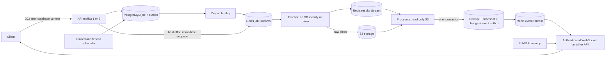

# Part 1 — scheduling, recoverable work and realtime delivery

Session: 23 October 2026. This report describes the actual repository implementation,
its evidence and its remaining limits. Read [the standing rules](../STANDING_RULES.md)
before running operational commands. The shared Report Spec mentioned in the
attachment was not included; this report covers the supplied concept list,
measured enhancement, implementation, verification, learning exercises and handoff.

**Status: implementation and isolated verification are complete; the live Compose
Gate 2 is blocked and has not passed.** Human credential provisioning was confirmed
ready. All service images built. Starting the stack failed because Docker's existing
`warden_default` network references a missing bridge device. No Docker daemon,
network, subnet, capabilities or host networking configuration was changed. A
request for the human to restore their existing campus-network setup is pending.
Do not present the isolated tests as the several-hundred-job SIGKILL deployment proof.

## 1. What this part changed

Previously an HTTP request performed the fetch and comparison itself. The caller
had to remain connected while the work happened. A slow site occupied API capacity,
and process termination could interrupt the work without a recoverable job record.

Now `POST /api/monitors/{id}/check` returns **202 Accepted** with a `job_id` after
PostgreSQL commits a job receipt and dispatch outbox. A fetcher retrieves the page
and writes blobs. A processor compares those bytes and commits its effects. A
WebSocket can deliver a change through either API replica. Scheduling uses the same
pipeline, rather than creating another way to process a monitor.

202 means **the system durably accepted the request**, not that the target website
was successfully checked. Target failure can produce a terminal failed job. This
distinction is part of the public contract, not an implementation detail.

The arrows that cross storage systems cannot share one ordinary PostgreSQL
transaction. This is why outboxes, stable identifiers, retries and receipts are
necessary. Drawing boxes is easy; naming the precise commit and acknowledgment
boundaries is the engineering work.

### Starting-state audit and authorship

The four reserved Prompt 3 groups were still stubs: Myers edits, SimHash,
Union-Find/visual clustering and TF-IDF cosine. The initial TODO suite produced
**30 failed, 36 passed, 4 skipped**. Commit `be10eff` introduced the scaffold;
its Git author name alone does not establish who composed those lines. Earlier
reports describe AI scaffolding. No verified human implementation of those four
algorithms was found. This session implemented them under the user's explicit
retirement of the student-stub policy.

The uncommitted `warden_core/ssrf.py` implementation existed before this work:
153 insertions and 47 deletions. It was preserved and excluded from AI commits.
The current passing tests include that working-tree implementation. A clean
checkout without it is therefore not equivalent to the verified working tree.
See [the authorship ledger](../AUTHORSHIP.md).

## 2. The important contracts and design choices

### Who is trusted with what

| Component | Access it receives | Reason |
|---|---|---|
| API | PostgreSQL, named API Redis identity, JWT keys | Authenticate users, enforce ownership and accept durable work |
| Scheduler | PostgreSQL, named scheduler Redis identity | Decide when work is due and relay accepted jobs |
| Fetcher | HTTP/Selenium, named fetcher Redis, S3 read/write | Touch hostile websites without receiving database credentials |
| Processor | PostgreSQL, named processor Redis, S3 read-only | Interpret results and atomically persist effects |
| `warden_compare` | Input bytes and pure computation dependencies | Keep comparison reusable and free of network/database dependencies |
| Bootstrap process | Separate S3 admin identity | Create the bucket once, then exit |

A trust boundary is a constraint enforced by packaging, configuration and checks.
The fetcher image build asserts that `sqlalchemy`, `asyncpg` and `warden_db` cannot
be imported. Its startup assertion rejects either database-URL environment key,
even when empty. Recursive dependency/source tests check the package boundary.
These controls remove database credentials and client code; they do **not** claim
that the shared Docker network is a firewall against arbitrary raw sockets.

Redis uses separate named identities and Redis 7 ACL selectors. Commands and key
patterns are coupled: allowing API `SET` for rate buckets must not permit replacing
a job Stream with a string. `default` is disabled. SCAN is used for advisory
discovery, with an explicit limitation: Redis SCAN permissions do not hide other
key names. The policies exclude broad administrative commands.

The human ran the credential provisioning script. It was never run by the AI, and
actual `.env`, ACL, S3 credential configuration and key contents were never opened
or printed. [Setup instructions](../PART1_SETUP.md) contain templates, exact human
commands and the live proof command. Credential files are ignored by Git and the
Docker build context.

### The job is durable before it is visible to Redis

Imagine the API does these two independent operations:

1. Insert a job in PostgreSQL.
2. Publish to Redis.

If the process dies between them, the accepted job is not visible to a worker.
Reversing the order creates another problem: Redis may deliver work whose database
transaction later fails. This is the dual-write problem.

Instead, the API commits both the job receipt and an outbox row in **one database
transaction**. A relay repeatedly publishes pending rows. Publication happens before
the row becomes `sent`. A crash in between creates a repeated message, which is
recoverable. Marking the row sent first could create a permanently lost job.

The API also attempts an immediate enqueue for latency. It deliberately uses the
same stable job ID as the relay. This can duplicate transport work; the receipt
protects durable effects. The database remains authoritative about acceptance.

### At-least-once delivery and one committed effect

A Redis consumer group has three useful states to remember:

- A Stream entry exists but has not been delivered to the group.
- A consumer received it; it is now in the group's pending entries list (PEL).
- A consumer acknowledged it with XACK; it is no longer pending.

`XREADGROUP ... >` obtains new deliveries. It does not automatically recover an old
consumer's pending work. `XAUTOCLAIM` transfers ownership of entries idle beyond a
threshold. Its scan cursor is retained across calls so empty intermediate pages do
not strand entries later in the pending list. Dead members' entire queues and
retry sets are discoverable and adopted, including jobs never delivered before
their original worker disappeared.

XACK is issued only after a durable handoff: fetcher result/retry publication, or
processor transaction commit. It does not delete the Stream entry. Job Streams are
not trimmed in this implementation; retention/compaction is an explicit future
operational concern, not something allowed to destroy unacknowledged work.

The difficult crash is **commit succeeded, acknowledgment did not**. The queue
correctly redelivers. The processor locks the monitor and receipt, checks whether
that stable `job_id` is still queued, and commits the snapshot, optional change,
event outbox and completed receipt together. Redelivery sees the terminal receipt
and produces no further effects. This is at-least-once transport with idempotent
durable processing. It is not a claim of globally exactly-once execution.

Malformed payloads are copied to a dead Stream before acknowledgment. Known invalid
results become failed receipts. Transient infrastructure failures leave claims
pending. A failure is observable; retrying forever without any terminal status
would obscure the difference between slow work and permanently bad input.

### Delayed retries: why XADD must precede ZREM

A ZSET stores payloads scored by due time. The mover selects due entries, XADDs
each to a work Stream, then removes it from the retry set, inside Lua.

Lua prevents another Redis command from interleaving. **It does not roll back all
previous writes if a later command raises a runtime error.** The integration test
removes ZREM permission from a fixture-only fault identity: XADD can succeed before
ZREM fails. The original retry remains and can be moved again, producing a duplicate
instead of loss. Reversing the order could destroy the only recoverable copy.
Retries use Redis TIME when scheduled; the mover currently accepts the worker's
wall clock, so synchronized host time remains an assumption.

### Fencing: a lease is not enough

Suppose scheduler A has a 15-second lease and then pauses for 20 seconds. Scheduler
B acquires the expired lease. A resumes with stale local belief that it is leader.
A Redis lock does not reach into A's memory and stop its instructions.

Each successful acquisition therefore gets an increasing token. Every protected
PostgreSQL transaction locks a shared fence row. Takeover advances that row; an
older token is rejected. Holding the lock through the transaction orders takeover
against the previous term's protected writes. The actual test advances token 10
to 11 and verifies that 10 can no longer write. The current token can perform many
transactions; equality within a term must remain valid.

Renew/release verify the unique holder ID atomically. A stale holder cannot renew
or delete the new holder's lease. The fencing counter must never be silently reset.
Redis-state loss needs an operator recovery procedure; guessing a token is unsafe.
A lease renewal that is delayed by a long scheduler operation can still cause term
loss, so the PostgreSQL fence, rather than renewal timing alone, supplies safety.

### Realtime means push plus recovery

Pub/Sub is fast and lossy. A disconnected subscriber has no mailbox to return to.
The Redis event Stream is retained history with ordered cursors. Publication writes
the Stream first, then sends a Pub/Sub wakeup. The outbox retries a crash in between.
The gateway periodically reads the Stream even without a wakeup, so an append that
was never published can still be discovered.

A naïve sequence of “replay, then subscribe” has a gap: an event can appear after
replay finishes and before subscription begins. This gateway confirms a live
subscription **first**, then replays strictly after the cursor. Wakeups trigger
another cursor-based read; their payload is not trusted as a second history. A
bounded recent-ID cache also suppresses repeated event identities within a connection.
Replay is limited to 500 events per page, avoiding an unbounded backlog allocation;
full pages are drained without an extra one-second wait.

Authentication uses the existing JWT/denylist/database checks. The first frame
contains the token, avoiding tokens in URL logs. Monitor IDs and tags are scoped
to their owner. Browser origins, input sizes, subscription counts, frame deadline,
send deadline, JWT expiry and revocation are checked. A client cannot request
another owner's monitor. The two-replica Compose topology is configured, but its
actual cross-replica demonstration remains blocked by the Docker network.

Replay is finite: the Stream is approximately capped at 100,000 entries, append
idempotency keys expire after seven days and the gateway's recent-event cache holds
10,000 IDs. A cursor older than the retained first entry causes `resync_required`
on connection. Continuous trimming during an already-running slow replay needs
stronger retention/snapshot coordination before claiming arbitrary outage recovery.
A client must persist a delivered cursor and be prepared to rebuild current state.

## 3. Measured enhancement beyond the minimum: live-claim renewal

Idle time is often mistaken for failure. A Selenium request can take longer than a
claim timeout even though its worker is healthy. Reclaiming it needlessly duplicates
network traffic and comparison work. Final receipts protect correctness, but they
do not make wasted work free.

The worker now renews its pending claim in an independent task, checking current
consumer ownership inside Lua before resetting idle time. This is separate from
membership heartbeats: “process exists” and “this particular task is progressing
under this owner” are different facts. A stopped heartbeat lets normal reclaim
resume; a stale consumer cannot steal ownership back with a renewal.

The real Redis A/B test uses two pending claims, a **30 ms idle threshold** and a
**40 ms work interval**. Renew only the experimental claim. The next reclaim
returns the unrenewed control and **does not return the renewed claim**: one false
reclaim in the control versus zero with renewal. After renewal stops, the protected
claim is also reclaimed after another 40 ms. This measures both avoided redundant
work and preserved crash recovery. It is a targeted protocol test, not a production
throughput estimate. No adaptive control loop or sketch was added merely to make
the project appear sophisticated.

Additional hardening includes claim-check hashes, bounded object reads, malformed
message quarantine, and a durable accepted-job ledger. The latter makes “lost”
measurable against an independent list of accepted job IDs rather than guessing
from an empty queue.

## 4. Algorithms: build the intuition before memorizing the names

### Bloom and counting Bloom filters

Think of a compact “possibly seen” notebook. Hash an item to several bit positions
and set them. If any position is zero, the item is definitely absent. If all are
one, other items may have set those same bits: the answer is only “possibly present.”
For expected entries `n` and target false-positive probability `p`, sizing uses
`m ≈ -n ln(p)/(ln 2)^2` bits and `k ≈ (m/n) ln 2` hash probes. Double hashing derives
the probes from two deterministic BLAKE2 values.

A false positive is safe only when the caller checks something exact afterward.
The processor requires an exact preceding-content hash match before skipping a
comparison. A Bloom hit alone never discards an unseen change. The database receipt,
not the filter, prevents duplicate durable effects.

Counting Bloom uses byte counters so removal can decrement probes. Remove only
items actually added. Removing an absent item that collides with present items can
create false negatives. Counter overflow is preflighted and raises; saturating a
counter then decrementing later would silently forget live memberships. These are
semantic preconditions, not just integer implementation details.

### A timing wheel is a calendar with increasingly large drawers

A heap keeps the next deadline at the top, usually costing O(log n) per insertion
or removal. A timing wheel groups timers into time buckets. Near deadlines occupy
fine buckets; distant deadlines occupy coarser levels and cascade closer as time
advances. Handles remember their bucket for O(1) cancellation. Many callbacks can
still expire together; no data structure makes executing a million callbacks free.

The scheduler uses 100 ms ticks. Positive delays round **up**, preventing early
execution. A zero-delay timer becomes ready on the next advance. Deadlines beyond
the initial hierarchy gain coarser levels. Equal-deadline ordering is unspecified.
Wall-clock UTC timestamps survive restart; monotonic elapsed time drives running
ticks. Changing the system clock must not make a monotonic counter move backward.

A million timers held only in process memory would disappear on restart. PostgreSQL
stores due times; the wheel is reconstructed on boot and reconciled every five
seconds. The implementation avoids scanning every monitor on every 100 ms tick,
but the five-second reconciliation still scans active monitors. That scan will
need incremental change discovery at larger scale.

The tests compare randomized insert/cancel/advance sequences with an independent
min-heap reference. A test that repeats the wheel's own bucket arithmetic would
mostly check the same possible mistake twice.

### Poisson rate estimation: observing “something changed” is not counting changes

A Poisson model assumes independent changes at an approximately stable rate λ.
If the polling gap is T, the chance of no change is `exp(-λT)`; the chance of at least
one is `1-exp(-λT)`. A changed observation might contain one update or ten. Dividing
“changed checks” by elapsed time treats those very different cases as identical
counts and biases the estimate.

MLE maximizes the likelihood of the observations. MAP adds a prior; here a Gamma
prior expresses a positive default belief and prevents sparse history from making
an unstable rate estimate. With no changes, the mode becomes `(shape-1)/exposure`,
where exposure includes unchanged intervals and the prior rate. Shape is at least
one, preserving concavity; rate is positive. The prior is an assumption you should
be able to defend, not a hidden magic constant.

Newton's method asks where the log-posterior derivative reaches zero. It uses the
second derivative to estimate a better step. Unconstrained Newton can jump to a
negative rate or outside a useful region. This implementation brackets the root
and falls back to bisection when the Newton step leaves the bracket. Numerically
stable `expm1` avoids subtracting two nearly equal numbers near zero.

Real websites can change in bursts and undo changes between polls. The model is
an approximation; these tests do not establish that all web activity is Poisson.

### Lagrange multipliers: a price for one more crawl

Let monitor i use interval Iᵢ, change rate λᵢ and importance wᵢ. Its crawl rate is
`1/Iᵢ`. A global budget B requires `Σ 1/Iᵢ ≤ B`. For small λI, expected staleness
is approximately `λI/2`: changes wait, on average, about half a polling interval.

Minimize `Σ wᵢ λᵢ Iᵢ/2` under that budget. Add a multiplier μ for crawl usage. Taking
the derivative with respect to Iᵢ gives:

`Iᵢ = sqrt(2μ / (wᵢ λᵢ))`.

μ acts like the price of scarce crawl capacity. Increase it and intervals become
longer, reducing usage. Bisection finds a feasible price. A four-times-faster change
rate earns twice the crawl frequency under this approximation, not automatically
four times. That square root is a consequence of the chosen objective.

Each monitor's minimum and maximum interval is clamped **inside every candidate**.
Clamping only after solving can violate the budget or destroy optimality. If the
budget cannot fund even all maximum intervals, the solver raises instead of
pretending the constraints are feasible. Zero-rate monitors use their maximum
interval. The runtime applies per-monitor and plan bounds using the same KKT
calculation; it does not use an approximate rescaling of an already-clamped result.

The optimizer is exact for this bounded approximate objective, not an exact
optimizer for all λI or all definitions of freshness. The simulator separately
measures time stale and compares the exact Poisson stale-fraction formula.

### Consistent hashing and bounded loads

Ordinary `hash(key) % N` changes most assignments when N changes. A consistent
hash ring places member virtual nodes on a stable circle and sends a key to the
next node. Adding a member takes a local share of the ring. Virtual nodes smooth
capacity variation but do not split one extremely hot key's traffic.

Bounded-load routing checks projected reported load and probes for a member below
its weighted cap. This can spread a hot domain across workers, sacrificing strict
domain affinity to avoid one overwhelmed member. The caller must report load;
otherwise the ring has no evidence of imbalance. Capacity weights affect the
probing cap, not the number of virtual nodes in this implementation.

The scheduler estimates load from pending entries plus consumer-group lag. That
view is advisory and sampled; it is not a global linearizable load counter.
Remapping is benchmarked on ordinary consistent ownership, while the hot-load
benchmark measures the adaptive bounded variant. These are different experiments.
Adding to N members predicts about `1/(N+1)` remapping; removing one of N predicts
`1/N`, the departing owner's share. Blindly applying `1/(N-1)` to removal uses the
wrong denominator for this experiment.

### Redis LRU + TTL and GCRA

LRU asks which cached item was least recently used; TTL asks whether an item has
aged beyond its validity period. They solve different problems. Cache values use
Redis expiry; a sorted set tracks access recency. Lua couples writing/touching and
bounded eviction so simultaneous writers do not overshoot the entry limit. Expired
tracking entries are pruned during writes. That bounded scan is O(max_entries), so
this implementation should not be described as a constant-time universal cache.

GCRA represents a rate budget as a theoretical arrival time. A permitted request
moves that time forward by one request interval. A burst allows a limited number
of requests to arrive ahead of schedule. Redis TIME and Lua make the decision
shared and atomic across API replicas, avoiding per-process login counters. The
configured burst means total immediately allowed requests, not “burst plus one.”
Denied requests return a computed Retry-After. Successful login does not reset the
budget; resetting it would let success evade the rate policy.

### Circuit breaking

Retries answer “try this failed work later.” A circuit breaker answers “stop
calling this repeatedly failing domain for a while.” The current breaker opens
from a rolling failure ratio, waits for cooldown, admits one half-open probe,
then closes on success or reopens on failure. It is per worker, per domain; it is
not a shared global circuit state. Minimum samples prevent one isolated failure
from opening a circuit. Eight exhausted fetch attempts produce a failed result.

### The four completed earlier algorithms

Myers diff finds a shortest insertion/deletion edit script by extending diagonals
through matching runs. Its saved frontier trace reconstructs Keep/Delete/Insert
operations. Independent dynamic-programming LCS tests check minimum edit cost.
Its trace can still consume substantial memory for adversarial unrelated documents;
byte caps do not magically make every quadratic algorithm cheap.

SimHash hashes character shingles and accumulates signed weighted votes per bit.
Similar documents often have nearby fingerprints; Hamming distance is a heuristic,
not proof of semantic equivalence. Empty input returns zero and bit widths are
validated. Never use SimHash as a cryptographic content identity.

Union-Find keeps connected pixel components with path compression and union by
size. Neighbor connectivity is four-directional, so diagonal-only touches remain
separate. The visual test generator was fixed to generate rectangular masks;
assertions were preserved rather than ignoring ragged invalid input.

TF-IDF downweights frequent corpus terms and cosine compares vector direction.
The implementation matches the existing sklearn test oracle's smoothed formula,
`log((1+N)/(1+df))+1`, with a vocabulary learned from the supplied corpus. Unknown
or empty vectors return zero. This replaces the contradictory old doc formula.
No sklearn dependency was added to runtime comparison code.

The structural Merkle diff was also repaired: JSON field encoding prevents
separator ambiguities, tail text participates in hashes, duplicate siblings are
matched separately, and a moved node no longer hides an adjacent replacement.
Paths now represent actual nesting. Equal hashes are a practical short-circuit
under the cryptographic collision assumption, not a mathematical proof that hash
collisions are impossible.

## 5. Evidence and measured numbers

[Machine-readable benchmark results](part-1-numbers.json) were generated by
`scripts/benchmark_part1.py` on Python 3.12.3. These are local single-run measurements,
not production service-level guarantees.

| Experiment | Actual result | Interpretation |
|---|---:|---|
| Insert 1,000,000 timers | 1.473 s | Wheel insertion measurement |
| Fire those timers | 1.445 s | Expiration measurement |
| Combined operations/second | 685,405 | 2,000,000 operations divided by total elapsed time |
| Add ninth member to eight, 100,000 keys | 11.122% remapped | Near 11.111% theory |
| Remove one of eight, 100,000 keys | 13.066% remapped | Near 12.5% theory; finite ring variation remains |
| Hot workload: ordinary busiest/mean | 2.37336× | 20% one domain, 80% distinct domains |
| Same workload: bounded busiest/mean | 1.102× | Caller reports load after every assignment |

The budget benchmark uses seed 4721, four independent Poisson rates
`[0.00002, 0.00008, 0.00032, 0.00128]` changes/s, ten simulated days, bounds 10–1000 s
and budget 0.1 checks/s. All policies see the same generated changes.

| Policy | Intervals in seconds | Checks | Simulated fraction of time stale |
|---|---|---:|---:|
| Fixed | 40, 40, 40, 40 | 86,396 | 0.84776% |
| Frequency proportional to rate | 850, 212.5, 53.125, 13.28125 | 86,398 | 0.82403% |
| Bounded optimizer | 150, 75, 37.5, 18.75 | 86,396 | 0.52855% |

The optimized policy has about **37.7% less stale time than fixed** and **35.9% less
than proportional** in this scenario. None exceeds the 0.1/s scheduled budget.
This is a result for the stated model and rates; workloads and objectives can
change the winner. Fair baselines use the same budget, trace and bounds.

### Checks actually run

- `make check`: **249 passed, 21 skipped, 37 deselected**; ruff and formatting
  passed; strict mypy passed on 73 source files. Tests ran outside the filesystem/
  network sandbox so TestClient's local sockets could function.
- `make check-todos`: **66 passed, 4 skipped**. All four algorithm groups execute;
  legacy deployment denylist cases require an explicitly configured test identity.
- Real PostgreSQL + Redis integration suite: **14 passed**. Private fixture-owned
  Unix sockets, no published TCP ports, no deployment credentials. The PostgreSQL
  fixture exercises the actual Alembic migration chain.
- Redis tests include 1,000 concurrent cache writes (limit 16), 200 concurrent GCRA
  requests with exactly seven admitted, ACL positive/negative checks, TTL expiry,
  leader handover, stale renewal/release denial, claim reclaim/renewal, deliberate
  partial Lua failure, event overlap and bounded backlog paging.
- PostgreSQL tests include eight concurrent duplicate deliveries producing exactly
  one snapshot, rollback before commit followed by successful retry, exactly one
  meaningful-change/outbox effect, and global fence rejection after takeover.
- Gateway tests cover confirmed subscribe-before-replay ordering, filtering another
  owner's event, unauthorized subscriptions, malformed frames, retention resync
  and cross-origin rejection. They are protocol tests with doubles, not a live
  two-replica deployment demonstration.
- `docker compose up --build -d`: images built, container startup failed on the
  missing existing Docker bridge. Existing PostgreSQL, mailpit and Selenium
  services remain running; newly created application containers are not claimed
  healthy. No volumes were deleted.

The default suite intentionally excludes explicitly marked integration/Selenium/
chaos tests. A green default command does not prove those excluded checks passed.
The additional 14 real protocol checks are listed separately for that reason.
A Starlette/httpx TestClient deprecation warning remains; adding its suggested
replacement dependency is outside the approved dependency list.

### Rechecking Gate 1 revealed a real limitation

After removing the old NotImplemented fallbacks, the classifier uses real SimHash
and TF-IDF features. The latest 210 synthetic pairs produced **43 TP, 0 FP, 27 FN,
140 TN**: precision 100%, recall 61.43%, accuracy 87.14%, F1 0.7611. All job-list
addition/removal cases in that run were missed. The previous weights were not
validated for the now-real feature values. The simulator uses process randomness,
so repeated run counts differ; these are the last observed counts, not a seeded
classifier benchmark. No human-labeled real pairs are available.

Therefore earlier Gate 1 accuracy claims must not be carried forward. No test or
threshold was loosened to conceal the regression. A follow-up should add a labeled
training/held-out split, meaningful structural-change evidence and calibrate a
versioned classifier; merely lowering the decision threshold until this small
simulator passes would not establish generalization. The Gate 2 price-monitor
probe is designed to exercise the queue and cross-replica path, not to certify
classifier quality across page types.

### Live Gate 2: not yet executed

`scripts/chaos_queue_proof.py` is ready to submit 500 accepted jobs, randomly SIGKILL
and restart fetcher/processor, wait for all accepted IDs, audit snapshot receipt
uniqueness and count actual reclaims. It first checks image isolation, fetcher
storage write success, processor read success and an actual HTTP 403 on processor
write. The denial probe writes the same content-addressed bytes if permissions
are accidentally broad, avoiding corruption even in the failing case.

It also opens a WebSocket on API 2, mutates the simulator and submits a check via
API 1, then verifies receipt of the resulting event and no immediate duplicate.
The reported latency includes fetch/processing, not just socket transport. Cleanup
restarts the workers it kills. The script refuses to report a successful kill run
without at least two kills and one reclaimed entry.

No `part-1-gate2.json` success artifact exists. Do not fill in zero-loss numbers
until the script really completes on the running stack. Redis AOF everysec is not
zero-loss storage in a Redis/host crash; this proof concerns worker crashes while
PostgreSQL, Redis and object storage remain available and retained.

## 6. Limits that matter before production

The core question is always: **under which failures does this guarantee hold?**

- URL validation checks resolved addresses and each redirect, but the HTTP client
  resolves again when connecting. DNS rebinding between those operations is not
  prevented by connection pinning. Selenium subrequests also need a controlled
  egress boundary. Do not describe this as comprehensive hostile-site isolation.
- Fetchers share the default Docker network; absence of credentials and DB packages
  is verified, network-level PostgreSQL isolation is not. The standing rule prevents
  solving this by improvising Docker daemon/network configuration.
- Processor history is serialized in result-arrival order. Concurrent requests
  can finish out of fetch-time order; an older page may become the latest processed
  observation. A per-monitor sequence/stale-result policy needs explicit design.
- Runtime snapshots use immutable raw keyframe references. The old delta codec is
  tested independently but not persisted by a read-only processor. Moving delta
  uploads into it would violate the established object-store identity boundary.
- Scheduler reconciliation scans active monitors every five seconds, rate estimation
  fetches history per monitor, and work dispatch holds a fence/database transaction
  while calling Redis. These are explicit first-scale tradeoffs, not an unlimited
  horizontal scheduling claim. Add incremental discovery/batching when measurements
  establish the need.
- The bounded ring uses sampled reported load. It cannot enforce an exact global
  capacity cap across arbitrary simultaneous dispatchers. Its linear probing and
  full sorted-node updates are adequate here, not an asymptotic breakthrough.
- Job/result/dead Streams and completed outboxes/receipts need an operational
  retention policy that preserves pending entries and the idempotency horizon.
  Event trimming, finite dedup retention and a slow client require resync policy.
- Byte limits and bounded replay reduce resource use, but adversarial diff inputs,
  many domains and long-lived breaker maps still need workload-specific limits.
- A single local Redis/PostgreSQL/SeaweedFS deployment has no demonstrated HA,
  backup recovery, regional failover or production capacity guarantee.
- The API accepts work durably without a per-tenant queue admission limit. This
  preserves accepted jobs during a temporary outage but allows backlog growth;
  tenant fairness and backpressure are follow-on design work.

These are concrete limits of the current implementation. “Modern” engineering
means being able to name them and design the next measurement, not claiming every
large-company pattern has already been implemented.

## 7. Learn it so you can carry it into another project

Start with one memory sentence:

> Accept the intent durably; move it at least once; commit its effect once per
> stable identity; let clients recover what a live connection missed.

Use three objects when reasoning: **the receipt** (what we owe), **the message**
(how a worker learns about it), and **the effect** (what actually changed). They
are related, but losing a connection between them must not erase the obligation.

### A five-session learning path

1. **Draw the journey, without reading code.** On paper trace a price change from
   user click to API 2's WebSocket. Mark each storage boundary. Explain why 202
   does not promise a finished check. Compare your drawing with section 1.
2. **Play the crash game.** For each arrow, say what happens if the process dies
   immediately before it and immediately after it. Locate the job ID, outbox,
   pending claim and database receipt that make recovery possible. Use the local
   queue-crash learning HTML already in `docs/learning/` as an exercise, not proof.
3. **Earn the scheduling equations.** With four monitors and budget 0.1/s, calculate
   why 40 s fixed intervals fit. Then use 150/75/37.5/18.75 and verify that the
   reciprocal sum is still 0.1. Explain why higher change rate gets a square-root,
   rather than directly proportional, frequency under the stated objective.
4. **Explain the two false beliefs.** A Bloom hit does not prove presence; a lease
   does not prove an old process stopped. Invent a counterexample for each, then
   show the exact hash check or fence row that supplies the missing certainty.
5. **Defend a tradeoff and propose a measurement.** Pick one current limit from
   section 6. State the symptom, the metric, a possible design and its new cost.
   For example: backlog lag grows while API latency stays low; add admission quotas
   and measure tenant wait time, rather than simply adding more queue layers.

Repeat sessions 1–2 from memory after **one day, three days and seven days**.
Do not reread first. Retrieval exposes the gap between recognizing an explanation
and being able to produce it. Keep an error notebook with the assumption you forgot,
not a copy of the source code.

### Interview prompts with defensible answers

| Question | Answer you should be able to derive |
|---|---|
| Why a queue? | It separates request latency and worker capacity, but requires explicit acceptance, recovery and idempotency contracts. |
| Why not acknowledge immediately? | A crash after acknowledgment could remove the recoverable ownership record before a result or effect exists. |
| Can the work run twice? | Yes. A stable job receipt makes a second committed effect a no-op; fetching twice can still waste resources. |
| Why both PostgreSQL and Redis? | PostgreSQL owns durable business state and transactions; Redis supplies Streams, leases and atomic small coordination operations. Their boundary needs an outbox. |
| Why not just Pub/Sub? | Disconnected clients miss events. Cursor-based retained history permits recovery within a stated retention window. |
| Why subscribe before replay? | The opposite ordering leaves an event gap. Cursor reads make subscription/replay overlap harmless. |
| Why not just a leader lock? | An expired holder can resume. The database must reject older fencing tokens where protected writes happen. |
| Why bounded consistent hashing? | Stable ownership reduces remapping, but a hot key can still overload one worker. A load cap trades affinity for spread. |
| Can a Bloom false positive lose a change? | It must not: the caller verifies exact content before skipping. The probabilistic structure is only an optimization. |
| Why not optimize exact freshness? | The square-root rule optimizes a small-λI approximation; exact objectives may require a different solver. We evaluate actual stale time separately. |
| What did you personally write? | The current Part 1 implementation was AI-authored. Explain what you studied, independently verified or later changed, and point to the authorship ledger. |
| Is Gate 2 passed? | No. Builds and isolated tests passed; the live Docker deployment proof is blocked by an existing missing bridge. |
| Is the classifier accurate enough? | Not demonstrated: the latest synthetic recall was 61.43%, with no labeled real evaluation set. Explain the planned validation rather than repeating old claims. |

A strong answer has five parts: **requirement → invariant → failure example →
mechanism → evidence and limit**. For example: “Accepted checks must survive a worker
crash. The receipt must commit before 202. A crash between DB and Redis would otherwise
lose dispatch. We use a transactional outbox and stable IDs. Our rollback/concurrent
receipt tests pass; the live multi-process kill proof is still pending.”

### How to make this project your own honestly

Choose one narrow improvement, write the expected behavior before editing, make
it yourself, and explain the failure it fixes. Good first exercises are a
fetch-time ordering policy, a labeled classifier regression fixture, or a backlog
admission rule. Predict which test should fail first. After implementation, explain
why that test would catch the old behavior and what it still cannot establish.
Update the authorship table for the part you actually composed.

You do not need to memorize every line or pretend you authored AI output. You need
to reconstruct the guarantees, identify the weakest assumption and show a concrete
change you can reason about independently. That is transferable engineering skill.

### Local commits

- `844bd4f`: pure primitives and completion of the earlier comparison algorithms.
- `c0a71eb`: Redis protocols, durable scheduling/processing, gateway and service wiring.

No changes were pushed. The final documentation commit records evidence and this
handoff. The pre-existing SSRF diff remains outside these commits.

## 8. File map and operational entry points

| Purpose | Files |
|---|---|
| Pure primitives | `libs/warden_core/src/warden_core/{bloomfilter,timingwheel,budget,hashring,circuitbreaker,jobs}.py` |
| Redis protocols and policy | `libs/warden_redis/src/warden_redis/` |
| Durable acceptance and fence | `libs/warden_db/src/warden_db/dispatch.py`, `models.py`, migration `e021a1000001_distributed_jobs.py` |
| Running services | `services/{scheduler,fetcher,processor}/src/` and their Dockerfiles/READMEs |
| HTTP acceptance and shared auth | `services/api/src/warden_api/monitors/router.py`, `auth/` |
| Cursor gateway | `services/api/src/warden_api/websocket.py` |
| Human setup | `docs/PART1_SETUP.md`, `scripts/provision_part1.py` |
| Reproducible primitive benchmark | `scripts/benchmark_part1.py`, `sim/chaos_web/src/chaos_web/benchmarks.py` |
| Live proof | `scripts/chaos_queue_proof.py` |
| Real protocol tests | `libs/warden_redis/tests/`, `services/processor/tests/test_durable_effects.py` |

The sync API pipeline was removed; do not restore a second processing path. New
external dependencies were not added. Internal workspace dependency changes used
`uv add`; frozen service builds prove closure. Strict type checking now covers all
service source directories, and the retired algorithm marker is included in the
default test suite. `.env` auto-loading in API settings was disabled; Compose
injects runtime values without application code opening that file.

## Handoff

Read this section cold before continuing. The active objective remains the full
Part 1, especially **actual live Gate 2 proof**. Do not mark it complete because
default tests pass. The human confirmed “credentials ready”; no need to request
credential generation again, read credential files, or run the generator.

1. Await the human's **“Docker network ready”** response or equivalent confirmation
   that their existing campus-network setup has been restored. Current failure:
   `adding interface ... to bridge br-410b9f108109 failed: Device does not exist`.
   Never repair daemon/network configuration yourself. No auto-review rejection
   caused this blocker; it is an actual Docker daemon error and a standing-rule
   boundary.
2. Rebuild/start with `docker compose up --build -d`, then inspect **safe service
   status**. Never dump Compose config, credential files or raw environments.
   Migration `e021a1000001` must apply. Verify Redis identity permissions, object
   bootstrap completion, fetcher package closure and read-only processor S3 with
   the actual proof. A build alone does not prove runtime permissions.
3. The host proof needs `WARDEN_DATABASE_URL` with the existing human-owned DB
   credentials and host `127.0.0.1:5433`. Human setup instructions already explain
   this. Do not invent or print a password. The human may need to run the proof in
   their own shell if that URL is not available to the agent's environment:
   `uv run --env-file .runtime/proof.env python scripts/chaos_queue_proof.py --jobs 500 --kill-workers`.
4. Require actual completion, at least two SIGKILLs, at least one reclaim, 500/500
   completed receipts, no failed/lost accepted IDs and one snapshot effect per
   job. Inspect the actual generated `docs/reports/part-1-gate2.json`; do not create
   a success artifact manually. Confirm cross-replica WebSocket and S3 403 evidence.
   If a target/dependency fails, fix the cause and rerun with a fresh proof monitor.
5. Update this report and the authorship ledger with real outcomes, then rerun
   `make check`. The last verified default suite is 249 passed/21 skipped; explicit
   private PostgreSQL/Redis tests are 14 passed. The strengthened claim-renewal A/B
   test passed in the final explicit integration run (14 passed in 6.24 seconds).
6. Keep the pre-existing uncommitted `libs/warden_core/src/warden_core/ssrf.py`
   separate. Its diff is 153 insertions/47 deletions; never overwrite or silently
   attribute it. Existing older learning files and `docs/reports/prompt-04.md`
   were untracked before Part 1; do not sweep them into an unrelated commit.
7. Gate 1 classifier quality is a separate known regression with real measurements
   in section 5. Do not infer quality from unit test success, and do not silently
   waive its recall requirement before production work.

For this environment, commands used `UV_CACHE_DIR=/tmp/warden-uv-cache UV_OFFLINE=true`.
Default test WebSockets and private integration sockets require execution outside
the restricted network sandbox. That is a test-runtime permission issue; it does
not authorize changing Docker host networking.

Primary background references: [Redis ACL selectors](https://redis.io/docs/latest/operate/oss_and_stack/management/security/acl/),
[Redis Streams](https://redis.io/docs/latest/develop/data-types/streams/), and
[SeaweedFS S3 server configuration](https://github.com/seaweedfs/seaweedfs/blob/master/weed/command/s3.go).
The source code and measured results above determine this report's claims.
