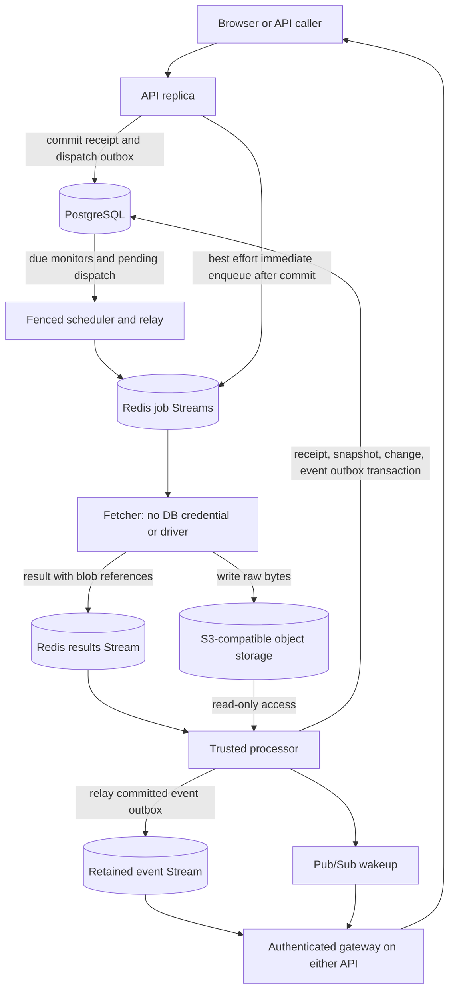

# Part 1 — learning to build a system that survives unfinished work

Implementation sessions: 23 October 2026. Report rebuilt to the human's full
[Report Spec](../REPORT_SPEC.md): 25 October 2026. Source links are relative to
this report; excerpts are literal selections from the checked-out implementation.
Recovery/source selections updated 28 October 2026; the current Handoff supersedes
the earlier operational hold. [Gate 2 evidence](part-1-gate2.json) is now recorded.

## 1. Executive summary

WARDEN watches websites and tells a user when something meaningful changes. A
small version can fetch a page, compare it with the previous page and return an
answer inside one HTTP request. That is easy to picture, but it ties the user's
connection to a website's speed. If the process dies halfway through, “the user
clicked Check” can disappear with its memory. Running a second copy introduces
another problem: work, rate limits and notifications must agree across copies.

Part 1 changes the product from a request that performs all the work into a
system that records an obligation and fulfills it asynchronously. The API commits
a stable job identity and a dispatch record in PostgreSQL, then returns **202
Accepted**. A scheduler decides when recurring checks should happen. Fetchers
retrieve hostile web content without receiving database credentials; processors
compare stored bytes and commit snapshots, changes and notification records.
Authenticated WebSockets can deliver a result through either API replica.

The central design is deliberate repetition with controlled effects. A worker
may receive the same job again after a crash. The database receipt makes a
second completed delivery a no-op. An outbox remembers publication still owed to
Redis. Redis Streams remember delivered-but-unacknowledged jobs; a retained event
log lets a client recover beyond a live connection. The system does not promise
that every operation executes once: it tries to make repeated execution safe at
the boundaries where business state changes.

Supporting algorithms make this practical rather than merely more distributed.
A timing wheel tracks due work; a Poisson estimator and bounded optimizer allocate
crawl capacity; a consistent hash ring routes work while a load cap spreads hot
traffic. Shared rate limits, cache expiry, leases, fencing tokens, membership
heartbeats, retries and circuit breakers coordinate the processes. Four earlier
comparison stubs were also completed. Classifier v2 corrects a measured synthetic
recall regression without lowering the decision threshold.

The full live Gate 2 **passed on 28 October 2026** after route-checked recovery
and a narrow missing-object failure fix. The fresh batch completed 500/500 with
zero lost jobs or duplicate durable effects, across 12 worker kills and three
reclaims observed through shared counters. Cross-replica delivery took 1.287
seconds. The 23 October interrupted attempt and the first 28 October timeout
remain failed attempts in the record. This is a worker-crash proof, not a claim
of durable storage restoration or regional failover. Containers now run on the
approved local subnet with host routes intact; automatic daemon pools still
require correction before relying on implicit allocation.

Use this chapter in three careful passes: concepts and worked examples; design
choices and source tour; then interview answers and scratch exercises. Pause at
the prediction questions and explain answers aloud. The goal is to reconstruct
why a design works, where its assumptions end and what evidence would change it.
That skill transfers to payment processing, email delivery, data ingestion and
many systems that must finish something after its original caller has gone away.

## 2. Concepts from scratch

Use this map while reading. The database records accepted obligations and effects;
Streams move work; the event path lets an observer recover. The diagram omits
routine health checks and failure branches, which the following sections explain.



### 2.1 A process, a service and a library are different things

**Analogy.** A library is a recipe book. A process is a cook currently following
recipes. A service is a responsibility the kitchen promises to fulfill, possibly
using several cooks. Owning a recipe does not mean a meal is being prepared, and
hiring another cook does not make their private notebooks magically agree.

**Mechanism.** Python library packages expose functions and classes. A process
has its own address space, variables, event loop and failure lifetime. The API,
scheduler, fetcher and processor are running services implemented with shared
libraries. An API replica is another process fulfilling the same API role.
`asyncio` allows a process to suspend an operation while waiting for I/O and work
on other tasks; it does not automatically share Python objects with other
processes or make CPU-heavy code parallel.

An in-memory dictionary belongs to one process. If API A stores five failed
login attempts in a dictionary, API B cannot see them. If a scheduler stores
future checks only in Python objects, restarting it destroys that schedule.
This explains the role of shared state before introducing any particular tool:
we need information whose lifetime and visibility exceed one process.

**WARDEN's need.** `warden_core` contains reusable computation; `warden_redis`
contains coordination protocols; `warden_db` contains persistent business
records. Service entry points assemble them into long-running loops. A library
boundary expresses dependency discipline, while a service boundary introduces
communication and partial failure. Splitting a folder into services only earns
its complexity when the resulting ownership, isolation or scaling benefit is
worth that communication cost.

**Pause and predict.** If two API replicas import the same Python module, do
they share its module-level counter? No: shared source does not imply shared
memory. The Redis rate limiter exists because requests can reach either replica.

### 2.2 State, obligations and what 202 actually promises

**Analogy.** A repair shop gives you a numbered claim ticket. The ticket means
“we accepted responsibility for this repair,” not “your device is already fixed.”
A reliable shop keeps its own ledger; it does not rely on your standing at the
counter until the technician finishes.

**Mechanism.** An HTTP response ends a particular exchange between client and
server. Status 202 describes accepted work that will complete later. WARDEN
creates a UUID job identity, a `CrawlJob` receipt and a pending dispatch outbox
inside a database transaction. It responds after commit. The caller can retain
that identity while the actual fetch and comparison proceed separately.

Separate three things: an **obligation** says what the system owes; a **message**
tells a worker about it; an **effect** records what happened. A queue can be empty
while obligations remain unpublished in the database. Conversely, a queue can
contain duplicate messages about an obligation whose effect is already committed.
Counting queue entries alone cannot tell you whether every accepted job finished.

**WARDEN's need.** The receipt supplies an independent audit population for the
crash proof. Start with accepted job IDs, then ask whether every ID has a valid
terminal state and the expected effects. A permanently failed target request is
not automatically a lost job if a failed receipt records the outcome. However,
the particular success-oriented Gate 2 workload requires all its accepted jobs
to complete successfully; the script treats terminal failure as a failed proof.

A WebSocket push is an observation channel, not the durable obligation itself.
The browser can disconnect without canceling accepted work. A production client
still needs clear “queued,” “completed” and “failed” product states; merely
returning 202 is not an adequate user experience by itself.

### 2.3 Transactions, row locks and migrations

**Analogy.** When moving money between two accounts, crossing out one balance
and promising to update the other later leaves an inconsistent ledger. A
transaction is an envelope of edits accepted together. A row lock is a way to
reserve a particular ledger entry while making a decision about it.

**Mechanism.** WARDEN uses PostgreSQL transactions through SQLAlchemy's async
sessions. A transaction can commit its writes or roll them back. The processor
uses a transaction to keep a receipt, snapshot, optional change and event outbox
consistent. `with_for_update()` asks PostgreSQL to lock selected rows until the
transaction ends. Another transaction requiring the same lock must wait; it
cannot independently read “queued” under that lock and also create the effect.
PostgreSQL's [transaction introduction](https://www.postgresql.org/docs/16/tutorial-transactions.html)
explains the basic all-or-nothing boundary.

A lock is scoped: it does not serialize every action in the application. The
processor locks the monitor to order competing modifications of its history,
then its receipt to protect the job outcome. A consistent lock order helps avoid
cycles where two transactions each hold a resource the other needs. Holding a
lock while awaiting S3 also has a cost: other work for that monitor waits during
network latency. Transactions provide a mechanism, not free concurrency.

A migration is a versioned change to database structure. Adding Python model
classes alone does not create deployed tables. The new Alembic revision adds
`scheduler_fences` and `crawl_jobs`, including the fence seed and receipt fields.
The private integration fixture applies the real migration chain rather than
creating an approximate test-only schema from model metadata.

**WARDEN's need.** The receipt status and the snapshot must not disagree after a
crash. Schema constraints supply additional protection such as unique receipt
references; application branches alone are easier to race or bypass. A migration
also makes the change reproducible for the next environment. Never run migration
downgrades against retained development data merely to “try a rollback”: those
operations can delete business records even when Docker volumes remain intact.

### 2.4 The dual-write problem and the transactional outbox

**Analogy.** A restaurant writes an order in its ledger and sends a slip to the
kitchen. If the cashier disappears between those actions, the kitchen never
learns about a paid order. Sending the slip first is also unsafe if payment then
fails. Keeping “slips still to send” in the same ledger as orders closes the gap.

**Mechanism.** PostgreSQL and Redis are separate storage systems. An ordinary
PostgreSQL transaction cannot roll back a Redis XADD, and a Redis script cannot
commit a PostgreSQL receipt. Two operations that are individually reliable do
not become one atomic operation simply because they appear beside each other
in Python code.

The API commits the receipt and outbox together. A relay reads pending outboxes,
publishes a message, then marks the outbox sent. If it dies before publication,
the pending row remains. If it dies after publication but before recording sent,
it may publish again. That second case is intentionally allowed: the stable
job ID follows both messages and lets the processor recognize repeated work.

The API attempts immediate enqueue after commit for lower latency, while the
scheduler's relay remains responsible for eventual publication. The immediate
path does not remove the durable dispatch obligation. This can duplicate work
even without a crash, so correctness cannot depend on “duplicates are rare.”
The event side uses the same principle: commit a change with its event outbox,
then relay to Redis after the transaction.

**WARDEN's need.** A Redis outage after successful database commit should not
make the system forget an accepted check. This design keeps acceptance available
under that failure, but the backlog can grow while Redis remains unavailable.
An outbox is not backpressure: admission limits and tenant fairness are separate
missing policies. Nor is it magic eventual delivery if the relay never runs
again; liveness still requires a recovering relay and available dependencies.

**Crash exercise on paper.** Draw a vertical line after commit, after XADD and
after “sent.” At each line ask which durable record remains and whether the next
attempt can repeat an operation. If the design has neither an outstanding record
nor a completed effect, you have found a loss window.

### 2.5 Idempotency and why “execute once” is the wrong default assumption

**Analogy.** Pressing an elevator button repeatedly should not request ten
separate elevator visits. The button represents one desired obligation. By
contrast, ordering ten distinct coffees requires ten distinct order identities,
even if their descriptions are identical.

**Mechanism.** An operation is idempotent when repeating it has the same intended
observable result as performing it once. WARDEN's processor uses a stable UUID
job ID as the identity of an accepted obligation. Its receipt starts queued; a
transaction changes it to completed with the associated effects. A duplicate
result locks and reads the same receipt, sees that it is no longer queued and
returns without adding another snapshot.

Two concurrent deliveries cannot both pass the locked state transition. One
obtains the relevant lock, commits, then the next sees its terminal status. If
the first transaction fails, its receipt and effects roll back, leaving the next
attempt able to finish the job. This is stronger than an in-memory “seen IDs”
set, which disappears on restart and can be private to only one replica.

**WARDEN's need.** The queue cannot distinguish “worker died before commit” from
“worker committed and died before acknowledgment” by looking at silence alone.
It must be able to redeliver both. The database receipt absorbs that uncertainty.
The test with eight concurrent copies producing one snapshot demonstrates this
particular database boundary; it does not imply a website was fetched only once.

Use precise language: **at-least-once messages with idempotent durable effects
per accepted job**, under the stated retention and storage assumptions. A new
manual click gets a new UUID and can intentionally produce a new snapshot, even
if the page is unchanged. A producer retry that invents a new job ID has created
a new obligation, so the old receipt cannot deduplicate it. Identity design is a
product decision as well as a database technique.

### 2.6 Bloom filters: a small memory with asymmetric uncertainty

**Analogy.** Imagine a shared notebook containing checkmarks at numbered places.
Each visitor marks three places derived from their name. An unmarked required
place proves the visitor has not signed in. Three marked places do not prove
that visitor came: other visitors might have marked the same places.

**Mechanism.** A Bloom filter stores a bit array of length m and uses k probe
positions per item. Adding sets the positions; membership checks whether all
are set. Added items have no false negatives while their bits remain intact,
but absent items can have false positives. Expected item count n and desired
false-positive probability p guide sizing:

`m ≈ -n ln(p) / (ln 2)^2`, and `k ≈ (m/n) ln 2`.

For 100,000 expected items and p = 0.01, this is roughly 959,000 bits, about
120 KB of packed bit storage, plus object overhead and rounding. It is much
smaller than storing every original value, but it cannot list those values or
return an exact membership proof. The implementation derives probe positions
from two BLAKE2 digest halves and packs eight bits per byte.

Exceeding the expected capacity increases the false-positive rate; it does not
by itself clear bits. A sizing estimate is not a hard capacity enforcement
mechanism. A cryptographic digest used to derive positions also does not make
Bloom membership cryptographically certain: collisions are the structure's
intentional compression trade-off.

**WARDEN's need.** The processor uses a monitor/content-hash key as a possible
seen-content hint. A Bloom hit is accepted only with an exact preceding-snapshot
hash match before avoiding expensive comparison work. The filter never decides
that a job is complete; PostgreSQL receipts do that. Its memory can vanish on
restart without destroying an accepted obligation.

There is an engineering wrinkle worth noticing: the previous snapshot already
has a content hash. Exact hash equality could supply the unchanged-content
shortcut directly, so the additional Bloom requirement has no demonstrated
incremental runtime benefit here. The project implements and tests the primitive,
but it has not benchmarked the processor against a simpler hash-only shortcut.
Knowing when a clever structure is redundant is part of understanding it.

**Pause and predict.** If the filter says “possibly present” for a genuinely new
page, what prevents a lost change? The exact previous-hash guard. If you remove
that guard, a probabilistic performance optimization becomes a correctness bug.

### 2.7 Counting Bloom filters: deletion changes the contract

**Analogy.** A checkmark can mean one person or twenty. If one person erases it,
they might erase evidence of everyone else. Counting marks instead of storing a
single yes/no bit lets a departure decrement only its contribution.

**Mechanism.** Counting Bloom replaces bits with counters. Add increments each
probe position; remove decrements it. The implementation uses byte counters,
so each position can hold at most 255. A hash may map several probes of the same
item to one position; the code counts that multiplicity rather than pretending
every position is distinct.

Deletion is safe only for an item with an outstanding matching add. Membership
cannot prove that precondition because membership positives can be false. Even
if every relevant counter is positive, decrementing an item that was never added
can erase another item's contribution and introduce a false negative. The
precondition belongs to the caller's ownership model, not to a hopeful check.

Counter saturation is another trap. Suppose a counter saturates while more
items continue arriving. Later decrements can reach zero despite outstanding
members. WARDEN preflights all increments and rejects the whole add on overflow
before mutating any counter. That provides a clear failure instead of a quiet
violation of membership semantics.

**WARDEN's need.** The ordinary Bloom filter is used in the current processor;
the counting variant is a reusable primitive with deletion tests, not a claim
that production membership discovery already uses counting Bloom. Redis TTL
keys, not probabilistic deletion, track fetcher membership. Keep “implemented
library capability” separate from “wired into a service,” particularly in an
interview where a diagram can otherwise suggest more integration than exists.

### 2.8 Hierarchical timing wheels: calendars instead of repeated searching

**Analogy.** A calendar has a drawer for this hour, drawers for later days and
larger sections for distant months. You do not reread every future appointment
every second. As time advances, a distant appointment moves into a finer drawer.

**Mechanism.** A timing wheel maps deadlines into buckets. Fine buckets cover
nearby deadlines; coarser levels cover larger spans. Advancing the clock moves
entries from coarse buckets toward the fine level and emits deadlines that are
due. An opaque handle records ownership and location so cancellation can remove
an entry from its dictionary bucket without searching every timer.

The implementation's tick is configurable; the scheduler uses 100 ms. Positive
delays round upward to a tick boundary. A timer scheduled 150 ms after time zero
therefore becomes due at 200 ms, not at 100 ms. Zero delay is put in a ready set
and emitted on the next advance, including an advance at the same timestamp.
Equal-deadline callback order is not promised. Coarser levels are added if the
initial horizon is insufficient.

A binary heap is a serious alternative: it keeps the minimum deadline readily
available, with logarithmic insertion/removal and straightforward semantics.
The wheel exchanges exact timing and simpler ordering for inexpensive bucket
operations when many timers fit a tick-based workload. Advancing still costs
elapsed ticks plus cascaded and fired entries; a large clock jump is not O(1).
Likewise, one million callbacks due together still require one million emissions.

**WARDEN's need.** Crawls tolerate subsecond scheduling granularity while the
number of monitors can be large. The wheel avoids querying every monitor on
every 100 ms tick. PostgreSQL remains the persisted schedule: a process-local
wheel is rebuilt at startup and reconciled every five seconds. This periodic
reconciliation still scans active monitors, so the implementation has not removed
all full-table work from scheduling.

**Pause and predict.** Does a timer benchmark prove the scheduler can perform
685,000 website checks per second? No. It measures local timer operations, not
HTTP, S3, database locks or target politeness limits.

### 2.9 Wall time, monotonic time and recovering a schedule

**Analogy.** A wristwatch tells you the appointment is at 4 p.m.; a stopwatch
tells you how long until a race interval ends. Resetting the wristwatch should
not make a stopwatch run backward. But a stopwatch reading alone cannot tell a
new process which calendar appointment an old process meant.

**Mechanism.** Wall-clock UTC time is useful for persisted timestamps and
cross-process interpretation. A monotonic clock measures elapsed time without
ordinary wall-clock adjustments moving it backward. The scheduler stores
`next_due_at` in PostgreSQL, then maps remaining UTC delay into a timing wheel
whose epoch is monotonic elapsed time. Rebuilding translates persisted intent
into the new process's local clock domain.

This does not eliminate every clock assumption. A delayed-retry score is created
with Redis TIME, while promotion currently receives a worker wall-clock value.
Large disagreement can promote too soon or too late. Leader leases are enforced
by Redis expiry, while fencing correctness is checked in PostgreSQL. Each clock
has a distinct role; saying “we use monotonic time” for the whole distributed
system would be inaccurate.

**WARDEN's need.** A restart must recover when a monitor is due, and a running
scheduler should not interpret a wall-clock correction as negative elapsed
time. Tick drift is logged when the loop falls behind. That observation is a
signal, not an automatic cure: CPU-heavy work or slow database operations still
need capacity management and perhaps process isolation.

Use units in every derivation. A delay in milliseconds, an interval in seconds
and a change rate per second are not interchangeable plain numbers. Many timing
bugs are dimensional mistakes before they are distributed-systems mistakes.

### 2.10 Poisson observations: seeing a difference is not counting every change

**Analogy.** You inspect a noticeboard each morning. Finding a different poster
tells you at least one replacement happened overnight. It does not tell you
whether the caretaker changed it once or changed it five times and left the
last poster. If the caretaker restored yesterday's poster, you might observe
no difference despite activity.

**Mechanism.** A Poisson model treats events as arriving independently at an
approximately constant rate λ. Over an interval T, the probability of zero
modeled events is `exp(-λT)` and of at least one is `1-exp(-λT)`. WARDEN's estimator
receives observations consisting of an interval and a Boolean “changed.” It
therefore uses an interval-censored likelihood rather than treating every
changed check as an exact count of one event.

For unchanged observations the log-likelihood contribution is `-λT`. For
changed observations it is `log(1-exp(-λT))`. Longer unchanged exposure is stronger
evidence of a quiet monitor. A changed result over a short interval is stronger
evidence of a high rate than the same Boolean over a very long interval. Simply
counting changed checks and dividing by total duration ignores this distinction.

**WARDEN's need.** Limited crawl capacity should not be assigned uniformly when
some monitors change far more often than others. Recent completed jobs supply
change/no-change evidence and elapsed completion times. However, the runtime
observation is based on normalized text difference, not exclusively on a
meaningful classifier event. A relative timestamp can therefore influence the
estimated rate even when no alert is emitted. The estimator optimizes against
what it measures; it cannot infer product meaning that the observation does not
encode.

The model also assumes that observed differences are a useful proxy for changes.
Change-and-revert activity, bursty edits, fetch-time disorder and correlated
changes violate parts of that story. The mathematics can be implemented correctly
while its model is only approximately appropriate. State those assumptions before
calling its estimate “the true change rate.”

### 2.11 MLE, MAP and a prior that prevents brittle cold starts

**Analogy.** If a new shop receives no customers during its first ten minutes,
you should not conclude it will never receive a customer. You combine the short
observation with a tentative expectation, then let accumulating evidence matter
more. That initial expectation should be visible and defensible.

**Mechanism.** Maximum likelihood estimation, MLE, chooses the parameter that
makes observed data most likely. Maximum a posteriori estimation, MAP, also
includes a prior distribution. WARDEN uses a Gamma prior for positive λ with
shape α and rate β. Its log-prior contribution, ignoring constants, is
`(α-1) log λ - βλ`. The “rate” parameterization matters: confusing rate with its
reciprocal scale would produce a different prior.

The total objective is the sum of changed and unchanged log-likelihoods plus
that log prior. Shape at least one keeps the intended objective concave in the
supported regime. Positive prior rate regularizes the estimate. With no changed
observations, the mode is `(α-1)/(β + unchanged exposure)`, including zero as a
boundary mode when α equals one.

The scheduler currently uses α = 2 and β = 3600. With no observations, the mode
is `1/3600` changes per second under this prior, about one modeled change per
hour. This is not proof that a new site changes hourly. It is a cold-start policy
encoded as a statistical assumption, and it needs calibration for the product.
The library accepts other valid values; the service supplies these particular
ones.

**WARDEN's need.** A sparse monitor history should not cause wild scheduling
changes from one observation. A visible prior is preferable to unexplained
special cases hidden around the estimator. Yet a prior can dominate new monitors
and allocate capacity poorly if chosen badly. Ask how the estimate changes as
unchanged exposure accumulates, and how to validate the prior against a labeled
history rather than treating “Bayesian” as an assurance of correctness.

### 2.12 Newton's method and why the guardrail matters more than the name

**Analogy.** To find the top of a hill in fog, estimate the slope and how rapidly
the slope changes. That tells you a promising next step. If the step would leave
the safe path, move halfway between two known bounds instead of following the
estimate off a cliff.

**Mechanism.** At a smooth interior maximum, the derivative of the log posterior
is zero. A changed observation contributes `T/(exp(λT)-1)` to the derivative; an
unchanged observation contributes `-T`. The prior contributes `(α-1)/λ - β`.
Newton's update is `λ_next = λ - f'(λ)/f''(λ)` when f is the objective. The second
derivative is negative in the supported concave setting, helping identify a
unique interior mode where one exists.

Unconstrained Newton steps can become negative, leave the root bracket or
behave badly when curvature is numerically small. The implementation first
finds an upper bound whose derivative is nonpositive. It maintains lower and
upper bounds around the root, accepts a Newton proposal only inside the bracket,
and otherwise bisects. Stopping uses a relative bracket-width condition rather
than hoping a fixed number of iterations always means convergence.

Numerics also matter near zero. Computing `1-exp(-x)` directly for tiny x
subtracts nearly equal floating-point numbers. `expm1(-x)` computes the small
exponential difference more accurately. A mathematically equivalent expression
can be computationally much less reliable; numerical software has both symbolic
and floating-point semantics.

**WARDEN's need.** Scheduling must produce finite, nonnegative rates from sparse
or extreme histories. A sophisticated optimization formula is not useful if a
single unusual monitor produces NaN or a negative interval. Validation, stable
arithmetic and bracketed iteration turn the mathematical idea into a usable
component. These tests validate the supported parameter domain; arbitrary
nonstationary website behavior remains outside that numerical guarantee.

### 2.13 Lagrange multipliers: putting a price on limited crawl capacity

**Analogy.** A hospital has a limited number of examination slots. Giving every
patient equally frequent visits can waste slots on stable cases and underserve
rapidly changing ones. A shadow price describes how expensive an additional slot
is when demand competes for a shared budget.

**Mechanism.** For monitor i, let Iᵢ be its polling interval, λᵢ its estimated
change rate and wᵢ its importance. Its polling frequency is `1/Iᵢ`. A shared budget
B requires `Σ 1/Iᵢ ≤ B`. When λI is small, an approximation to stale time is
`λI/2`, because an unseen change waits about half an interval on average.

Minimize `Σ wᵢλᵢIᵢ/2` and add a multiplier μ times the budget excess. Differentiating
with respect to Iᵢ gives `wᵢλᵢ/2 - μ/Iᵢ² = 0`, hence

`Iᵢ = sqrt(2μ / (wᵢλᵢ))`.

Increase μ and intervals grow, lowering total frequency. Bisection searches this
monotone relationship. Four times the rate earns twice the frequency in this
approximate objective. Giving four times the frequency corresponds to a different
allocation policy, not a consequence of these equations.

Bounds matter. Each candidate interval is clamped to that monitor's minimum and
maximum **inside** the budget computation. These are the bounded optimum's
active constraints, often described through Karush–Kuhn–Tucker conditions. If
the budget cannot fund every monitor even at its maximum interval, the feasible
set is empty. WARDEN raises an error rather than inventing a solution that
overspends or silently ignores a monitor.

**WARDEN's need.** Paid-plan interval floors and user constraints can differ by
monitor. The runtime passes heterogeneous bounds into the same solver, rather
than solving a uniform problem and rescaling already-clipped answers afterward.
That later rescaling would generally lose the original optimality conditions.
A zero-rate monitor uses its maximum interval; surplus capacity need not be
spent on a model that predicts no value from more checks.

For arbitrary rates, the exact probability of being stale is not λI/2. Under
the idealized Poisson model, the interval-average stale fraction is
`1 - (1-exp(-λI))/(λI)`, with limit zero as λI tends to zero. The optimizer is
exact for its stated bounded approximation, not an exact solution to every
freshness objective. Comparing against actual simulated stale time tests the
approximation's usefulness in a declared scenario.

**Work it out.** Four fixed 40-second intervals consume `4/40 = 0.1` checks/s.
The optimized intervals 150, 75, 37.5 and 18.75 consume the same budget:
`1/150 + 1/75 + 1/37.5 + 1/18.75 = 0.1`. Distribution changes; capacity does not.

### 2.14 Consistent hashing: changing the team without reassigning everything

**Analogy.** Put workers at positions around a circular track. Place each task
on the same track using its name, then give it to the next worker clockwise.
Adding a new worker takes over a nearby arc rather than redrawing everyone's
territory. Giving each worker many positions reduces unlucky gaps.

**Mechanism.** A deterministic hash maps both keys and virtual nodes to integers.
The sorted ring supports binary search for the first vnode at or after a key's
hash, wrapping at the end. A member owns many vnodes. With ordinary consistent
hashing, adding a ninth member to eight should move about one ninth of uniformly
distributed keys. Removing one of eight should move the departing member's share,
about one eighth; using one seventh for that particular experiment is the wrong
denominator.

Compare `hash(key) % N`: changing N changes the modulus for many keys, so most
assignments can move. Stable ring ownership instead keeps much of the existing
mapping. Determinism requires a stable hashing algorithm and consistent member
identifiers; Python's process-randomized built-in string hash would be the wrong
choice for cross-process persistent routing.

**WARDEN's need.** Domain-based assignment can keep related fetches near one
worker and reduce churn as fetchers join or disappear. Membership supplies the
currently believed-live workers. Redis job Streams retain work separately from
the hash-ring object, so remapping future jobs does not magically migrate old
queued or pending jobs. The worker adoption logic must handle that historical
work explicitly.

Virtual nodes smooth random ownership variation; they do not solve a single hot
domain. If 20% of requests share one key, ordinary hashing still sends that 20%
to one owner. Nor does a ring implement politeness limits for a website. Placement,
load balancing and target rate control are distinct responsibilities.

### 2.15 Bounded loads: stable ownership sometimes must yield to capacity

**Analogy.** A delivery depot prefers its usual driver for a neighborhood, but
sends an overflow parcel to another driver if the preferred one is overloaded.
Neighborhood familiarity is useful; it is not worth leaving one driver with a
mountain of work while the others wait.

**Mechanism.** WARDEN starts at the ordinary ring position, then probes members
until it finds one below a projected load cap. For capacity weight w and total
capacity W, the cap is roughly `(1+epsilon) * projected_total * w/W`, rounded up
for indivisible jobs. The projected total includes the incoming assignment.
Caller-reported load is separate from lookup; the library does not pretend it
knows when a job finished unless the caller updates its count.

This implementation's weights affect capacity caps, not vnode counts. The
scheduler samples pending entries plus consumer-group lag as a backlog estimate,
then increments its local view when dispatching. A stale sample can differ from
actual in-flight work. Concurrent independent routers could each observe spare
capacity and both assign to it; this is not a globally linearizable admission
controller.

**WARDEN's need.** The benchmark's 20%-hot-domain workload produced a busiest/
mean load ratio of 2.37336 under ordinary placement and 1.102 with bounded routing.
This measures assignments with load reported on each assignment. It does not
measure heterogeneous website response times or a production fleet under stale
samples. Read the result as evidence that the cap helps the stated skew, not as
a theorem that no deployed worker can exceed 1.102 times mean utilization.

The cost is extra probing and less strict affinity. That may increase duplicate
robots-cache accesses or spread one domain's traffic across workers. If domain
politeness requires a fleet-wide limit, a separate shared limiter is needed.
Good engineering keeps the useful placement property without mistaking it for
all the other scheduling properties a product might need.

### 2.16 Redis, Lua and the precise meaning of atomic

**Analogy.** One clerk performs a short sequence of ledger operations while no
other clerk interrupts. That prevents interleaving. It does not necessarily mean
the clerk can erase every earlier mark if the final instruction is invalid.

**Mechanism.** Redis offers data structures and server-side commands used here
for cache state, coordination, rate accounting, Streams and sorted retry sets.
Lua scripts combine reads, decisions and writes without another client's command
running between them. The small GCRA and ownership checks require that coupling:
separate client-side GET and SET calls would race under concurrent callers.
[Redis's scripting introduction](https://redis.io/docs/latest/develop/programmability/eval-intro/)
describes this execution model.

Atomic execution against other clients is not general rollback on runtime error.
WARDEN's fault test gives a private identity XADD permission but denies ZREM.
The mover appends to the job Stream, then its removal fails. The earlier append
survives. This is why command order inside the script is part of correctness.
Do not transfer the all-or-nothing expectation of a PostgreSQL transaction to
an arbitrary sequence of Lua writes.

**WARDEN's need.** The scripts are deliberately small. Long scripts block other
Redis work, while the cache's bounded metadata scan still scales with the number
of cached entries. Script registration avoids resending source unnecessarily;
that is a client optimization, not persistent script source as business state.
The code uses a single Redis deployment. Cross-key scripts have not been designed
with Redis Cluster hash slots, so “move to Cluster” is not a drop-in capacity fix.

Persistence is another independent axis. Redis AOF with `everysec` aims to retain
writes on disk while trading sync latency for a possible recent-loss window.
A worker-crash proof that keeps Redis alive cannot establish zero data loss when
Redis storage itself is lost. Name the failed component before choosing which
durability claim applies.

### 2.17 LRU and TTL: usefulness and freshness are separate questions

**Analogy.** A shelf can remove the book nobody has touched recently, while a
food cupboard throws out milk after its expiry date even if someone just used
it. Recency and validity are two different policies.

**Mechanism.** TTL gives each cache value an expiry. LRU orders values by recent
access and evicts the least recently used when a namespace exceeds its entry
limit. WARDEN stores values as Redis keys, tracks recency in a ZSET and uses a
monotonic sequence counter as the score. Sequence numbers avoid timestamp ties
from many accesses at the same clock resolution.

Reads atomically obtain a value and update recency; missing values remove stale
tracking. Writes purge expired index members, write the value, touch recency and
evict excess values inside a script. Since values and tracking entries have
different lifetimes, expiry alone would otherwise leave stale index entries.
The write-side scan costs O(namespace size), intentionally bounded by max entries.
It is not a universal O(1) LRU implementation.

**WARDEN's need.** Fetchers share cached robots responses rather than every
process independently making the same requests. Sharing can reduce redundant
requests and gives TTL a common enforcement point. A cache miss must still work
by fetching the source; treating the cache as the only durable copy would change
its role. A cache failure and a source failure need sensible behavior, not just
an exception swallowed because “caches are optional.”

The concurrency test launches 1,000 writes under a 16-entry limit and checks
that the tracked count stays within the bound. That proves the tested atomic
entry-limit behavior. It does not establish that 16 entries is a good production
cache size, nor does entry count bound the total bytes when values vary in size.

### 2.18 GCRA: a shared arrival schedule instead of one counter per process

**Analogy.** Imagine a metered gate that allocates permitted arrival times. A
small burst lets a few people arrive early, but each accepted arrival moves the
future schedule forward. Waiting pays off that scheduling debt.

**Mechanism.** Let τ be the request interval, such as ten seconds at 0.1 requests/s,
and let b be the total immediately allowed burst. GCRA stores a theoretical
arrival time, TAT. The next request is allowed when
`now >= TAT - (b-1)τ`. On acceptance, update TAT to `max(TAT, now)+τ`. On denial,
return how long until the inequality becomes true. Redis TIME supplies a common
clock, and Lua makes read/decision/update one atomic operation.

Take b = 3 and τ = 10 seconds at time zero. Three immediate requests can move TAT
to 10, 20 and 30 seconds. The fourth would require time at least 10 seconds, so
it is denied with about a ten-second wait. Calling this “three extra requests”
would be an off-by-one policy change: b here includes the first request.
The value's expiry covers outstanding debt, preventing premature expiry from
refilling a bucket while the caller is still ahead of schedule.

**WARDEN's need.** Login attempts pass shared IP and normalized-email buckets.
A user cannot evade a limit merely by hitting API replica 2 instead of replica
1. Success does not reset the shared attempt budget. The real Redis test sends
200 concurrent requests to one bucket and sees exactly seven admitted under a
burst of seven; a unit test also checks the rounded Retry-After header.

A per-login pair of bucket checks is not one atomic two-bucket transaction: the
IP bucket may be charged even if the email bucket then denies. That conservative
accounting is different from promising a single all-or-nothing combined policy.
Likewise, trusted proxy handling matters: a shared proxy address can group many
users, while blindly trusting arbitrary forwarded addresses would let attackers
choose identities. GCRA solves concurrency of its state, not every identity or
fairness decision around the limiter.

### 2.19 Leases, ownership and fencing tokens

**Analogy.** A building access badge expires, but expiry does not physically
freeze the former holder's hands. A receiving clerk needs an increasing work
permit number and must reject an old permit when accepting protected changes.

**Mechanism.** A Redis SET with NX creates a lease only if absent; PX makes it
expire. Acquisition also increments a never-reset token counter in the same
script. Renewal and release compare the stored holder ID before changing or
deleting the lease. Holder IDs are unique to an acquisition term, preventing a
stale process name from being mistaken for the current ownership session.

Suppose A obtains token 10 and pauses beyond the lease. B obtains token 11.
If A resumes, it may still try to schedule work. The PostgreSQL fence row stores
the accepted token and is locked within every protected scheduling transaction.
B's takeover advances it; later token-10 transactions fail. A transaction that
already holds the fence lock orders before B's takeover rather than interleaving
halfway through it. Same-token transactions must remain valid within one term.

**WARDEN's need.** Leader election reduces duplicate scheduling, but fencing
places the stale-writer check where protected effects happen. The test proves
that after token 11 is accepted, token 10 is rejected. Do not claim that mere
lease expiry stops every old write at the exact expiry instant. The database
orders accepted terms, and the scheduler's work still needs to obey that fence.

The global fence row simplifies reasoning and serializes protected transactions.
That is a potential throughput bottleneck, especially while the dispatch relay
awaits Redis inside its database transaction. The counter also cannot be reset
independently of PostgreSQL: after losing Redis state, new smaller tokens will
be rejected until an explicitly designed recovery procedure restores ordering.
Safety can require refusing work rather than guessing a token to regain liveness.

### 2.20 Membership and two kinds of heartbeat

**Analogy.** Seeing a courier's phone online tells you the courier exists. A
separate check-in for parcel 123 tells you that parcel is still being handled.
Neither message proves every other task in the courier's bag is progressing.

**Mechanism.** Fetchers write per-member TTL keys and periodically renew them.
The scheduler scans the membership prefix, deduplicates keys and checks existence
again because keys can expire during the scan. This is a periodically refreshed,
weakly consistent view; SCAN can return duplicates and does not create a single
consensus snapshot of the fleet. A disappeared key makes a member eligible for
orphan-work adoption, but it is not cryptographic proof that the old process died.

A separate heartbeat renews an individual pending claim. Its Lua script verifies
that the message is still owned by the same consumer before resetting idle time.
An old consumer cannot use that renewal to steal the message after another
consumer reclaims it. A network partition can still leave both consumers doing
work: losing ownership is observed, while the original handler is not magically
canceled. Receipts protect durable effects in that overlap.

**WARDEN's need.** A slow Selenium fetch should not be mistaken for a dead worker
merely because it exceeded a claim-idle threshold. Membership renewal runs
independently of fetch operations, and claim renewal runs while each handler
waits. The measured A/B test uses a 30 ms idle threshold and waits 40 ms: an
unrenewed control is reclaimed, while a renewed claim is not. After renewal stops,
the protected claim becomes reclaimable as well.

This enhancement reduces unnecessary repeated work without removing crash
recovery. It does not prove the handler is making useful progress forever;
a heartbeat can accompany a stuck operation. Real deadlines, cancellation and
observability still matter. Nor do TTL keys hide other key names from a Redis
identity with SCAN permission; discovery privacy and command authorization are
separate aspects of least privilege.

### 2.21 Redis Streams: a log, a delivery cursor and a pending ledger

**Analogy.** A dispatcher has a permanent sequence of delivery slips. Marking a
slip “handed to driver A” is different from marking it “delivered.” If A
vanishes, the dispatcher needs the handed-out-but-unfinished list, not just the
next untouched slip.

**Mechanism.** XADD appends a Stream entry with an ordered Stream ID. A consumer
group maintains a shared delivery position and a pending entries list, PEL.
`XREADGROUP` with `>` asks for entries not yet delivered to that group. Receiving
an entry puts it in the PEL under the receiving consumer. XACK removes its pending
record; it does not by itself remove the historical Stream entry.

A consumer that repeatedly requests `>` does not automatically receive a dead
consumer's pending entries. XAUTOCLAIM scans pending work and transfers ownership
when idle time exceeds a threshold. The returned scan cursor matters even when
that page contains no eligible job. WARDEN remembers that cursor per client,
stream, group and consumer; starting at the beginning forever can neglect later
parts of a large pending set. See the command's [cursor and ownership contract](https://redis.io/docs/latest/commands/xautoclaim/).

Group creation starts at ID `0`, making retained earlier entries eligible for a
new group. Creating at `$` would skip the existing history for that group.
The wrapper also treats `block_ms=0` as nonblocking by omitting BLOCK; literal
Redis `BLOCK 0` means wait indefinitely. The same number has different semantics
at the wrapper and server interfaces, which is why that translation is explicit.

**WARDEN's need.** Fetcher input and processor results need recoverable ownership.
An entry is acknowledged after a durable result/retry handoff or a committed
processor transaction. Dead-member discovery must cover queued work that was
never delivered as well as pending work. A ring membership update alone does
not handle either one.

Job Streams are not trimmed here. That protects pending payloads but permits
unbounded historical growth. Future retention must distinguish acknowledged
history from still-needed entries and coordinate with the idempotency horizon.
“XACK succeeded” means a delivery obligation ended for that group; it does not
mean memory was reclaimed or every interested consumer has seen the event.

### 2.22 Delayed retries and circuit breakers solve different failures

**Analogy.** A missed delivery goes into tomorrow's tray rather than immediately
being put back at the front of today's line. If the entire destination building
is closed, a dispatcher stops sending couriers there for a while rather than
letting every parcel independently discover the same closure.

**Mechanism.** A retry ZSET stores payloads with due-time scores. The mover takes
due entries, appends them to a work Stream, then removes them from the ZSET.
XADD-before-ZREM preserves a recoverable copy if removal fails after append.
The Lua fault-injection test demonstrates that ordering: duplicate delivery is
possible, but deleting the retry before the append would create a loss window.
Redis server time establishes the scheduled score; the current promotion clock
is supplied by the worker, a time-synchronization assumption already noted.

The fetcher uses capped exponential delays for failed attempts and eventually
emits an exhausted-attempt error result after the configured maximum, normally
eight attempts. The current delay formula is deterministic and has no jitter;
a large correlated failure could synchronize retries. It treats server errors
and 429 as transient, but the broad error path also retries some errors that
would benefit from finer permanent/transient categorization.

A per-domain circuit breaker maintains recent outcomes. Enough failures open the
circuit for a cooldown; later it admits one half-open probe. Probe success closes
and clears recent outcomes; failure opens it again. Minimum samples prevent a
single isolated failure from deciding the whole policy. The defaults are local
worker state: 60-second window, at least five outcomes, 60% failure ratio and
15-second cooldown.

**WARDEN's need.** Retries retain an individual job's obligation while a breaker
reduces repeated pressure on a failing domain. Neither replaces queue recovery,
a target-wide politeness limiter or a global outage policy. Breaker state can
vanish on restart, and another fetcher may have a different local view. A stuck
half-open operation also needs an operation deadline; a state machine cannot
complete a network request merely by naming its states.

### 2.23 Claim-check messages and content-addressed object storage

**Analogy.** A cloakroom ticket carries a reference to your coat, not the coat
itself. If coats are identified by a reliable description of their exact bytes,
two copies of the same content can share one storage identity without sharing
the identity of the two occasions on which they were received.

**Mechanism.** A fetcher uploads raw HTML or screenshots to S3-compatible
SeaweedFS storage. The blob key is derived from SHA-256, with a prefix such as
`blobs/ab/<digest>` to organize keys. A job result carries hashes and metadata
rather than moving multi-megabyte page bodies through Redis. This pattern is
called claim check: messages carry references to larger stored payloads.

S3 is an object-storage API: a bucket groups objects, and a key names one object
within a bucket. This project uses a compatible SeaweedFS server, not a claim that
these local bytes are stored in Amazon's cloud. The Python client calls the same
sort of put/get operations against the configured local endpoint. Object storage
holds blobs; PostgreSQL holds the relational facts about observations and ownership.

A content hash and a job ID answer different questions. The hash identifies
bytes; the UUID identifies an accepted observation. Several jobs can reference
identical bytes while still deserving separate completed receipts and snapshots.
The processor recomputes a fetched HTML object's hash and rejects a mismatch.
That checks consistency between the message reference and retrieved bytes; it
does not prove the website was honest, that the fetcher was uncompromised or
that every referenced screenshot received the same validation path.

Reads handle partial chunks, count bytes and reject objects over a configured
budget. A single `read(n)` is not generally a promise of n bytes or end of stream.
The stream context also closes on error. Byte limits constrain one resource,
but parsing a small adversarial input can still consume significant CPU, and
image dimensions or decompression can create other resource pressures.

**WARDEN's need.** Fetchers need storage write access; processors need read-only
access. A separate bootstrap admin creates the bucket and exits. This enforces a
useful asymmetry while keeping comparison itself pure. Current snapshots reference
raw keyframes: the old compression/delta codec is tested but not persisted by the
read-only processor. Giving that processor upload credentials merely to activate
the codec would violate the established trust boundary.

Content addressing makes overwriting identical bytes idempotent by convention.
It is not an S3 object-lock policy: a compromised writer with broad enough object
permissions could replace content under a misleading name. Hash verification
supplies detection on the checked path; storage immutability and attestation
would require additional controls.

### 2.24 Pub/Sub, a durable log and the subscribe gap

**Analogy.** A station loudspeaker announces departures, while a departure board
keeps a record you can inspect after arriving late. The announcement is useful
for immediacy; the board is what lets a traveler recover missed information.

**Mechanism.** Pub/Sub sends to currently connected subscribers and does not
retain a per-disconnected-client mailbox. WARDEN first appends a change event to
an event Stream, then publishes a wakeup. The gateway reads the Stream strictly
after its cursor on a wakeup and periodically even without a wakeup. Thus an
append whose publish was interrupted can still be found through retained history.

Naïvely replaying before subscribing creates a race: replay finishes, an event
arrives, then subscription begins. Neither phase necessarily returns that event.
WARDEN confirms its subscription first, then replays from the cursor. Pub/Sub
payloads are not a second authoritative delivery path; they prompt another
cursor read. Overlap is therefore much easier to reason about than trying to
merge two independently trusted event sequences.

A page contains at most 500 events. Full pages cause an immediate next read;
short pages return to wakeup/periodic waiting. The cursor advances over filtered
other-owner events too, preventing repeated scanning of the same irrelevant
history. A per-connection recent-ID cache holds up to 10,000 delivered identities.
Append dedup keys last seven days and the Stream has an approximate 100,000-entry
cap. Those are finite recovery boundaries, not arbitrary-time guarantees.

**WARDEN's need.** API replica 2 must be able to notify a user about work accepted
through replica 1. A process-local subscriber list is insufficient across replicas.
The live attempt completed that cross-replica phase before the Docker-network
interruption, but did not save a final latency result. The test establishes that
path worked then; it does not establish infinite retention or sustained throughput.

An initial cursor older than retained history produces `resync_required`.
Continuous trimming during an active slow replay still needs stronger coordination.
A server send completing also does not prove the browser durably processed it;
a client can crash before persisting its cursor and legitimately see it again.
Client-side application and cursor persistence are part of the end-to-end story.

### 2.25 Authentication, authorization and credential boundaries

**Analogy.** A membership card can prove who you are, but it does not entitle you
to inspect every other member's locker. A maintenance worker may have a storage
room key without having a key to the accounting office.

**Mechanism.** Authentication identifies the user; authorization determines which
resources that identity may access. The WebSocket reuses JWT signature/expiry,
denylist and database-user checks. The first frame contains the access token,
keeping it out of the URL query string. The server checks monitor ownership or
expands owner-scoped tags, then filters event owner and allowed monitor IDs.
Tokens expire and revocations are checked while the loop runs.

A JWT is a signed token carrying claims such as user identity, expiry and a
unique token ID. Signing protects integrity; it does not mean the payload is
secret or that a stolen valid token cannot be used. The API uses its existing
Ed25519 signing setup, and clients should treat bearer tokens as credentials.
A Redis denylist stores revoked token IDs with finite expiry; verification checks
that state as well as the signature. This adds revocation state to a token that
could otherwise be verified without looking up a server session, and that lookup
becomes an availability/security dependency.

Browser Origin allowlisting is an additional browser-context control, not a
replacement for a token. Non-browser clients can omit or forge Origin, so owner
checks remain essential. Subscription size, frame time, send time and monitor/tag
counts constrain abusive inputs. Tags are expanded at subscription time; later
tag or authorization-state changes are not a continuously refreshed subscription
view. Reconnection and dynamic-revocation policy need explicit treatment.

Redis ACL users separate API, scheduler, fetcher and processor privileges. Redis
7 selectors couple permitted commands to key namespaces; a flat union of SET
and broad key access can grant more than intended. Source policy is credential
free; actual passwords, ACL hashes, S3 keys and JWT PEM files remain human-owned.
Not logging a URL is important because connection URLs can embed credentials.
`repr=False` and secret wrappers reduce accidental exposure but do not excuse
printing arbitrary environment dictionaries or raw exceptions.

**WARDEN's need.** A hostile fetcher must not receive PostgreSQL credentials or
drivers. Its image and startup assertions enforce those particular boundaries;
sharing a Docker network is not a packet-filter firewall against raw sockets.
Likewise, `warden_compare` has no network-capable dependency, while its trusted
processor service supplies bytes and persists results around it. Architectural
purity belongs to the library's dependencies, not to a claim that the processor
service itself has no networking.

Do not overclaim containment. A compromised fetcher can still submit misleading
content through capabilities it legitimately holds. Hash checks establish byte
consistency, not truthful execution or site authenticity. Removing database
credentials limits blast radius; it does not make every result trustworthy.

### 2.26 The completed comparison algorithms and why their differences matter

**Analogy.** Comparing two books can mean producing exact editing instructions,
checking whether their overall wording is similar, comparing their outlines or
finding which regions of two page images changed. Those questions need different
representations; one “similarity number” cannot answer all of them.

**Mechanism: Myers edits.** Myers finds a shortest insertion/deletion script by
tracking furthest progress along edit diagonals and extending matching runs.
The saved frontier trace reconstructs Keep, Delete and Insert operations. An
independent dynamic-programming longest-common-subsequence oracle checks both
that applying the script produces the target and that the edit cost is minimal.
Correct reconstruction alone would let “delete everything, insert everything”
pass while missing the shortest-script requirement. Trace storage and unrelated
long documents remain important resource costs.

**Mechanism: SimHash.** Text becomes character shingles; shingle hashes cast
weighted signed votes at bit positions. Each output bit follows its final vote.
Hamming distance counts differing fingerprint bits, supplying a cheap approximate
similarity signal. Empty text and bit-width rules are explicit. SimHash is not
a cryptographic identity, and small distance does not prove semantic equivalence.
It answers a different question from the SHA-256 blob reference.

**Mechanism: TF-IDF and cosine.** Term frequency describes counts; inverse document
frequency reduces the weight of terms common in the supplied corpus. WARDEN uses
smoothed `log((1+N)/(1+df))+1`, matching the existing sklearn test oracle while
keeping sklearn outside runtime code. Cosine compares vector direction and returns
zero for missing/empty vectors. The vocabulary comes from the supplied corpus,
so a term outside it does not silently expand the learned feature space.

**Mechanism: Union-Find and visual regions.** A disjoint-set structure joins
neighboring changed pixels. Path compression shortens future parent traversals;
union by size attaches the smaller component to the larger. Four-neighbor
connectivity treats diagonal-only touching pixels as separate components.
Bounding boxes summarize the resulting regions, while SSIM supplies a perceptual
image-comparison signal. Neither proves that a visual difference matters to the
user; classification still needs a policy.

**Mechanism: Merkle DOM comparison.** Each node's hash covers normalized fields
and child hashes. Equal hashes allow a subtree skip under a cryptographic
collision assumption. JSON encoding avoids ambiguous delimiter concatenations;
tail text is included, duplicate siblings are matched separately, and moved
siblings no longer hide nearby replacements. These repairs prevent false
structural identity from an incomplete representation, rather than merely making
the tree traversal faster.

**WARDEN's need.** HTML normalization suppresses scripts, styles and selected
volatile attributes, and selectors narrow relevant content. Any normalization
can erase meaningful information if the site's semantics differ from the policy.
The old stub fallbacks hid real feature behavior; completing the algorithms
exposed a classifier weakness instead of automatically improving every product
metric. Algorithms are building blocks whose interactions must be evaluated.

### 2.27 A classifier score is a policy, not automatically a probability

**Analogy.** A reviewer adds points for evidence that an update matters and
subtracts points for a likely rotating banner. A total of 0.8 does not mean the
reviewer has experimentally established an 80% chance of meaning: it is a
scoring rule unless calibration demonstrates otherwise.

**Mechanism.** The classifier combines text-edit ratio, numeric evidence,
timestamp evidence, DOM depth, banner heuristics, SimHash distance, TF-IDF
similarity and optional visual coverage. Version 2 adds a content-topology signal:
a DOM insertion/deletion accompanied by changed normalized text. A wrapper-only
change does not receive that signal. A separate timestamp-only rule masks temporal
expressions and compares the surrounding text, preventing short relative-time
changes from being treated as price updates merely because inserted tokens are
numeric.

The decision threshold remains 0.35. Configuration declares version v2, the
loader checks that version, and committed events record it. This makes a change
in meaning-producing policy visible in historical data. The synthetic evaluation
now has a fixed seed and exports its confusion matrix rather than relying only
on console claims.

**WARDEN's need.** A v1 run with real features missed all its job-list additions
and removals: 43 true positives, zero false positives, 27 false negatives and
140 true negatives. A content addition can be important despite being a tiny
fraction of a long page. The v2 seeded regression run has 77 true positives,
zero false positives, zero false negatives and 133 true negatives over 210 pairs.
These are different mutation mixes, so they are not a paired causal estimate of
an exact improvement percentage.

The templates were used during diagnosis. They are regression validation, not
untouched held-out real-world evaluation. No human-labeled real corpus is present.
Dates can be meaningful, decorative added widgets can look structural, and a
10-digit identifier can resemble a Unix timestamp. More sophisticated names for
features do not resolve those semantics. A later part must collect labels,
separate training/tuning from evaluation and measure precision and recall on
sites the policy was not designed around.

### 2.28 Docker images, numeric users, ports and subnet routes

**Analogy.** An image is a packed workshop blueprint and toolset; a container is
an active workshop instance. A published port is a door to one application. A
subnet route is a direction sign for an entire district. Moving the door does
not redirect the district's traffic.

**Mechanism.** Service images install frozen workspace dependency closures. The
fetcher image asserts that PostgreSQL packages are absent; the API and trusted
services have different dependencies. Numeric container UID/GID controls file
access on Linux bind mounts. The API originally ran as UID 10001 while the
owner-only private JWT key belonged to host UID 1000. The development override
now maps APIs to the host's non-root UID/GID instead of changing the key's
contents or broadening its permissions. Production images retain their fixed
non-root user.

Container processes use bridge networking to communicate. The built-in `docker0`
network and a Compose project's automatically created default network are not
the same network. In the incident, docker0 used 10.200.0.0/24, but WARDEN's bridge
used 172.17.0.0/16. Creating it added a host route for that subnet. A campus service
in that range could then be sent toward Docker instead of the default Ethernet
route; the exact affected service was not identified. The observed Ethernet
gateway was 10.23.32.1, so claiming the gateway itself was 172.17 would be wrong.
[Docker's subnet-allocation documentation](https://docs.docker.com/engine/network/#subnet-allocation)
describes the address-pool distinction.

**WARDEN's need.** The earlier recovery restored the missing device but brought
back the route conflict. The human deleted the bridge and explicitly required
containers to remain stopped until the host address-pool fix is corrected.
That hold was later superseded by the human's 28 October route-checked policy
and explicit scoped recovery approval; blind recreation remains prohibited. Stale Docker network metadata can
remain after host-side deletion even while containers still appear “running.”

An API `/live` response proves a process can answer, not that it can reach
PostgreSQL, Redis and S3. The incident demonstrated that distinction. Operational
engineering means protecting the host network and respecting a known constraint,
not merely making an application's process indicator turn green.

### 2.29 Tests, oracles, benchmarks and the boundary of evidence

**Analogy.** Inspecting a parachute's stitching, testing a component under load
and conducting a complete jump answer different questions. Passing the stitching
inspection does not make an interrupted jump a successful flight test.

**Mechanism.** Unit tests isolate a behavior, sometimes with doubles replacing
external systems. Property tests generate many cases under declared rules.
An independent oracle uses a different method to answer the same question:
heap-based timer behavior, dynamic-programming edit distance or sklearn TF-IDF.
If a test duplicates the production algorithm's exact reasoning, it can duplicate
the same mistake. Strict typing and lint catch other classes of errors but do
not prove distributed recovery or website semantics.

Integration tests use real private Redis/PostgreSQL processes over fixture-owned
Unix sockets. They exercise Lua, ACLs, actual transactions and migrations without
using deployment credentials or exposing new TCP ports. A benchmark measures a
declared workload, machine and implementation. A chaos proof additionally kills
real workers while tracking accepted IDs and committed effects. Each layer earns
a different claim; one should not silently substitute for another.

**WARDEN's need.** The 25 October revision recorded 252 default tests and
15 explicit private integration tests. After the 28 October missing-object fix,
checks record **258 passed, 21 skipped, 40 deselected**, and **17 private integration
passes**. Timer/ring/budget/classifier artifacts remain their historical runs.
The new [Gate 2 artifact](part-1-gate2.json) records the actual worker-crash proof.

The old local audit counted 421 completed and 82 queued proof-related receipts,
including setup/scheduled work. It was not an exact successful 500-ID audit.
Recovery first found 504 old proof-related completions with no queued receipts;
the initial fresh run then timed out on older missing-object result starvation.
After the narrow fix, that monitor's 503 receipts drained and a separate fresh
500-job proof passed. Keep these populations separate: unfinished work during
an outage is not automatically permanent loss, and later recovery does not turn
a timeout into an on-time success.

### 2.30 The engineering habit that connects all these concepts

For each mechanism, ask five questions: what product requirement does it serve,
what invariant must hold, what failure threatens that invariant, where is the
mechanism enforced, and what evidence supports it? Follow with a sixth: what
assumption could make this guarantee stop applying?

For example, “we use Redis Streams” is a technology statement. “Accepted checks
must remain recoverable after a worker dies; the PEL tracks deliveries, stale
claims are reclaimed, and acknowledgment follows durable handoff” is a design
argument. “Private tests pass, but the full live run was interrupted by a host
network failure” is the evidence boundary. Neither buzzwords nor confidence
replaces those connections.

Keep this memory sentence: **record the obligation, move its message at least
once, commit its effect once per stable identity, and retain enough history for
observers to recover**. Then challenge each verb. A receipt records an obligation,
not an infinite retention guarantee. A heartbeat suggests ownership, not certain
progress. A cursor orders retained events, not client-side durable application.
A hash checks bytes, not truthful execution. These distinctions are what you
should carry into a different project after the class names have faded.

### 2.31 Connection pools, deadlines and graceful shutdown

**Analogy.** A workshop can keep a limited set of phone lines open rather than
redialing for every question or creating a thousand calls at once. A deadline
limits how long a caller waits; a shutdown procedure stops accepting new jobs
while completing or safely abandoning existing obligations.

**Mechanism.** Redis clients use a bounded connection pool, with up to 64
connections per client, a five-second wait for an available connection and
separate connect/socket timeouts. These are different waits: pool exhaustion
can occur even when Redis is healthy, while a socket timeout concerns an active
connection's response. Keeping binary responses avoids accidentally decoding
arbitrary cached bytes as text. SQLAlchemy also pools database connections and
can precheck connections before reuse; pooling is reuse plus capacity control,
not proof of dependency health.

Service shutdown handlers set an event on SIGTERM/SIGINT so loops stop taking
new claims and can finish current work. SIGKILL offers no such cleanup; the
queue/receipt protocols must recover without it. Heartbeat tasks are canceled
and awaited in finally blocks, and clients/engines are closed to release
resources. The proof helper additionally bounds subprocess and database-query
waits and reports cleanup failure without masking the original failed proof.

**WARDEN's need.** Running more coroutines than a dependency can serve should
not create unbounded connections or hang forever without an observable failure.
Timeouts also interact with retries: a timed-out operation may have completed
remotely, so blindly treating timeout as definite nonexecution is unsafe.
Idempotent receipts and stable outbox identities handle that ambiguity. Pool
limits are per client/process; adding replicas increases aggregate potential
connections and must be checked against the database/Redis capacity.

### 2.32 Serialization, typed contracts and rolling versions

**Analogy.** A parcel label needs an agreed set of fields and units. Writing the
same information in two different private notebooks does not help the receiving
depot unless both understand the label actually attached to the parcel.

**Mechanism.** A Python object in one process becomes serialized bytes before
another process can read it. Job payloads use JSON with explicit fields and a
schema version; decoding checks the overall size, object shape, UUIDs, hashes,
status ranges and flag types. A frozen dataclass supplies a convenient immutable
record interface for its primitive fields, but type annotations alone do not
validate arbitrary network data. The runtime checks supply that separate boundary.

One small detail illustrates the distinction: Python treats booleans as a kind
of integer, so `isinstance(True, int)` succeeds. The payload validation uses
exact integer type checks where a Boolean attempt count or HTTP status would be
nonsensical. Hash references also need the expected hexadecimal shape; annotating
a value as str does not make it a valid SHA-256 identifier.

**WARDEN's need.** Shared payload definitions live in a core library rather than
forcing one service to import another service package. That keeps dependency
closures smaller and prevents accidentally dragging trusted database code into
the fetcher. Unsupported or malformed jobs are inspectable dead-stream entries
rather than unexplained vanished work. A version field does not itself implement
rolling compatibility: future producer/consumer changes need an explicit policy
for old, new, missing and unknown fields before heterogeneous versions are deployed.

## 3. Design decisions and the road not taken

This section distinguishes implementation choices from experiments. Alternatives
are assessed against the actual code and constraints; an alternative listed here
was not necessarily implemented or benchmarked. Only the results explicitly tied
to recorded artifacts are measurements. The report rewrite itself changes
documentation, not these runtime mechanisms.

### 3.1 Make one pipeline own both manual and scheduled work

The old synchronous endpoint was easy to debug because one request contained the
whole story. Keeping it alongside the distributed path would create two places
for snapshot, classification and notification semantics to drift. Part 1 removed
the synchronous service pipeline and made manual checks use the same durable
acceptance/queue/processor path as recurring checks.

The alternative of spawning an in-process background task after responding would
improve perceived response time with less infrastructure. It would not give the
task an independent durable lifetime if that API process died. A maintained
queue framework could provide more operational features, but adding another
external dependency was outside the approved dependency scope. The current
explicit Redis protocol exposes recovery semantics for study, at the cost of
owning those semantics and their tests.

What cuts the other way is product simplicity. The client now needs asynchronous
status and recovery behavior; 202 can disappoint a user who expected an immediate
answer. The design is justified by recoverability and separated worker capacity,
not because asynchronous systems are automatically better for every small app.

### 3.2 Put acceptance in PostgreSQL and transport in Redis

Publishing only to Redis would avoid the initial database transaction and a
relay, but the proof would then need a trustworthy independent acceptance
population and a coordinated way to attach durable business effects. This
implementation already uses PostgreSQL for monitors, snapshots and changes, so
placing the job receipt there makes the receipt/effect transaction direct.

An outbox avoids a distributed transaction spanning PostgreSQL and Redis.
Two-phase commit is a theoretical alternative with different availability and
operational costs, not a capability quietly supplied by the chosen Redis calls.
The outbox instead accepts duplicate publication and requires idempotent
consumers. That is an explicit complexity trade: easier local transactions,
more responsibility for identity and replay.

Immediate enqueue after commit reduces latency, while the relay supplies recovery.
Relying solely on the relay would avoid some duplicates and simplify the API path,
but add relay polling delay. The current choice can duplicate work during normal
operation, so it must be defended by the locked receipt rather than by an
assumption that the two paths rarely overlap.

### 3.3 Keep probabilistic shortcuts away from authoritative state

A Bloom filter was appropriate to implement as a compact membership primitive.
Using it to decide completion would permit false positives to discard real work,
so the processor retains an exact hash guard and PostgreSQL receipt authority.
An exact set would use more memory but offer exact membership; an exact preceding
hash comparison already exists for the particular unchanged-content shortcut.

The last observation argues against uncritical attachment to the Bloom filter.
Its end-to-end incremental benefit has not been measured, and the hash-only
shortcut may be simpler. Retaining the primitive for study does not require
pretending its integration is already the best-performing design. A later
refactor should compare allocations, S3 reads and CPU time with and without it.

Counting Bloom is implemented but not forced into membership discovery. TTL keys
provide understandable ownership expiry without requiring a caller to prove a
probabilistic removal precondition. This is a case where “we built the algorithm”
and “we should use it everywhere” are very different conclusions.

### 3.4 Use a wheel for due timers, but retain a persistent schedule

A heap was a serious simpler option, particularly when exact deadlines or
smaller populations dominate. The wheel matches many coarse crawling deadlines
and provides direct handle cancellation. Its independent heap oracle keeps the
more complicated bucket/cascade code accountable.

Persisting every timer operation inside Redis would move the schedule's active
representation outside the scheduler process, but introduce more per-operation
network work and another authoritative-state question. Instead, PostgreSQL
stores `next_due_at`; the wheel is rebuildable local acceleration. Reconciliation
provides discovery of edits and deletes while avoiding a monitor scan every tick.

The cost is still a five-second active-monitor scan and history queries during
budget recomputation. This is a first-scale compromise, not a claim of fully
incremental scheduling. An incremental database-change feed or versioned
reconciliation cursor should be considered when measurements show those scans
are the bottleneck, rather than added solely for architectural appearance.

### 3.5 Optimize an explicit objective, not the word “freshness”

Fixed intervals are easy to explain and operate. Frequency proportional to
estimated change rate is intuitive but does not follow from minimizing the
small-rate stale-time objective. The bounded square-root allocation supplies a
specific mathematical trade between rate, importance and resource use.

An exact Poisson freshness objective, a maximum detection-delay guarantee or a
per-tenant fairness objective could require a different solver. The chosen
approximation is tractable and evaluated against actual simulated stale time.
Per-monitor clamps live inside the multiplier search; a tempting “solve, then
clip, then rescale” shortcut was rejected because it can break feasibility or
the intended optimality conditions.

The MAP prior handles sparse history more gracefully than an unconstrained
cold-start MLE, but brings assumptions. Bracketed Newton was chosen over naked
Newton because invalid steps are a realistic numerical failure, while pure
bisection would be simpler and sometimes slower. The implemented safeguard
keeps the practical safety of a bracket while using curvature when useful.

### 3.6 Trade strict affinity for bounded placement load

Modulo partitioning would be simple but remap many keys when fleet size changes.
Ordinary consistent hashing limits that churn but does not spread one hot key.
Bounded probing improves the hot-domain assignment workload while retaining the
ordinary owner as the first preference.

Random or power-of-two-choice routing could distribute load with different
locality and sampling costs. Tenant-fair weighted round robin could address
customer fairness, but domain routing and tenant fairness are not interchangeable.
The implemented cap addresses a measured assignment-skew problem; it does not
claim to solve all fairness or politeness requirements.

Capacity weights only affect caps in this implementation. Every member still has
the same configured vnode count, and dispatch relies on sampled backlog. A
production design might use more accurate in-flight accounting, separate per-
domain limits or tenant admission queues. Those changes should be evaluated
against wait-time and overload metrics rather than inferred from remap fraction.

### 3.7 Prefer recoverable duplication to a destructive retry move

A ZSET makes delayed retries sortable by due time without keeping one sleeping
process task for each job. A dedicated delayed-message broker could offer this
as a managed feature, while a database retry table would keep delay intent in
PostgreSQL. The selected Redis scheme uses the existing approved dependency and
makes the copy-before-delete ordering visible.

Inside Lua, XADD must happen before ZREM. The reverse order looks symmetrical
only if you incorrectly assume rollback on runtime errors. The fault fixture
turns this into evidence by denying removal after allowing append. An application
must still cope with the resulting duplicate; the script alone does not supply
once-only business effects.

The current deterministic backoff lacks jitter, and error classification is
broad. A polished production retry policy would distinguish permanent input
errors, target throttling, transient infrastructure failures and systemic outage.
Avoiding data loss is necessary but insufficient for avoiding retry storms.

### 3.8 Use a lease for coordination and a fence for protected writes

An unfenced Redis lock was rejected because a paused old holder can resume after
expiry. A database-only advisory lock could colocate coordination with protected
state, but the implemented design uses Redis membership/leases consistently and
adds explicit PostgreSQL term enforcement. An external consensus coordination
system would introduce deployment complexity beyond this part's need and
approved dependencies.

The fence row is held through protected scheduling transactions, ordering takeover
against the prior term. It simplifies the argument while serializing writes.
The dispatch transaction also awaits Redis, increasing lock hold time. A later
scaling change must preserve the term-check/effect boundary if it shortens locks
or batches work differently; deleting the fence for throughput would remove the
very stale-writer protection the lease lacks.

Redis counter loss remains an operator recovery problem. Automatically accepting
a smaller token after a restart would favor apparent availability by discarding
term order. The system should refuse uncertain stale terms until recovery is
explicitly reasoned about, not manufacture a number that happens to pass a test.

### 3.9 Separate durable event history from live wakeups

Pub/Sub alone is simpler and fast, but cannot recover disconnected clients.
Polling the database for every socket could recover durable changes but create
another read/distribution path. The chosen retained Stream plus Pub/Sub wakeup
keeps a shared ordered event path and a low-latency trigger.

Subscribe-confirm-first replaces a replay-then-subscribe gap with manageable
overlap. Treating the log as authoritative avoids delivering the same event
through two separately merged channels. Bounded pages, a bounded recent-ID cache
and send deadlines contain some per-connection work, while old cursors require
resync rather than a false promise of infinite replay.

An event Stream is not an infinite backup. Its approximate length cap, seven-day
append dedup and per-connection cache are deliberate finite policies. Continuous
trim races and client cursor persistence still need stronger end-to-end treatment.
The live cross-replica phase is useful evidence, but not a substitute for testing
all these retention edge cases.

### 3.10 Preserve asymmetric trust instead of moving convenient credentials

Putting everything in the API would reduce deployment count but combine hostile
fetching with database and signing identities. Giving the fetcher a database
client would simplify writing results directly, while breaking the permanent
trust-zone constraint. Giving the processor storage-write credentials would make
runtime delta persistence easier, but violate its read-only identity boundary.

The chosen claim-check pipeline accepts more handoffs to keep those capabilities
separate. Fetcher closure checks and startup assertions make accidental database
access conspicuous. Redis selectors and separate S3 identities constrain normal
service actions. None is a claim that the shared bridge is an egress firewall or
that a compromised fetcher cannot submit misleading result data.

Local JWT permission repair also followed this principle. Running as root or
chmodding the private key would be convenient but broaden authority. Mapping the
local non-root API UID to the file owner preserved owner-only key permissions
and kept secrets out of images. That is a development binding choice, not a
reason to make production UID selection depend on a developer's workstation.

### 3.11 Add the enhancement that addresses an observed failure mode

The extra enhancement is owner-checked live-claim renewal, separate from process
membership. Without it, a healthy slow request can exceed claim idle time and be
unnecessarily reclaimed. Final receipts preserve correctness, but repeated HTTP,
Selenium and S3 work still costs time and resources.

The A/B protocol test makes the improvement concrete: two claims wait 40 ms under
a 30 ms threshold, one is renewed, and only the unrenewed control is reclaimed.
After renewal stops, the protected claim becomes reclaimable too. This tests
both avoided redundant work and retained recovery. A Count-Min sketch or adaptive
breaker could have looked more elaborate, but neither addressed this tested
slow-worker ambiguity as directly.

The new receipt ledger and operator audit make the proof less circular. An empty
queue is not the oracle; independently accepted IDs and reference counts are.
The latest helper checks snapshot, event and event-outbox effects and restricts
its staging operations to proof simulator monitors. It runs inside the trusted
scheduler so no database URL needs to leave that container.

### 3.12 Report the actual measurements and the operational road not taken

The [primitive benchmark artifact](part-1-numbers.json) records Python 3.12.3 and
these local results. They are single-run measurements for declared workloads,
not production service-level objectives.

| Experiment | Measurement | What it does not establish |
|---|---:|---|
| One million timer insertions | 1.473 s | Website throughput |
| Expire those timers | 1.445 s | Database/S3 latency under load |
| Combined timer operations | 685,405/s | A real monitor-check rate |
| Add ninth ring member, 100,000 keys | 11.122% remapped; theory 11.111% | Bounded-load behavior under live skew |
| Remove one of eight members | 13.066% remapped; theory 12.5% | Exact equality for a finite vnode sample |
| Hot workload busiest/mean | Ordinary 2.37336×; bounded 1.102× | Exact fleet-wide capacity enforcement |

The budget experiment uses seed 4721, ten simulated days, rates
`[0.00002, 0.00008, 0.00032, 0.00128]` changes/s, bounds 10–1000 seconds and
0.1 checks/s. All policies see the same trace and use the same budget.

| Policy | Intervals in seconds | Checks | Fraction of time stale |
|---|---|---:|---:|
| Fixed | 40, 40, 40, 40 | 86,396 | 0.84776% |
| Proportional frequency | 850, 212.5, 53.125, 13.28125 | 86,398 | 0.82403% |
| Bounded optimization | 150, 75, 37.5, 18.75 | 86,396 | 0.52855% |

That is about 37.7% less stale time than fixed and 35.9% less than proportional
in this scenario. It is not a claim that the same improvement holds for bursty
sites, different priors or a different freshness objective. The separate
[classifier artifact](part-1-classifier-v2.json) is a seeded synthetic regression
result; its missing real-pair corpus is part of the result, not an omitted detail.

The operational incident supplies a different design lesson. Recreating WARDEN's
stale bridge restored the application's network but reintroduced a host route
that harmed Ethernet. The agent should have checked the routing constraint
before repeating network creation. A different port could not fix it, and
restarting until the process indicator was green would have repeated the harm.
The human's 23 October hold was a design constraint, not an inconvenience to
work around. On 28 October a new route-checked policy and explicit scoped approval
permitted recovery using a non-overlapping project subnet, with volumes retained. The [incomplete-attempt record](part-1-live-attempt.json) and
[network handoff](../DOCKER_NETWORK_RECOVERY.md) preserve that boundary.


## 4. A guided code tour

Read this as a route through the important boundaries, not an invitation to paste
fragments into the application. Each selection below contains **20–40 literal source lines**, including ordinary
blank/comment lines; it may start inside a larger function. The numeric prefix
and vertical bar are display annotations, not Python code. Everything after that
separator reproduces its source line exactly, including indentation. These are
numbered source listings rather than standalone executable blocks; the source
path and inclusive line numbers identify their context.
No credential file is included. These excerpts describe this checkout on
25 October 2026; future source edits can move their line numbers.

Start with acceptance, then the primitives, queue lifecycle, processor transaction,
gateway and independent proof. After each stop, explain the crash that its most
important line prevents before continuing.

### 4.1 Accept an obligation and enforce a scheduler term

Source: [libs/warden_db/src/warden_db/dispatch.py](../../libs/warden_db/src/warden_db/dispatch.py), lines 9–38.

```text
   9 | from warden_db.models import CrawlJob, Monitor, Outbox, SchedulerFence
  10 |
  11 |
  12 | def stage_check(session: AsyncSession, monitor: Monitor) -> JobPayload:
  13 |     job = JobPayload(
  14 |         str(uuid.uuid4()),
  15 |         str(monitor.id),
  16 |         monitor.url,
  17 |         monitor.domain,
  18 |         needs_render=monitor.needs_render,
  19 |     )
  20 |     session.add(CrawlJob(id=uuid.UUID(job.job_id), monitor_id=monitor.id, status="queued"))
  21 |     session.add(
  22 |         Outbox(
  23 |             kind="fetch", payload=json.loads(job.encode()), idempotency_key=f"fetch:{job.job_id}"
  24 |         )
  25 |     )
  26 |     return job
  27 |
  28 |
  29 | async def fence(session: AsyncSession, token: int, *, takeover: bool = False) -> None:
  30 |     """Shared row lock is held through the protected transaction.
  31 |
  32 |     Redis counters must persist and never be reset. Losing Redis state requires
  33 |     an explicit operator recovery; stale/lower tokens are rejected, never guessed.
  34 |     """
  35 |     row = await session.get(SchedulerFence, "scheduler", with_for_update=True)
  36 |     if row is None or token < row.token or (not takeover and token != row.token):
  37 |         raise RuntimeError("stale_scheduler_term")
  38 |     row.token = token
```

Read the first function as preparation, not a commit. It creates one UUID payload,
adds its queued receipt and dispatch outbox to the caller's session, and returns
the shared identity. Both database rows become durable only when that caller's
transaction commits; returning the Python object does not publish anything.

The second function locks the shared scheduler fence. A token below the stored
term fails; a non-takeover write must equal the accepted term. Updating the token
inside the same protected transaction orders takeover against earlier writers.
Notice what is absent: no Redis publication and no autonomous commit inside this
helper. Keeping transaction ownership with the caller lets acceptance and protected
mutations be composed without secretly committing half a larger operation.

### 4.2 See precisely where 202 becomes justified

Source: [services/api/src/warden_api/monitors/router.py](../../services/api/src/warden_api/monitors/router.py), lines 756–790.

```text
 756 |     model_config = ConfigDict(from_attributes=True)
 757 |
 758 |
 759 | @router.post(
 760 |     "/monitors/{monitor_id}/check",
 761 |     status_code=202,
 762 |     summary="Accept a durable monitor check for asynchronous processing",
 763 | )
 764 | async def check_monitor(
 765 |     monitor_id: uuid.UUID,
 766 |     request: Request,
 767 |     session: Annotated[AsyncSession, Depends(get_db)],
 768 |     user: Annotated[User, Depends(get_current_user)],
 769 | ) -> dict[str, str]:
 770 |     """Commit the accepted-job ledger/outbox before attempting an immediate enqueue.
 771 |
 772 |     Redis outage still returns 202 for a durably accepted job: scheduler's outbox
 773 |     relay retries the handoff. Immediate and relay publishes share a stable job ID.
 774 |     """
 775 |     monitor = await session.scalar(
 776 |         select(Monitor)
 777 |         .where(Monitor.id == monitor_id, Monitor.user_id == user.id, Monitor.state == "active")
 778 |         .with_for_update()
 779 |     )
 780 |     if monitor is None:
 781 |         raise APIError(status_code=404, title="Not Found", detail="Active monitor not found")
 782 |     job = stage_check(session, monitor)
 783 |     await session.commit()
 784 |     try:
 785 |         await enqueue_job(request.app.state.redis, "warden:jobs:ingress", job)
 786 |     except Exception as exc:
 787 |         _log.warning(
 788 |             "accepted_check_awaiting_dispatch", job_id=job.job_id, category=type(exc).__name__
 789 |         )
 790 |     return {"monitor_id": str(monitor_id), "job_id": job.job_id, "status": "queued"}
```

The ownership/state query obtains the active monitor under a row lock. A missing
or other-owner monitor yields the same not-found response rather than exposing
another user's resource. `stage_check` adds the obligation and dispatch record;
`session.commit()` is the decisive acceptance boundary.

Only after commit does the endpoint try Redis. Publication failure logs a category
and leaves the pending outbox to the relay; it does not undo a successfully accepted
job. The returned job ID is the one already in PostgreSQL. The route decorator
immediately above this selection declares status 202. Try moving commit after
publication on paper and identify which failure window that would reopen.

### 4.3 Read the packed Bloom representation

Source: [libs/warden_core/src/warden_core/bloomfilter.py](../../libs/warden_core/src/warden_core/bloomfilter.py), lines 16–37.

```text
  16 |     def __init__(self, expected_items: int, false_positive_rate: float) -> None:
  17 |         if expected_items < 1 or not 0 < false_positive_rate < 1:
  18 |             raise ValueError("expected_items must be positive and probability strictly in (0, 1)")
  19 |         self.m = max(
  20 |             8, math.ceil(-expected_items * math.log(false_positive_rate) / math.log(2) ** 2)
  21 |         )
  22 |         self.k = max(1, round(self.m / expected_items * math.log(2)))
  23 |         self._bits = bytearray((self.m + 7) // 8)
  24 |
  25 |     def _positions(self, item: bytes) -> list[int]:
  26 |         digest = hashlib.blake2b(item, digest_size=16).digest()
  27 |         first = int.from_bytes(digest[:8], "big")
  28 |         second = int.from_bytes(digest[8:], "big") | 1
  29 |         return [(first + i * second) % self.m for i in range(self.k)]
  30 |
  31 |     def add(self, item: bytes) -> None:
  32 |         for pos in self._positions(item):
  33 |             self._bits[pos // 8] |= 1 << (pos % 8)
  34 |
  35 |     def __contains__(self, item: bytes) -> bool:
  36 |         return all(self._bits[pos // 8] & (1 << (pos % 8)) for pos in self._positions(item))
  37 |
```

Construction translates capacity/probability into bit and probe counts. The
bytearray allocation rounds storage up to whole bytes, while m remains the logical
bit count. `_positions` derives deterministic probe locations from a digest and
a second step value; it does not store original items.

`add` computes a byte index and bit offset, then sets the bit with OR. Membership
checks every required bit using the same locations. It returns a Boolean about
bit coverage, not an exact database fact. The fixed capacity assumptions govern
expected false-positive behavior; the processor's exact hash guard must remain
outside this primitive. Explain why replacing OR with assignment would accidentally
erase other items before calling this implementation understood.

### 4.4 Follow a wheel advance instead of memorizing its buckets

Source: [libs/warden_core/src/warden_core/timingwheel.py](../../libs/warden_core/src/warden_core/timingwheel.py), lines 78–107.

```text
  78 |     def advance(self, now_ms: int) -> list[str]:
  79 |         if now_ms < self._now_ms:
  80 |             raise ValueError("clock moved backwards")
  81 |         fired: list[str] = []
  82 |         for handle in self._ready.values():
  83 |             handle.active = False
  84 |             fired.append(handle.callback_id)
  85 |         self._ready.clear()
  86 |         target = now_ms // self.tick_ms
  87 |         while self._tick < target:
  88 |             self._tick += 1
  89 |             for level in range(len(self._wheels) - 1, 0, -1):
  90 |                 span = self._spans[level]
  91 |                 if self._tick % span == 0:
  92 |                     slot = self._tick // span % self._sizes[level]
  93 |                     entries = self._wheels[level][slot]
  94 |                     self._wheels[level][slot] = {}
  95 |                     for handle in entries.values():
  96 |                         self._place(handle)
  97 |             slot = self._tick % self._sizes[0]
  98 |             entries = self._wheels[0][slot]
  99 |             self._wheels[0][slot] = {}
 100 |             for handle in entries.values():
 101 |                 if handle.deadline_tick <= self._tick:
 102 |                     handle.active = False
 103 |                     fired.append(handle.callback_id)
 104 |                 else:
 105 |                     self._place(handle)
 106 |         self._now_ms = now_ms
 107 |         return fired
```

The first guard forbids backward movement in the wheel's chosen clock domain.
Ready zero-delay handles are emitted and deactivated. The target tick is the
integer tick containing the requested time; advancing does not jump directly to
all timers with a linear scan.

At each tick, coarse levels whose span boundary has arrived are emptied and their
handles re-placed into appropriate finer buckets. Then the fine slot is processed:
due handles fire, and not-yet-due entries are re-placed. Detached bucket dictionaries
let re-placement avoid mutating the collection being traversed. Finally `_now_ms`
records the new scheduling reference. This is why runtime depends on elapsed ticks
and moved entries, not only on the number of callbacks returned.

### 4.5 Inspect the safeguarded numerical step

Source: [libs/warden_core/src/warden_core/budget.py](../../libs/warden_core/src/warden_core/budget.py), lines 41–69.

```text
  41 |     def derivatives(rate: float) -> tuple[float, float]:
  42 |         first = (prior_shape - 1) / rate - exposure
  43 |         second = -(prior_shape - 1) / rate**2
  44 |         for interval in changed:
  45 |             x = rate * interval
  46 |             decay = math.exp(-x)
  47 |             denominator = -math.expm1(-x)
  48 |             first += interval * decay / denominator
  49 |             second -= interval**2 * decay / denominator**2
  50 |         return first, second
  51 |
  52 |     low = 0.0
  53 |     high = max(1.0 / exposure, (len(changed) + prior_shape) / exposure)
  54 |     while derivatives(high)[0] > 0:
  55 |         high *= 2
  56 |     rate = high / 2
  57 |     for _ in range(150):
  58 |         first, second = derivatives(rate)
  59 |         if first > 0:
  60 |             low = rate
  61 |         else:
  62 |             high = rate
  63 |         proposal = rate - first / second if second < 0 else (low + high) / 2
  64 |         if not low < proposal < high:
  65 |             proposal = (low + high) / 2
  66 |         if high - low <= 1e-12 * max(high, 1e-12):
  67 |             return high
  68 |         rate = proposal
  69 |     return rate
```

The nested derivative function combines prior, unchanged exposure and changed
intervals. `expm1` stabilizes the denominator for small rate-times-interval values.
The surrounding code has already validated the supported prior and interval domain.

The upper-bound loop finds a nonpositive derivative. Each iteration narrows the
root bracket using the current derivative, proposes a Newton step, and replaces
that step with a midpoint if it leaves the bracket. The termination condition
uses bracket width relative to scale. This is a maximum of the stated posterior,
not a direct count of all website edits. Ask separately whether the service's
raw-text observations represent the user-relevant changes you want to optimize.

### 4.6 Find the budget invariant inside the candidate function

Source: [libs/warden_core/src/warden_core/budget.py](../../libs/warden_core/src/warden_core/budget.py), lines 113–136.

```text
 113 |     def intervals(mu: float) -> dict[str, float]:
 114 |         return {
 115 |             m.monitor_id: bounds[m.monitor_id][1]
 116 |             if m.change_rate == 0
 117 |             else min(
 118 |                 bounds[m.monitor_id][1],
 119 |                 max(bounds[m.monitor_id][0], math.sqrt(2 * mu / (m.weight * m.change_rate))),
 120 |             )
 121 |             for m in monitors
 122 |         }
 123 |
 124 |     result = intervals(0)
 125 |     if sum(1 / interval for interval in result.values()) <= total_budget_per_second:
 126 |         return result
 127 |     low = 0.0
 128 |     high = max(m.weight * m.change_rate * bounds[m.monitor_id][1] ** 2 / 2 for m in monitors)
 129 |     for _ in range(120):
 130 |         mid = (low + high) / 2
 131 |         candidate = intervals(mid)
 132 |         if sum(1 / interval for interval in candidate.values()) > total_budget_per_second:
 133 |             low = mid
 134 |         else:
 135 |             high, result = mid, candidate
 136 |     return result
```

`intervals(mu)` applies each monitor's lower/upper bounds while producing every
candidate. Zero-rate monitors use their maximum interval. The preceding validation
rejects a budget below the sum of mandatory minimum frequencies; it is outside
this selection, not silently absent from the solver.

At multiplier zero, the function checks whether the most aggressive useful policy
already fits. Otherwise the high bound is large enough to reach the upper clamps,
and bisection keeps the feasible side when the reciprocal sum fits the budget.
Notice that the condition sums frequencies, not intervals. Clipping only after
this search would solve a different constrained problem and could invalidate the
candidate's resource accounting.

### 4.7 Distinguish ordinary ownership from capped probing

Source: [libs/warden_core/src/warden_core/hashring.py](../../libs/warden_core/src/warden_core/hashring.py), lines 48–72.

```text
  48 |     def get_member(self, key: str) -> str:
  49 |         if not self._ring:
  50 |             raise LookupError("no live members")
  51 |         index = bisect.bisect_left(self._ring, (self._hash(key), "")) % len(self._ring)
  52 |         if math.isinf(self._epsilon):
  53 |             return self._ring[index][1]
  54 |         total = sum(self._loads.values()) + 1
  55 |         total_weight = sum(self._weights.values())
  56 |         seen: set[str] = set()
  57 |         for offset in range(len(self._ring)):
  58 |             member = self._ring[(index + offset) % len(self._ring)][1]
  59 |             if member in seen:
  60 |                 continue
  61 |             seen.add(member)
  62 |             cap = math.ceil((1 + self._epsilon) * total * self._weights[member] / total_weight)
  63 |             if self._loads[member] < cap:
  64 |                 return member
  65 |         raise RuntimeError("all members exceed their projected load capacity")
  66 |
  67 |     def report_load(self, member_id: str, delta: int) -> None:
  68 |         if member_id not in self._loads:
  69 |             raise KeyError(member_id)
  70 |         if self._loads[member_id] + delta < 0:
  71 |             raise ValueError("load cannot become negative")
  72 |         self._loads[member_id] += delta
```

Binary search identifies the ordinary clockwise owner. Infinite epsilon is an
explicit ordinary-hashing mode for remap measurements. Finite epsilon instead
computes projected total load, including the incoming assignment, and normalizes
the cap by capacity weight.

Probing visits each distinct member at most once despite multiple virtual nodes.
A member is returned only if its reported load remains below its cap before this
assignment. `report_load` is a separate operation; lookup does not claim that work
has actually arrived or finished. This separation makes stale or omitted reporting
an explicit caller concern. The code is a local routing estimate, not an atomic
cross-replica global reservation.

### 4.8 Watch cache recency and expiry metadata move together

Source: [libs/warden_redis/src/warden_redis/cache.py](../../libs/warden_redis/src/warden_redis/cache.py), lines 9–42.

```text
   9 | _PUT = """
  10 | local members = redis.call('ZRANGE', KEYS[1], 0, -1)
  11 | for _, key in ipairs(members) do
  12 |   if redis.call('EXISTS', key) == 0 then redis.call('ZREM', KEYS[1], key) end
  13 | end
  14 | redis.call('SET', KEYS[3], ARGV[1], 'EX', ARGV[2])
  15 | local seq = redis.call('INCR', KEYS[2])
  16 | redis.call('ZADD', KEYS[1], seq, KEYS[3])
  17 | local excess = redis.call('ZCARD', KEYS[1]) - tonumber(ARGV[3])
  18 | if excess > 0 then
  19 |   local evicted = redis.call('ZPOPMIN', KEYS[1], excess)
  20 |   for i=1,#evicted,2 do redis.call('DEL', evicted[i]) end
  21 | end
  22 | redis.call('EXPIRE', KEYS[1], math.max(tonumber(ARGV[2]), redis.call('TTL', KEYS[1])))
  23 | redis.call('EXPIRE', KEYS[2], math.max(tonumber(ARGV[2]), redis.call('TTL', KEYS[2])))
  24 | return 1
  25 | """
  26 | _GET = """
  27 | local value = redis.call('GET', KEYS[3])
  28 | if not value then redis.call('ZREM', KEYS[1], KEYS[3]); return false end
  29 | local ttl = redis.call('PTTL', KEYS[3])
  30 | local seq = redis.call('INCR', KEYS[2])
  31 | redis.call('ZADD', KEYS[1], seq, KEYS[3])
  32 | if ttl > redis.call('PTTL', KEYS[1]) then redis.call('PEXPIRE', KEYS[1], ttl) end
  33 | if ttl > redis.call('PTTL', KEYS[2]) then redis.call('PEXPIRE', KEYS[2], ttl) end
  34 | return value
  35 | """
  36 |
  37 |
  38 | def _keys(namespace: str, key: str) -> list[str]:
  39 |     prefix = f"warden:cache:{component(namespace)}"
  40 |     digest = hashlib.sha256(key.encode()).hexdigest()
  41 |     return [f"{prefix}:lru", f"{prefix}:sequence", f"{prefix}:value:{digest}"]
  42 |
```

In the write script, expired value keys are first removed from the recency index.
The new value receives TTL, an increasing sequence score records access, and excess
entries are evicted from the least-recent end together with their values. Metadata
expiry is extended to cover the namespace's remaining useful lifetime.

The read script either removes stale tracking or atomically returns the value
while updating its recency. A read is therefore a write to cache bookkeeping.
The scan at the top is why write complexity is bounded by namespace size rather
than constant time. This is also a reminder that a cached value's expiration and
its index member's expiration are separate pieces of state that must be reconciled.

### 4.9 Translate GCRA arithmetic into one Redis decision

Source: [libs/warden_redis/src/warden_redis/ratelimit.py](../../libs/warden_redis/src/warden_redis/ratelimit.py), lines 18–46.

```text
  18 | _GCRA = """
  19 | local clock = redis.call('TIME')
  20 | local now = tonumber(clock[1])*1000000 + tonumber(clock[2])
  21 | local interval = tonumber(ARGV[1])
  22 | local tat = tonumber(redis.call('GET', KEYS[1])) or now
  23 | local allow_at = tat - (tonumber(ARGV[2])-1)*interval
  24 | if now < allow_at then return {0, tostring((allow_at-now)/1000000)} end
  25 | local next_tat = math.max(tat, now) + interval
  26 | redis.call('SET', KEYS[1], string.format('%.0f', next_tat),
  27 |            'PX', math.max(1, math.ceil((next_tat-now)/1000)))
  28 | return {1, '0'}
  29 | """
  30 |
  31 |
  32 | async def gcra_allow(
  33 |     redis: Redis, bucket_key: str, *, rate_per_second: float, burst: int
  34 | ) -> GcraDecision:
  35 |     """burst counts the total requests admitted immediately, not extra requests.
  36 |
  37 |     Shared server time prevents divergent API clocks. Expiry covers the entire
  38 |     outstanding TAT debt so an early expiry cannot replenish a busy bucket.
  39 |     """
  40 |     if not math.isfinite(rate_per_second) or rate_per_second <= 0 or burst < 1:
  41 |         raise ValueError("finite positive rate and burst >= 1 required")
  42 |     result = cast(
  43 |         list[object],
  44 |         await run_script(redis, _GCRA, [bucket_key], [1_000_000 / rate_per_second, burst]),
  45 |     )
  46 |     return GcraDecision(bool(result[0]), float(as_text(result[1])))
```

The script obtains Redis time in microseconds and reads the bucket's theoretical
arrival time, defaulting to now. The allowance subtracts b-minus-one intervals,
which makes burst the total immediately allowed request count. A denial returns
remaining delay without moving TAT forward.

An accepted request advances TAT from the greater of now or its old value and
sets expiry long enough to cover the debt. The Python wrapper validates policy
inputs, converts rate to interval and decodes the decision into a typed result.
The atomic unit is one bucket. Calling this function twice for IP and email does
not make those two bucket charges one combined transaction.

### 4.10 Understand group creation and new-delivery reads

Source: [libs/warden_redis/src/warden_redis/queue.py](../../libs/warden_redis/src/warden_redis/queue.py), lines 42–68.

```text
  42 | async def ensure_group(redis: Redis, stream_key: str, group: str = GROUP) -> None:
  43 |     try:
  44 |         await redis.xgroup_create(stream_key, group, id="0", mkstream=True)
  45 |     except ResponseError as exc:
  46 |         if not str(exc).startswith("BUSYGROUP"):
  47 |             raise
  48 |
  49 |
  50 | async def enqueue_job(redis: Redis, stream_key: str, job: JobPayload) -> str:
  51 |     await ensure_group(redis, stream_key)
  52 |     return as_text(await redis.xadd(stream_key, {"payload": job.encode()}))
  53 |
  54 |
  55 | async def claim_jobs(
  56 |     redis: Redis, stream_key: str, group: str, consumer: str, *, count: int, block_ms: int
  57 | ) -> list[ClaimedJob]:
  58 |     """Only new entries via >. block_ms=0 means nonblocking, never Redis BLOCK 0."""
  59 |     if count < 1 or block_ms < 0:
  60 |         raise ValueError("positive count and nonnegative block required")
  61 |     await ensure_group(redis, stream_key, group)
  62 |     response = cast(
  63 |         list[Any],
  64 |         await redis.xreadgroup(
  65 |             group, consumer, {stream_key: ">"}, count=count, block=block_ms or None
  66 |         ),
  67 |     )
  68 |     return [job for _, entries in response for job in _decode(entries)]
```

Creating at ID zero allows a new group to consume retained entries, and only
the expected BUSYGROUP response is treated as an already-created group. An ACL,
connection or other Redis error is not swallowed under the same label.

Enqueue ensures the group before appending the compact payload. Claiming uses the
special greater-than cursor for new deliveries, with the explicit zero-block
translation. Decoding returns inspectable claims; malformed bodies do not vanish
silently. This function is not the crash-recovery path: a separate stale-pending
scan must recover previously delivered work.

### 4.11 Continue an XAUTOCLAIM scan across calls

Source: [libs/warden_redis/src/warden_redis/queue.py](../../libs/warden_redis/src/warden_redis/queue.py), lines 71–90.

```text
  71 | async def ack_job(redis: Redis, stream_key: str, group: str, message_id: str) -> None:
  72 |     await redis.xack(stream_key, group, message_id)
  73 |
  74 |
  75 | async def reclaim_stale(
  76 |     redis: Redis, stream_key: str, group: str, consumer: str, *, idle_ms: int, count: int
  77 | ) -> list[ClaimedJob]:
  78 |     if idle_ms < 1 or count < 1:
  79 |         raise ValueError("positive idle threshold and count required")
  80 |     await ensure_group(redis, stream_key, group)
  81 |     cursors = _cursors.setdefault(redis, {})
  82 |     key = (stream_key, group, consumer)
  83 |     result = await redis.xautoclaim(
  84 |         stream_key, group, consumer, idle_ms, start_id=cursors.get(key, "0-0"), count=count
  85 |     )
  86 |     cursors[key] = as_text(result[0])
  87 |     jobs = _decode(result[1])
  88 |     if jobs:
  89 |         await redis.incrby("warden:metrics:reclaimed", len(jobs))
  90 |     return jobs
```

The cursor dictionary is associated with the Redis client and a stream/group/
consumer tuple. Each reclaim passes its remembered position, saves the next
position and decodes the entries. An empty returned page can still advance the
cursor, which matters when eligible work exists later in the pending set.

The reclamation metric counts reclaimed deliveries, not unique completed jobs.
Reclaiming the same job more than once can legitimately increase it more than
once. The acknowledgment wrapper at the top ends a pending delivery for this group.
Retry timing is a different protocol from ownership; read the next selection
for the actual copy-before-delete transfer.

### 4.12 See why a retry mover chooses possible duplication

Source: [libs/warden_redis/src/warden_redis/queue.py](../../libs/warden_redis/src/warden_redis/queue.py), lines 93–116.

```text
  93 | _RETRY = """
  94 | local clock = redis.call('TIME')
  95 | local now = tonumber(clock[1]) + tonumber(clock[2])/1000000
  96 | redis.call('ZADD', KEYS[1], now+tonumber(ARGV[2]), ARGV[1])
  97 | return 1
  98 | """
  99 | _MOVE = """
 100 | local entries = redis.call('ZRANGEBYSCORE', KEYS[1], '-inf', ARGV[1], 'LIMIT', 0, ARGV[2])
 101 | for _, value in ipairs(entries) do
 102 |   redis.call('XADD', KEYS[2], '*', 'payload', value)
 103 |   redis.call('ZREM', KEYS[1], value)
 104 | end
 105 | if #entries > 0 then redis.call('INCRBY', KEYS[3], #entries) end
 106 | return #entries
 107 | """
 108 |
 109 |
 110 | async def schedule_retry(
 111 |     redis: Redis, retry_zset_key: str, job: JobPayload, *, delay_s: float, attempt: int
 112 | ) -> None:
 113 |     if not math.isfinite(delay_s) or delay_s < 0 or attempt < 0:
 114 |         raise ValueError("finite nonnegative delay/attempt required")
 115 |     await run_script(redis, _RETRY, [retry_zset_key], [job.with_attempt(attempt).encode(), delay_s])
 116 |
```

The scheduling script stores the attempted payload with its due score. The mover
selects a bounded due set and, for each payload, XADDs before ZREM. If XADD fails,
the original retry still exists; if ZREM fails after XADD, there may now be two
recoverable copies rather than zero.

The final metric increment is observational bookkeeping after the transfers.
Lua prevents interleaving, but a later runtime error does not undo an earlier
write. This ordering must be read together with the processor's receipt: preferring
duplicates is safe for committed effects only because the downstream application
absorbs repeated job identities. The fault-injection test denies ZREM to exercise
this exact boundary.

### 4.13 Locate the acknowledgment boundary and live claim renewal

Source: [libs/warden_redis/src/warden_redis/worker.py](../../libs/warden_redis/src/warden_redis/worker.py), lines 80–103.

```text
  80 |     if claim.job is None:
  81 |         await redis.xadd(
  82 |             dead_stream, {"payload": claim.raw, "source": stream, "message_id": claim.message_id}
  83 |         )
  84 |         await ack_job(redis, stream, GROUP, claim.message_id)
  85 |         return
  86 |
  87 |     async def heartbeat() -> None:
  88 |         while True:
  89 |             await asyncio.sleep(max(0.01, idle_ms / 3000))
  90 |             if not await renew_claim(redis, stream, GROUP, consumer, claim.message_id):
  91 |                 _log.warning("claim_ownership_lost", job_id=claim.job.job_id if claim.job else "")
  92 |                 return
  93 |
  94 |     task = asyncio.create_task(heartbeat())
  95 |     started = time.monotonic()
  96 |     try:
  97 |         await handler(claim.job)
  98 |         await ack_job(redis, stream, GROUP, claim.message_id)
  99 |         _log.info("claim_done", job_id=claim.job.job_id, elapsed_s=time.monotonic() - started)
 100 |     finally:
 101 |         task.cancel()
 102 |         with contextlib.suppress(asyncio.CancelledError):
 103 |             await task
```

A malformed claim is copied to a dead Stream before acknowledgment, preserving
inspectable evidence. A valid claim gets a separate heartbeat task that repeatedly
checks ownership and refreshes idle time. Losing ownership is logged; that does
not forcibly undo handler work already underway.

The important order is handler, then acknowledgment. The handler's service-specific
contract must mean a durable handoff or committed effect; merely returning because
an exception was swallowed would make this generic loop unsafe. Finally cancels
and awaits the heartbeat so task cleanup accompanies normal or exceptional exit.
The generic worker cannot know whether an HTTP fetch or a database transaction
was meaningful; those meanings belong to its supplied handler.

### 4.14 Read the processor receipt before reading its comparison code

Source: [services/processor/src/warden_processor/main.py](../../services/processor/src/warden_processor/main.py), lines 51–77.

```text
  51 |         async with self.sessions() as session, session.begin():
  52 |             monitor = await session.scalar(
  53 |                 select(Monitor).where(Monitor.id == monitor_id).with_for_update()
  54 |             )
  55 |             record = await session.get(CrawlJob, job_id, with_for_update=True)
  56 |             if (
  57 |                 not monitor
  58 |                 or not record
  59 |                 or record.monitor_id != monitor_id
  60 |                 or job.url != monitor.url
  61 |             ):
  62 |                 raise ValueError("unrecognized_or_mismatched_job")
  63 |             if record.status != "queued":
  64 |                 return
  65 |             now = datetime.now(UTC)
  66 |             record.completed_at = now
  67 |             if job.error:
  68 |                 record.status, record.error = "failed", job.error
  69 |                 record.changed = False
  70 |                 return
  71 |             record.status, record.changed = "completed", False
  72 |             if not job.content_hash or job.not_modified or job.blocked_by_robots:
  73 |                 return
  74 |             body = await get_blob(self.store, job.content_hash)
  75 |             digest = hashlib.sha256(body).digest()
  76 |             if digest.hex() != job.content_hash:
  77 |                 raise ValueError("object_hash_mismatch")
```

The transaction encloses both locks and subsequent effects. The monitor lock
serializes history changes; the receipt lock protects this accepted job. The
cross-check rejects unknown monitor/job pairs or a URL that does not match the
current monitor. Already-terminal receipts return without effects.

A fetch error records a failed receipt. A valid outcome starts completed, but
that assignment is still uncommitted: a later exception rolls it back with the
rest of this transaction. Content-free outcomes return without an HTML snapshot,
while a body-bearing result is fetched and hash-verified. Returning inside the
context commits a valid transaction; returning from Python is not itself an
acknowledgment of the Redis claim.

### 4.15 Connect snapshot identity to the receipt and optional event

Source: [services/processor/src/warden_processor/main.py](../../services/processor/src/warden_processor/main.py), lines 108–136.

```text
 108 |             snapshot = Snapshot(
 109 |                 monitor_id=monitor.id,
 110 |                 fetched_at=now,
 111 |                 kind="keyframe",
 112 |                 content_hash=digest,
 113 |                 blob_ref=job.content_hash,
 114 |                 screenshot_ref=job.screenshot_hash,
 115 |                 http_status=job.http_status,
 116 |                 size_bytes=len(body),
 117 |                 tier=job.tier,
 118 |             )
 119 |             session.add(snapshot)
 120 |             await session.flush()
 121 |             record.snapshot_id = snapshot.id
 122 |             if classification and classification.meaningful and previous is not None:
 123 |                 event = ChangeEvent(
 124 |                     monitor_id=monitor.id,
 125 |                     from_snapshot_id=previous.id,
 126 |                     to_snapshot_id=snapshot.id,
 127 |                     detected_at=now,
 128 |                     kind="structural",
 129 |                     score=classification.score,
 130 |                     meaningful=True,
 131 |                     features=classification.features,
 132 |                     classifier_version=CLASSIFIER_VERSION,
 133 |                 )
 134 |                 session.add(event)
 135 |                 await session.flush()
 136 |                 record.event_id = event.id
```

This block executes inside the same transaction opened in the previous stop.
The snapshot is added and flushed so its generated ID is available for the
receipt reference. Flush sends pending database operations; it is not a commit,
so later failure can still roll this effect back.

A meaningful classification adds a change linking previous and new snapshots,
records the policy version and flushes for its event identity. The receipt then
references that event too. These explicit references make an audit stronger than
simply counting rows in an otherwise empty test database. Notice that the current
event kind is labeled structural; a richer taxonomy would need additional policy
rather than being inferred from the version stamp.

### 4.16 Follow the committed event through the publisher

Source: [services/processor/src/warden_processor/main.py](../../services/processor/src/warden_processor/main.py), lines 178–199.

```text
 178 | async def publish_pending(sessions: async_sessionmaker[AsyncSession], config: WorkerConfig) -> int:
 179 |     redis = connect(config.redis_url, "processor")
 180 |     try:
 181 |         async with sessions() as session, session.begin():
 182 |             rows = (
 183 |                 await session.scalars(
 184 |                     select(Outbox)
 185 |                     .where(Outbox.kind == "event", Outbox.status == "pending")
 186 |                     .order_by(Outbox.id)
 187 |                     .limit(100)
 188 |                     .with_for_update(skip_locked=True)
 189 |                 )
 190 |             ).all()
 191 |             for row in rows:
 192 |                 event = ChangeEventPayload.decode(json.dumps(row.payload).encode())
 193 |                 await append_event(redis, STREAM, event, max_len_approx=100_000)
 194 |                 row.status = "sent"
 195 |                 row.attempts += 1
 196 |             return len(rows)
 197 |     finally:
 198 |         await redis.aclose()
 199 |
```

The producer just above this selection builds a payload with event, monitor and
owner identities and derives its outbox key from the durable event ID. That gives
retries a stable publication identity. The Bloom update in the producer is process
memory, not part of PostgreSQL rollback; exact guards and the receipt remain
authoritative. The selection was refreshed on 28 October after the missing-object
handler was inserted between producer and publisher.

The publisher locks pending outboxes with SKIP LOCKED, appends/publishes each event,
then marks it sent. A crash after Redis write but before database commit repeats
publication on recovery. The event-log protocol and cursor path absorb ordinary
retries within their finite dedup horizon. The publisher opens a Redis client
per batch and holds a database transaction while awaiting Redis, which are
performance trade-offs rather than invisible free operations.

### 4.17 Confirm a live subscription before reading history

Source: [services/api/src/warden_api/websocket.py](../../services/api/src/warden_api/websocket.py), lines 107–126.

```text
 107 |         claims = decode_access_token(token, settings)
 108 |         disconnect = asyncio.create_task(websocket.receive())
 109 |         async with redis.pubsub() as subscription:
 110 |             await subscription.subscribe(CHANNEL)
 111 |             async with asyncio.timeout(5):
 112 |                 while True:
 113 |                     confirmation = await subscription.get_message(timeout=1)
 114 |                     if confirmation and confirmation["type"] == "subscribe":
 115 |                         break
 116 |             earliest = await redis.xrange(STREAM, count=1)
 117 |             if (
 118 |                 earliest
 119 |                 and cursor != "0-0"
 120 |                 and cursor_tuple(cursor) < cursor_tuple(as_text(earliest[0][0]))
 121 |             ):
 122 |                 await send({"type": "resync_required"})
 123 |                 await websocket.close(code=1000)
 124 |                 return
 125 |             await send({"type": "subscribed", "cursor": cursor})
 126 |             seen: OrderedDict[str, None] = OrderedDict()
```

Owner checks have already happened; the opening lines decode claims and watch for
disconnection. The gateway subscribes, then waits for the server's confirmation within a deadline;
issuing a subscribe call alone is not assumed to mean the subscription is active.
It checks the retained first entry and asks an out-of-retention client to resync.

Only then does it announce subscription and begin its cursor loop. This is the
ordering that prevents a replay/subscribe gap. It does not make log retention
infinite, and the initial retention check is not a complete atomic solution to
trimming during a long replay. The recent-ID cache introduced below is bounded
state, not a permanent record of every event ever seen by the user.

### 4.18 Treat live notifications as prompts to read the authoritative cursor

Source: [services/api/src/warden_api/websocket.py](../../services/api/src/warden_api/websocket.py), lines 135–162.

```text
 135 |                 replay = await asyncio.wait_for(replay_since(redis, STREAM, cursor), 5)
 136 |                 for event in replay:
 137 |                     cursor = event.cursor
 138 |                     if (
 139 |                         event.user_id == user_id
 140 |                         and event.monitor_id in allowed
 141 |                         and event.event_id not in seen
 142 |                     ):
 143 |                         await send({"type": "change", **event.as_dict()})
 144 |                         seen[event.event_id] = None
 145 |                         if len(seen) > 10_000:
 146 |                             seen.popitem(last=False)
 147 |                 if replay:
 148 |                     await send({"type": "cursor", "cursor": cursor})
 149 |                 if len(replay) == 500:
 150 |                     continue
 151 |                 # A periodic read also repairs append-before-publish crashes.
 152 |                 await subscription.get_message(ignore_subscribe_messages=True, timeout=1)
 153 |             await websocket.close(code=1008)
 154 |     except WebSocketDisconnect:
 155 |         return
 156 |     except (APIError, ValueError, TypeError, KeyError, TimeoutError):
 157 |         await websocket.close(code=1008)
 158 |     finally:
 159 |         if disconnect is not None:
 160 |             disconnect.cancel()
 161 |             with contextlib.suppress(asyncio.CancelledError):
 162 |                 await disconnect
```

Each page is read strictly after the cursor, and the cursor advances even across
other owners' events. A change is sent only when owner, monitor membership and
recent-ID checks all pass. The cache evicts oldest entries beyond its bound.

A cursor frame tells the client how far the global stream scan progressed. Full
pages immediately continue, while smaller pages await a wakeup or timeout. The
code never independently sends Pub/Sub payloads as an alternative history source.
The five-second send deadline constrains a slow receiver, but a completed send
still cannot prove durable application in the browser. That is why reconnecting
clients need cursor persistence and idempotent UI/event handling of their own.

### 4.19 Observe a fenced fetch-outbox relay under one transaction

Source: [services/scheduler/src/warden_scheduler/main.py](../../services/scheduler/src/warden_scheduler/main.py), lines 165–184.

```text
 165 |         async with self.sessions() as session, session.begin():
 166 |             await fence(session, self.token)
 167 |             rows = (
 168 |                 await session.scalars(
 169 |                     select(Outbox)
 170 |                     .where(Outbox.kind == "fetch", Outbox.status == "pending")
 171 |                     .order_by(Outbox.id)
 172 |                     .limit(100)
 173 |                     .with_for_update(skip_locked=True)
 174 |                 )
 175 |             ).all()
 176 |             for row in rows:
 177 |                 job = JobPayload.decode(json.dumps(row.payload).encode())
 178 |                 member = self.ring.get_member(job.domain) if members else "ingress"
 179 |                 await enqueue_job(self.redis, f"warden:jobs:{member}", job)
 180 |                 if members:
 181 |                     self.ring.report_load(member, 1)
 182 |                     self.loads[member] += 1
 183 |                 row.status = "sent"
 184 |                 row.attempts += 1
```

The fence runs before selecting pending dispatch rows. SKIP LOCKED allows a
competing relay transaction to avoid rows already reserved by another transaction,
while the global fence still constrains protected scheduler terms. The batch is
bounded to 100 rows.

Each row decodes the stable payload, chooses a member from the current ring or
ingress fallback, appends to Redis, updates its local load estimate and marks the
outbox sent. Redis publication precedes the database sent mark, preserving the
recoverable duplication choice. Holding the fence/database transaction during
network calls simplifies term ordering but lengthens lock time. Any future relay
optimization must preserve the stale-writer and publication boundaries, not merely
move these lines outside the context for speed.

### 4.20 Inspect the version-2 timestamp context rule

Source: [libs/warden_compare/src/warden_compare/classify.py](../../libs/warden_compare/src/warden_compare/classify.py), lines 155–181.

```text
 155 |     # Context matters: changing "2 hours ago" to "3 hours ago" inserts a
 156 |     # number, but is not a price/count change. Compare the surrounding content
 157 |     # after replacing entire recognized temporal expressions, at any text ratio.
 158 |     def without_timestamps(value: str) -> str:
 159 |         for pattern in DATE_TIME_PATTERNS:
 160 |             value = pattern.sub("<time>", value)
 161 |         return value
 162 |
 163 |     timestamp_only = (
 164 |         old_text != new_text
 165 |         and date_hits > 0
 166 |         and without_timestamps(old_text) == without_timestamps(new_text)
 167 |     )
 168 |     if timestamp_only:
 169 |         is_numeric = False
 170 |     h_old = hash_tree(old.dom)
 171 |     h_new = hash_tree(new.dom)
 172 |     tree_ops = diff_trees(h_old, h_new)
 173 |     depth_scores = []
 174 |     ad_or_banner_hit = False
 175 |     for tree_op in tree_ops:
 176 |         path = getattr(tree_op, "path", "")
 177 |         depth = path.count("/")
 178 |         depth_scores.append(depth)
 179 |         lower_path = path.lower()
 180 |         if any(w in lower_path for w in ("ad", "banner", "promo", "sponsor", "iframe")):
 181 |             ad_or_banner_hit = True
```

The helper replaces whole recognized temporal expressions, not arbitrary digits.
Two documents whose surrounding normalized text matches after that replacement
are treated as timestamp-only changes, and numeric-price credit is removed. The
score function later gives this explicit noise rule priority.

The next block computes structural operations and depth evidence. Some banner
heuristics inspect generated tree paths, so do not mistake their presence for
rich site-semantic classification. The content-topology feature and version check
appear elsewhere in the same file/configuration. This excerpt explains a real
short-page regression fix while preserving the known limitation: a date or
10-digit identifier can be meaningful despite matching a temporal pattern.

### 4.21 Audit effects using business identities, not an empty queue

Source: [libs/warden_db/src/warden_db/proof_ledger.py](../../libs/warden_db/src/warden_db/proof_ledger.py), lines 58–93.

```text
  58 |             if action == "audit":
  59 |                 actual = await session.scalar(
  60 |                     select(func.count())
  61 |                     .select_from(Snapshot)
  62 |                     .where(Snapshot.monitor_id == monitor_id)
  63 |                 )
  64 |                 effects = await session.scalar(
  65 |                     select(func.count())
  66 |                     .select_from(CrawlJob)
  67 |                     .where(CrawlJob.monitor_id == monitor_id, CrawlJob.snapshot_id.is_not(None))
  68 |                 )
  69 |                 events = await session.scalar(
  70 |                     select(func.count())
  71 |                     .select_from(ChangeEvent)
  72 |                     .where(ChangeEvent.monitor_id == monitor_id)
  73 |                 )
  74 |                 event_receipts = await session.scalar(
  75 |                     select(func.count())
  76 |                     .select_from(CrawlJob)
  77 |                     .where(CrawlJob.monitor_id == monitor_id, CrawlJob.event_id.is_not(None))
  78 |                 )
  79 |                 event_outboxes = await session.scalar(
  80 |                     select(func.count())
  81 |                     .select_from(Outbox)
  82 |                     .where(
  83 |                         Outbox.kind == "event",
  84 |                         Outbox.payload["monitor_id"].as_string() == str(monitor_id),
  85 |                     )
  86 |                 )
  87 |                 return {
  88 |                     "actual_snapshots": actual,
  89 |                     "receipt_snapshots": effects,
  90 |                     "actual_events": events,
  91 |                     "receipt_events": event_receipts,
  92 |                     "event_outboxes": event_outboxes,
  93 |                 }
```

Snapshot rows are counted independently from receipts that claim snapshot IDs.
The same check is repeated for events and event-outbox records scoped to the proof
monitor. Unique receipt references plus matching population counts make extra or
unreferenced durable effects observable for this controlled workload.

The earlier part of the helper rejects non-proof monitor URLs and stages bounded
batches; it is an operator CLI requiring container access, not a new network
endpoint. It reads the existing trusted scheduler environment and prints only
proof identities/statuses/counts. The private integration case exercises duplicate
processing and expects three snapshots with one event/outbox. The latest helper
changes were rebuilt and exercised in the successful 28 October live proof.


## 5. Interview question bank

These are model answers to reason from, not lines to recite. Each answer has
three to six sentences and states the implementation's actual scope. Questions
marked **Gotcha** deliberately test whether you can resist an attractive but
unsupported claim. Practise the sequence requirement → failure → mechanism →
evidence → limitation, then answer follow-ups without reading the paragraph.

### Q01. What product problem did Part 1 solve?

A synchronous check tied the user's request lifetime to fetching and comparison,
so a slow target or API crash could disrupt the whole exchange. Part 1 records a
job obligation durably, returns an accepted job identity and lets workers complete
it independently. The scheduler and manual endpoint share that pipeline rather
than maintaining separate processing behavior. This improves recovery and capacity
separation, but introduces asynchronous product states and coordination overhead.

### Q02. Why does the API return 202 rather than 200 with a change result?

The response follows durable acceptance, while the website fetch and comparison
have not necessarily finished. The receipt and dispatch outbox are committed
before the response, so the system has evidence of what it owes. Successful
acceptance does not guarantee a successful target request; a later failed receipt
is a possible terminal result. The client therefore needs a job-aware status or
event experience instead of interpreting 202 as “the page was checked.”

### Q03. Why not insert the job and then simply publish to Redis?

A process can die after the database insert and before publication, leaving an
accepted obligation invisible to workers. Reversing the order lets Redis deliver
work whose database transaction might never commit. The transactional outbox
commits acceptance and publication intent in one database transaction, then a
relay publishes pending intent repeatedly. Publication precedes marking sent,
so a crash can create a duplicate message that the stable receipt must absorb.

### Q04. How does the processor prevent duplicate snapshots under concurrent delivery?

It locks the monitor and the receipt for the stable job identity inside one
PostgreSQL transaction. Only a queued receipt can produce effects; a later
contender sees the terminal status after the first transaction commits. Snapshot,
optional event, outbox and receipt changes share that commit boundary, so failure
before commit rolls them back together. The private test sends eight concurrent
copies and observes one snapshot, while intentionally distinct job IDs remain
distinct obligations even if their content matches.

### Q05. [Gotcha] Can a Bloom false positive make WARDEN miss a new change?

It would if the application treated a Bloom hit as an exact completion or content
identity decision. The current shortcut also requires an exact preceding-content
hash match, and durable completion depends on the database receipt. A false
positive can therefore cause extra checking rather than authorize discarding a
distinct change through that guard. The Bloom layer's incremental benefit over
the already-available exact hash comparison has not been measured, so I would
not claim it is necessary or optimal in this particular integration.

### Q06. Why is removing an apparently present item from counting Bloom unsafe?

A membership positive can be caused by collisions from other items, so it cannot
prove the item had an outstanding add. Decrementing those counters can erase
other items' contributions and create false negatives. WARDEN documents matching
add ownership as a caller precondition and preflights counter overflow before
mutation. Its underflow checks catch some invalid removals but cannot turn a
probabilistic membership structure into an exact deletion ledger.

### Q07. Why choose a hierarchical timing wheel instead of a heap?

Crawling tolerates coarse timing and can involve many future deadlines, making
bucketed scheduling and direct handle cancellation attractive. A heap is simpler
and offers ordered minimum deadlines with logarithmic updates, so it remains a
credible option for different scale or precision requirements. The wheel rounds
positive delays up and advances through elapsed ticks and cascaded entries rather
than scanning every timer each tick. Its million-timer result measures those
local operations, not HTTP or database throughput, and a heap oracle checks behavior.

### Q08. What does a changed observation tell the Poisson estimator?

It indicates at least one observed change over the polling interval under the
model, rather than an exact event count of one. The estimator uses probabilities
of no change and at least one change, so interval duration affects the evidence.
A long interval can hide multiple edits, and a change that later reverts can even
produce no observed difference. These assumptions limit how directly the estimate
can be interpreted as the website's true event rate.

### Q09. [Gotcha] Does MAP make the scheduler allocate capacity to meaningful changes?

MAP supplies regularization and an explicit prior for whatever observations it
receives; it does not supply missing semantics. The runtime's changed flag is
based on normalized text difference rather than only on meaningful classifier
events. Timestamp noise can therefore affect the rate estimate even when it does
not produce an alert. To optimize meaningful-change detection, I would first
revisit observation construction and validation rather than merely tuning the prior.

### Q10. Why safeguard Newton's method with a bracket?

A raw Newton update can leave the positive parameter domain or become unstable
when the local curvature is unhelpful. The implementation maintains bounds around
the derivative root and uses a midpoint when the Newton proposal leaves them.
Stable exponential-difference arithmetic also reduces cancellation near small
rate-times-interval values. This protects the numerical optimization within its
supported domain, while leaving the Poisson model's real-world suitability a
separate question.

### Q11. Derive the square-root crawl allocation in plain terms.

The chosen approximate loss grows with weighted change rate times polling
interval, while resource usage is the sum of reciprocal intervals. Adding a
multiplier for that shared resource and setting the interval derivative to zero
gives an interval proportional to the square root of multiplier divided by
weighted change rate. Raising the multiplier lengthens intervals until the total
frequency fits the budget. The bounded implementation clamps inside every
candidate calculation and rejects a budget that cannot fund the maximum intervals.

### Q12. [Gotcha] If a site changes four times faster, should it receive four times as many checks?

Not under the particular small-rate stale-time objective implemented here. The
stationary condition makes frequency proportional to the square root of weighted
change rate, so four times the rate earns twice the frequency before bounds.
Direct proportional allocation is a different policy and was included as a
budget-matched benchmark baseline. Exact freshness objectives, tenant fairness
or latency guarantees could justify different allocations, so the objective must
be stated before calling a frequency rule optimal.

### Q13. What property does consistent hashing preserve when workers change?

It preserves much of the existing ordinary key ownership by placing keys and
worker virtual nodes on a stable ring. Adding a ninth member to eight moves roughly
one ninth of keys, while removing one of eight moves roughly the departing one
eighth share. The measured finite-ring fractions are close to those expectations
rather than exactly equal. This property concerns placement churn, not automatic
migration of historical queued work or protection against a single hot key.

### Q14. How does the bounded-load extension help, and what does it cost?

It starts from the ordinary owner and probes for a member below a projected
weighted load cap. The hot-domain assignment benchmark reduced busiest-to-mean
load from roughly 2.37 to 1.10 under prompt load reporting. Probing sacrifices
some strict domain affinity and costs extra work, while sampled backlog can differ
from actual live utilization. I would not describe it as an exact fleet-wide
admission controller or a replacement for shared domain politeness limits.

### Q15. [Gotcha] A Redis Lua script is atomic, so can command order inside it cause data loss?

Atomic execution prevents other clients from interleaving but does not guarantee
rollback of all earlier writes after a runtime error. In the retry mover, deleting
the ZSET member before a failing XADD could remove the only recoverable copy.
The implemented XADD-before-ZREM ordering instead allows duplication if removal
fails, and the fault fixture demonstrates that earlier append survives. The
processor receipt makes that duplication tolerable for committed effects; Lua
alone does not provide that application guarantee.

### Q16. Why does the cache use both LRU and TTL?

TTL expresses how long a value is valid, while LRU chooses which values to evict
when storage is constrained. WARDEN stores expiring values separately from a
sorted recency index and atomically updates both through Lua. The write path
also removes expired tracking entries so the index does not confuse dead values
with active capacity. Its bounded scan is linear in namespace entries, and an
entry limit is not a byte-size limit for arbitrarily large cached values.

### Q17. What does GCRA store, and why does it help across API replicas?

GCRA stores a theoretical arrival time that advances by one request interval on
acceptance. A request can arrive ahead only within the configured burst allowance,
otherwise the algorithm returns the remaining wait. Redis time and an atomic
script let both API replicas consult the same rate state rather than separate
Python counters. The implementation defines burst as the total immediately
allowed requests, and a successful login does not reset the attempt budget.

### Q18. Are the IP and email login limits one atomic combined decision?

No, the application checks the two shared buckets sequentially. Each bucket's
GCRA decision is atomic, but the first may be charged before the second denies.
That conservative policy differs from an all-or-nothing multi-bucket transaction
and should be documented rather than inferred. Proxy identity and legitimate
users sharing an IP are additional policy concerns that atomic arithmetic does
not solve by itself.

### Q19. [Gotcha] Why can two schedulers both act after a Redis lock was used?

A former holder can pause until its lease expires, then resume after another
scheduler has acquired leadership. Lease expiry does not halt the former process's
instructions. The increasing token is checked against a locked PostgreSQL fence
row in protected transactions, so an accepted newer term rejects older writers.
The guarantee is term ordering at the resource, not a claim that expiry alone
instantly cancels every old operation.

### Q20. What breaks if Redis's fencing counter is reset?

PostgreSQL may retain a larger accepted term than the newly restarted counter
can issue. Automatically accepting smaller values would discard the stale-writer
ordering that fencing is meant to enforce. The implementation rejects stale or
unexpected terms rather than inventing a token to regain apparent availability.
An operator recovery procedure must reconcile authoritative term state and
storage loss before normal leadership safely resumes.

### Q21. How do consumer groups differ from a simple “pop this item” queue?

They retain an ordered Stream and track delivery separately from acknowledgment
through a pending entries list. New reads use the greater-than cursor, while
previously delivered idle work needs explicit reclaim. Acknowledgment removes
the pending record for the group rather than deleting the Stream entry itself.
This separation enables worker recovery but also creates responsibilities for
stale ownership, payload retention and historical cleanup.

### Q22. How do you distinguish a dead worker from a slow healthy one?

Silence alone is not conclusive, so the implementation uses timeout-based recovery
plus live claim renewal to reduce false reclaim. Membership heartbeats describe
process presence, while claim heartbeats refresh a particular owned delivery.
The private A/B test reclaims an unrenewed control and preserves a renewed claim,
then recovers that claim after its heartbeat stops. A heartbeat still does not
prove useful progress, so handler deadlines and idempotent completion remain necessary.

### Q23. What is the difference between retries and a circuit breaker?

A retry preserves an individual failed job for another attempt after a delay.
A breaker temporarily stops calls to a repeatedly failing domain and later admits
a probe before reopening normal traffic. WARDEN uses both because repeatedly
rediscovering a destination outage wastes work even when every job has backoff.
The breaker is local to each fetcher, and deterministic retries without jitter
can still synchronize during broad failures.

### Q24. [Gotcha] Why not replay event history and subscribe to Pub/Sub afterward?

An event can appear after replay ends and before subscription becomes active,
leaving a delivery gap. The gateway confirms its subscription first and treats
wakeups as prompts for cursor-based Stream reads. Overlap is then manageable
because the retained log is authoritative rather than a second live payload path.
Finite retention, mid-replay trimming and client cursor persistence still limit
how much recovery that ordering alone can guarantee.

### Q25. What prevents a WebSocket from reading another user's events?

Initial authentication validates the token and current user, then database checks
scope explicit monitor IDs or expanded tags to that user. Delivery also checks
event owner and allowed monitor membership before sending. Origin allowlisting
and frame/count/time bounds add controls but do not replace ownership enforcement.
The allowed subscription set is captured at connection time, so later tag or
permission changes need an explicit dynamic-refresh or reconnect policy.

### Q26. Why are HTML blobs outside Redis, and why is the processor read-only?

Claim-check messages keep large payloads in object storage while Redis carries
small references and job metadata. SHA-256 names identify exact bytes independently
of the accepted job identity, allowing repeated observations to share stored content.
Read-only processor credentials limit its storage capabilities while a separate
bootstrap admin handles bucket setup. This means runtime delta upload is not
implemented by that service, and hash consistency does not prove an uncompromised
fetcher retrieved truthful website content.

### Q27. [Gotcha] Does 100% on the synthetic classifier evaluation prove production quality?

No, the templates were used during diagnosis, so the result is regression
validation rather than an untouched real-world test. The seeded v2 run records
77 true positives and 133 true negatives without errors, but no labeled real
corpus exists. Dates can be meaningful and added decorative text can trigger a
structural feature, so plausible false negatives and false positives remain.
I would collect labels, separate tuning from evaluation and report per-site
precision/recall before claiming production performance.

### Q28. Why did a healthy-looking API still fail login or lose dependencies?

Process liveness only establishes that the HTTP server can answer its liveness
route. Login additionally needs database access and the signing key, and the live
attempt exposed a numeric UID mismatch on the owner-only bind-mounted key. Later,
deleting the conflicting bridge broke inter-container communication while some
process indicators still looked healthy. The local non-root UID mapping fixed
the key-access path, while route-checked recovery later restored project connectivity.

### Q29. [Gotcha] Why could changing API ports not fix the Ethernet problem?

A published port chooses how traffic reaches an application, whereas a subnet
route chooses the path for an entire destination address range. Docker created
a 172.17 subnet route for WARDEN even though docker0 already used a different
range. The observed Ethernet gateway was not 172.17, so the specific conflicting
campus destination must not be invented. The 28 October recovery used an explicitly approved, route-checked project
subnet while leaving daemon configuration untouched.

### Q30. [Gotcha] If make check passed, is a clean checkout guaranteed to pass too?

The recorded checks included a pre-existing uncommitted SSRF implementation that
was deliberately kept separate from the AI commits. A clean checkout without
that working-tree content is not the identical verified artifact. The authorship
ledger states that difference rather than silently claiming its provenance or
sweeping it into an unrelated commit. Reproducibility requires describing the
actual source state, dependency lock and runtime assumptions in addition to a
successful test command.

### Q31. Which parts did you personally author, and how can you make the project your own?

The ledger attributes the Part 1 implementation and this report to AI, while
human requirements and credential provisioning are identified separately. I
should explain what I independently studied, verified or later changed instead
of equating my Git account with authorship of every line. A good next contribution
is a small behavior change with a predicted failure, an independent test and a
clear trade-off, recorded honestly in the ledger. Understanding and demonstrating
such a change is stronger evidence of ownership than memorizing generated code.

### Q32. What can you truthfully say about the crash proof today?

A fresh 28 October run completed all 500 batch jobs with no lost jobs or duplicate
durable effects under its receipt/effect audit. It recorded 12 worker kills,
three shared-counter reclaims and cross-replica delivery in 1.287 seconds.
The earlier interrupted and timed-out attempts remain failures, even though
recovery later drained their queued work. The result covers this declared
worker-crash workload, not storage destruction, arbitrary workloads or HA.

## 6. Try it yourself

These five exercises are intentionally separate from WARDEN. Use Python's standard
library in a scratch directory such as `/tmp/warden-part1-practice`, with a
separate `.py` file for each. Do not import WARDEN packages, read credentials,
start Docker or modify the repository. Run a file with
`python3 /tmp/warden-part1-practice/receipt_lab.py`, substituting its actual name.
Each exercise reproduces one core mechanism rather than rebuilding a service.

Give yourself the time box, write a prediction before running, and stop when the
acceptance checks work. A useful lab note has four lines: what I expected, what
happened, which assumption explained the difference, and what this model does
not prove. The optional extension is not required for the time estimate.

### 6.1 A receipt that survives “commit, then crash” — 40–55 minutes

**Core idea:** repeated delivery need not create repeated committed effects.
Create `receipt_lab.py` and a small SQLite database in the same scratch directory.
SQLite is included with Python; its locking differs from PostgreSQL, so the lab
models the transaction/identity idea rather than WARDEN's exact concurrency behavior.

Create a `receipts(job_id PRIMARY KEY, status)` table and an
`effects(job_id UNIQUE, description)` table. Commit one queued receipt with a
constant ID. Write `process(job_id)` using a transaction context: read its status,
return if completed, otherwise insert the effect and mark the receipt completed.
Use a parameterized SQL query for job IDs; do not build SQL by concatenating input.

Add two deliberate failure locations: one inside the transaction after inserting
the effect, and one after the transaction commits but before the caller records
an acknowledgment. Catch the simulated exception in your driver, close and reopen
the database connection, then invoke processing again with the same job identity.
Do not erase the database between the simulated restart phases.

**Acceptance checks:** the before-commit failure leaves zero effects and a queued
receipt; its retry produces one effect. The after-commit failure leaves one
effect and a completed receipt; its retry still leaves one effect. A distinct
job ID produces a distinct effect even when the description text is identical.

**Explain afterward:** why would a process-local set lose the guarantee after
restart, and why is hashing the effect description not the same as identifying
an accepted job? Optional extension: add an outbox table committed with the
receipt, relay it to a Python list, and simulate failure after appending but
before marking sent. Show duplicate messages with one durable effect.

### 6.2 A tiny wheel checked by a heap — 40–55 minutes

**Core idea:** independent representations can verify the same timer contract.
Create `timer_lab.py` with a fake integer clock, ten-millisecond ticks and four
buckets. Implement only a single-level wheel; distant timers may be visited on
multiple revolutions, which exposes why a hierarchy can help later. Store each
handle's absolute deadline tick, ID and active flag.

Schedule delays of 0, 1, 9, 10, 11, 40 and 95 milliseconds at time zero. Round
positive deadlines up, return the zero-delay item on the next advance, and allow
cancellation before delivery. Advance through a sequence that includes partial
ticks and a large jump. A not-yet-due item in a wrapped bucket must be retained,
not fired merely because its slot was visited.

Separately build a reference with `heapq` and an active-ID set. It should use
absolute deadlines, not the wheel's bucket calculations. Compare sorted emitted
IDs after every advance, including a canceled timer and several equal deadlines.
Do not require an arbitrary tie order unless you deliberately add that contract.

**Acceptance checks:** nothing with a positive delay fires early, canceled IDs
never fire, the zero-delay rule is consistent, and both models emit the same
live due IDs across at least 100 generated schedule/cancel/advance operations.
Reject a backward fake-clock advance. Keep generation deterministic with a fixed
`random.Random` seed in this scratch simulator.

**Explain afterward:** which operations caused repeated visits to far-future
timers, and how would coarse levels change that cost? Optional extension: add
one coarse level only after the single-level model agrees with the heap. A
single-level lab is the goal, not an obligation to finish a production wheel.

### 6.3 GCRA with a fake clock — 25–40 minutes

**Core idea:** rate control is an arrival schedule with debt, not simply a
counter reset at arbitrary wall-clock boundaries. Create `gcra_lab.py` with
`allow(now, interval, burst)` and one stored TAT value. Use only supplied fake
time; no sleep, network or Redis is needed.

Implement the allowance condition and accepted TAT update from section 2.18.
Return both allowed/denied and retry delay. Expire stored state only when doing
so cannot erase outstanding debt. Keep the allowance decision separate from any
printed message, so you can check the result with assertions.

With interval 10 seconds and total burst 3, feed times
`[0, 0, 0, 0, 9.9, 10, 10]`. Predict the sequence before executing:
`[allowed, allowed, allowed, denied, denied, allowed, denied]`. The fourth request
waits ten seconds; the request at 9.9 waits approximately one tenth of a second.
At a sufficiently later time, such as 100, idle capacity should be available again.

**Acceptance checks:** the fourth simultaneous request is denied, denied attempts
do not advance TAT, exact boundary time permits the next request, and a burst of
one permits only one immediate request. Compare floating-point delays with a
small tolerance rather than exact decimal equality.

**Explain afterward:** sketch two callers both reading the same old TAT before
either writes. Show how separate reads and writes can over-admit even though the
arithmetic is correct. Optional extension: protect an in-memory implementation
with a lock and compare it with that deliberately interleaved trace; this does
not require or authorize starting Redis.

### 6.4 A lease that expires while its holder pauses — 30–45 minutes

**Core idea:** expiration is not cancellation; the protected resource needs a
term check. Create `fence_lab.py` with a fake clock, lease dictionary, increasing
counter and a resource storing the largest accepted token. A small Python state
machine is enough; do not add a networking library.

Initialize the counter so A acquires token 10 with expiry at time 15. Pause A,
advance time to 20 and let B acquire token 11. Let B advance the resource's
accepted term, then resume A's attempted resource write. First demonstrate that
an unfenced resource accepts A's stale action, then reject it with the token check.

Implement renewal and release that compare holder identity. Let stale A attempt
to renew and delete the lease while B owns it. Neither should change B's
ownership. Allow B to perform multiple protected writes with token 11; equality
must remain valid within a term, not only the first time the token appears.

**Acceptance checks:** only one acquisition wins while the lease is valid, B can
acquire after expiry, A cannot renew/delete B's lease, and the resource rejects
A after accepting B's newer term. Reset the counter while leaving the resource
term intact and observe that new low tokens fail; do not silently bypass the check.

**Explain afterward:** what does this deterministic model prove, and what still
requires an atomic server operation or real database transaction? Optional
extension: model a write already holding the resource lock before takeover and
show the two possible serialized orders. The lab is not a consensus implementation.

### 6.5 The replay/subscribe gap and overlap — 25–40 minutes

**Core idea:** a durable sequence and lossy live signals have different roles.
Create `replay_lab.py` with a Python list as the event log, integer cursor IDs
and a subscriber flag controlling whether a wakeup is collected. Begin with
events 1 and 2 and a client cursor at 2.

For the first trace, replay after 2, append event 3 before activating the
subscription, then subscribe. With only wakeups triggering further reads, the
client misses the immediate notification. State the scope correctly: periodic
polling could repair this later, so you demonstrated an ordering gap in that
push-only trace, not inevitable permanent loss in WARDEN's periodic-read gateway.

For the second trace, activate and confirm the subscription first, append event
3, then replay after 2 and drain the wakeup. Make both paths read strictly after
the current authoritative cursor instead of independently delivering the wakeup
payload. A naïve two-payload implementation should demonstrate duplicate event 3;
the corrected cursor path should deliver it once in that connection.

**Acceptance checks:** the bad ordering exposes the gap, the subscribe-first
trace has no gap, an overlap wakeup adds no second applied event, and replaying
again after cursor 3 returns no events. Trim the list so its earliest retained
ID exceeds a nonzero saved cursor and return an explicit resync result rather
than pretending the missing history can be recovered.

**Explain afterward:** why must a real client store its cursor after successful
application, and why could reconnect legitimately replay an event after a client
crash? Optional extension: add owner filtering and show why scanning another
owner's event should still advance the global cursor without delivering that event.

### A retention routine, without turning the project into memorization

After a day, three days and a week, redraw one accepted job's path without opening
the report first. Mark the commit, publication, acknowledgment and client cursor
boundaries, then invent one crash at each. Re-derive the rate/budget example on
paper and explain the difference between a Bloom hit, a receipt and a content hash.

If you cannot reconstruct a point, reread its concept and its tour stop together.
Keep a short error notebook about the mistaken assumption, rather than copying
source into notes. Once time permits, a small independently authored contribution
can be added to the real project under its rules, but none of these scratch labs
requires touching the main WARDEN runtime.

## 7. Known limitations and what a later part must revisit

### 7.1 Current operational state and remaining constraints

The 28 October policy and explicit scoped approval superseded the earlier hold.
WARDEN runs on local project `10.200.1.0/24`; docker0 remains `10.200.0.0/24`.
Ethernet/Wi-Fi routes and localhost published ports were verified, and Ethernet
gateway ping succeeded. No volumes, credentials or host-network settings were
removed/edited. Read [the recovery record](../DOCKER_NETWORK_RECOVERY.md) before
any new network creation; daemon automatic address pools remain uncorrected.

The fresh Gate 2 proof passed on its exact 500-ID batch. Its 503-snapshot monitor
audit includes baseline and scheduled checks; do not describe those 503 as the
batch size. The three reclaim and 273 retry metrics are shared-counter deltas
during the run and may include other monitors' work. No per-batch attribution
or production throughput guarantee is inferred from them.

Older missing-object results exposed a processor starvation bug. Explicit missing
keys now fail their receipts with `missing_snapshot_blob` and attempt quarantine;
transient/auth/bucket failures remain distinct. The metadata directory was
observed on `/data`, so the source of missing historical objects remains unknown.
A hash cannot reconstruct bytes and the fix is not a storage restore. Inherited
DB-failure/Redis-DLQ writes are not atomic; failed receipts are durable even if a
crash prevents the Redis copy. That older path needs transactional failure relay
if a stronger DLQ guarantee is required.

The final all-monitor audit records 40 `missing_snapshot_blob` and 37
`fetch_attempts_exhausted` failed receipts, outside the successful fresh batch.
Those failures remain visible; no global all-jobs-success claim is made.

### 7.2 Security and trust boundaries before public operation

| Limitation | Why it matters | Required follow-up |
|---|---|---|
| DNS validation and connection resolution are separate | A host can change between validation and the HTTP connection | Pin or otherwise bind connection destinations to validated addresses; test rebinding and redirects |
| Selenium subrequests lack a fully enforced egress boundary | Initial URL validation does not cover every browser-initiated destination | Design browser/network isolation within the human-approved infrastructure policy |
| Shared Docker network is not a PostgreSQL firewall | Missing drivers/credentials do not prevent arbitrary raw sockets | Explicitly reason about service/network access controls before production |
| Fetcher results are not execution attestations | A compromised allowed writer can submit consistent but misleading content | Define the threat model, validation and provenance needed for trustworthy observations |
| Some payload/reference checks differ by path | Checking the HTML hash does not automatically validate every screenshot or reference path | Audit all untrusted references and enforce consistent integrity/resource limits |
| Subscription scope is captured at connection time | Changed tags/permissions may not update a live socket's allowed set | Specify dynamic authorization refresh or forced reconnect policy |
| Resource caps cover only some dimensions | Bounded bytes do not bound parser CPU, decoded image memory or all map growth | Add measured CPU/time/dimension limits and lifecycle cleanup for adversarial workloads |

These are prerequisites to a credible hostile-site/public deployment story, not
reasons to widen the fetcher's database access or make comparison network-capable.
The permanent trust boundaries remain binding in later parts.

### 7.3 Correctness, ordering and retention

Processor history is serialized in **result-arrival order**, using processing
time for the snapshot timestamp. Two fetches can complete out of fetch-time
order; an older observation may become the latest processed version. A later
part must define whether to sequence requests per monitor, reject stale results,
store an observation order separately, or accept this semantic intentionally.
Adding a timestamp field alone does not decide what an out-of-order meaningful
change should mean to the user.

Job/result/dead Streams and completed receipts/outboxes have no complete
operational retention policy. Event retention is finite: approximate Stream
length 100,000, append dedup seven days, connection recent IDs 10,000. Initial
old-cursor rejection is conservative, while trimming during active replay and
very old publication retries need stronger coordination. Acknowledged history
must be cleaned without destroying pending payloads or idempotency evidence.

Lua runtime failures can leave earlier writes applied, including a Stream append
before its dedup key is recorded. The normal path's dedup window is therefore
not an unconditional promise against every Redis error. Database effects remain
protected by receipt transactions; transport logs and browser application need
their own explicit duplicate/recovery policies.

Distributed clock assumptions also remain. Retry scheduling uses Redis time
while movement uses worker wall time; large skew changes timing. Lease renewal
runs in the scheduler loop and can be delayed by long operations; database fencing
protects accepted term ordering rather than preventing every lease lapse.
Redis counter/storage loss requires a documented recovery procedure before
resuming protected scheduling.

### 7.4 Scale, fairness and model quality

| Current compromise | What to measure before changing it | Direction a later part must consider |
|---|---|---|
| Five-second active-monitor reconciliation and per-monitor history queries | Database query count, scan duration, tick drift | Incremental discovery, bounded history aggregation and batching |
| Global fence and Redis awaits inside protected DB transactions | Lock waits, transaction duration, dispatch throughput | Shorter carefully fenced batches without reopening stale-writer or dual-write gaps |
| Sampled pending-plus-lag routing loads | Worker utilization and queue wait distribution under heterogeneous jobs | Better in-flight estimates and explicit admission accounting |
| Capacity weights affect caps, not vnode ownership | Placement and load under unequal worker capacities | Decide whether weighted ownership is actually required |
| No tenant queue admission/fairness policy | Per-tenant backlog and tail wait time during outages | Bound accepted backlog and define fair service without losing accepted IDs |
| Deterministic backoff and broad retry categories | Retry bursts, repeated permanent failures and target 429 behavior | Jitter, error taxonomy and domain-wide policies |
| Local per-worker breaker state | Correlated target traffic and restart behavior | Decide when shared suppression is worth coordination cost |
| LRU write-side metadata scan and entry-only bound | Cache write latency and byte occupancy | Tighter byte/resource bounds or a different eviction/index strategy |
| Bloom plus an already available exact hash | CPU, allocations and S3 reads against hash-only baseline | Remove redundant complexity unless measured benefit justifies it |
| Raw-text change observations and fixed prior | Allocation quality against meaningful labeled changes | Better observations, calibrated priors and evaluation under burst/revert behavior |
| Approximate stale-time objective | Exact stale fraction across different λI regimes and product weights | Revisit objective and solver when approximation error matters |
| Synthetic classifier regression only | Held-out real-site precision, recall and drift | Collect labels, separate tuning/evaluation and version policy changes |

Single-run microbenchmarks establish neither capacity planning nor a production
latency target. The current single Redis/PostgreSQL/SeaweedFS deployment has no
demonstrated regional failover, full backup restoration or high-availability
proof. Those must be tested as their own failure models rather than attached to
the worker-crash result after the fact.

### 7.5 Storage evolution and compatibility

Runtime snapshot persistence currently uses raw immutable keyframe references.
The independently tested delta codec is not wired into the read-only processor's
write path. A storage lifecycle/compression design must place writes in an
appropriately trusted component without quietly changing the processor identity.
Orphan blobs, retention, restore integrity and long histories need explicit policy.

Schema versions exist, but rolling compatibility between old and new producers,
workers and clients is not comprehensively demonstrated. A version number is
only useful if the reader's behavior for old, new and malformed payloads is
specified. Classifier v2 similarly records which policy made a decision; it does
not automatically make historic v1 decisions comparable without feature context.

Finally, the verified working tree includes a pre-existing uncommitted SSRF
implementation whose authorship is unverified. Preserve it and do not advertise
a clean-clone check result that was never run on that exact source state.
Authorship and reproducibility are operational facts, not administrative footnotes.

## 8. Updated docs/AUTHORSHIP.md

The ledger is [docs/AUTHORSHIP.md](../AUTHORSHIP.md). The exact diff below compares
the current ledger with HEAD, before the uncommitted 25 October report revision
and 28 October recovery/Phase A additions. It records human requirements/approval
and AI implementation/report ownership without retroactively assigning earlier
source to the human or changing the unverified SSRF attribution.

```diff
--- a/docs/AUTHORSHIP.md
+++ b/docs/AUTHORSHIP.md
@@ -26,3 +26,9 @@
 | Classifier v2 regression fixes and reproducible evaluation | `libs/warden_compare/src/warden_compare/{classify.py,classifier_config.json,classifier_config.md}`, classifier tests, processor version stamp, `scripts/evaluate_classifier.py`, `docs/reports/part-1-classifier-v2.json` | Codex AI | Explicit content-topology signal and timestamp-only rule; existing 0.35 threshold preserved. 210 seeded synthetic pairs pass; no labeled real-world quality claim. |
 | Live recovery attempt, local API UID alignment and network handoff | `docker-compose.override.yml`, `docs/{STANDING_RULES,PART1_SETUP,DOCKER_NETWORK_RECOVERY}.md`, report/README | Codex AI; one-time recreation conditionally authorized by human | Recreated Compose runtime network without deleting volumes; this reintroduced 172.17 route and Ethernet trouble. Human deleted bridge and then required Docker remain stopped. No daemon settings or subnet declarations changed. |
 | Trusted operator proof ledger and bounded proof cleanup | `libs/warden_db/src/warden_db/proof_ledger.py`, `scripts/chaos_queue_proof.py`, processor integration test, `docs/reports/part-1-live-attempt.json` | Codex AI | Keeps DB credentials inside trusted scheduler. Live S3 permission and WebSocket phases passed; 500-job run interrupted. Final private test audits three snapshots and one event/outbox against receipts; no Gate 2 pass claimed. |
+| Shared report requirements | `docs/REPORT_SPEC.md` | Human requirements, transcribed by Codex AI | Supplied 25 October 2026; nine ordered sections, source excerpts, model answers, scratch exercises and an actual authorship diff. |
+| Part 1 report rebuilt to the shared spec | `docs/reports/part-1.md`, `README.md`, report-spec link in `docs/STANDING_RULES.md` | Codex AI, 25 October 2026 | Documentation-only expansion grounded in current source and recorded evidence; does not change code authorship or claim the interrupted live Gate 2 passed. Docker hold preserved. |
+| Part 2 Phase A language/delivery contract and learning report | `docs/{dsl,PART2_PLAN}.md`, `docs/reports/part-2.md` | Codex AI, 28 October 2026 | Source-grounded design only; precise diagnostics selected as the addition. No CP1–CP4 implementation or fuzz/signature proof claimed; Phase B waits for human go. |
+| Route-checked local Docker recovery | `docker-compose{,.override}.yml`, `docs/{STANDING_RULES,DOCKER_NETWORK_RECOVERY,PART1_SETUP}.md`, README/report status | Human supplied policy and explicit scoped recovery approval; Codex AI implemented | Local override selects 10.200.1.0/24 after inspecting all route tables and Docker subnets. Named volumes retained; no daemon, firewall or host-network settings changed. |
+| Missing-object poison-result recovery | `libs/warden_net/{src/warden_net/objectstore.py,tests/test_objectstore.py}`, `services/processor/{src/warden_processor/main.py,tests/test_durable_effects.py}` | Codex AI, 28 October 2026 | Explicit missing-key errors become failed receipts/quarantine; unrelated valid work proceeds. Auth/transient/bucket failures remain distinct; existing tests retained with new regression coverage. Missing object provenance is not fabricated. |
+| Completed Part 1 live recovery proof | `docs/reports/part-1-{gate2,recovery-2026-10-28}.json`, Part 1/2 reports and runtime handoff | Codex AI ran the proof under explicit human approval | Fresh batch 500/500, zero lost/duplicate durable effects, 12 kills, three shared-counter reclaims, cross-replica 1.287 s. Earlier timeout retained as failure; no region/storage-loss/HA guarantee inferred. |
```

Git's author identity is not a line-by-line authorship proof. The earlier audit
found four actual comparison stub groups and a baseline of 30 failed, 36 passed
and four skipped TODO tests; the subsequent implementation is attributed to AI.
Human-owned credential provisioning remains separate, and no credential values
or key files were inspected to write this report. A future independently authored
human improvement should add its own specific component/file row rather than
rewriting those historical facts.

## 9. Handoff

**28 October Parts 2/3 continuation:** current source/runtime/test status is in
[the combined Handoff](parts-2-3.md#9-handoff). Part 1 source excerpts are a dated
record and may no longer match lines changed by that implementation. The original
app images/schema were restored after the later full-disk incident; no new Part 2/3
deployment is implied by the earlier Gate 2 success below.

**Current as of 28 October 2026.** Read [standing rules](../STANDING_RULES.md),
[recovery record](../DOCKER_NETWORK_RECOVERY.md), [Part 2 plan](../PART2_PLAN.md)
and [Report Spec](../REPORT_SPEC.md). Part 2 Phase A is complete; Phase B waits
for `go`, followed by CP1–CP4 `continue` checkpoints. No Part 2 engine is built.

**Authorization/runtime:** the new human policy permits route-checked Docker use;
the human explicitly approved scoped down without `-v`, rebuild/start and proof.
All WARDEN services remain running. Project subnet is `10.200.1.0/24`, docker0
`10.200.0.0/24`; Ethernet `10.23.32.0/21` and Wi-Fi `172.31.0.0/18` routes remain
intact. Local published ports bind 127.0.0.1, Ethernet gateway ping succeeded.
The daemon JSON still has only bip; automatic default pools are uncorrected.
No daemon restart/edit, host-network changes, secrets or volume deletion occurred.

**Gate 2 now passed:** [artifact](part-1-gate2.json): fresh 500/500 batch,
zero lost/duplicate durable effects, 12 worker kills, three shared-counter reclaims,
273 shared-counter retries, 108.594 seconds total, cross-replica 1.287 seconds.
Monitor audit: 503 snapshots matching 503 receipt references and four events
matching four event receipts/outboxes. Extra snapshots are setup/scheduled checks.
Shared metrics are not per-batch attribution; this is not HA/storage-loss proof.
The old interrupted attempt and initial 28 October timeout remain failures in
[the recovery record](part-1-recovery-2026-10-28.json).

**Fix discovered by recovery:** explicit S3 missing-key codes become
BlobNotFoundError; processor fails/quarantines those invalid results instead of
retrying forever and starving other work. Timeouts/auth/bucket failures retain
their original behavior. Missing historical blob provenance is unresolved;
filer metadata was observed on retained `/data`, so do not invent metadata loss
as the cause. Failed receipt and Redis DLQ append are inherited separate writes.

**Validation:** make check: 258 passed, 21 skipped, 40 deselected; ruff/format and
strict mypy 74 files green. Private Redis/PG suite: 17 passed; focused S3/processor
suite: 16 passed. Legacy algorithm marker: 66 passed, four skipped. No dependency
added, test loosened or strictness changed. Source selections were refreshed for
the processor handler insertion; the 25 October validation below is historical.

**Provenance:** preserve pre-existing core SSRF diff (153 insertions/47 deletions),
untracked prior learning files and prompt-04 report. Earlier documentation changes
remain uncommitted alongside this session; no push/commit claimed. Part 1 head is
04ad33a plus working-tree fix/config/docs. Do not infer authorship from Git account.

**Next:** after human `go`, implement Part 2 CP1 per docs/dsl.md and plan. Add only
approved google-re2 via uv when needed. No new credentials now; human-owned
alerter ACL/signing setup is needed later. Never give fetcher PostgreSQL access
or add network dependencies to compare. Strict webhook SSRF means a real public
reference receiver is needed for the final wire proof; no localhost exceptions.

### Validation note — 25 October 2026

`UV_CACHE_DIR=/tmp/warden-uv-cache UV_OFFLINE=true make check` passed: ruff lint
and formatting, strict mypy on 74 source files, and **252 passed, 21 skipped,
38 deselected** tests. The existing Starlette/httpx TestClient deprecation warning
remains; no dependency was added to suppress it. The first execution was delayed
by an automatic approval-review timeout; a later run exposed formatting of
standalone Python fences, resolved by using faithful numbered source listings
without changing formatter/lint configuration. The completed check above is the
actual final result, not a claim that the earlier attempt passed.

The report-specific content check verified nine ordered sections, a 480-word
executive summary, 21 exact 20–39-line source listings, 32 four-sentence model
answers with nine marked gotchas, five sub-hour scratch exercises, valid local
links and an exact embedded authorship diff. The historical 15-test explicit
private integration result was not rerun for this documentation-only revision.
No containers were started, no host-network configuration was changed and no
credential values were opened or printed. The pre-existing SSRF diff remains
153 insertions/47 deletions and outside this documentation change.

### 30 October 2026 — version-control handoff update

The human authorized packaging and pushing the pending development work as twelve
focused commits on `fast-api-dev`. The pre-existing SSRF implementation is included
unchanged so the committed tree contains its required security behavior; the human
supplied 26 October as its work date, while original line-level authorship remains
unverified. Earlier notes to leave that diff uncommitted are superseded for this
checkpoint. Actual commit-creation dates are retained separately from milestone
author dates. Main is not merged because the later-part completion conditions
remain open. Read the latest Handoff in `parts-2-3.md` and compare local/remote HEADs
for publication state. No new application or live-deployment behavior is claimed.
