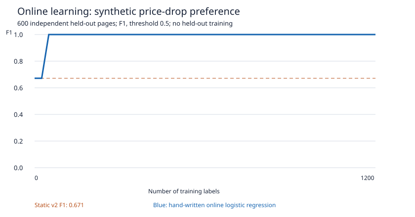

# WARDEN Parts 2 and 3 — implementation, reasoning and learning report

28 October 2026. This report supersedes Part 2's earlier Phase A-only status.
It covers the new work without repeating Part 1's scheduler, queue and crawl
algorithms. Read Part 1 for those foundations. The examples here refer to the
current source tree; recorded evidence has a narrower, explicitly stated scope.

**Status: substantial implementation and several real proofs; both parts remain
incomplete.** Django/DRF analytics/admin, deployed replica/pooler integration,
updated application deployment, the full live Jaeger export and worker-kill crawl
SLO proof remain outstanding. The exact prerequisites are in
[PART23_SETUP.md](../PART23_SETUP.md); the cold-start Handoff is section 9.
No checkpoint approval is being requested. Work stopped at dependency,
credential-ownership and storage boundaries, not at a planned CP1/CP2 pause.

## 1. Executive summary

Part 2 gives a monitor a precise decision policy. A page change can now carry
explicit numeric price fields, pass through a handwritten rule compiler, and
produce a recorded decision such as matched, no match, cooldown or error.
Matching rules can add a tag or create a durable webhook/email delivery intent.
The intent is committed with the change, while a separate relay handles slow,
fallible delivery. This lets WARDEN distinguish detecting a change, deciding it
is useful, scheduling a notification, attempting transmission and receiving an
acknowledgment. Those are different facts and now have different records.

The language has a real lexer, precedence-aware parser, canonical printer,
static checker and bounded interpreter. It rejects malformed programs with
source positions and useful field suggestions. User regex uses RE2. The delivery
path signs exact bytes, checks every webhook destination through the existing
SSRF guard, retries under a stable delivery identity, and records attempts.
An isolated PostgreSQL crash test killed the relay after a verifying receiver
committed an effect; retry produced two attempts and one receiver effect.
Actual SMTP delivery to the existing development Mailpit was also measured.

Part 3 adds the implemented learning core: immutable user feedback, handwritten
online logistic regression, feature hashing, regularization toward a shared
prior, account-specific model versions, shadow predictions, server-computed
promotion gates and rollback. A declared synthetic price-drop preference
improved held-out F1 from 0.671 to 1.000. Real PostgreSQL query plans and a real
streaming standby were exercised in private fixtures. The source also contains
queue trace propagation, metrics, dashboards and SLO rules, whose PromQL tests
passed. These are useful advances, but the Django service and several deployment
proofs are still absent. Reporting those gaps is part of making the system
reviewable; a green source gate alone does not establish a running product.

### Evidence at a glance

| Requirement | Current evidence | What it does not establish |
|---|---|---|
| Language conformance | 199 language tests, including 144 arithmetic/precedence combinations | Exhaustive proof for every possible source |
| Round trip and fuzz | 60,000 seeded programs; no unexpected exception/hang; AST equivalence and printer idempotence | Formal verification or unrestricted-input resource isolation |
| Windows/cooldowns/atomic intents | Private PostgreSQL/Redis integration cases | Deployment of the new processor image |
| Signed crash recovery | Real DB, clean subprocess SIGKILL, persistent verifying receiver, two attempts/one effect | Real public DNS/TLS transmission; transport is injected |
| Email | Real existing Mailpit SMTP and a delivered private DB ledger | External email-provider delivery or recipient deduplication |
| Online model | Unit/DB gates; synthetic independent held-out curve | Real-human preference learning or broad web accuracy |
| Query tuning | EXPLAIN ANALYZE/BUFFERS on three actual app query shapes with fixture data | Ranking of the three slowest production queries |
| Read replica | Actual PostgreSQL streaming standby, replay and write rejection | Deployed Compose replica with dedicated roles |
| Observability | Instrumentation, committed configs/JSON, promtool/amtool validation and rule tests | A real all-service Jaeger trace or worker-chaos crawl SLO demonstration |
| Django/DRF | Dependencies and package scaffold | Models, authenticated endpoints, admin or replica routing |

Evidence files are beside this report: [fuzz](part-2-fuzz.json),
[delivery crash](part-2-delivery-proof.json), [Mailpit](part-2-mailpit-proof.json),
[learning curve](part-3-learning-curve.json),
[query plans](part-3-query-plans.json), and
[replication](part-3-replication-proof.json). Prefer the exact JSON numbers over
rounded prose. Each file must retain its environment and proof limitations.

## 2. Concepts from scratch

### 2.1 A language is a contract before it is an interpreter

A rule is a user-authored program, even if it occupies one line. It contains
names, values, operators and actions. A reliable implementation must decide what
each sequence of characters means, which combinations are legal, what values
are available, when external history is consulted, and which effects can occur.
Without those decisions, behavior emerges accidentally from implementation
shortcuts. For example, converting every field to a string makes a price
comparison depend on alphabetical ordering; converting every string to a number
makes currency and malformed data ambiguous.

WARDEN's v1 form is:

```text
when price.drop_percent >= 10 and price.current < 1000
     and count(changes, 24h) < 3
then webhook("deals") + tag("bargain") cooldown 6h
```

The condition is a Boolean expression. The actions are literal references to
registered destinations or a literal tag name. The cooldown belongs to this
rule revision. `webhook("deals")` does not contain a connection URL; it names an
owned endpoint record that can be independently disabled or versioned. This
keeps user expression evaluation separate from destination configuration and
lets the relay recheck the destination before transmission.

The implementation deliberately has a small vocabulary. There are no loops,
assignments, imports, arbitrary function calls or access to Python objects.
The interpreter never calls Python `eval`. Adding a language feature means
extending the grammar, type rules, evaluation rules, printer and tests together.
A seemingly convenient feature such as dynamic regex construction also changes
resource accounting and error timing. The small language makes those obligations
visible rather than pretending that arbitrary Python is a safe configuration format.

### 2.2 Lexing: turning characters into typed tokens

The lexer reads source from left to right and emits tokens. A token has a kind,
its relevant text and its source span. For `price.current >= 100`, the lexer
recognizes identifiers and the dot, the two-character comparison operator, and
a numeric literal. It must recognize `>=` as one operator rather than treating
it as unrelated `>` and `=` characters. A quoted string is processed as a string
state, so spaces and punctuation inside it do not split it into language tokens.

This implementation uses explicit character scanning. JSON-style double-quoted
strings provide well-defined escape handling. Numbers and durations have
separate recognition rules: a duration is a positive integral quantity followed
by a supported unit, then normalized to seconds. ASCII identifiers avoid
visually confusable field spellings. Invalid escapes and invalid Unicode are
rejected as diagnostics rather than allowed to reach a later stage unexpectedly.

The lexer also enforces limits before deeper processing: source bytes, token
count, numeric precision and parentheses. These are not cosmetic restrictions.
A parser can be correct on short inputs and still exhaust memory or recursion
on adversarial ones. Bounding the lexer output bounds the amount of subsequent
work. A maximum input size is also easier to explain and test than an accidental
Python recursion failure.

Source offsets are half-open: `[start, end)`, including the first character and
excluding the one after the offending text. Thus slicing the original source by
the reported offsets returns the exact field spelling that failed. These offsets
count Python Unicode code points, not UTF-8 bytes or JavaScript UTF-16 code units.
A future browser editor must convert offsets for its own indexing convention;
otherwise an emoji before an error can move the highlight. Line and column are
provided for humans, but the original source plus offsets remains the precise
reference.

### 2.3 Parsing and why Pratt binding powers work

The parser turns tokens into an abstract syntax tree, or AST. Each node records
an operation and its children, with source information. In `2 + 3 * 4`, the root
must be addition, with a multiplication subtree on the right. If the parser
instead made multiplication the root, it would evaluate `(2 + 3) * 4`, changing
the result from 14 to 20. Syntax trees are therefore decisions about meaning,
not just a convenient internal representation.

A Pratt parser handles this with binding powers. Its core operation is
`expression(minimum_power)`. It reads a starting expression, then repeatedly
looks at the next infix operator. If that operator's power is too low for the
current call, the call returns. Otherwise it consumes the operator, parses the
right-hand side with an appropriate stronger minimum, and combines the two
expressions into a new node.

Consider addition at power 40 and multiplication at 50. The outer call reads
`2`, then accepts `+`. Parsing the right side of `+` begins with `3`; `*` has
higher power, so that right-side call also consumes `4` and returns `3 * 4`.
The outer call then builds `2 + (3 * 4)`. For left-associative subtraction,
parsing a right side at a strictly stronger threshold prevents another equal
power subtraction from being absorbed into that side. Consequently `9 - 3 - 1`
becomes `(9 - 3) - 1`, giving 5, rather than `9 - (3 - 1)`, giving 7.

Prefix operators such as `not` and unary minus begin expressions rather than
joining two existing ones. Parentheses explicitly start a nested expression and
require a matching closing token. Function calls parse comma-separated argument
expressions but do not decide whether a function name or its argument types are
legal; that belongs to static checking. WARDEN orders `or`, `and`, comparisons,
addition/subtraction, multiplication/division, then prefix operators. Comparison
chaining is rejected so that `a < b < c` cannot silently inherit a surprising
Boolean-to-number interpretation.

This algorithm is compact because one precedence table drives the infix loop.
That compactness does not remove the need for independent examples. Tests must
verify expected trees/results, not merely parse and print with two functions
that share the same bug. The conformance tests supply ordinary arithmetic
answers and manually inspected precedence cases alongside round trips.

### 2.4 Canonical printing, normalization and round-trip properties

An AST contains meaning plus incidental details such as source positions. A
pretty-printer reconstructs source from the meaningful structure. WARDEN emits
explicit parentheses, canonical durations, normalized decimals and JSON-escaped
strings. The result prioritizes unambiguous reparsing over minimal punctuation.
Different spacing or duration spellings can then represent the same normalized
program.

Two distinct properties matter. First,
`normalize(parse(print(parse(source)))) == normalize(parse(source))`: printing
must preserve the syntax tree's meaning-bearing structure. Second,
`print(parse(print(parse(source)))) == print(parse(source))`: printing should
reach a stable canonical form in one step. Normalization deliberately discards
source spans because formatting changes positions; comparing spans would reject
semantically correct output.

Canonical text is hashed to identify an equivalent rule. Re-saving equivalent
source can return the existing revision and retain its cooldown. This avoids
creating a fresh notification opportunity merely because someone changed spaces.
The hash is an identity aid, not an authorization check or proof that a program
will evaluate true. Ownership and static validity are checked separately.

A round trip is a property over many examples, not an exhaustive mathematical
proof. The seeded harness generated 45,000 deliberately valid programs and
15,000 additional mutation/adversarial cases. All deliberately valid programs
had to be accepted; malformed cases were allowed to return documented errors.
Every accepted program then had to satisfy both round-trip properties. A shell
watchdog bounds the overall run as well as the parser's own budgets. A
reproducible seed lets a failure be investigated with the same input sequence.

### 2.5 Static checking versus evaluating live data

Parsing answers whether a program has a grammatical structure. Static checking
answers whether its operations make sense for the declared types. Evaluating
answers what a checked program means for one concrete change. Those are
separate questions. `price.current + true` can form a perfectly ordinary binary
AST and still be invalid because addition expects two decimals.

The checker has a fixed field schema: decimal prices/scores, strings for text
and currency, and Boolean event decisions. It recursively infers child types,
then checks the parent operator's signature. Logical operators require Boolean
children; arithmetic requires decimals; ordering comparisons require decimals;
string functions require strings. `count(changes, duration)` is a specific
function shape, not a generic operation over arbitrary variables. It cannot be
used to fetch another user's monitor history.

Static checking visits branches even if a Boolean constant would make them
unreachable during this evaluation. Thus `true or price.curent > 10` still
reports the misspelled field. Accepting it would leave a hidden defect that
appears only after a later edit changes the first operand. Checking at save time
also produces useful feedback before the monitor waits hours for another change.

Unknown fields use Levenshtein edit distance. The algorithm constructs a row of
best costs for matching prefixes, considering insertion, deletion and
substitution at each character. Each next row depends only on the previous row,
so a full two-dimensional matrix is unnecessary. Candidate names are sorted by
distance, restricted to a small distance, and capped at three suggestions.
`price.curent` can therefore suggest `price.current`. A suggestion never changes
the program automatically; silently correcting a financial condition would be
an unacceptable meaning change.

Static types do not guarantee that a price exists on a particular page. The
extractor may find no element, multiple elements or malformed text. That absence
is represented by `None` internally, treated as Missing by the language. Most
operations involving Missing propagate absence or yield false comparisons.
Notably, `missing != 5` does not become true. Use `exists(price.current)` when
the condition requires an explicit availability test. `not` operates on a
Boolean result, so negating a failed comparison can still yield true; the report's
interview questions revisit why existence guards matter.

### 2.6 Decimal prices and explicit extraction

Money-like comparisons should not depend on binary floating-point rounding.
The rule evaluator uses Decimal values and bounded precision. The extractor
requires an explicit CSS selector and currency convention. It accepts exactly
one selected value and checks grouping/decimal separators rather than guessing
from arbitrary page text. Currency text is metadata about the number; the
system does not perform exchange-rate conversion.

A percentage drop is `100 × (previous - current) / previous`, when both prices
exist and the previous price is positive. A change from 100 to 89 is an 11%
drop. A change from 89 to 100 is a negative drop, so it does not satisfy
`drop_percent >= 10`. A zero prior price makes the percentage undefined; the
implementation returns Missing rather than divide by zero. A missing selector
also produces Missing rather than inventing a zero price.

These choices make extraction failure observable through rule outcomes and
dry-run history. They also expose a limitation: the configured currency is
trusted monitor configuration, not a financial-data verification service. If a
page changes its currency or markup without updating monitor settings, a human
may need to revise the selector. Quietly guessing a new currency would make
numeric alert conditions harder to trust.

### 2.7 Bounded interpretation and why a timeout alone is insufficient

The tree-walking evaluator recursively computes node values. It can short
circuit `and` and `or`, so unnecessary history calls are skipped. Each visited
node consumes a step, and the evaluator checks a monotonic deadline. The outer
async timeout covers awaits, including history lookups. Numeric operands,
intermediate magnitude, strings and the AST also have explicit bounds.

A timeout implemented only as cancellation cannot stop an arbitrary synchronous
infinite loop in the same event loop: the loop must yield before cancellation
is delivered. WARDEN therefore avoids user-controlled loops entirely and bounds
all expression structure before execution. A step budget limits work even if a
program contains many otherwise cheap nodes. A monotonic clock is appropriate
for elapsed time because changing the wall clock should not extend a program's
budget.

History and other infrastructure failures are different from a rule evaluating
false. If Redis is unavailable, pretending the recent change count is zero
could fire an alert that the rule explicitly forbids. The processor instead
allows that failure to roll back the event transaction, so retry can evaluate
from valid history. Rule errors have structured diagnostics; temporary service
failures retain retry semantics. Cancellation during a database operation can
invalidate its transaction, so successful recovery still requires a fresh
transaction, not continuing to use a broken connection.

### 2.8 RE2 and the specific regular-expression threat

Some regex engines explore many alternative matching paths with backtracking.
An expression that is short to write can require an enormous number of paths
to reject a crafted long input. In WARDEN both the pattern and page text can be
outside the operator's control. Using Python's normal backtracking regex engine
inside user rules would therefore expose the worker to regular-expression
denial of service, commonly called ReDoS.

RE2 restricts the supported language and implements matching with predictable
linear-time behavior in the input length for a fixed expression. Backreferences
and some advanced assertions are intentionally unavailable. WARDEN compiles
only literal regex arguments, caps their bytes, configures RE2 memory and
reports unsupported constructs during validation. There is no fallback to
Python `re` when RE2 rejects a pattern. Such a fallback would remove the
property the dependency was chosen to provide.

Linear time is not zero cost or a complete process sandbox. Matching many
patterns against large text still costs time, and many compiled rules still
consume memory. Source/AST/text bounds and the compiled-program cache are
additional controls. Aggregate compiled-cache memory remains a resource-tuning
limitation; the per-pattern option is not a promise about the process's total
RSS. This distinction matters when explaining why one library choice cannot
replace every other resource limit. The engine's supported syntax and guarantees
are described in the [RE2 project](https://github.com/google/re2).

### 2.9 Redis window projections and durable cooldowns

A window such as `count(changes, 24h)` needs a defined population and time
boundary. WARDEN counts prior meaningful changes for this monitor in the closed
interval `[event_time - window, event_time]`. The current event is excluded by
its ID. A previous event at exactly the lower boundary counts; one a second
older does not. Wall-clock event time defines the policy, while elapsed
execution deadlines use the monotonic clock for a different purpose.

The current implementation stores bounded window-count aggregates in Redis,
identified by the monitor, current event/time and the prior-event watermark.
PostgreSQL remains the membership source. A missing or malformed projection
is rebuilt by an indexed count query; a repeated identical window can use its
cached count. The cache never has authority to invent a durable change record.
This uses the existing processor GET/SET ACL instead of editing a secret ACL
file to add sorted-set commands. It does not claim to eliminate PostgreSQL work
on every new event: the aggregate is tied to that event's evaluation point.

An earlier implementation serialized at most 10,000 recent events into Redis.
That imposed an arbitrary history-size failure on a busy monitor. Replacing the
list with counts makes cache size depend on distinct requested windows rather
than the number of prior changes. A regression exercises more than 10,000
history events and checks that the resulting cache is still small. Count queries
still have real database cost; that trade-off is explicit rather than hidden
behind a false claim of constant-time historical reconstruction.

A cooldown is different from a history cache. It is a durable rule-revision
state: `next_allowed_at`. The processor already serializes a monitor's changes,
so it can read the state, decide whether this event may schedule actions and
advance the state in the same transaction. Two processors cannot independently
observe an expired cooldown and both schedule its first allowed alert. An
unchanged canonical rule retains the revision/state; a real revision gets new
state. Product semantics for carrying a cooldown across materially changed
rules are a later policy decision, not something a printer hash can solve.

Cooldown starts when an intent is scheduled, not when a network attempt succeeds.
Otherwise a failed destination could create a fresh intent on every subsequent
change and flood the retry system. A delivery's retries keep the same identity
and do not rerun the rule. A manual redelivery also operates on that delivery,
not on a fresh cooldown opportunity.

### 2.10 The new atomic boundary: a decision and its delivery obligation

Part 1 already explained transactions and the outbox. The extension here is the
set of facts that must commit together: the new ChangeEvent, rule evaluation,
updated cooldown, tag associations, alert outbox row and delivery record. If the
transaction fails, none of those facts should become an independently visible
promise. In particular, a cooldown must not advance while its corresponding
notification intent disappears.

The processor constructs exact delivery bytes and a stable UUID derived from
revision/event/action position. A database uniqueness constraint independently
prevents the same action from creating multiple delivery records. Those are
different defenses: deterministic identity makes retries recognizable to a
receiver, while uniqueness makes an accidental duplicate insert fail locally.
The payload contains event identifiers and facts, not signing secrets. Endpoint
configuration is referenced and snapshotted with a version for safe cancellation
when the destination changes.

This boundary is deliberately narrower than a network request. PostgreSQL
cannot roll back an HTTP receiver that has already acted. Holding a database
transaction open across the request would also waste connections and locks
while waiting on a remote system. The durable relay boundary separates the
local atomic decision from the remote acknowledgement problem.

### 2.11 Claiming work, leases and fenced completion

The relay selects due alert work with `FOR UPDATE SKIP LOCKED`. Row locking lets
one claimant reserve a delivery; SKIP LOCKED lets other claimants work on
unlocked rows instead of queuing behind the first. The claim transaction is
short. It updates a lease token, expiry, attempt count and attempt ledger, then
commits before contacting the endpoint.

The lease states that the claimant may finish this attempt before an expiry.
It is not a physical lock on the remote receiver. If the worker is killed,
another worker can reclaim an expired lease. A late result from the original
worker must not overwrite the new owner's result. Completion therefore checks
the token, status and expiry under a row lock. A successful network response
without a valid completion token is not enough to mutate the ledger.

An expired claimed attempt becomes abandoned, not secretly successful or
unsent. This preserves what the sender actually knows. When a replacement
attempt succeeds, the ledger can show that the first outcome was uncertain.
The receiver may have acted on that first attempt; its persistent deduplication
record resolves the duplicate-effect question separately.

LISTEN/NOTIFY wakes the relay promptly after a transaction commits. It is a
latency aid, not the authoritative work queue. Notifications are not a durable
replay log for a disconnected listener. The relay establishes its listener,
scans durable pending work, periodically rescans, and reconnects after errors.
The LISTEN connection must be a dedicated direct/session connection; a
transaction pool does not preserve the required backend session identity.

### 2.12 HMAC signing, freshness and receiver deduplication

HMAC combines a shared secret key and message bytes into an authentication tag.
The receiver recomputes the tag with the same key and compares it in constant
time. This demonstrates possession of the key and detects changed bytes; it
does not encrypt the body. HTTPS is still required for transport confidentiality
and server identity. The implementation uses HMAC-SHA256 and versioned key IDs.

WARDEN signs the timestamp, stable delivery ID and exact body bytes with explicit
separators. Including the ID prevents an attacker from relabeling a captured
message as a new delivery. Including the timestamp binds the claimed freshness
to the signature. Signing the exact bytes avoids disagreement over JSON
whitespace, property order or number serialization. The sender retains the
same body/ID on a retry but produces a fresh timestamp and signature.

The receiver accepts only a bounded timestamp window around its own clock.
This rejects an old captured request even if its signature is otherwise valid.
Clock skew consumes some of that window, so production hosts need sensible time
synchronization. A valid request can still be replayed within the window.
Freshness therefore does not replace receiver idempotency.

The reference receiver stores the delivery ID, body hash and effect in a single
SQLite transaction. A duplicate ID with the same body returns success without
repeating the effect; the same ID with a different body is rejected as a conflict.
A restart retains those records because they are on disk. The one-effect result
only covers an effect committed in the same transaction as that receipt. If a
receiver commits a receipt and then calls an unrelated payment provider, that
external effect has its own uncertainty boundary and needs its own design.

The crash proof targets the difficult boundary: the receiver committed, but the
sender did not mark the attempt finished. The parent waits for a post-commit
marker, kills a clean relay subprocess, waits for lease expiry, and retries.
The observed result is two attempt records, one abandoned and one succeeded,
and exactly one receiver effect. The transport is injected at the pinned socket
boundary, so this is a genuine database/process/signature proof with a stated
network limitation, not a public TLS proof.

### 2.13 SSRF protection on an outbound webhook

A user-controlled webhook address gives the server a destination to contact.
That address can target a private database, cloud metadata endpoint or another
internal service as readily as a monitored URL. Registration-time validation
alone is insufficient because DNS can change before dispatch. WARDEN validates
at registration/redelivery and again for each actual attempt.

The transport requires HTTPS, rejects userinfo/fragments/control characters,
resolves the destination through `warden_net`, and rejects unsafe address sets.
It connects to a validated IP while retaining the original hostname for TLS
certificate verification/SNI and the Host header. That prevents a second
uncontrolled DNS lookup between checking the name and connecting. Redirects
are not followed; accepting a safe first URL does not authorize a different
second destination. Proxy environment variables cannot quietly redirect the
connection through another resolver or network path.

No webhook uses the monitor-only chaos-web allowlist. The integration fixture
supplies a public test DNS answer and an injected pinned transport; the normal
SSRF guard still runs. A real internet proof needs a human-owned public HTTPS
receiver and signing material. Exempting a private test destination would prove
a different security policy, so the missing prerequisite is recorded instead.

### 2.14 Retries, backoff, circuit breakers and dead letters

A failed attempt needs classification. A timeout or a 5xx response may succeed
later; most 4xx responses indicate a configuration/request problem; 408 and 429
have distinct retry meaning. A redirect is terminal in this transport. Recording
only a Boolean failure would lose these operational distinctions. The ledger
stores bounded categories/statuses without dumping secret-bearing URLs or
arbitrary exception strings.

Exponential backoff increases the maximum delay as the attempt number rises.
Full jitter chooses a delay within that range rather than making every worker
retry at exactly the same instant. Retry-After is honored within a cap. Attempts
also have a maximum count and age so a permanently failing endpoint cannot
occupy retry capacity forever. These are product reliability choices: a lower
cap reduces repeated load but moves work to operator recovery sooner.

The circuit breaker belongs to an endpoint, not the entire relay process. After
repeated retryable failures it opens briefly, deferring that endpoint's work.
A half-open probe has its own short ownership interval so multiple workers do
not simultaneously test recovery. A successful attempt resets the failure state.
Healthy endpoints continue to make progress. The breaker does not replace
per-delivery retries or prove the endpoint is permanently broken.

A dead letter here is a durable delivery in `dead` state with its failed outbox
and attempt history. It is queryable and eligible for controlled manual recovery;
it is not discarded. The owner-scoped redelivery API requires an idempotency
key, revalidates the current destination, preserves delivery identity/attempt
numbers, extends a bounded retry allowance and records an audit event. Repeating
the same request cannot repeatedly add another allowance. A different request
with the same idempotency key conflicts.

SMTP has an important limit. A stable Message-ID is useful for correlation but
does not require a mailbox provider to deduplicate repeated sends. A relay crash
after SMTP acceptance may still produce duplicate emails. The one-effect claim
belongs to the reference webhook receiver with transactional deduplication,
not to arbitrary email recipients.

### 2.15 Learning from feedback: what is actually being predicted

The static classifier estimates whether a page change is meaningful by a fixed
policy. A particular user may want a different decision: a price decrease is
useful, while a price increase is not. Learning tries to estimate that account's
usefulness label from a feature vector. The target label must be defined before
judging model quality. It would be misleading to evaluate one model against
generic simulator signal labels and another against a more favorable preference
policy, then call the difference a general accuracy improvement.

The implemented feedback API records an owned event's useful/noise label. Labels
are immutable in this version: the same submission is idempotent and a conflicting
label returns a conflict. That restriction simplifies reproducible model
versions; changing labels later requires a correction/retraining policy rather
than silently applying a second contradictory SGD step. Feedback and its
learning example commit together.

The processor now persists scored comparisons even when the final decision is
not meaningful. Without those observations, a user could label false positives
but could not label the false negatives that were never stored. Notification
fanout still filters nonmeaningful observations. This distinction prevents
learning coverage from being limited to the classifier's own previous positive
choices, although it does not remove all selection bias in real user feedback.

### 2.16 Logistic regression and its update equation

A feature vector is a set of named numeric measurements. The model computes a
weighted sum `z = w·x`, including a bias, then a probability
`p = 1 / (1 + exp(-z))`. A threshold of 0.5 maps that probability to a decision.
A probability near 0.9 means the model assigns greater confidence to usefulness;
it is not automatically a calibrated 90% chance on real future websites.
Calibration would need its own held-out analysis.

For a binary label `y` in `{0,1}`, the logistic-loss gradient for one feature is
`(p - y) × x_i`. If the model predicts too low on a positive example, this term
moves weights toward a larger positive score for that example. If it predicts
too high on a negative example, the update moves the other way. The code uses
stochastic gradient descent: one example, one bounded update, then the next
example. It does not solve a large batch optimization problem for every click.

Regularization adds `lambda × (w_i - prior_i)` for nonbias weights. The update is
therefore `w_i ← w_i - eta × ((p-y)x_i + lambda(w_i-prior_i))`. This discourages
an account with few labels from moving arbitrarily far from its prior. The bias
is exempt so the account can adjust its overall positive rate. The learning rate
decreases as the sample count grows, reducing the influence of each later
individual label. This is a fixed reviewed policy, not a claim of optimal
hyperparameters.

Computing the sigmoid directly with `exp(-z)` can overflow when `z` is a large
negative number. The implementation uses separate positive and negative forms
so the exponent passed to `exp` remains safe. Weights, features and parameters
are also checked for finite values. A NaN in a model can poison every subsequent
probability and make promotion comparisons unreliable, so rejecting it is part
of correctness, not merely numerical tidiness.

### 2.17 Signed feature hashing and its costs

A feature dictionary can grow as extraction evolves. Feature hashing maps each
name deterministically to one of a fixed number of weight positions. WARDEN
uses BLAKE2b-derived positions and signs, with index zero reserved for bias.
The same feature name maps to the same position across processes and restarts.
Python's ordinary randomized hash would not provide that reproducibility.

Multiple names may collide. Their contributions share a weight position;
that is the cost of bounded dimensionality without a growing vocabulary registry.
A separate deterministic sign reduces systematic positive accumulation from
collisions, but does not eliminate their interference. The model has 4,096
positions and clips input magnitude, while retaining named numeric features in
learning records for inspection. Feature schema versioning is necessary because
changing normalization or hash rules can invalidate the interpretation of
existing weights even if the model shape is unchanged.

A price-direction feature is essential to the demonstration. If the only
features describe “a number changed” without direction, no logistic model can
reliably learn “drops matter but increases do not” from identical vectors.
Model capacity cannot recover information that extraction discarded. This is
why feature design and a clear target often matter more than choosing a more
complex optimizer.

### 2.18 Global prior, account specialization and immutable versions

A new account has little or no feedback. Its initial weights come from a shared,
reviewed prior derived from static-v2 reasoning. That prior is persisted as an
immutable registry version when needed, so a training run can identify its
starting point. It is not represented as a globally trained model on pooled
private labels. Cross-account training and its consent/privacy policy are not
implemented by implication.

Every training update creates a new ModelVersion with weights, prior weights,
sample count, feature schema and parent identity. A mutable alias identifies the
account's shadow and production versions. Mutating one weights row in place
would lose the ability to reproduce yesterday's decisions. Version rows and
alias pointers have different responsibilities: a version records what a model
was; an alias records what role it currently has.

Training holds the account alias lock so concurrent feedback cannot both start
from the same shadow version and lose one update. The global prior initialization
also uses a lock/unique scope. A held-out example is stored but never updates
weights. This ordering makes training eligibility an explicit part of each
example's provenance rather than an informal convention in a plotting script.

Shadow scoring runs the candidate on real incoming observations without letting
its decision control notifications. The stored comparison includes candidate
probability and production/shadow decisions. Agreement rate can reveal that a
candidate would change many outcomes, but agreement is not accuracy: two models
can agree and both be wrong. Ground-truth feedback is still required for a
quality gate.

### 2.19 Held-out evaluation, promotion and rollback

The deterministic event/account split sends roughly one fifth of feedback to
held-out evaluation. The split uses a stable digest rather than process-random
state. Training ignores those examples. At promotion time the server loads its
own stored examples and evaluates candidate and incumbent on exactly the same
labels. The caller cannot submit a convenient F1 value or omit difficult cases.

Precision is `TP/(TP+FP)`: among proposed useful alerts, how many were useful?
Recall is `TP/(TP+FN)`: among useful changes, how many were found? F1 is the
harmonic balance `2TP/(2TP+FP+FN)`. A model that predicts everything positive can
have perfect recall and poor precision. Accuracy alone can also look high when
useful events are rare. WARDEN checks both F1 improvement and a minimum precision,
with minimum held-out count and both classes present.

Promotion requires an F1 margin of at least 0.01 over the incumbent, precision
at least 0.8 and at least 20 held-out labels. It rejects nonfinite metrics and
one-class samples. A regression deliberately supplies a bad model and verifies
that production does not move. Another case promotes an actually better model,
rejects the same model when it can no longer improve on itself, then rolls back.
These are policy tests about an important state transition, not assertions that
just repeat a formula's implementation.

Rollback moves a pointer to the previous production version. It does not invert
SGD, erase feedback or delete versions. The first promotion's previous incumbent
can be the static scorer, represented by no account production pointer. A
rollback to that state is therefore meaningful. The CLI performs the same owned
alias operation and records an audit entry.

Repeatedly trying many candidates against the same holdout leaks information
about that holdout into model selection, even if SGD never trains on it.
Minimum-count gates also provide little statistical certainty on small samples.
A later version needs fresh/time-based evaluation windows, confidence analysis,
drift monitoring and a policy for model selection frequency. “Held out” is a
specific data-use rule, not a permanent guarantee against all overfitting.

### 2.20 Reading the measured learning curve correctly

The harness obtains actual before/after price pages and mutation truth from
chaos-web through its ASGI app. It uses separate deterministic page IDs and
seeds for 1,200 training and 600 test examples. The explicitly declared synthetic
utility label is “a simulator price signal with a decrease.” Increases are
negative for this preference even though the generic static scorer correctly
recognizes them as meaningful page changes. No real user labels are claimed.

The fixed test set contains 93 positives. Static-v2 F1 is 0.671480, precision
0.505435 and recall 1.000. The online model reaches F1/precision/recall 1.000 on
that test set by the 50-label checkpoint and retains it at 1,200 labels. The
curve is not required to improve monotonically on every dataset; these measured
points happen to do so. Hyperparameters were not searched against the test set.
The visual is a standalone SVG generated from the saved measured points without
adding an unapproved plotting dependency.



The defensible conclusion is that feedback plus a direction feature can adapt
this system to a simple account preference. It is not that WARDEN solves
arbitrary page semantics, that the real-world F1 is 1, or that generic static-v2
became worse. In interviews, state the target, sample sizes, split and limitation
before quoting the number. That makes the measurement informative rather than
an unsupported product claim.

### 2.21 Query plans, indexes and honest performance evidence

A SQL query states the desired result; PostgreSQL's planner chooses how to obtain
it. A sequential scan reads candidate table rows, while an index can narrow
which rows or key ranges need inspection. An index-only scan may avoid visiting
the heap for visible rows when the index contains the needed fields and the
visibility map permits it. Additional indexes also cost storage and work on
inserts/updates, so creating one for every column is not automatically an improvement.

`EXPLAIN` describes the chosen plan and estimated costs. `ANALYZE` actually
executes the query and records measured rows/timing. `BUFFERS` records database
buffer activity; shared hits and reads help distinguish CPU/cache work from
reading blocks into shared buffers. Planner cost units are not milliseconds.
Measured execution time also depends on caching, data distribution, machine
load and instrumentation overhead. A single tiny development-table result does
not predict production tail latency.

The private benchmark uses actual application query shapes for durable queued
count/oldest age, recent SLO population and owned held-out evaluation. It seeds
150,002 crawl rows and 30,000 learning examples, measures five repetitions,
creates the intended indexes, then measures five more. It retains full JSON
plans and checks that result-row counts agree. The changes add a partial queued
age index, a time index covering status/completion fields, and an owner/split/
event index for held-out examples.

These are three selected hot paths, not evidence that they are the three slowest
queries in a deployed workload. The full user requirement for a real-system
ranking remains open. A future deployment should capture representative query
frequency and latency before choosing the final top three. The saved fixture
plans are still useful evidence about why these specific indexes matter.
Production creation should use a separately planned concurrent-index rollout
where needed; the ordinary local migration can block writers while building.


Latest successful fixture medians (five warm-cache repetitions; milliseconds):

| Query | Before | After |
|---|---:|---:|
| durable_queued_age | 6.184 | 0.026 |
| slo_5m_population | 9.309 | 0.058 |
| promotion_holdout | 5.929 | 0.311 |

The fixture labels 2% of its learning rows held out for this selectivity test;
the actual deterministic feedback split is approximately 20%. Do not transfer
the speedup magnitude directly to that different distribution. A later failed
repeat hit disk exhaustion; after scoped cleanup the full 13-case suite, including
this benchmark, passed and refreshed the saved plans.

### 2.22 Streaming replication and the exact read-only claim

A physical streaming standby starts from a base backup of the primary cluster.
It receives write-ahead log records and replays them to reproduce primary data.
It is not a second independently writable copy of the same application database.
The standby can serve read-only queries while recovery continues. A write should
fail rather than silently create data that the primary never saw.

The isolated proof starts a real second PostgreSQL 16 server from `pg_basebackup`,
commits a fresh marker on the primary, waits until the standby replays at least
the recorded WAL position, verifies the marker, and checks that an UPDATE is
rejected as read-only. Both instances use private fixture-owned Unix sockets;
no deployment password or host route is changed. The artifact proves actual
streaming/replay behavior, not just a mocked router method returning `replica`.

Replication is asynchronous here. A read immediately after a primary commit can
be stale until replay catches up. Analytics can often tolerate that delay; an
operation deciding whether a notification was just delivered may not. Separating
analytics reads protects the crawl path's primary resources, but a replica is
not free capacity: WAL generation, transfer, replay CPU, storage and monitoring
all remain costs.

Replay lag needs a careful definition. The age of the last replayed transaction
can increase on a perfectly caught-up idle standby, so that timestamp alone is
not a reliable “seconds behind” metric. Compare WAL positions to determine a
backlog, and use heartbeats or primary commit/replay measurements when a time lag
is required. A disconnected standby also needs WAL-retention/reseeding planning.
The optional Compose profile does not implement automatic promotion or automatic
volume deletion/reseeding. PostgreSQL's own behavior is described in the
[streaming replication documentation](https://www.postgresql.org/docs/16/warm-standby.html).

### 2.23 Django, unmanaged models and why the driver gap is real

Django provides an ORM, application configuration, middleware and administrative
interface. Django REST Framework adds API-oriented request handling, validation,
serialization, authentication and permissions. In this project these tools are
requested for analytics/admin while the existing FastAPI application continues
to serve the operational API. Adding Django does not require moving schema
ownership or duplicating application tables.

`inspectdb` can inspect the real database and generate starting model classes.
Its output is not a reviewed domain model: relationship names, nullability,
composite keys, database defaults and constraints need inspection. `managed=False`
means Django should not create/drop that application table through its migration
lifecycle. It does not make reads automatically safe, enforce tenant ownership,
or forbid writes from model methods/admin. Those require permissions, routing
and preferably a database role with only the required grants.

The planned three analytics endpoints are busiest domains, an hour/day change
heatmap and a precision trend. They must scope data to the authenticated account
unless an explicitly authorized admin is querying global aggregates. A read router
should send their ORM reads to the standby; critical writes/admin mutations must
have explicit primary policy. Read-only database credentials provide an
independent defense if a view or router is wrong. Django's authentication tables
and existing WARDEN password/session schema also require an intentional mapping;
pretending the existing users table is an unmodified Django auth model is unsafe.

This work has not been implemented. Django's supported PostgreSQL backend needs
psycopg or psycopg2; neither driver was explicitly authorized under dependency
rule 5. The package scaffold and Django/DRF installations do not constitute a
running analytics service. The report does not manufacture inspectdb output,
ship an untested custom asyncpg backend, or relax strict typing to conceal that
gap. [The Django database documentation](https://docs.djangoproject.com/en/6.0/ref/databases/#postgresql-notes)
describes the driver requirement; the human-owned setup document records the
exact proposed `uv add` command for later authorization.

### 2.24 Transaction pooling and prepared statements

An application-side connection pool reuses client connections within one process.
PgBouncer can share a smaller set of PostgreSQL backend sessions across many
client processes. In transaction mode it assigns a backend for one transaction,
then makes that backend available to another client. The next transaction from
the same client may use a different PostgreSQL session. Reducing idle backend
sessions is the benefit; losing session affinity is the main constraint.

Session-scoped assumptions therefore need review: LISTEN, session-level temporary
state, some advisory locks, cursors and prepared statements cannot be treated
as if one client always owns one backend. Transaction-scoped locks/settings are
a different case because they live within the assigned transaction. Migrations
and the notification listener remain on direct primary connections in this design.

asyncpg uses prepared statements, and SQLAlchemy's asyncpg dialect explicitly
prepares statements even when its own prepared-statement cache is disabled.
Consequently “set one cache size to zero” is not a complete compatibility
argument. Modern PgBouncer can track protocol-level named prepared statements
when `max_prepared_statements` is nonzero. The prepared configuration pins a
modern pooler, enables tracking, and the optional engine mode uses NullPool,
unique prepared names and disabled client caches. This trades repeated parse
work for a deliberately simple client lifecycle while the pooler owns pooling.

The actual pooler integration has not been run. The optional profile alone does
not reroute existing application credentials or establish compatibility under
concurrency. A real proof must execute repeated transactions through the pooler,
force backend reuse across clients, and verify correct results without duplicate/
missing prepared-statement errors. See the primary
[PgBouncer configuration](https://www.pgbouncer.org/config#max_prepared_statements)
and [SQLAlchemy asyncpg guidance](https://docs.sqlalchemy.org/en/20/dialects/postgresql.html#prepared-statement-name-with-pgbouncer)
for the mechanism and its restrictions.

### 2.25 Metrics, structured logs and traces answer different questions

A metric aggregates numeric measurements over time, such as completed operations
or queue age. It is useful for dashboards and alert evaluation across many
requests. A structured log records a discrete fact with named fields, such as a
failed attempt category. A trace records the causal spans of one operation across
components. The same incident can need all three: the metric shows that failure
rate rose, logs identify categories, and a trace shows where one affected job
waited or failed.

Prometheus periodically scrapes metric endpoints. Counters accumulate events;
histograms accumulate observations into buckets for distributions; gauges
represent current sampled state. WARDEN avoids putting user IDs, URLs or delivery
IDs into metric labels, because every new label combination creates another
series and can reveal private information. Those identifiers belong in
access-controlled logs/traces when needed, not in unbounded metric dimensions.

Grafana uses committed dashboard JSON and provisioned datasource configuration.
That makes a dashboard reviewable and recreatable instead of relying on manual
click history. Alertmanager groups and manages notifications from Prometheus.
The local receiver deliberately sends no messages to third parties. The Grafana
configuration disables initial admin creation, login and signup and exposes a
local read-only Viewer; it does not silently generate an admin secret.

A span has an operation name, timing, trace identity, span identity and parent
context. An HTTP server span can contain work whose messages are later processed
in other processes. The producer span may finish before the consumer starts;
parentage means causality, not that the parent was still occupying CPU for the
consumer's entire duration. Retries may create several attempt spans for the
same logical operation, so span counts must not be mistaken for unique jobs.

### 2.26 Why queue trace context must be serialized

An in-process async call can carry tracing context in task-local state. Redis
messages cannot carry the producer's Python context object. The producer must
serialize a transport format, and the consumer must extract it before starting
its child span. WARDEN uses W3C `traceparent`, added as an optional validated field
in JobPayload. Old messages without it still decode; new ones preserve it
through encoding, dispatch, results and stored delivery context.

The API captures context while staging the job. Scheduler dispatch creates a
child span and injects its current context into the queued payload. The fetcher
extracts that context and injects its own into the result. The processor extracts
the result context and saves its current context on delivery intents. The relay
extracts that context for each dispatch attempt. Logging processors add the
current trace/span IDs to structured events at each service.

The API's previous immediate best-effort enqueue could bypass scheduler dispatch
for an accepted manual check. The new default leaves dispatch to the durable
scheduler path, which also makes the intended API→scheduler trace chain real.
Immediate enqueue is an explicit opt-in rather than the default. This slightly
changes dispatch latency and makes scheduler availability more directly visible;
it preserves the durable accepted-job record rather than relying on an
in-process background task to remember work.

Unit tests show that the serialized context retains one trace ID and changes
parent span IDs correctly through the codec, and that exception messages are
not automatically exported as trace events. That is useful instrumentation
evidence, but it is not a real Jaeger export crossing independently running
services. The latter still needs the updated images deployed and a controlled
end-to-end operation. The [W3C Trace Context specification](https://www.w3.org/TR/trace-context/)
explains the transport fields and validity rules.

### 2.27 SLOs, error budgets and multi-window burn

A service-level indicator defines what is measured. This implementation's crawl
indicator asks whether an accepted durable crawl completed within a deadline.
A service-level objective sets a target proportion, here 99%. The allowed bad
fraction is therefore 1%, or 0.01. An error budget expresses that allowed failure
rather than promising that no operation ever fails.

Burn rate is observed bad fraction divided by allowed bad fraction. If 20% of
eligible crawls miss the objective, burn is `0.20 / 0.01 = 20`. A burn of one
consumes budget at its planned rate; a larger value consumes it faster. That
ratio is more closely tied to user-visible reliability than a flat condition
such as “five worker errors happened,” whose meaning changes with traffic.

The sampler queries durable receipts instead of counting only completed jobs.
Otherwise killing every worker could produce no completion errors and make a
completion-only metric look healthy. It excludes jobs too young to have had
their full deadline, then counts failed, incomplete or late completions among
the eligible population. It publishes 5m/1h/30m/6h windows and population counts.
The same receipt can contribute to overlapping windows, which is intentional;
these windows are different views of obligations, not independent experiments.

The fast rule requires burn above 14.4 in both 5m and 1h windows, plus a minimum
population and fresh sampler data. The longer window checks sustained budget
impact while the short window checks that the issue is still active. A slower
rule uses 30m/6h windows at burn above six. A stale-sampler alert prevents old
gauges from silently presenting a healthy current state. Separate scrape-health
alerts help identify missing worker endpoints but are not equivalent to a
user-visible crawl SLO violation.

Promtool tests prove the configured expression fires when both fast windows
cross the threshold, stays quiet when only the short window crosses, and raises
a stale-data alert when sampling stops. They do not prove that killing the real
workers generates those series correctly. That final chaos demonstration remains
pending. It must create actual queued obligations, interrupt workers with notice,
wait for eligible deadlines/rule evaluation, capture the alert, and restore
workers in a guaranteed cleanup path. A chart with manually invented bad values
would not satisfy that proof.

### 2.28 Resource incidents are part of the engineering result

The runtime work hit a full 77 GB root filesystem. Dependency/image layers,
private PostgreSQL fixtures and new observability storage all need real disk
space. A successful unit test does not reserve capacity for a subsequent image
build. Retention settings also do not eliminate a service's initial storage
allocation. Grafana's newly initialized volume grew substantially during startup.

The response preserved user data and network rules. Only completed scratch
fixtures, the dedicated task uv cache and one exact cache record from this
session's failed processor build were removed. Existing images, volumes and
older build cache were not broadly pruned. The newly added telemetry containers
were stopped with notice; old healthy application containers were left running.
The report records a failed benchmark repeat rather than replacing it with a
fabricated successful result.

A production response would distinguish immediate containment, recovery capacity
and prevention. Here containment means stopping additional writes from newly
added optional services. Recovery requires a human decision about storage
headroom because deletion of existing data is outside the session's authority.
Prevention includes scratch cleanup, capacity monitoring and deploying fewer
services concurrently on a small development machine. The safe engineering
choice is to expose the resource requirement and preserve state, even when that
means some requested runtime proofs are unfinished.

## 3. Design decisions and the road not taken

### 3.1 A pure language core with narrow infrastructure adapters

`warden_rules` owns syntax, checking and evaluation. A History protocol supplies
the one asynchronous count operation. The processor implements it against its
current transaction/Redis; dry-run implements it against historical SQL without
writing production state. Letting AST nodes choose Redis keys, monitor IDs or
SQL would give the language unnecessary authority and make isolated replay hard.
The adapter boundary is extra code, but also an explicit place to test ownership,
window boundaries and failure semantics. The language cannot request arbitrary
network or database operations by constructing an expression.

### 3.2 A small compiler pipeline instead of regex rewriting or Python eval

Regex matching can recognize a fixed sentence but becomes brittle around nested
expressions, escaped strings and operator precedence. Translating user source
into Python would inherit a much larger language and attack surface. A parser
library was explicitly excluded. The handwritten pipeline costs maintenance:
every feature must update grammar, typing, printing, evaluation and tests. That
cost serves the core requirement that a user's policy mean exactly what it says.
The AST and independent arithmetic cases make the decisions inspectable.

### 3.3 Canonical parentheses instead of minimal punctuation

A minimal pretty-printer needs subtle precedence/associativity rules of its own.
Explicit parentheses make the generated source longer but make reparsing less
ambiguous. Normalized durations/decimals and escaped strings stabilize identity.
Equivalent source can retain its existing revision/cooldown. A hash is not an
authorization check or proof that the program is valid; checking and ownership
remain separate. Round trips also retain independent expected-result tests so
a shared parser/printer defect cannot be mistaken for correctness.

### 3.4 Explicit types and Missing instead of permissive coercion

Converting every value to a string or number would be convenient until a price
comparison changed meaning. The checker rejects incompatible operands before
live evaluation. Failed extraction remains Missing, with explicit `exists`,
rather than becoming a fictitious zero or an automatically guessed number.
This may suppress a notification while a selector is broken, but it preserves
the difference between an established zero price and unknown data. A future UI
must expose extraction errors instead of leaving silence unexplained.

### 3.5 Source-span diagnostics as the required useful addition

Starter templates help with a first rule but cannot explain later mistakes.
Structured errors with stable codes, exact spans and bounded suggestions improve
validation, testing and a future editor together. Historical dry-run is a second
addition enabled by the same evaluator/History boundary. It explicitly says that
cooldown before the replay window is unknown, and never writes actions/state.
Both additions increase API surface, so ownership, error redaction and absence
of side effects have dedicated tests rather than being assumed from parser tests.

### 3.6 Readable destination names with durable endpoint identities

The DSL references an owned name; Delivery stores endpoint UUID/version.
Literal URLs inside expressions were rejected because they mix policy with
connection configuration and validation. Names make rules readable but introduce
rename semantics: renaming an endpoint can make old source unavailable until
revised. Current version checks invalidate stale pending destinations. A future
editor could resolve stable IDs at save time, but needs an intentional import/
export and rename policy. No silent URL redirection substitutes for that design.

### 3.7 Keep endpoint kind immutable

Changing a webhook endpoint into an email endpoint would leave old pending work
with the wrong transport interpretation. The update API therefore requires a
new endpoint for a different kind. Versions still permit disabling, target edits
within a kind and key-reference rotation. This costs some form convenience but
keeps existing transport semantics stable. Disabling cannot retract a request
already accepted remotely; the ledger may correctly record that in-flight success.

### 3.8 Exact GET/SET counts under the existing Redis ACL

A Redis sorted set is a reasonable rolling-window alternative. The deployed
processor ACL does not grant those commands for this use, and actual ACL secrets
must not be edited silently. The chosen projection uses bounded count aggregates
with existing GET/SET permission and PostgreSQL reconstruction. It does not
eliminate SQL on every new event. An initial event-list projection imposed a
10,000-member failure; aggregate counts remove that history-sized cache growth.
The choice trades some database count work for simpler permissions and bounded
cache representation. Dedicated window permissions can be provisioned later if
measurements justify them.

### 3.9 PostgreSQL owns cooldown suppression

A Redis `SET NX` cooldown would be fast but outside the event/intent transaction.
A rollback could leave suppression without a notification obligation; cache loss
could allow another obligation. RuleState instead uses the existing monitor lock
and the same database commit. That adds durable rows and transaction work, but
six hours of notification suppression is product state, not replaceable cache.
Cooldown begins when the intent is scheduled so destination failure does not
create a new delivery on every later change. Retries and redelivery do not rerun it.

### 3.10 Extend the established outbox with a delivery ledger

A second Redis-only alert authority would create another publish/commit gap.
Putting all attempt/endpoint/lease fields into generic Outbox would obscure its
existing role. The selected design reuses outbox kinds and commit boundaries,
while Delivery/DeliveryAttempt express the richer delivery state machine.
Database uniqueness and deterministic IDs serve separate purposes: local
single-intent enforcement and remote recognition of retries. More rows require
future retention planning; deleting failed attempts merely because they are old
would erase useful uncertainty and recovery history.

### 3.11 Store exact body bytes and endpoint version

Rebuilding a body at every attempt could change a notification under the same
logical ID and conflict with a receiver's body hash. The stored body remains
stable while timestamps/signatures refresh. An endpoint edit invalidates stale
pending versions until explicit operator recovery refreshes the target. This
can stop queued alerts after an edit and needs a clear UI explanation. It avoids
treating a configuration change as implicit permission to redirect old effects.
The payload contains identifiers/facts, not signing secrets.

### 3.12 Short claims and fenced completion instead of HTTP under row locks

Holding a database transaction across remote HTTP would tie lock/connection
capacity to endpoint latency. Leases release those resources before transmission,
then tokens fence completion under a new short transaction. The cost is more
states and explicit uncertainty. A request can outlive its lease and cannot be
unsent; receiver idempotency remains necessary. An expired claimed attempt is
recorded as abandoned, preserving the difference between uncertain and failed.

### 3.13 Notifications accelerate; polling repairs

Polling alone forces a latency-versus-query-load choice. LISTEN alone misses
work while disconnected and does not replay a durable history. The relay listens
before scanning and periodically rescans the authoritative pending rows. A
reconnect does not require reconstructing delivery intent from notifications.
This costs a dedicated session connection and must remain separate from transaction
pooling. It makes the latency optimization recoverable from durable state.

### 3.14 Pin validated HTTPS destinations instead of following client defaults

Convenient HTTP defaults often re-resolve DNS, honor proxies or follow redirects.
Each is another destination decision beyond a registration-time check. The
transport validates all addresses through `warden_net`, pins an approved IP,
preserves original-host TLS verification and treats redirects as terminal.
This adds transport implementation/testing obligations. It also prevents a
misleading “SSRF checked” claim about a connection whose actual destination was
chosen later. Monitor-only chaos-web exceptions are never used for webhooks.

### 3.15 Freshness and persistent deduplication are complementary

A signed timestamp blocks old captured requests but permits replay within its
window. A stable ID receipt blocks repeated effects but must survive restart.
The receiver uses both and rejects a reused ID with different body bytes. Its
SQLite receipt and effect commit together. This proves one local committed
effect for that receiver, not a universal exactly-once property for external
systems called afterward. The clean-process SIGKILL proof targets this uncertain
acknowledgment boundary directly, with its injected network transport disclosed.

### 3.16 Classify failures and isolate one endpoint's outage

Retrying every status wastes work on bad requests; never retrying loses legitimate
alerts on temporary faults. The policy distinguishes retryable transport/HTTP
conditions, caps delay/age/count and preserves dead letters for recovery.
Persisted per-endpoint breaker state coordinates relays and avoids punishing
healthy endpoints. Thresholds are reviewed constants, not adaptive tuning.
Different provider behavior may justify later configuration after actual latency/
failure measurements. A breaker is not a replacement for stable delivery identity.

### 3.17 Redelivery needs API request idempotency as well as receiver idempotency

The receiver prevents another effect; the API must also prevent repeated operator
requests from repeatedly extending retry allowance. The endpoint serializes an
owner-scoped key, stores request hash/response and rejects conflicting reuse.
It revalidates the current target and preserves the logical delivery/attempt
sequence. This adds another durable record and eventual retention decision.
No rule re-evaluation or new cooldown opportunity is hidden inside recovery.

### 3.18 Persist negative observations without notifying about them

Positive-only storage would save space but make false negatives unlabelable.
The processor now records scored comparisons regardless of final meaningfulness;
websocket fanout still filters nonmeaningful observations. This increases storage
and indexing needs and does not remove all user-feedback selection bias. It does
remove the structural requirement that every labeled example first be a positive
choice by the incumbent. The report treats data coverage separately from claims
about real-world model quality.

### 3.19 A small online model with explicit operational controls

Batch retraining or a more expressive model could be appropriate later, but adds
infrastructure, retraining delay and explanation costs. Handwritten logistic SGD
fits incremental account feedback and the prompt's learning objective. Its
limitations include linear decision boundaries, hash collisions and uncalibrated
probabilities. Reproducible features, lineage, shadows and promotion tests are
more useful here than adding complexity without evidence. A better optimizer
cannot infer price direction from features that discarded it.

### 3.20 Register the prior without silently promoting it

Reproducible training needs an identified starting prior. Registering that seed
must not silently replace static-v2 as the production policy for every account.
The seed is persisted without automatic production promotion; account candidates
record their prior and must pass their own gate. Pooling private account labels
into a global SGD update would require consent, weighting and poisoning policy.
Those decisions are not implied by a shared reviewed prior. The global seed is
not falsely described as a globally trained feedback model.

### 3.21 Immutable weights, mutable aliases

Overwriting one weights row would be cheaper but lose historical reproducibility.
A version records a model; an alias records its current role. The account lock
prevents concurrent feedback updates from losing an SGD step. Pointer rollback
restores a version rather than trying to reverse optimization. Per-label versions
can grow quickly, so later checkpoints/retention must preserve lineage rather
than repurpose existing model IDs. This is an explicit storage trade-off.

### 3.22 Promotion trusts server-owned evaluation, not submitted scores

An API accepting a caller's F1 number would merely authorize an assertion.
The gate recomputes both models on the same stored account holdout and checks
count, class coverage, finite metrics, precision and improvement. Tests cover
worse and equal candidates, actual promotion and rollback pointer movement.
Small/reused holdouts still have statistical and selection limitations. The gate
is a controlled state-transition guard, not a quality certificate for all future
traffic. Fresh time-based evaluation and drift analysis remain later work.

### 3.23 Synthetic feedback has a declared preference target

The generic Part 1 simulator evaluation already performed well. A fabricated
“improvement” on that same target would be unjustified. The added harness instead
defines a legitimate different preference: price decreases are useful; increases
are not. Independent seeds/IDs, a direction feature and fixed held-out samples
make that demonstration repeatable. Its simplicity limits the conclusion, so
the artifact and plot label the synthetic source explicitly. No real-user labels
or general 1.000 F1 claim is inferred.

### 3.24 Tune measured query shapes and disclose the ranking gap

Indexes chosen only from column names do not explain performance. The benchmark
executes actual app query shapes and retains full plans, buffers, repeated timings
and result agreement. It does not assert a fragile fixed speedup on every laptop.
A representative production ranking of the three slowest real queries remains
open, and the report does not rename three chosen hot paths as that ranking.
The ordinary local migration also needs a planned concurrent-index alternative
before running against a large busy primary.

### 3.25 Prove replication mechanics without inventing deployment credentials

A private real standby is more useful than a mocked router when deployment roles
are missing. It exercises base backup, WAL replay and read-only rejection without
copying a DB superuser secret into a new service. Its environment is explicitly
scoped; it does not prove Compose routing or least-privilege grants. The optional
profile consumes human-owned role credentials and refuses unsafe automatic
reseed/delete behavior. Lag semantics and WAL retention remain operational work.

### 3.26 PgBouncer mode must be explicit

A global DSN replacement could incorrectly route LISTEN and migrations through
transaction pooling. Direct/session remains the default; a separate engine mode
configures pool-compatible ordinary transactions. The profile enables modern
prepared-statement tracking and bounded client/backend counts. Starting a pooler
container is not a compatibility proof, and the profile alone does not reroute
existing apps. Actual prepared-statement concurrency tests remain required before
turning it on for normal traffic.

### 3.27 Observability as code, with stale-data protection

Committed dashboard JSON and provisioning/config files are reviewable and
recreatable. Low-cardinality metrics avoid a series per user/URL. A last-success
sample timestamp prevents old SLO gauges from silently looking current after a
DB error; SQLAlchemy failures are caught and surfaced. Local Alertmanager has
no real third-party recipient. Triggering a local alert and sending messages to
people are separate operational steps. PromQL tests cover logic; real queued-work
chaos must still establish that the application produces the correct inputs.

### 3.28 Respect constraints when progress is inconvenient

A published-port change cannot repair overlapping IP routes. The inspected
project subnet was retained without host/daemon/network edits. A disk-full build
did not justify deleting user volumes or old images: only identified session
scratch/cache artifacts were removed. Newly added telemetry services were stopped
with notice, preserving old application services. The driver dependency rule and
no-approval request similarly intersect in an explicit pending prerequisite,
not a silent install or fake Django milestone. The handoff records what remains
rather than declaring the parts complete because the source tests pass.

## 4. A guided code tour

Each excerpt below is 20–40 consecutive lines from the current source, not a
complete file. Follow its relative source link to inspect the continuation. The
block explanations focus on invariants and review questions. Literal text fences
preserve original indentation because these are excerpts, not standalone modules.

### 4.1 Lexing and early resource rejection

[language.py](../../libs/warden_rules/src/warden_rules/language.py#L43), lines 43–82.

```text
def lex(source: str) -> list[Token]:
    try:
        size = len(source.encode("utf-8"))
    except UnicodeError as exc:
        raise RuleError("encoding", "Source must be valid UTF-8", Span(0, 0, 1, 1)) from exc
    if size > 16_384:
        raise RuleError("source_limit", "Source exceeds 16 KiB", Span(0, len(source), 1, 1))
    tokens: list[Token] = []
    i, nesting = 0, 0
    while i < len(source):
        start = i
        c = source[i]
        if c.isspace():
            i += 1
            continue
        if c == "#":
            while i < len(source) and source[i] != "\n":
                i += 1
            continue
        span = Span(
            start, start + 1, source.count("\n", 0, start) + 1, start - source.rfind("\n", 0, start)
        )
        kind = c
        if c == '"':
            i += 1
            escaped = False
            while i < len(source):
                current = source[i]
                i += 1
                if current == '"' and not escaped:
                    break
                escaped = current == "\\" and not escaped
            else:
                raise RuleError("string", "Unterminated string", span)
            try:
                decoded = json.loads(source[start:i])
                if not isinstance(decoded, str):
                    raise ValueError("not string")
                decoded.encode("utf-8")
            except (ValueError, UnicodeError) as exc:
```

Read this block in execution order. Encoding is checked before token allocation,
so invalid Unicode cannot turn into an unrelated server error later. Source size
is measured in UTF-8 bytes, while spans refer to code-point offsets; those are
different contracts. The scanner advances an index and distinguishes whitespace,
comments and quoted strings explicitly. A string state makes an operator-looking
character inside quotes ordinary data. The rest of the function handles numeric,
duration and operator tokens under the same limits. Notice where an error gets
its span: the compiler preserves the user's actual source rather than returning
only a generic parse failure. To own this code, trace the index through a string
containing an escaped quote and then explain why splitting on spaces cannot do
the same job. The token cap bounds the parser's future input, not only this loop.

### 4.2 The Pratt infix loop and action boundary

[language.py](../../libs/warden_rules/src/warden_rules/language.py#L262), lines 262–293.

```text
        compared = False
        while self.current.text in POWERS and POWERS[self.current.text] >= minimum:
            operator = self.take()
            power = POWERS[operator.text]
            if power == 30 and compared:
                raise RuleError("comparison", "Join comparisons with and", operator.span)
            right = self.expression(power + 1, recursion + 1)
            left = self.node("binary", operator.text, (left, right), operator.span)
            compared = power == 30
        return left

    def parse(self) -> Program:
        self.expect("when")
        condition = self.expression()
        self.expect("then")
        actions: list[Action] = []
        while True:
            token = self.take()
            if token.text not in ("webhook", "email", "tag"):
                raise RuleError("action", "Expected webhook, email or tag", token.span)
            self.expect("(")
            target = self.take()
            if target.kind != "STRING":
                raise RuleError("action", "Action target must be a string literal", target.span)
            name = cast(str, json.loads(target.text))
            if not 1 <= len(name) <= (50 if token.text == "tag" else 128) or any(
                ord(c) < 32 for c in name
            ):
                raise RuleError("action", "Invalid action target", target.span)
            if (token.text, name) in {(x.kind, x.target) for x in actions}:
                raise RuleError("action", "Duplicate action", target.span)
            self.expect(")")
```

The first loop is the precedence algorithm. The current minimum excludes
operators belonging to the caller. Parsing a right operand at power + 1 gives
left associativity; changing that one expression changes subtraction semantics.
The comparison flag rejects chained comparisons at this level. Returning left
finishes an expression, after which the outer rule parser requires then and
accepts only declared actions with literal targets. This shows why expression
syntax and rule/action syntax are distinct layers. Do not memorize the numeric
powers; understand which call is permitted to consume the next token. Walk
9 - 3 - 1 and 2 + 3 * 4 using those call boundaries. Then explain which expected
closing token terminates a parenthesized expression without needing a second
parser for every precedence level.

### 4.3 Canonical output and the fixed field schema

[language.py](../../libs/warden_rules/src/warden_rules/language.py#L313), lines 313–345.

```text
def pretty(program: Program) -> str:
    def expression(node: Node) -> str:
        if node.kind == "STRING":
            return json.dumps(node.value, ensure_ascii=True)
        if node.kind == "DURATION":
            return node.value + "s"
        if node.kind == "NUMBER":
            return format(Decimal(node.value).normalize(), "f")
        if node.kind == "unary":
            return f"({node.value} {expression(node.children[0])})"
        if node.kind == "binary":
            return f"({expression(node.children[0])} {node.value} {expression(node.children[1])})"
        if node.kind == "call":
            return node.value + "(" + ", ".join(expression(x) for x in node.children) + ")"
        return node.value

    actions = " + ".join(x.kind + "(" + json.dumps(x.target) + ")" for x in program.actions)
    suffix = f" cooldown {program.cooldown_s}s" if program.cooldown_s else ""
    return f"when {expression(program.condition)} then {actions}{suffix}"


FIELDS: dict[str, str] = {
    "event.kind": "String",
    "event.score": "Decimal",
    "event.meaningful": "Bool",
    "text.before": "String",
    "text.after": "String",
    "price.previous": "Decimal",
    "price.current": "Decimal",
    "price.drop_percent": "Decimal",
    "price.currency": "String",
}

```

The nested printer dispatches on AST node kinds, not on the original text.
Literal values use canonical representation, and binary operations carry explicit
parentheses. Actions and cooldown are reconstructed from Program fields.
Consequently comments/spacing are intentionally absent from canonical identity.
The adjacent field table declares which names exist and their types; this is the
schema against which user source is checked. Printing does not prove validity,
so a caller uses compile_rule when both parse and type-checking are required.
To reason about round trips, compare normalized node structure before and after
printing and deliberately ignore positions. A source-preserving editor would
need an additional concrete-syntax representation for comments/formatting; this
AST/printer pair intentionally solves a narrower problem.

### 4.4 Static name checking and typo suggestions

[language.py](../../libs/warden_rules/src/warden_rules/language.py#L381), lines 381–418.

```text
    def infer(node: Node) -> str:
        if node.kind in ("NUMBER", "STRING", "BOOL", "DURATION"):
            return {
                "NUMBER": "Decimal",
                "STRING": "String",
                "BOOL": "Bool",
                "DURATION": "Duration",
            }[node.kind]
        if node.kind == "field":
            if node.value not in FIELDS:
                candidates = sorted((edit_distance(node.value, name), name) for name in FIELDS)
                suggestions = tuple(name for distance, name in candidates if distance <= 2)[:3]
                raise RuleError(
                    "unknown_field", "Unknown field " + node.value, node.span, suggestions
                )
            return FIELDS[node.value]
        if node.kind == "call" and node.value == "count":
            if (
                len(node.children) == 2
                and node.children[0].kind == "field"
                and (node.children[0].value == "changes" and node.children[1].kind == "DURATION")
            ):
                return "Decimal"
            raise RuleError("type", "Use count(changes, duration)", node.span)
        types = [infer(x) for x in node.children]
        if node.kind == "unary":
            expected = "Bool" if node.value == "not" else "Decimal"
            if types == [expected]:
                return expected
        elif node.kind == "binary":
            if node.value in ("and", "or") and types == ["Bool", "Bool"]:
                return "Bool"
            if node.value in ("+", "-", "*", "/") and types == ["Decimal", "Decimal"]:
                return "Decimal"
            if node.value in ("==", "!=") and types[0] == types[1] and types[0] != "Duration":
                return "Bool"
            if node.value in ("<", "<=", ">", ">=") and types == ["Decimal", "Decimal"]:
                return "Bool"
```

Literal node kinds map to declared types. A field lookup either returns its
schema type or constructs a diagnostic with ranked edit-distance suggestions.
The special count shape accepts the symbol changes and a duration rather than
evaluating an arbitrary field as a data source. Other nodes recurse into their
children before checking the operator/function signature. This is why an
unreachable typo is still rejected. The comparison and function branches that
follow this excerpt extend the same rule: inferred children must match a known
signature. The caller cannot supply a type label to bypass inference. When
adding a field, update its runtime context/extraction and tests as well as this
table; a type declaration alone does not make real page data available.

### 4.5 Interpreter budgets and short-circuit behavior

[evaluator.py](../../libs/warden_rules/src/warden_rules/evaluator.py#L45), lines 45–84.

```text
    deadline, remaining = time.monotonic() + timeout_s, steps

    async def walk(node: Node) -> Value:
        nonlocal remaining
        remaining -= 1
        if remaining < 0 or time.monotonic() >= deadline:
            raise RuleError("evaluation_limit", "Evaluation budget exceeded", node.span)
        if node.kind in ("NUMBER", "DURATION"):
            return Decimal(node.value)
        if node.kind == "STRING":
            return node.value
        if node.kind == "BOOL":
            return node.value == "true"
        if node.kind == "field":
            return context.get(node.value)
        if node.kind == "call" and node.value == "count":
            count = await history.count(int(node.children[1].value))
            if not 0 <= count <= 1_000_000_000:
                raise ValueError("history returned invalid count")
            return Decimal(count)
        if node.kind == "call" and node.value == "exists":
            return context.get(node.children[0].value) is not None
        left = await walk(node.children[0])
        if node.kind == "unary":
            if node.value == "not":
                return not left
            return -left if isinstance(left, Decimal) else None
        if node.value == "and" and left is False:
            return False
        if node.value == "or" and left is True:
            return True
        right = await walk(node.children[1])
        if node.value in ("and", "or"):
            return right
        if left is None or right is None:
            return (
                False
                if node.value in ("==", "!=", "<", "<=", ">", ">=", "contains", "matches")
                else None
            )
```

Each walk consumes a step and checks elapsed monotonic time before dispatching
the node kind. Literal/field cases return values without arbitrary object access.
The history call receives only the compiled duration, and its return is bounded.
exists tests availability rather than coercing a missing price. Unary and
short-circuit branches decide whether a second subtree is needed. The remaining
function handles Missing, comparisons, string operations and bounded decimal
arithmetic, under an outer async timeout. The important division is between a
false condition and failure to establish a value safely. In an interview, explain
why awaiting Redis is permitted but user-created loops are not, and why a
monotonic deadline plus structural bounds is stronger than cancellation alone.

### 4.6 Configured price extraction

[extract.py](../../libs/warden_compare/src/warden_compare/extract.py#L11), lines 11–47.

```text
def extract_price(document: NormalizedDoc, configuration: Mapping[str, object]) -> Decimal | None:
    selector = configuration.get("price_css")
    if not isinstance(selector, str) or not 1 <= len(selector) <= 512:
        return None
    currency = configuration.get("price_currency")
    decimal = configuration.get("price_decimal_separator", ".")
    grouping = configuration.get("price_group_separator", ",")
    if not isinstance(currency, str) or len(currency) != 3 or decimal not in (".", ","):
        return None
    if grouping not in ("", ",", ".", " ") or grouping == decimal:
        return None
    try:
        query = cssselect.GenericTranslator().css_to_xpath(selector)
        selected = document.dom.xpath(query)
        if len(selected) != 1:
            return None
        raw = "".join(selected[0].itertext()).strip()
        for symbol in ("$", "€", "£", "₹", currency):
            raw = raw.replace(symbol, "")
        raw = raw.strip()
        if not raw or len(raw) > 40:
            return None
        if grouping:
            integer = raw.split(str(decimal), 1)[0]
            groups = integer.split(str(grouping))
            if len(groups) > 1 and (
                not 1 <= len(groups[0]) <= 3 or any(len(x) != 3 for x in groups[1:])
            ):
                return None
            raw = raw.replace(str(grouping), "")
        raw = raw.replace(str(decimal), ".")
        if any(c not in "0123456789." for c in raw) or raw.count(".") > 1:
            return None
        value = Decimal(raw)
        return value if value.is_finite() and 0 <= value <= Decimal("1e15") else None
    except (ValueError, InvalidOperation, cssselect.SelectorError, AttributeError):
        return None
```

The monitor supplies one selector and explicit numeric conventions. The code
rejects unsupported configuration and demands exactly one selected element.
Currency markers are removed as configured formatting, not converted between
currencies. Grouping and decimal punctuation are validated before Decimal is
constructed; a plausible-looking but ambiguous number is not silently accepted.
The result is bounded and nonnegative, with failure represented as absence.
This pure helper gains no network/database dependency, preserving the comparison
trust boundary. The useful review question is what happens when a site adds a
second matching sale price or switches punctuation. The answer is a missing
price needing configuration review, not whichever value happened to appear
first in DOM traversal. Exchange-rate conversion is outside its contract.

### 4.7 Versioned extracted context

[context.py](../../libs/warden_rules/src/warden_rules/context.py#L10), lines 10–49.

```text
def build_context(
    *,
    kind: str,
    score: float | None,
    meaningful: bool,
    before: str,
    after: str,
    previous_price: Decimal | None,
    current_price: Decimal | None,
    currency: str | None,
) -> dict[str, Value]:
    drop = (
        100 * (previous_price - current_price) / previous_price
        if previous_price is not None and previous_price > 0 and current_price is not None
        else None
    )
    return {
        "event.kind": kind,
        "event.score": Decimal(str(score)) if score is not None else None,
        "event.meaningful": meaningful,
        "text.before": before,
        "text.after": after,
        "price.previous": previous_price,
        "price.current": current_price,
        "price.drop_percent": drop,
        "price.currency": currency,
    }


def serialize(context: Mapping[str, Value]) -> dict[str, object]:
    return {
        "schema_version": 1,
        "fields": {
            key: str(value) if isinstance(value, Decimal) else value
            for key, value in context.items()
        },
    }


def deserialize(payload: Mapping[str, object]) -> dict[str, Value]:
```

The percentage calculation guards both availability and a positive denominator.
The returned dictionary uses the same declared field names as the checker.
Serialization marks a context schema version and converts Decimal values to
strings so JSON round trips do not introduce binary floats. Deserialization later
accepts only known fields and supported representations. Persisting context lets
historical dry-run evaluate what was observed rather than re-fetching today's
page. It also creates a compatibility obligation: later context schema changes
must remain interpretable or be reported as unavailable. A price missing at
observation time cannot be recovered by treating a later page fetch as if it
were the historical source. That distinction makes replay scientifically useful.

### 4.8 Constant-space Redis window-count projection

[rules.py](../../services/processor/src/warden_processor/rules.py#L46), lines 46–85.

```text
    async def count(self, seconds: int) -> int:
        if type(seconds) is not int or not 0 < seconds <= 604800:
            raise ValueError("invalid history window")
        key = f"warden:eventids:rule-history:{self.event.monitor_id}"
        high = (
            await self.session.scalar(
                select(func.max(ChangeEvent.id)).where(
                    ChangeEvent.monitor_id == self.event.monitor_id,
                    ChangeEvent.id < self.event.id,
                )
            )
            or 0
        )
        anchor = self.event.detected_at.isoformat()
        raw = await self.redis.get(key)
        counts: dict[str, int] = {}
        if raw and len(raw) <= 65536:
            try:
                cached = json.loads(raw)
                values = cached["counts"]
                if (
                    type(cached["watermark"]) is int
                    and cached["watermark"] == high
                    and cached["anchor"] == anchor
                    and cached["event_id"] == self.event.id
                    and isinstance(values, dict)
                    and len(values) <= 2048
                    and all(
                        isinstance(k, str)
                        and k.isascii()
                        and k.isdigit()
                        and 0 < int(k) <= 604800
                        and type(v) is int
                        and 0 <= v <= 1_000_000_000
                        for k, v in values.items()
                    )
                ):
                    counts = values
            except (ValueError, TypeError, KeyError, OverflowError):
                pass
```

The adapter first validates the window and identifies the last prior event for
this monitor. The cache is namespaced by monitor and checked against current
observation/time and watermark; counts from another evaluation cannot simply be
reused. Bounded JSON validation rejects malformed or oversized projections.
The continuation runs an exact SQL count for a missing window and writes only
aggregate counts with an expiry. That avoids a list proportional to historical
events while retaining rebuildability. The monitor lock supplies a stable ordering
for the production transaction. Redis failure remains a real infrastructure
failure, not an invented count of zero. To own the design, explain both why the
current event is excluded and why a new event usually still needs database work.

### 4.9 Rule state and transaction-local decisions

[rules.py](../../services/processor/src/warden_processor/rules.py#L114), lines 114–153.

```text
async def evaluate_event(
    session: AsyncSession,
    redis: Redis,
    monitor: Monitor,
    event: ChangeEvent,
    context: dict[str, Value],
) -> None:
    revision = await session.scalar(
        select(RuleRevision).where(
            RuleRevision.monitor_id == monitor.id,
            RuleRevision.user_id == monitor.user_id,
            RuleRevision.enabled.is_(True),
        )
    )
    if revision is None:
        return
    state = await session.get(RuleState, revision.id)
    if state is None:
        state = RuleState(revision_id=revision.id)
        session.add(state)
    record = RuleEvaluation(event_id=event.id, revision_id=revision.id, decision="no_match")
    session.add(record)
    try:
        checked = compiled(revision.source)
        if state.next_allowed_at and event.detected_at < state.next_allowed_at:
            record.decision = "cooldown"
            return
        if not await evaluate(checked, context, RedisHistory(session, redis, event)):
            return
        endpoints: dict[int, AlertEndpoint] = {}
        for index, action in enumerate(checked.program.actions):
            if action.kind != "tag":
                endpoint = await session.scalar(
                    select(AlertEndpoint).where(
                        AlertEndpoint.user_id == monitor.user_id,
                        AlertEndpoint.name == action.target,
                        AlertEndpoint.kind == action.kind,
                        AlertEndpoint.enabled.is_(True),
                    )
                )
```

The query binds active revision and owner to the locked monitor. A durable
RuleState and RuleEvaluation are attached to the current session. Cooldown is
checked before a condition may schedule anything. The checked program evaluates
through the History adapter, then all required destinations are validated before
action effects are staged. No network dispatch occurs here. The continuation
records matched state, sets the next allowed time, upserts tags and creates
outbox/delivery rows. A failed transaction cannot keep only the cooldown.
This is the concrete extension of Part 1's commit boundary. A reviewer should
check lock ordering, whether an error can occur after partial effects, and which
exceptions intentionally propagate for retry instead of becoming false matches.

### 4.10 The alert intent and immutable wire body

[rules.py](../../services/processor/src/warden_processor/rules.py#L181), lines 181–220.

```text
            identity = uuid.uuid5(revision.id, f"{event.id}:{index}")
            outbox = Outbox(
                kind="alert." + action.kind,
                payload={"delivery_id": str(identity), "traceparent": carrier()},
                idempotency_key=f"alert:{identity}",
            )
            session.add(outbox)
            await session.flush()
            body = json.dumps(
                {
                    "schema_version": 1,
                    "delivery_id": str(identity),
                    "event_id": str(event.id),
                    "monitor_id": str(monitor.id),
                    "revision_id": str(revision.id),
                    "detected_at": event.detected_at.isoformat(),
                    "kind": event.kind,
                    "score": event.score,
                },
                sort_keys=True,
                separators=(",", ":"),
            )
            session.add(
                Delivery(
                    id=identity,
                    outbox_id=outbox.id,
                    event_id=event.id,
                    revision_id=revision.id,
                    user_id=monitor.user_id,
                    endpoint_id=endpoint.id,
                    action_index=index,
                    endpoint_version=endpoint.version,
                    kind=action.kind,
                    destination=endpoint.target,
                    body=body,
                    secret_ref=endpoint.secret_ref,
                    key_id=endpoint.key_id,
                    traceparent=carrier(),
                )
            )
```

Delivery identity is a deterministic function of revision, event and action
position. The generic outbox carries a reference to the logical delivery and
trace context; it carries no key material. The body is canonical JSON with stable
identifiers and event facts, then is stored exactly for signing/retries.
Endpoint version and target are snapshotted in Delivery so an edit can invalidate
stale work. The next code stages pg_notify in the same transaction, waking a
listener only after commit. Count rows and identities separately when debugging:
two network attempts should still point to one Delivery/Outbox obligation.
Changing the body on a retry would violate the receiver's hash conflict rule.
Transport side effects belong to the relay, outside this transaction.

### 4.11 Claiming one delivery with SKIP LOCKED

[relay.py](../../services/alerter/src/warden_alerter/relay.py#L111), lines 111–150.

```text
    async def claim(self, *, now: datetime | None = None) -> Claim | None:
        now = now or datetime.now(UTC)
        async with self.sessions() as session, session.begin():
            row = await session.scalar(
                select(Delivery)
                .join(Outbox)
                .where(
                    Outbox.kind.in_(("alert.webhook", "alert.email")),
                    Outbox.status == "pending",
                    Outbox.available_at <= now,
                    or_(
                        Delivery.status == "pending",
                        (Delivery.status == "leased") & (Delivery.lease_expires_at <= now),
                    ),
                )
                .order_by(Outbox.available_at, Delivery.id)
                .limit(1)
                .with_for_update(skip_locked=True, of=Delivery)
            )
            if row is None:
                return None
            outbox = await session.get(Outbox, row.outbox_id)
            endpoint = (
                await session.get(AlertEndpoint, row.endpoint_id, with_for_update=True)
                if row.endpoint_id
                else None
            )
            if outbox is None:
                raise RuntimeError("delivery_outbox_missing")
            if endpoint is None or not endpoint.enabled or endpoint.version != row.endpoint_version:
                row.status, row.last_error, outbox.status = (
                    "dead",
                    "destination_unavailable",
                    "failed",
                )
                return None
            if endpoint.open_until and endpoint.open_until > now:
                outbox.available_at = endpoint.open_until
                return None
            if endpoint.failure_count >= 5:
```

The due-work query joins generic outbox state to delivery state and accepts
pending or expired leased work. Ordering and a one-row limit bound each claim;
SKIP LOCKED permits concurrent relays to choose different available rows. The
endpoint is then locked to coordinate version/enablement and breaker decisions.
An unavailable destination becomes a recorded dead letter rather than a send.
The continuation checks retry/age policy, marks an earlier claimed attempt
abandoned, installs a new token/expiry and inserts the next attempt. The function
returns only after its context manager commits. This is a reservation protocol,
not remote exactly-once delivery. The network call does not appear inside this
transaction, which is the operational advantage bought by the extra state.

### 4.12 Fencing a late completion

[relay.py](../../services/alerter/src/warden_alerter/relay.py#L238), lines 238–277.

```text
    async def finish(self, claim: Claim, outcome: Outcome, *, now: datetime | None = None) -> bool:
        now = now or datetime.now(UTC)
        async with self.sessions() as session, session.begin():
            row = await session.get(Delivery, claim.identity, with_for_update=True)
            if (
                row is None
                or row.status != "leased"
                or row.lease_token != claim.token
                or (row.lease_expires_at is None or row.lease_expires_at <= now)
            ):
                return False
            attempt = await session.scalar(
                select(DeliveryAttempt).where(
                    DeliveryAttempt.delivery_id == row.id, DeliveryAttempt.token == claim.token
                )
            )
            outbox = await session.get(Outbox, row.outbox_id)
            if outbox is None or attempt is None:
                raise RuntimeError("delivery_ledger_incomplete")
            endpoint = (
                await session.get(AlertEndpoint, row.endpoint_id, with_for_update=True)
                if row.endpoint_id
                else None
            )
            attempt.status, attempt.finished_at = "succeeded" if outcome.success else "failed", now
            attempt.http_status, attempt.error = outcome.http_status, outcome.category
            row.lease_token, row.lease_expires_at, row.last_error = None, None, outcome.category
            if endpoint:
                endpoint.probe_until = None
                if outcome.success:
                    endpoint.failure_count, endpoint.open_until = 0, None
                elif outcome.retryable:
                    endpoint.failure_count += 1
                    if endpoint.failure_count >= 5:
                        endpoint.open_until = now + timedelta(seconds=30)
            if outcome.success:
                row.status, row.delivered_at, outbox.status = "delivered", now, "sent"
            elif (
                outcome.retryable
                and row.attempts < row.retry_limit
```

Completion locks the logical delivery and checks status, exact lease token and
expiry. A stale result returns false before editing attempts or outbox state.
The matching attempt and outbox are required: a missing ledger is an internal
invariant failure, not a reason to fabricate success. Endpoint locking coordinates
breaker updates across processes. The remainder applies delivered, retry or dead
state and a bounded next availability time. Notice that remote success and local
ledger success are separate observations. A stale claimant may have sent a valid
request, but cannot overwrite a newer claimant's state. The receiver's persistent
ID receipt handles the corresponding remote duplicate-effect risk.

### 4.13 Exact-byte signing and replay freshness

[signing.py](../../services/alerter/src/warden_alerter/signing.py#L8), lines 8–36.

```text
def sign(key: bytes, identity: str, timestamp: int, body: bytes) -> str:
    uuid.UUID(identity)
    if len(key) < 32 or len(body) > 65536 or timestamp < 0:
        raise ValueError("invalid_signing_input")
    return (
        "v1="
        + hmac.new(key, f"{timestamp}.{identity}.".encode() + body, hashlib.sha256).hexdigest()
    )


def verify(
    key: bytes,
    identity: str,
    timestamp: str,
    body: bytes,
    signature: str,
    *,
    now: int,
    tolerance_s: int = 300,
) -> bool:
    if not timestamp.isascii() or not timestamp.isdigit() or len(timestamp) > 12:
        return False
    if not 0 <= tolerance_s <= 600 or abs(now - int(timestamp)) > tolerance_s:
        return False
    try:
        expected = sign(key, identity, int(timestamp), body)
        return len(signature) == 67 and hmac.compare_digest(expected, signature)
    except (ValueError, TypeError):
        return False
```

The signer validates identity and bounds key/body/timestamp input before HMAC.
Its authenticated bytes include timestamp, identity, separators and body.
Verification first limits the timestamp representation and freshness window,
then recomputes the expected tag and uses compare_digest. This versioned format
makes a copied body with changed unsigned-looking metadata fail authentication.
The return is only an authentication/freshness decision; it does not insert a
receipt or claim that a duplicate effect was prevented. Those actions occur in
the receiver transaction. Explain why each signed field exists and what would
be lost if it were removed. HMAC authenticates bytes but does not encrypt them;
TLS remains necessary and keys must be provisioned by their human owner.

### 4.14 Receiver receipt and effect commit together

[receiver.py](../../services/alerter/src/warden_alerter/receiver.py#L34), lines 34–65.

```text
    def accept(self, headers: dict[str, str], body: bytes, *, now: int | None = None) -> int:
        identity = headers.get("webhook-id", "")
        key = self.keys.get(headers.get("webhook-key-id", ""))
        if key is None or not verify(
            key,
            identity,
            headers.get("webhook-timestamp", ""),
            body,
            headers.get("webhook-signature", ""),
            now=now or int(time.time()),
        ):
            return 401
        try:
            payload = json.loads(body)
            if not isinstance(payload, dict) or payload.get("delivery_id") != identity:
                return 400
        except (ValueError, UnicodeError):
            return 400
        digest = hashlib.sha256(body).hexdigest()
        with sqlite3.connect(self.database, timeout=5) as connection:
            connection.execute("BEGIN IMMEDIATE")
            existing = connection.execute(
                "SELECT digest FROM receipts WHERE id=?", (identity,)
            ).fetchone()
            if existing:
                return 200 if existing[0] == digest else 409
            connection.execute(
                "INSERT INTO receipts VALUES (?, ?, ?)", (identity, digest, now or int(time.time()))
            )
            connection.execute("INSERT INTO effects VALUES (?, ?)", (identity, body.decode()))
        return 200

```

The receiver obtains the key by an explicit ID and rejects an invalid signature
before accepting the body. A persistent transaction serializes the ID lookup and
new effect. The stored body hash detects incompatible reuse of one logical ID;
an identical retry can be acknowledged without another effect. BEGIN IMMEDIATE
provides the intended SQLite write serialization in this small reference service.
This is why killing the sender after receiver commit is safe to retry here.
It is also the boundary of the proof: an external operation performed outside
this transaction would need its own recovery/idempotency design. SQLite is a
clear reference implementation, not a claim that all customer receivers use
this exact database or automatically inherit its one-effect behavior.

### 4.15 Pinned transport validation

[webhook.py](../../libs/warden_net/src/warden_net/webhook.py#L54), lines 54–76.

```text
async def safe_post(
    url: str, body: bytes, headers: dict[str, str], *, timeout_s: float = 10
) -> HttpResult:
    if len(body) > 65536 or not 0 < timeout_s <= 15:
        raise ValueError("webhook_request_limit")
    if any(ord(c) <= 32 for c in url):
        raise SSRFBlockedError("invalid_url_characters")
    parsed = urlsplit(url)
    if parsed.scheme != "https" or parsed.username or parsed.password or parsed.fragment:
        raise SSRFBlockedError("webhook_requires_https_without_userinfo_or_fragment")
    canonical = canonicalize_url(url).url
    async with asyncio.timeout(timeout_s):
        decision = await validate_url_is_safe(canonical)
        if not decision.safe or not decision.resolved_ips:
            raise SSRFBlockedError("webhook_destination_blocked")
        return await asyncio.to_thread(
            _post_pinned,
            canonical,
            decision.resolved_ips[0],
            body,
            {**headers, "Content-Type": "application/json", "User-Agent": "WARDEN-Webhook/1"},
            timeout_s,
        )
```

Destination syntax and payload/time bounds are checked before a request is
made. The existing guard resolves and approves the URL without a webhook
allowlist. The pinned helper receives an approved address, retaining the original
hostname for TLS/HTTP identity. The outer timeout and helper's socket deadline
bound waiting, and responses are bounded as well. The helper does not follow
redirects or use ambient proxy routing. When reviewing SSRF, ask which code
chooses the final socket address, not merely where a boolean safe flag is set.
A registration-time check cannot authorize later DNS answers. The fixture tests
exercise unsafe/mixed address sets and the pinned boundary, while the public
network proof is still a separately documented prerequisite.

### 4.16 Owner-scoped idempotent redelivery

[router.py](../../services/api/src/warden_api/rules/router.py#L303), lines 303–342.

```text
async def redeliver(
    delivery_id: uuid.UUID,
    session: Session,
    user: Owner,
    idempotency_key: Annotated[str, Header(min_length=1, max_length=128)],
) -> dict[str, object]:
    key = f"redeliver:{user.id}:{idempotency_key}"
    lock = int.from_bytes(hashlib.blake2b(key.encode(), digest_size=8).digest(), "big", signed=True)
    await session.execute(text("SELECT pg_advisory_xact_lock(:key)"), {"key": lock})
    saved = await session.get(IdempotencyKey, key)
    request_hash = hashlib.sha256(str(delivery_id).encode()).hexdigest()
    if saved:
        if saved.request_hash != request_hash or saved.user_id != user.id:
            raise APIError(409, "Conflict", "Idempotency key belongs to a different request")
        return saved.response_body or {}
    row = await session.scalar(
        select(Delivery)
        .where(Delivery.id == delivery_id, Delivery.user_id == user.id)
        .with_for_update()
    )
    if row is None:
        raise APIError(404, "Not Found", "Delivery not found")
    if row.status != "dead" or row.retry_limit >= 64:
        raise APIError(
            409, "Conflict", "Only dead deliveries below the operator retry cap can be redelivered"
        )
    endpoint = await session.get(AlertEndpoint, row.endpoint_id) if row.endpoint_id else None
    if endpoint is None or endpoint.user_id != user.id or not endpoint.enabled:
        raise APIError(409, "Conflict", "Destination unavailable")
    await validate_destination(endpoint.kind, endpoint.target)
    row.destination, row.endpoint_version = endpoint.target, endpoint.version
    row.secret_ref, row.key_id = endpoint.secret_ref, endpoint.key_id
    row.status, row.last_error, row.lease_token, row.lease_expires_at = "pending", None, None, None
    row.retry_limit += 8
    outbox = await session.get(Outbox, row.outbox_id)
    if outbox is None:
        raise RuntimeError("delivery outbox missing")
    outbox.status, outbox.available_at = "pending", datetime.now(UTC)
    response: dict[str, object] = {"delivery_id": str(row.id), "status": "pending"}
    session.add(
```

The idempotency namespace includes the owner and request key. A transaction
advisory lock serializes requests for that key, then the saved request hash
prevents reuse for another delivery. The delivery lookup also includes owner,
so knowing a UUID does not grant access. Only eligible dead deliveries can be
reopened, within a hard operator cap. The rest revalidates destination, refreshes
its version/reference, preserves logical identity and attempt sequence, records
audit/response state and notifies the relay. This operation does not run the DSL
or create another ChangeEvent. The useful distinction is between duplicate API
requests, duplicate attempts and duplicate receiver effects: each has its own
identity and enforcement point.

### 4.17 Signed feature hashing

[learning.py](../../libs/warden_core/src/warden_core/learning.py#L11), lines 11–41.

```text
def hashed_features(features: Mapping[str, float]) -> dict[int, float]:
    if len(features) > 256:
        raise ValueError("feature count exceeded")
    result = {0: 1.0}
    for name, value in features.items():
        if not name or len(name) > 128 or not math.isfinite(value):
            raise ValueError("invalid feature")
        digest = hashlib.blake2b(name.encode(), digest_size=8).digest()
        index = 1 + int.from_bytes(digest[:6], "big") % (DIMENSIONS - 1)
        sign = 1 if digest[7] & 1 else -1
        result[index] = result.get(index, 0) + sign * max(-10, min(10, value))
    return result


@dataclass
class OnlineLogistic:
    weights: dict[int, float] = field(default_factory=dict)
    prior: dict[int, float] = field(default_factory=dict)
    samples: int = 0

    def __post_init__(self) -> None:
        if self.samples < 0 or any(
            not 0 <= k < DIMENSIONS or not math.isfinite(v)
            for mapping in (self.weights, self.prior)
            for k, v in mapping.items()
        ):
            raise ValueError("invalid model state")

    def probability(self, features: Mapping[str, float]) -> float:
        value = sum(
            self.weights.get(k, self.prior.get(k, 0)) * x
```

The vector starts with bias at index zero. Named features are checked for count,
name length and finite values, then a stable digest selects index and sign.
Magnitude clipping bounds one feature's influence; colliding contributions are
summed rather than silently overwriting each other. The dataclass below stores
sparse weights, a prior and the number of training samples. This representation
keeps dimensionality fixed but does not remove collision error. To own the
algorithm, predict what two colliding opposite-signed names do to a shared
coordinate, and explain why Python hash cannot provide stable model meaning
across processes. Retained named features and feature_schema make later audits
possible even though prediction uses hashed coordinates.

### 4.18 Stable sigmoid and one SGD update

[learning.py](../../libs/warden_core/src/warden_core/learning.py#L39), lines 39–70.

```text
    def probability(self, features: Mapping[str, float]) -> float:
        value = sum(
            self.weights.get(k, self.prior.get(k, 0)) * x
            for k, x in hashed_features(features).items()
        )
        if value >= 0:
            return 1 / (1 + math.exp(-value))
        positive = math.exp(value)
        return positive / (1 + positive)

    def update(
        self, features: Mapping[str, float], label: bool, *, rate: float = 0.2, l2: float = 0.001
    ) -> float:
        if type(label) is not bool or not 0 < rate <= 1 or not 0 <= l2 <= 1:
            raise ValueError("invalid SGD parameters")
        prediction = self.probability(features)
        step = rate / math.sqrt(1 + self.samples / 100)
        vector = hashed_features(features)
        for k in self.weights.keys() | self.prior.keys() | vector.keys():
            old = self.weights.get(k, self.prior.get(k, 0))
            penalty = l2 * (old - self.prior.get(k, 0)) if k else 0
            self.weights[k] = old - step * ((prediction - label) * vector.get(k, 0) + penalty)
        self.samples += 1
        return prediction

    def serialized(self) -> dict[str, float]:
        return {str(k): v for k, v in sorted(self.weights.items())}


def metrics(predictions: Sequence[bool], labels: Sequence[bool]) -> dict[str, float]:
    if len(predictions) != len(labels) or not labels:
        raise ValueError("nonempty aligned evaluation required")
```

The probability calculation uses a weighted sparse sum and two numerically safe
sigmoid branches. update validates parameters, computes one pre-update prediction
and decreases its learning rate with sample count. For each relevant coordinate,
the data gradient and prior-centered L2 penalty are combined before subtraction.
Bias is excluded from that penalty. Updating once advances samples and returns
the old prediction, which is useful for observing online behavior without
confusing pre- and post-training output. Work through one positive label whose
probability is too low and check the sign of the change. Then explain why L2
pulls toward prior weights rather than necessarily toward zero in this model.

### 4.19 Global seed registration and feedback split

[learning.py](../../libs/warden_db/src/warden_db/learning.py#L93), lines 93–132.

```text
async def ensure_global_prior(session: AsyncSession) -> ModelVersion:
    """Persist a reproducible seed without silently replacing the static incumbent."""
    pointer = await alias(session, "global", lock=True)
    identity = pointer.production_id or pointer.shadow_id
    if identity:
        existing = await session.get(ModelVersion, identity)
        if existing is not None:
            return existing
    prior = global_prior()
    version = ModelVersion(
        user_id=None,
        weights={str(k): v for k, v in prior.items()},
        prior_weights={str(k): v for k, v in prior.items()},
        samples=0,
        feature_schema="hashed-v1",
        metrics={"origin": "reviewed static-v2-derived seed; not trained on tenant labels"},
    )
    session.add(version)
    await session.flush()
    pointer.shadow_id = version.id
    return version


async def add_feedback(
    session: AsyncSession, event: ChangeEvent, user_id: uuid.UUID, useful: bool
) -> ModelVersion | None:
    """Caller verifies event ownership. Labels are immutable/idempotent, no holdout SGD."""
    pointer = await alias(session, str(user_id), lock=True)
    existing = await session.get(LearningExample, (event.id, user_id))
    if existing:
        if existing.label != useful:
            raise ValueError("feedback_already_recorded")
        return await session.get(ModelVersion, pointer.shadow_id) if pointer.shadow_id else None
    features = feature_values(event.features or {}, event.extracted)
    is_holdout = held_out(event.id, str(user_id))
    sample = LearningExample(
        event_id=event.id,
        user_id=user_id,
        label=useful,
        features=features,
```

The global alias is serialized before a seed is created, so concurrent accounts
do not independently establish conflicting starting points. The version records
that its origin is a reviewed static-derived seed rather than pooled tenant
training. The pointer does not silently promote it to production. Feedback then
locks the account alias, checks immutable/idempotent prior labeling and computes
a deterministic holdout split. The rest stores both original feedback and the
learning record; only train examples produce an SGD version. These database
steps make provenance and concurrency behavior explicit. No caller supplies a
convenient split flag or directly edits production weights through this API.

### 4.20 Real-traffic shadow scoring

[learning.py](../../libs/warden_db/src/warden_db/learning.py#L170), lines 170–201.

```text
async def score_observation(session: AsyncSession, event: ChangeEvent, user_id: uuid.UUID) -> None:
    features = feature_values(event.features or {}, event.extracted)
    pointer = await session.get(ModelAlias, str(user_id))
    global_pointer = await session.get(ModelAlias, "global")
    production_id = (
        pointer.production_id
        if pointer and pointer.production_id
        else global_pointer.production_id
        if global_pointer
        else None
    )
    if production_id:
        version = await session.get(ModelVersion, production_id)
        if version:
            probability = load_model(version).probability(features)
            event.meaningful = probability >= 0.5
            event.score = probability
            event.classifier_version = "online:" + str(version.id)
    if pointer and pointer.shadow_id:
        candidate = await session.get(ModelVersion, pointer.shadow_id)
        if candidate:
            probability = load_model(candidate).probability(features)
            session.add(
                ShadowScore(
                    event_id=event.id,
                    model_id=candidate.id,
                    probability=probability,
                    shadow_prediction=probability >= 0.5,
                    production_prediction=event.meaningful,
                )
            )

```

Named extracted features are normalized before either model sees them. The
account production alias takes priority, with an explicitly selected global
production fallback if one exists. A selected online model changes probability,
meaningfulness and classifier version together. The candidate is also scored,
but its decision is stored in ShadowScore rather than controlling the alert.
This separation lets a reviewer compare behavior before promotion. Agreement
alone is not correctness, so the quality gate still needs owned feedback.
The stored version ID makes a probability attributable to an actual immutable
weight set; changing only the version stamp while retaining a static score would
have made that record misleading.

### 4.21 Server-side held-out promotion

[learning.py](../../libs/warden_db/src/warden_db/learning.py#L203), lines 203–240.

```text
async def promote(session: AsyncSession, user_id: uuid.UUID) -> dict[str, object]:
    pointer = await alias(session, str(user_id), lock=True)
    candidate = await session.get(ModelVersion, pointer.shadow_id) if pointer.shadow_id else None
    if candidate is None or candidate.user_id != user_id:
        raise ValueError("no_owned_shadow_model")
    examples = (
        await session.scalars(
            select(LearningExample)
            .where(LearningExample.user_id == user_id, LearningExample.split == "holdout")
            .order_by(LearningExample.event_id)
        )
    ).all()
    if not examples:
        raise ValueError("insufficient_holdout")
    labels = [x.label for x in examples]
    predictions = [load_model(candidate).probability(x.features) >= 0.5 for x in examples]
    incumbent = (
        await session.get(ModelVersion, pointer.production_id) if pointer.production_id else None
    )
    baseline = [
        load_model(incumbent).probability(x.features) >= 0.5 if incumbent else x.static_prediction
        for x in examples
    ]
    candidate_metrics, incumbent_metrics = metrics(predictions, labels), metrics(baseline, labels)
    allowed = promotion_allowed(candidate_metrics, incumbent_metrics, labels)
    result: dict[str, object] = {
        "allowed": allowed,
        "candidate": candidate_metrics,
        "incumbent": incumbent_metrics,
        "holdout_event_ids": [x.event_id for x in examples],
        "candidate_id": str(candidate.id),
    }
    if not allowed:
        return result
    pointer.previous_id, pointer.production_id = pointer.production_id, candidate.id
    return result


```

Promotion locks the account alias and requires an owned candidate. The server
loads its own ordered holdout records, computes candidate predictions and compares
the incumbent on the same examples. Static predictions are the baseline when no
account production model is selected. promotion_allowed applies the reviewed
quality policy, and the returned result includes the evaluated IDs/metrics for
audit. Only the allowed branch moves production/previous pointers. The request
cannot provide its own F1 or selectively remove negatives. The remaining
limitation is statistical/model-selection reuse of the holdout, which database
ownership and locking do not solve. Rollback below moves pointers, retaining the
versions and labels rather than deleting inconvenient history.

### 4.22 Transaction-pooling engine mode

[session.py](../../libs/warden_db/src/warden_db/session.py#L69), lines 69–96.

```text
    if transaction_pool:
        # Requires PgBouncer >=1.21 with max_prepared_statements > 0: SQLAlchemy
        # calls prepare() even with its cache disabled. LISTEN and migrations
        # deliberately use the default direct/session engine instead.
        return create_async_engine(
            url,
            poolclass=NullPool,
            pool_pre_ping=True,
            connect_args={
                "prepared_statement_cache_size": 0,
                "statement_cache_size": 0,
                "prepared_statement_name_func": lambda: "__warden_" + uuid.uuid4().hex,
            },
        )

    return create_async_engine(
        url,
        pool_size=10,
        max_overflow=5,
        pool_pre_ping=True,
    )


def make_sessionmaker(engine: AsyncEngine) -> async_sessionmaker[AsyncSession]:
    """Create a session factory bound to the given engine.

    WHY expire_on_commit=False?
      In synchronous SQLAlchemy, after session.commit(), all attributes on ORM
```

The explicit mode selects NullPool and configures both client caches plus unique
prepared names. Its comment states the required modern PgBouncer tracking support:
SQLAlchemy still calls prepare, so cache disabling alone is insufficient. The
ordinary direct engine retains its existing application-side pool. This makes
session-sensitive paths an explicit choice rather than changing every connection
invisibly. The profile has not been deployed/tested under concurrent transactions,
so the snippet is configuration preparation, not a successful pooler proof.
A future integration must force backend reuse across clients and exercise real
queries. Keep the notification listener/migrations direct even after ordinary
request transactions successfully use the pooler.

### 4.23 Trace extraction and redacted failure status

[telemetry.py](../../libs/warden_observe/src/warden_observe/telemetry.py#L74), lines 74–98.

```text
@contextmanager
def span(name: str, parent: str | None = None) -> Iterator[trace.Span]:
    context = TraceContextTextMapPropagator().extract({"traceparent": parent}) if parent else None
    with trace.get_tracer("warden", "1").start_as_current_span(
        name, context=context, record_exception=False, set_status_on_exception=False
    ) as active:
        try:
            yield active
        except BaseException:
            active.set_status(trace.Status(trace.StatusCode.ERROR))
            raise


def correlation() -> dict[str, str]:
    current = trace.get_current_span().get_span_context()
    if not current.is_valid:
        return {}
    return {"trace_id": f"{current.trace_id:032x}", "span_id": f"{current.span_id:016x}"}


def log_correlation(
    logger: object, method: str, event: MutableMapping[str, object]
) -> MutableMapping[str, object]:
    event.update(correlation())
    return event
```

A supplied W3C carrier is extracted before the child span starts; without it,
normal current-context behavior applies. Automatic exception recording/status
text is disabled so a credential-bearing message cannot be exported by default.
The wrapper still marks failure with an error status before re-raising, preserving
failure visibility without arbitrary exception content. correlation reads the
current span IDs and the log processor attaches them to structured events.
The codec unit test verifies parentage across serialization, not merely matching
operation-name strings. A real Jaeger export across independently running updated
services remains pending. Never manufacture that export from manually named spans
and describe it as a production pipeline operation.

### 4.24 Durable SLO population and bad outcomes

[observability.py](../../services/api/src/warden_api/observability.py#L57), lines 57–94.

```text
        for name, seconds in (("5m", 300), ("1h", 3600), ("30m", 1800), ("6h", 21600)):
            window = (
                CrawlJob.created_at >= now - timedelta(seconds=seconds),
                CrawlJob.created_at <= now - timedelta(seconds=deadline_s),
            )
            total = (
                await session.scalar(select(func.count()).select_from(CrawlJob).where(*window)) or 0
            )
            bad = (
                await session.scalar(
                    select(func.count())
                    .select_from(CrawlJob)
                    .where(
                        *window,
                        or_(
                            CrawlJob.status == "failed",
                            CrawlJob.completed_at.is_(None),
                            CrawlJob.completed_at - CrawlJob.created_at
                            > timedelta(seconds=deadline_s),
                        ),
                    )
                )
                or 0
            )
            SLO_TOTAL.labels(name).set(total)
            SLO_BAD.labels(name).set(bad / total if total else 0)
        SLO_SAMPLE_TIME.set(time.time())


async def sampler(sessions: async_sessionmaker[AsyncSession]) -> None:
    while True:
        try:
            await sample(
                sessions, deadline_s=float(os.environ.get("WARDEN_CRAWL_SLO_SECONDS", "120"))
            )
        except (OSError, TimeoutError, SQLAlchemyError):
            OPERATIONS.labels("slo_sampler", "error").inc()
        await asyncio.sleep(5)
```

Each window selects accepted jobs old enough to have had the complete deadline.
The numerator includes failure, missing completion and late completion, so a
stopped worker cannot disappear from the metric by producing no result. The
sampler publishes both population and ratio; minimum traffic gates then have
actual counts. Successful sampling updates freshness separately. The following
loop catches database/network failures and increments an error counter rather
than letting the sampling task silently die. A stale-gauge alert is still needed
because one recorded error does not update old ratios. Review the timestamp
bounds carefully: using completion time instead of acceptance time would change
which obligations the SLO measures during an outage.

### 4.25 The process-kill proof boundary

[test_pipeline.py](../../services/alerter/tests/test_pipeline.py#L238), lines 238–277.

```text
async def test_kill_after_receiver_commit_restarts_without_duplicate_effect(
    pg_sessions, tmp_path: Path
) -> None:
    identity, event_id = await classified_change(pg_sessions)
    database, marker = tmp_path / "receiver.sqlite", tmp_path / "receiver-committed"
    process = await asyncio.create_subprocess_exec(
        sys.executable,
        FILE,
        str(pg_sessions.kw["bind"].url),
        str(database),
        str(marker),
        stdout=asyncio.subprocess.DEVNULL,
        stderr=asyncio.subprocess.PIPE,
    )
    try:
        for _ in range(300):
            if marker.exists():
                break
            if process.returncode is not None:
                pytest.fail("relay died before receiver commit marker")
            await asyncio.sleep(0.02)
        assert marker.exists()
        process.kill()
        await asyncio.wait_for(process.wait(), 5)
        assert process.returncode is not None and process.returncode < 0
        await asyncio.sleep(0.4)
        relay = Relay(
            pg_sessions,
            post=receiver_post(Receiver(database, {"v1": KEY})),
            key_provider=lambda ref: KEY,
        )
        claim = await relay.claim()
        assert claim is not None and claim.identity == identity and claim.number == 2
        assert await relay.finish(claim, await relay.dispatch(claim))
        with sqlite3.connect(database) as connection:
            assert connection.execute("SELECT count(*) FROM effects").fetchone()[0] == 1
            assert connection.execute("SELECT count(*) FROM receipts").fetchone()[0] == 1
        async with pg_sessions() as session:
            statuses = (
                await session.scalars(
```

This is a proof harness, not application code. It starts a clean interpreter
subprocess and waits for an explicit marker written after the receiver committed.
SIGKILL therefore targets the uncertainty window rather than an arbitrary sleep
that may kill before sending. After lease expiry, a replacement claims attempt
two for the same delivery identity. The remaining assertions check the persistent
receiver effect/receipt count and abandoned/succeeded attempt ledger. The test
uses real PostgreSQL and real signing verification, with injected pinned transport
and public fixture DNS; its JSON states that scope. Distinguish process crash
recovery from power loss, regional failure and real internet TLS delivery. The
harness does not claim those stronger properties.

## 5. Interview question bank

These answers are models for reasoning, not text to memorize. Start with the
requirement and invariant, describe the mechanism, then name its limitation.
Questions marked **Gotcha** deliberately test whether you will overclaim.

### Q01. Why build a rule language instead of storing a Python expression?

A user policy needs a small, documented meaning and a bounded amount of work.
Python exposes many operations and object-access paths that this product does
not need, making safe restriction much harder than the condition itself.
WARDEN declares a field schema, function signatures and literal actions, then
checks a program before it reaches live data. The interpreter has no imports,
loops or arbitrary calls and never invokes Python eval. The cost is maintaining
a real language pipeline and extending all stages/tests when adding a feature.

### Q02. What does a lexer do that a parser does not?

The lexer groups characters into tokens such as identifiers, numbers, strings
and operators, preserving where each token came from. It understands that an
escaped quote belongs inside a string and that >= is one operator. The parser
then combines those tokens according to expression and rule grammar. WARDEN
also puts input/token limits in lexing so deeper stages receive bounded work.
A valid token stream can still be an invalid program, so lexing success does
not imply parse or type-check success.

### Q03. Explain Pratt parsing using one actual precedence example.

The parser reads a starting expression, then consumes infix operators only when
their binding power meets the current call's minimum. For 2 + 3 * 4, multiplication
has higher power than addition, so parsing addition's right side absorbs 3 * 4
before returning it. The outer call then creates addition with that subtree,
producing 14. For left-associative operators the right call uses a stronger
threshold, preventing an equal-power subtraction from attaching to its right.
The important idea is which call is allowed to consume the next operator, not
the particular numeric values in the precedence table.

### Q04. **Gotcha:** Does a successful pretty-print round trip prove the parser is correct?

No: a parser and printer can agree on the same wrong interpretation. A round
trip proves that printing/reparsing preserves the implementation's normalized
structure for the tested inputs. WARDEN therefore also checks independent
arithmetic answers and manually expected precedence structure. Printer
idempotence is another separate property about reaching one canonical form.
The 60,000-case run is strong reproducible test evidence, not an exhaustive
formal proof for every possible source string.

### Q05. Why canonicalize a rule before identifying an equivalent revision?

Spacing, redundant parentheses and equivalent duration spellings should not
create a new product policy. A canonical printer converts the AST to a stable
representation, whose digest helps recognize equivalent saves. Reusing that
revision also preserves cooldown instead of giving a notification opportunity
for a formatting edit. The digest does not authenticate ownership or replace
static checking. Material rule changes still require a new version and an
explicit policy about state continuity.

### Q06. Why type-check branches that runtime short circuit would skip?

The program should remain valid as a whole, not only for one current input.
An unknown field in true or bad_field becomes a delayed failure as soon as an
edit changes the first operand. Static checking catches that defect when the
rule is saved and can show its exact source span. Runtime short circuiting still
avoids unnecessary evaluation/history work for a valid program. These stages
solve different problems, so checking a branch statically while skipping it
dynamically is intentional.

### Q07. How are did-you-mean field suggestions produced safely?

The checker compares an unknown name against the fixed field schema using
Levenshtein edit distance. A row-based dynamic program considers insertion,
deletion and substitution costs while retaining only the previous row.
Suggestions are distance-limited, sorted and capped rather than showing an
arbitrary large vocabulary. The diagnostic retains the full misspelled field's
source span. The system suggests a correction but never applies it automatically,
because a silent policy edit can change which alerts are authorized.

### Q08. **Gotcha:** If price is missing, can `not (price.current > 100)` fire?

Yes: the missing comparison evaluates false, and Boolean not can make that
result true. Missing is not automatically three-valued Boolean logic throughout
every expression. A rule requiring an actual observed price should use an
explicit existence condition as well as its comparison. Returning zero would
not solve this problem; it would invent a price with different mistakes.
Documented Missing semantics let users write the intended policy rather than
rely on an intuitive but undefined interpretation.

### Q09. Why use Decimal and explicit price selectors?

Binary floats can introduce rounding behavior that is undesirable around
money-like thresholds. Decimal supports a documented decimal interpretation,
while bounded arithmetic prevents extreme values from exhausting computation.
An explicit selector and separator/currency convention avoid guessing which
number on a page is the product price. Multiple matches or malformed formatting
produce Missing, rather than selecting whichever number is convenient. This
improves reproducibility but still requires configuration maintenance when a
site's markup or currency convention changes.

### Q10. Why RE2 here, and what functionality is sacrificed?

Both the regex and page text can be attacker-controlled, so a backtracking
engine can expose workers to pathological matching time. RE2 supports a more
restricted syntax with predictable linear-time matching for a fixed pattern.
Backreferences and some advanced assertions are unavailable, and the checker
rejects them without falling back to Python re. Pattern/text/source limits and
memory settings still matter because linear time is not free work. The library
is a specific defense against regex complexity, not a complete worker sandbox.

### Q11. **Gotcha:** Why is an asyncio timeout insufficient by itself?

Cancellation is delivered when execution reaches an appropriate scheduling point.
An unbounded synchronous loop can keep running without letting the event loop
deliver that cancellation. WARDEN bounds program structure, work per node and
text/numeric inputs, and checks a monotonic deadline during walking. The outer
timeout additionally covers awaited infrastructure operations. These layers
address different failure modes rather than assuming one timer can interrupt
arbitrary user computation safely.

### Q12. Define exactly what count(changes,24h) includes.

It counts this monitor's prior meaningful events with timestamps in the closed
interval from event time minus 24 hours through event time. The current event
is excluded by ID, so the decision concerns preceding history. A prior event at
the lower boundary counts, while an older one does not. Redis caches an exact
aggregate for a current event/time and prior-history watermark, with PostgreSQL
reconstruction on a miss. Infrastructure outage must not become an invented
zero count.

### Q13. Why does the Redis projection not become the cooldown authority?

A projection is replaceable performance state, while a cooldown changes whether
notification obligations may be created for hours. A Redis cooldown updated
outside the database commit could survive a rolled-back alert intent or disappear
independently of it. RuleState therefore lives in PostgreSQL under monitor
serialization and commits with evaluation/actions. Redis can be rebuilt without
changing that durable suppression fact. The trade-off is database work for state
whose loss changes product behavior.

### Q14. **Gotcha:** Does the outbox make webhook delivery exactly once?

The outbox makes a committed local delivery obligation recoverable; it cannot
atomically commit an unrelated HTTP receiver's transaction. A sender can crash
after remote acceptance and before recording completion, so it retries an
uncertain attempt. WARDEN uses stable delivery identity and a receiver that
commits an ID receipt with its effect to avoid another effect in that receiver.
The proof observes two attempts and one effect under that protocol. It does
not establish exactly-once behavior for arbitrary receivers or their external
downstream operations.

### Q15. What do SKIP LOCKED and a lease token each contribute?

SKIP LOCKED lets concurrent claimers reserve different unlocked rows instead
of waiting behind one delivery. A short claim commits an attempt/token/expiry
before network work begins. The token fences completion: an expired or replaced
owner cannot overwrite current delivery state with a late result. Neither
mechanism stops a remote request already outside the process. Receiver
idempotency is still required despite correct local locking.

### Q16. **Gotcha:** Why does a replay window not eliminate duplicate effects?

A valid captured request can be replayed while its signed timestamp remains
inside the allowed window. A legitimate retry can also have a fresh timestamp
for the same logical delivery. The replay window limits age, while persistent
ID deduplication limits repetition of the effect. WARDEN checks both and binds
timestamp, ID and body into the HMAC. Deduplicating only in memory would lose
that repetition history after a receiver restart.

### Q17. Why sign exact bytes instead of parsing JSON and signing fields?

Parsing and reserializing can change whitespace, key order, number spelling or
Unicode escaping without changing the intended object. Signing exact stored
bytes gives sender and receiver an unambiguous authenticated message. Including
delivery ID and timestamp prevents changing those metadata fields independently.
A versioned signature format leaves room for deliberate protocol changes.
The receiver still validates payload structure afterward; byte authentication
does not prove every application field is meaningful.

### Q18. **Gotcha:** Can stable Message-ID prevent duplicate emails after a crash?

It helps correlate attempts but does not require every SMTP server or mailbox
to deduplicate acceptance. A sender can be uncertain after SMTP acceptance just
as after HTTP acceptance. The one-effect proof applies to the reference webhook
receiver's transactional receipt/effect, not arbitrary email delivery. Mailpit
proves actual SMTP acceptance and ledger success for the tested attempt.
Production email integration must state its provider's idempotency support and
acceptable duplicate policy honestly.

### Q19. Why validate a webhook again at dispatch?

DNS answers and endpoint configuration can change between saving a destination
and attempting delivery. Registration-time safety does not authorize whatever
IP a later resolver chooses. The transport revalidates all addresses, pins an
approved IP and preserves original-host TLS verification. Redirects and ambient
proxies do not create unchecked second destinations. No private webhook exception
is added for tests; a real public receiver/key remains a separately owned
prerequisite.

### Q20. How do retries, backoff and a circuit breaker differ?

Retry policy decides whether and how a particular delivery may try again.
Backoff with jitter spreads attempts over time to avoid synchronized repeated
load. A per-endpoint breaker coordinates health across deliveries/relays and
briefly defers one endpoint after repeated transient failures. A half-open probe
tests recovery without every worker probing simultaneously. All still need
count/age caps and dead-letter visibility; none replaces stable identity or
makes an unsafe destination safe.

### Q21. What makes manual redelivery safe to repeat?

The API has an owner-scoped idempotency key and request hash, serialized with
a transaction advisory lock. Repeating the same request returns its saved
response instead of extending retry policy again. Reusing the key for another
delivery conflicts, and delivery lookup separately checks ownership. Redelivery
preserves logical ID/attempt sequence, revalidates the current target and records
audit state. It does not rerun a rule or create a fresh cooldown opportunity.

### Q22. Why persist observations classified as noise?

If only positive decisions exist, a user cannot label a false negative because
there is no event to reference. Training is then structurally selected by the
incumbent's positive choices. The processor records scored comparisons while
notification fanout still filters final nonmeaningful outcomes. This costs
storage/indexing and does not remove all real feedback bias. It expands what
can be labeled without equating every stored observation with an alert.

### Q23. What changes in one online logistic-regression step?

The model computes a weighted feature sum and a sigmoid probability. Its data
gradient is prediction minus label times each feature, with an L2 penalty toward
the prior for nonbias weights. A decaying step size controls one label's influence,
then the sample counter advances. Stable sigmoid branches and finite input/weight
checks protect numerical behavior. This is an incremental supervised update,
not a refit of all history or unsupervised discovery of what users want.

### Q24. What does signed feature hashing buy, and what can it lose?

It maps feature names to a fixed reproducible vector without a growing vocabulary
index. A stable digest gives the same position/sign in every process, unlike
Python's randomized ordinary hash. Collisions share a coordinate and can interfere;
opposite signs reduce systematic accumulation but do not eliminate that error.
WARDEN retains named features and a schema version for auditing. A hash-dimension
or normalization change is a model compatibility change, not a transparent
implementation detail.

### Q25. Why regularize account weights toward a shared prior?

An account with few labels has weak evidence about many weights and can drift
sharply from one unusual example. The prior supplies a reviewed starting policy,
and L2 discourages unsupported movement away from it. Bias is exempt so the
account can adjust its overall positive rate. This does not imply private labels
are pooled into global training; that policy is absent here. A poor prior can
slow useful adaptation, making regularization strength a real trade-off.

### Q26. How do versions, aliases and shadow scores fit together?

A version is an immutable weight set with lineage and feature semantics.
An alias points to the version serving a role such as account production or
shadow. Shadow scoring evaluates the candidate on incoming observations and
records comparisons without controlling notifications. Promotion moves production
only after the server gate accepts it, and rollback restores a previous choice
without deleting versions. Agreement is useful behavioral evidence but not
ground-truth accuracy.

### Q27. **Gotcha:** Is a holdout permanently unbiased if SGD never trains on it?

No: repeatedly choosing candidates based on the same holdout lets selection
adapt to that dataset indirectly. User feedback can also be selective, and 20
labels can have large uncertainty. WARDEN's gate controls a transition but is
not a statistical certificate for future traffic. A later design needs fresh/
time-based evaluation, drift checks and intentional selection frequency.
The correct answer names those limits rather than claiming held-out data solves
every overfitting risk.

### Q28. What does the 0.671 to 1.000 F1 improvement prove?

It demonstrates adaptation to a declared synthetic preference on independent
chaos-web price examples: decreases matter and increases do not. Static-v2
recognizes both as generic changes, so its lower preference precision does not
mean the generic classifier is broken. The harness has 1,200 training and 600
held-out examples, with no held-out SGD updates. Direction features make the
target distinguishable. It does not establish real-world/all-site F1 of 1.000
or use actual human feedback labels.

### Q29. What protects production from a worse candidate?

The server loads its own owned holdout and evaluates candidate/incumbent on the
same labels. It requires enough data, both classes, finite metrics, a precision
floor and an F1 improvement margin. A caller cannot submit a flattering score
to authorize pointer movement. Regression cases check worse/equal candidates
and actual alias state, not only a metric formula. Small/reused holdouts still
limit confidence, so these are operational guards with explicit statistical limits.

### Q30. Why rollback a pointer rather than reverse SGD?

Trying to undo a sequence of optimization updates is fragile and depends on
exact intervening history. Immutable versions let the system restore a known
production selection directly. The first rollback can restore the static
incumbent, represented by no account production model. Feedback, versions and
audit facts remain available for investigation. Rollback is therefore a small
state transition while preserving why the newer model was tried.

### Q31. **Gotcha:** Does an old last-replay timestamp prove replica lag?

No: a caught-up standby can be idle because the primary committed nothing new.
Its last transaction timestamp then gets old with zero WAL backlog. Compare
primary/replay WAL positions for outstanding work and use heartbeats or
commit-to-replay measurements for time lag. The private proof waits for a known
LSN and confirms a fresh committed marker plus write rejection. A monitoring
panel must label the measured quantity rather than rename idle age as delay.

### Q32. Why not let Django migrate existing application tables?

Alembic already owns the shared schema, and two migration authorities can make
incompatible assumptions about defaults, keys and relationships. Inspectdb gives
starting declarations that must be reviewed and marked unmanaged for those
tables. That flag does not establish tenant safety, read-only behavior or correct
admin permissions. Dedicated credentials and explicit replica routing still
matter. The actual Django models/views/admin remain pending, not inferred from
a package scaffold.

### Q33. **Gotcha:** Does disabling a statement cache solve PgBouncer compatibility?

Not by itself, especially with SQLAlchemy's asyncpg dialect, which explicitly
prepares statements. Transaction pooling can send the next transaction to another
backend session, so named-statement assumptions need intentional handling.
Modern PgBouncer tracking with nonzero max_prepared_statements is part of the
prepared configuration, alongside client lifecycle/naming choices. LISTEN and
migrations remain direct/session connections. The profile must pass actual
backend-reuse/concurrency tests before ordinary traffic is rerouted.

### Q34. What did the query benchmark measure, and what is missing?

It measured three actual application query shapes on real PostgreSQL fixture
data before/after their intended indexes. Five warm-cache executions and full
ANALYZE/BUFFERS JSON retain timing and plan evidence, with result agreement.
This explains those specific index choices without predicting production tails
from laptop medians. A deployed representative workload ranking of the three
slowest real queries is still absent. The report explicitly leaves that stronger
requirement open rather than relabeling selected hot paths as that ranking.

### Q35. Why propagate traceparent in Redis messages?

A consumer runs in another process after the HTTP request's task-local context
is gone. A serialized carrier preserves causal identity across that boundary.
Each consumer extracts it before creating a child span and injects its current
context into the next message or delivery intent. Without that step, Jaeger
would show unrelated traces despite every service emitting spans. Codec/SDK
tests establish the mechanism locally; a real multi-service export still needs
updated running images and actual traffic.

### Q36. **Gotcha:** Can completed-only error metrics detect all workers being killed?

They can fail because no workers means no completed results to classify as
errors. The durable sampler starts from accepted obligations and checks failed,
incomplete or late outcomes after their full deadline. Waiting work therefore
remains in the SLO population. Population/freshness gates prevent misleading
interpretation at low traffic or after sampler failure. Worker scrape health
is a separate symptom, not proof that the user-facing crawl deadline was missed.

### Q37. Why combine short and long burn windows?

The long window checks sustained budget impact while the short window checks
whether the problem is still active. Requiring both reduces pages caused by
old incidents or brief disturbances. Burn normalizes observed bad fraction by
the allowed budget instead of using an arbitrary error count. Population and
freshness checks still matter because ratios alone can mislead. Promtool verifies
the expression, while real worker chaos must verify the application's metric inputs.

### Q38. What does the crash proof do beyond mocking a failed send?

It uses real PostgreSQL, a clean relay interpreter subprocess and a persistent
verifying receiver. The parent waits for a post-receiver-commit marker, then
SIGKILLs the sender before local completion. A later claim reuses the logical
ID as attempt two while the receiver retains one effect. This targets uncertain
acknowledgment directly. Pinned transport is injected, so public DNS/TLS and
host/power-loss behavior remain outside its scope.

### Q39. **Gotcha:** Does green make check mean both parts are complete?

No: the default gate runs lint, strict typing and selected tests, with infrastructure
cases explicitly deselected or skipped. It does not deploy images, provision
roles, verify replica routing or produce an all-service trace. Storage failure
also left the new migrations undeployed. Django analytics/admin and several
live proofs remain open despite the green source gate. Credible status separates
source behavior, fixture evidence and running deployment.

### Q40. What should a cold-start engineer do first here?

Read the standing rules and final runtime/disk record before starting services.
Verify storage/routes, preserve credentials/data, and follow the human-owned
procedure for missing driver and roles. Finish ordinary image builds/migrations
before treating healthy old containers as new-code validation. Then implement
and verify Django routing, pooler compatibility, public signed delivery, full
Jaeger propagation and worker-chaos SLO recovery. Retain the measured artifacts
and state which stronger claims each new proof actually establishes.

## 6. Try it yourself

Use a new scratch directory outside this repository, such as a human-created
folder under `/tmp`. None of these exercises modifies WARDEN, uses its credentials
or needs Docker. Use Python's standard library unless you deliberately choose to
reuse an already installed RE2 binding for separate exploration. Stop after the
stated goal; production hardening is not part of a one-hour exercise. The point
is to reconstruct a core mechanism from its invariant, then explain why the
production version has more machinery.

### Exercise 1 — precedence without memorizing the parser (40–55 minutes)

Build a calculator for positive integers, `+`, `-`, `*` and parentheses. First
write a scanner that returns one token per integer/operator and remembers a
character offset. Then write `expression(minimum)` with separate binding powers
for addition/subtraction and multiplication. Prefix parsing only needs integers
and parenthesized expressions for this exercise. Return a small tuple-shaped
AST rather than calculating immediately, so you can inspect your interpretation.

Give the evaluator and printer separate functions. Print fully parenthesized
source, parse it again and compare the tuple tree. Independently check that
`2 + 3 * 4` is 14, `(2 + 3) * 4` is 20, and `9 - 3 - 1` is 5. Deliberately change
the right-side threshold from `power + 1` to `power` and observe which subtraction
tree changes. That controlled defect teaches associativity more reliably than
copying the production loop.

The finish condition is ten independent expected-result cases, one invalid-token
case with its offset, and a successful normalized round trip. Explain aloud why
the multiplication token belongs to one recursive call rather than another.
Do not add strings, types, DSL actions, regex or error recovery in this hour.
Those are separate concerns that WARDEN's compiler layers handle after the core
precedence mechanism is correct.

### Exercise 2 — the uncertain acknowledgment boundary (45–60 minutes)

Use two scratch SQLite files: one for a sender's pending/delivered row, one for
a receiver's receipt/effect. The logical message ID must remain the same across
runs; do not generate a new ID each time the program starts. A send operation
should open a transaction on the receiver, insert the ID if absent, increment
an effect count only for a new ID, then commit. Only afterward should the sender
mark its row delivered in its separate database.

Add a command-line switch that calls `os._exit` immediately after receiver
commit and before sender completion. Run once with the crash switch and once
without it. The sender should still see pending work after the first run, but
the receiver must end with one effect after the second. Keep an attempt counter
so that “two sends” and “one effect” are visibly different facts. Next move the
receiver receipt insert outside its effect transaction and explain which crash
would now violate your invariant.

The finish condition is a reproducible two-run crash/retry with one receiver
effect and an explanation of why two independent databases cannot share an
ordinary local commit. There is no network, lease or PostgreSQL setup here.
Those additions improve concurrency and deployment behavior, but do not remove
the uncertain-acknowledgment problem you just reproduced. Save the scratch files
only as learning artifacts; they contain no WARDEN state.

### Exercise 3 — authentication, freshness and repetition (30–45 minutes)

Choose an obvious public fixture-only byte string of at least 32 bytes and label
it unsuitable for deployment. With `hmac`, `hashlib` and `time`, authenticate the
exact bytes `timestamp.id.body` and verify using `compare_digest`. Check freshness
separately against a caller-supplied clock so the tests do not depend on sleeping.
The sender and verifier should use the same byte body without parsing and
reserializing JSON between signing and checking.

Create six cases: valid request, changed body, changed ID, changed timestamp,
stale timestamp and a byte-identical duplicate inside the accepted window.
The duplicate should pass signature/freshness checks, exposing why those checks
alone are insufficient. Then add a scratch SQLite receipt keyed by ID and body
hash, returning success without another effect for an identical retry and a
conflict for a different body under that ID. Reopen the database and repeat the
request to confirm the history survives a process restart.

The finish condition is a small result table separating signature validity,
freshness and whether a new effect occurred. Explain which layer rejects each
case, and why HTTPS would still be necessary on a real connection. Do not create
real keys, tunnels or public receiver infrastructure for the exercise. You are
learning the message protocol, not provisioning deployment credentials.

### Exercise 4 — one useful feature, SGD and a real gate (45–60 minutes)

Create a deterministic list of price-direction examples with a bias feature and
one signed direction measurement. Define the label before training: decreases
are useful, increases are not. Split examples into a training portion and a
fixed held-out portion, preserving both classes. Implement a stable sigmoid
and one-example logistic update using only `math`; begin with two weights so
you can print every change and inspect the gradient sign.

Measure precision, recall and F1 on the untouched held-out list after 0, 10, 25
and 50 labels. Compare against an all-positive baseline, which has perfect recall
but poor precision for this target. Then remove the direction feature and observe
that identical representations cannot distinguish opposing labels. This connects
feature information to model capability instead of treating training as an
automatic quality improvement.

Finally write a promotion function that accepts stored predictions/labels, a
minimum count and improvement margin. Supply a deliberately worse candidate and
assert that a production pointer does not move, then supply a measured better
candidate and assert that it does. The finish condition includes those two state
assertions, not only a plotted loss curve. Do not train on held-out examples or
change the target after seeing results; if the curve is disappointing, explain
it rather than editing labels to obtain a nicer score.

### Exercise 5 — a stopped worker must remain an SLO obligation (30–45 minutes)

Represent jobs as dictionaries with acceptance time, status and optional completion
time. Write a function taking a fixed `now`, window and deadline. It should
exclude jobs that have not yet had the full deadline, then count failed,
uncompleted and late completions among eligible accepted jobs. Return population,
bad count, ratio and burn for a 99% objective. Supplying `now` explicitly makes
boundary cases deterministic without waiting minutes.

Make cases for an on-time completion, a late completion, a queued job younger
than the deadline and an old queued job whose worker never reports. Show that
completed-only metrics miss that last obligation. Compute both short- and
long-window burn, require both thresholds and minimum population, then add a
last-sample time that disables current-health interpretation when stale. Change
only the clock and verify how the eligible population changes.

The finish condition is a table of expected counts at two times plus an
explanation of why a worker scrape failure is not itself the crawl SLO. This is
a semantic exercise, not the missing real worker-chaos proof. Prometheus is the
production evaluator for the committed rules; the scratch script helps you
understand what its inputs are supposed to mean.

### How to retain the design and make it your own

Work in three passes instead of trying to remember this report in one reading.
In the first pass, read the executive summary, the source-independent concepts
and the limitations, then draw only the new records and boundaries: rule revision,
evaluation/state, delivery/attempt, model version/alias and held-out example.
For each record write one sentence about what fact it proves. If you cannot
state that sentence, reread the corresponding design decision before reading
more implementation.

In the second pass, choose five tour blocks: Pratt parsing, transactional rule
state, relay completion fencing, one SGD step and server-side promotion. Cover
the code and explain each invariant from memory, then uncover it and find the
actual enforcement point. Mark whether enforcement is a schema constraint,
row lock, checked language rule, receiver transaction or operational prerequisite.
This prevents remembering only a file name or framework name.

In the third pass, do one scratch exercise per sitting and answer five interview
questions without looking at the model answers. Record one incorrect assumption
from each sitting; that mistake is a useful retrieval prompt later. On the next
day, reconstruct the corrected explanation before opening the report. Repeat
the same prompts after roughly three and seven days, mixing parsing, delivery,
learning and operations rather than practicing only one cluster repeatedly.
The goal is to recover the reason under a changed example, not recite a paragraph.

A practical discussion pattern is: state the requirement, name the invariant,
show the enforcement mechanism, describe the crash/edge case, and limit the claim
to actual evidence. For example, distinguish a committed alert intent from
remote acceptance, and a codec trace test from an actual Jaeger export. When a
question asks beyond the implemented system, say which measurement or design
choice would be needed next. Honest boundaries plus a concrete experiment are
stronger engineering answers than confidently naming a fashionable component.

## 7. Known limitations and what a later part must revisit

### 7.1 Completion and deployment gaps

Both parts remain incomplete despite substantial source/proof work. Django's
models, DRF endpoints, admin, real inspectdb review and replica read routing have
not been built. Psycopg requires explicit authorization under standing rule 5;
there is no silent dependency addition. Dedicated deployment roles/secrets and
a Django secret remain human-owned prerequisites. The optional replica/pooler
Compose file is preparation, not evidence of a running least-privilege analytics
path. The exact setup commands and required file fields are in PART23_SETUP.

Updated application images and migrations are not deployed to the existing
primary. A new scheduler image finished building, but the existing scheduler
container still refers to its older image. Source tests cannot validate old
running code as if it were new. Full public signed webhook DNS/TLS delivery,
real PgBouncer concurrency/prepared-statement behavior, one all-service Jaeger
export and a real worker-kill crawl burn alert remain required. The report does
not substitute manually named spans or synthetic alert inputs for those proofs.

The query benchmark covers three actual application query shapes on fixture
rows. It does not identify the three slowest deployed workload queries. A later
session must collect representative frequency/latency evidence, select the true
slowest set and retain before/after production-like plans. The existing measured
JSON remains valid for its stated environment and should not be discarded merely
because a broader claim is still missing.

### 7.2 Storage incident and final runtime must remain explicit

The root filesystem filled repeatedly during image builds/pulls and new telemetry
initialization. It eventually caused the pre-existing PostgreSQL container to
exit. The API/crawl writers were paused with notice, exact disposable artifacts
from this session were removed, and the existing database container restarted.
No credential file was read, no data volume was deleted, and no host/Docker
network or daemon setting was changed. Final observed runtime/space is recorded
in section 9 rather than assuming earlier healthy status remained true.

Cleanup was narrowly identified: completed private fixture directories, this
task's uv cache, four failed-build cache IDs and the newly downloaded Grafana
image/stopped container. The Grafana volume and dashboard configuration were
retained; pre-existing images, containers and older build cache were not broadly
pruned. Deleting an image means a later Grafana start needs another pull, so do
not restart the whole stack without several GB of usable storage. The new
Prometheus/Alertmanager/Jaeger containers are stopped. Their configurations
passed validation before this containment action.

The immediate safe recovery does not prove the host has sufficient capacity for
continued builds or an always-on observability stack. Later work needs measured
capacity, retained-data policy and appropriately bounded container logging.
Those should be planned without silently altering the user's network fix or
removing their old project artifacts. A run that hits DiskFullError is an
infrastructure failure to preserve in the record, not a reason to lower fixture
size until a desired benchmark number appears.

### 7.3 Language and rule-policy limits

The language is intentionally v1: fixed fields/functions, explicit configured
price extraction, no implicit casts, no dynamic regex construction or arbitrary
user code. New extraction types need versioned context and static/runtime tests.
Missing semantics require explicit existence guards for some negated predicates.
The configured currency is not verified exchange-rate data, and selectors can
become stale when sites change markup. The API does not yet provide a full
frontend editing/diagnostic workflow or a rule-evaluation history endpoint.

Per-pattern RE2 settings and a bounded compiled-program cache do not establish
a strict aggregate process-memory/RSS budget under every rule mix. Consider a
per-account compile budget, bounded distinct regex count and measured cache
memory before opening this to hostile large-scale workloads. Step/deadline limits
also do not turn synchronous comparison/classification of an entire page into
a process-isolated sandbox. Regex uses RE2 specifically; other pre-existing
extractor/normalizer code has separate assumptions and must not be described
as universally RE2-protected.

Cooldown belongs to a revision and begins when the alert obligation is scheduled.
Meaningful edits can create new state; there is no universal “carry old cooldown
through every policy rewrite” policy. Dry-run cannot know suppression state
before its bounded replay window and does not execute remote effects. Endpoint
renames can invalidate names in source, while edits invalidate pending destination
versions. These semantics need a product UI that makes them visible.

### 7.4 Delivery and receiver limits

Delivery is recoverable and at least once at the attempt boundary. One-effect
behavior requires a receiver that persists the ID/body hash and its effect in
one transaction. The reference receiver does that for its SQLite effect; it does
not automatically protect an unrelated external effect performed afterward.
Timestamp windows assume tolerable clock skew. HMAC keys need human provisioning,
rotation procedures and a production secret manager; environment references are
not themselves a complete secret-management platform.

SMTP can duplicate mail after uncertain acceptance. The stable Message-ID is
correlation, not a universal provider guarantee. Breaker/backoff thresholds,
retry count/age and operator redelivery cap are reviewed constants that need
workload/provider measurement before broader use. There is no provider-specific
email bounce/unsubscribe workflow. Dead letters and model/attempt/audit rows also
need retention/archival policies. The inherited failed-receipt/Redis processor
DLQ append boundary from Part 1 remains non-atomic and is not silently fixed by
the new alert delivery outbox.

The SQLite reference receiver performs short synchronous database work in its
ASGI handler. It is a clear correctness reference, but high-concurrency deployment
should use an intentional async/thread execution/concurrency policy and measure
lock contention. The HTTPS transport needs continuing TLS/socket compatibility
coverage. No public internet proof has been claimed from the injected socket
fixture. Receiver deduplication retention must cover the sender's retry/recovery
horizon before receipts are eligible for deletion.

### 7.5 Learning and evaluation limits

The synthetic preference is simple and contains no actual human labels. Its
held-out score cannot establish generic real-world usefulness, calibration,
domain robustness or long-term drift behavior. Feature hashing can collide, a
linear model cannot represent every interaction and normalized features may
change meaning when extractors evolve. The global seed is reviewed prior state,
not pooled-user training. A future global-learning policy needs consent,
privacy, account weighting and poisoning safeguards.

Per-label immutable model versions are auditable but can grow quickly. Feedback
is immutable, so correcting a mistaken label needs a deliberate event/retraining
workflow. User feedback is selective, and a deterministic reusable holdout can
be overfit through repeated model selection. Minimum 20/two-class evaluation
is a practical gate, not enough statistical confidence for every deployment.
Fresh time-separated evaluation, confidence intervals, drift detection, feature
schema compatibility and retention/checkpointing remain necessary later work.

### 7.6 Infrastructure and observability limits

A standby is asynchronous and not automatic high availability. Replica promotion,
failover routing, WAL retention and safe reseeding are not implemented. Idle
replay-timestamp age must not be mislabeled as actual lag. Analytics permissions
must enforce ownership as well as replica routing, and unmanaged Django tables
must not acquire a second migration authority. A pooler must be verified with
real backend reuse; cache flags alone are insufficient and session-sensitive
paths must remain direct.

Jaeger uses transient local memory, so traces disappear on restart. Grafana's
anonymous Viewer is a local development arrangement, not the Part 5 public
access policy. Alertmanager has no outbound paging destination, and telemetry
sampling/export can lose detail under failure or capacity pressure. Trace IDs
and structured failure categories are useful, but arbitrary exception messages
and per-user URL metric labels are intentionally excluded. The SLO's 99% target,
120-second default deadline and minimum populations are initial policy choices
that require product/workload review. A stopped sampler must not be interpreted
as a healthy current crawl system.

## 8. Updated docs/AUTHORSHIP.md

The following is the actual diff against the authorship file captured at the
start of this resumed implementation. Earlier rows remain historical records
of their dated sessions; new rows supersede earlier Phase A-only status for
this work. Human-owned credentials remain attributed to human provisioning,
and AI-authored source/report text is not attributed to the learner.

```diff
--- a/docs/AUTHORSHIP.md
+++ b/docs/AUTHORSHIP.md
@@ -32,3 +32,11 @@
 | Route-checked local Docker recovery | `docker-compose{,.override}.yml`, `docs/{STANDING_RULES,DOCKER_NETWORK_RECOVERY,PART1_SETUP}.md`, README/report status | Human supplied policy and explicit scoped recovery approval; Codex AI implemented | Local override selects 10.200.1.0/24 after inspecting all route tables and Docker subnets. Named volumes retained; no daemon, firewall or host-network settings changed. |
 | Missing-object poison-result recovery | `libs/warden_net/{src/warden_net/objectstore.py,tests/test_objectstore.py}`, `services/processor/{src/warden_processor/main.py,tests/test_durable_effects.py}` | Codex AI, 28 October 2026 | Explicit missing-key errors become failed receipts/quarantine; unrelated valid work proceeds. Auth/transient/bucket failures remain distinct; existing tests retained with new regression coverage. Missing object provenance is not fabricated. |
 | Completed Part 1 live recovery proof | `docs/reports/part-1-{gate2,recovery-2026-10-28}.json`, Part 1/2 reports and runtime handoff | Codex AI ran the proof under explicit human approval | Fresh batch 500/500, zero lost/duplicate durable effects, 12 kills, three shared-counter reclaims, cross-replica 1.287 s. Earlier timeout retained as failure; no region/storage-loss/HA guarantee inferred. |
+| Part 2 handwritten rule compiler and bounded interpreter | `libs/warden_rules/`, `scripts/fuzz_rules.py`, `docs/dsl.md` | Codex AI, 28 October 2026 | Lexer, Pratt parser, canonical printer, span diagnostics, static checking, RE2 and step/deadline limits; 199 language tests and 60,000 seeded fuzz cases. No parser dependency or Python eval. |
+| Transactional rule evaluation and durable alert delivery | `libs/warden_db/{src/warden_db/extensions.py,migrations/versions/e023a1000001_rules_learning.py}`, `services/processor/src/warden_processor/rules.py`, `services/alerter/`, `libs/warden_net/{src/warden_net/webhook.py,tests/test_webhook.py}` | Codex AI, 28 October 2026 | Monitor-serialized cooldowns, bounded Redis window-count aggregates, same-transaction intent staging, fenced relay, HMAC receiver deduplication, retries/breaker/dead letters and Mailpit. Private real-DB crash proof passed; public DNS/TLS receiver proof remains pending. |
+| Owned rule/delivery/feedback APIs | `services/api/src/warden_api/rules/`, monitor/websocket/main integration | Codex AI, 28 October 2026 | Versioned rules/endpoints, precise validation, historical dry-run, delivery/attempt logs, idempotent redelivery and immutable feedback. Private ownership/redelivery tests passed; full updated app images not deployed because disk filled. |
+| Online learning and immutable model registry | `libs/warden_core/{src/warden_core/learning.py,tests/test_learning.py}`, `libs/warden_db/src/warden_db/learning.py`, `scripts/{learning_curve,model_rollback}.py`, `sim/chaos_web/tests/learning_curve.py` | Codex AI, 28 October 2026 | Handwritten SGD, signed feature hashing, L2/global prior, per-account registry, shadow scores, server-computed held-out promotion and rollback. Synthetic price-drop preference improves F1 0.671→1.000; no human-label quality claim. |
+| Query indexing and isolated streaming replication proofs | `libs/warden_db/migrations/versions/e023a1000002_query_indexes.py`, DB index metadata, private integration tests, `docs/reports/part-3-{query-plans,replication-proof}.json` | Codex AI, 28 October 2026 | Real PostgreSQL EXPLAIN/BUFFERS before/after on fixture data and real standby replay/write-rejection proof. Disk-full repeat and final verification are recorded in the report. Deployed replica and pooler remain pending. |
+| Trace/metric instrumentation and local observability configuration | `libs/warden_observe/`, pipeline payload/span changes, `services/api/src/warden_api/observability.py`, `ops/`, Compose additions | Codex AI, 28 October 2026 | W3C queue context, structured correlation, durable SLO sampler, dashboards and dual-window burn rules. promtool checks/tests passed. New ops services were started, then stopped when disk filled; no full live Jaeger or worker-chaos proof claimed. |
+| Part 3 database integration preparation and explicit blockers | `services/analytics/`, `docker-compose.part3.yml`, `ops/postgres/replica-entrypoint.sh`, pool-aware DB engine, `docs/PART23_SETUP.md` | Codex AI, 28 October 2026 | Django/DRF scaffold only; PostgreSQL driver needs explicit dependency authorization. Optional replica/pooler configuration needs human-owned roles/secrets and live verification. No credentials generated or actual credential files inspected. |
+| Parts 2/3 execution record and combined learning report | `docs/{PART23_STATUS,PART23_SETUP}.md`, `docs/reports/parts-2-3.md`, `scripts/verify_part23_report.py`, report pointers | Codex AI, 28 October 2026 | Separates code, fixture proofs, live deployment and pending requirements; direct explanations without analogies. Parts 2 and 3 are not declared fully complete. |
```


## 9. Handoff

**Read first:** `docs/STANDING_RULES.md`, this section and
`docs/PART23_STATUS.md`. The human authorized full Parts 2/3 without checkpoint
pauses and no approval questions while asleep. Both parts remain incomplete;
continue independent work, but do not bypass dependency authorization, human
secret ownership, SSRF or permanent trust boundaries. Missing prerequisite
commands/fields are in `docs/PART23_SETUP.md`.

### Source and evidence

- Compiler/evaluator: `libs/warden_rules/`; current grammar is `docs/dsl.md`.
  Lexer/Pratt/printer/checker, spans/suggestions, RE2 and budgets implemented.
  Language tests: 199; fuzz: 60,000, accepted 45,745/rejected 14,255,
  deliberately valid 45,000, zero crashes/hangs, 17.915 seconds, seed 4721.
- Processing: `warden_compare.extract`, versioned context and
  `warden_processor.rules` stage durable evaluation/cooldown/tags/deliveries in
  the ChangeEvent transaction. Redis stores bounded exact window-count aggregates
  with existing GET/SET ACLs; no event-list cap or current-event membership.
  Scored negative observations are persisted for feedback, filtered from fanout.
- Delivery: `services/alerter`, `warden_net.webhook`, API rules router.
  SKIP LOCKED leases/token fencing, dedicated LISTEN, pinned HTTPS, HMAC,
  persistent receiver deduplication, retries/breaker/dead letters, Mailpit,
  owner-scoped logs and idempotent manual redelivery implemented.
- Learning: `warden_core.learning`, `warden_db.learning` and API feedback/model
  routes. Signed hashing/SGD/L2/prior, immutable versions, shadows, server holdout
  promotion and pointer rollback/CLI implemented. Curve is synthetic drop-preference
  personalization: 1,200 train/600 held-out, F1 0.671480→1.000, not real labels.
- DB source migrations reach `e023a1000002`; ten new rule/delivery/learning tables
  plus measured query indexes. Frozen migration DDL does not import mutable app
  metadata. Private migration/replication and plan proofs are recorded beside this
  report. Profiling selects three app query shapes, not the production slowest rank.
- Observe: `libs/warden_observe`, API SLO sampler, worker trace carriers/spans,
  `ops/` configs and dashboard JSON. Promtool config/three rule tests and amtool
  validation passed. SDK propagation/redaction tests pass; they are not a real
  all-service Jaeger export. Worker throughput/histogram coverage still needs
  completion beyond API/alerter business-operation metrics and process metrics.
- Django/DRF: package scaffold only. No real models/inspectdb/views/admin/router.
  Psycopg requires explicit authorization; do not silently add it or fake a backend.
  `docker-compose.part3.yml` is an opt-in unverified deployment preparation for
  dedicated-role replica/pooler, not a deployed path.

### Final verification

`make check` passed: **490 passed, 21 skipped, 53 deselected**; strict mypy passed
**95 source files**, lint and formatting passed. The new private integration
suite passed **13/13**, including actual SIGKILL/deduplication, owned APIs,
>10,000-event constant-space projection, real Mailpit, promotion/rollback,
query plans and streaming standby. Existing private processor/Redis recovery
suite passed **17/17** on its final rerun. Thus 30 distinct private integration
cases passed across those two runs. Earlier typed-bind/startup/counter mistakes
and resource failures are documented, not used to weaken/delete assertions.
A final report verifier checks 25 exact 20–40-line excerpts and the required
nine-section/interview structure.

Key commands, once enough temporary capacity exists:

```sh
UV_CACHE_DIR=/tmp/warden-uv-cache UV_OFFLINE=true make check
UV_CACHE_DIR=/tmp/warden-uv-cache UV_OFFLINE=true uv run pytest services/alerter/tests/test_pipeline.py -m integration -q
UV_CACHE_DIR=/tmp/warden-uv-cache UV_OFFLINE=true uv run pytest services/processor/tests/test_durable_effects.py libs/warden_redis/tests -m integration -q
UV_CACHE_DIR=/tmp/warden-uv-cache UV_OFFLINE=true timeout 180 uv run python scripts/fuzz_rules.py --count 60000 --seed 4721
python3 scripts/verify_part23_report.py
```

Mailpit test needs the explicit current private container address in
`WARDEN_TEST_MAILPIT_HOST`; otherwise it skips. Reinspect that address rather than
hardcoding this machine's last value. Evidence-output environment variable names
are in the test harness; setting them refreshes JSON only after successful cases.
Never run the destructive development `make migrate-test` on retained real data.

### Runtime, host and storage

The root filesystem filled and PostgreSQL exited. After notice, writers/new
telemetry were stopped; cleanup removed only session scratch/uv cache, four
identified failed-build cache entries and this session's newly downloaded
Grafana image/stopped container. All named volumes, credentials, old images and
older cache remain. PostgreSQL was restarted without recreation, then the
original API/scheduler/fetcher/processor containers were started with their old
images. Both API `/ready` endpoints returned 200; primary/Redis/other original
services were healthy in the final inspection. Starting existing dependencies
also reran the old migration/bootstrap containers successfully; this did not
apply the new source migrations.

**Live schema remains `e021a1000001`; new source is not deployed.** New telemetry
containers are stopped; Grafana image/container are absent but its volume/config
remain. Approximately 1.0 GiB was available in the saved final runtime snapshot,
still insufficient headroom for the requested full stack/build work. Use
[the filtered runtime snapshot](parts-2-3-runtime.json) for the dated service states,
route table and exact capacity observation; recheck before acting.

No daemon/network/host route changes occurred. Project network remains
`10.200.1.0/24`, disjoint from Ethernet `10.23.32.0/21`, Wi-Fi `172.31.0.0/18`,
Docker bridge `10.200.0.0/24`, and forbidden `172.17.0.0/16`. The daemon still
has only the known `bip` fix, not safe automatic pools. Reinspect all routes and
Docker subnets before creating networks; keep local published ports 127.0.0.1.

### Required next work

Obtain safe several-GB storage headroom and the human-owned driver/DB-role/Django
secret/public webhook prerequisites through PART23_SETUP. Finish ordinary image
builds, deploy source migrations and app services with notice, then implement
Django/DRF unmanaged analytics/admin and authenticated replica routing. Verify
the deployed standby and real PgBouncer prepared-statement concurrency; keep
LISTEN/migrations direct. Capture one genuine Jaeger export across API→scheduler→
fetcher→processor→webhook, then demonstrate the crawl SLO with actual queued jobs,
controlled worker interruption and guaranteed restoration. Finish the real-system
slow-query ranking and repeat gates/proofs. Do not label either part complete
until these obligations are actually satisfied.

The worktree remains uncommitted at the previous HEAD (`04ad33a`); no push.
Preserve the unrelated/unverified core `ssrf.py` diff exactly (153 added/47
removed) and the pre-existing learning/report files. Fetcher must never receive
DB dependencies/credentials; `warden_compare` must stay network-free. Do not
read/edit `.env`, ACL/S3 credential files, actual keys or generated runtime secrets.
The authorship diff above attributes this implementation/report to AI; human
credential provisioning remains human work.

### 30 October 2026 — README presentation and handoff

The root README now explains the product through a price-drop rule, one pipeline
diagram, a compact evidence table, setup links and an explicit project-status
boundary. It links the standalone algorithms guide and retains the security
and network setup path. The stale 258-test summary is replaced with the verified
490 passed / 21 skipped / 53 deselected default-run result; skipped and excluded
infrastructure coverage is stated separately. This is documentation work only:
no implementation, deployment, dependency, credential or Docker changes.

Authorship addition:

```diff
+| Public project overview and evidence-linked README | `README.md`, documentation handoff in `docs/reports/parts-2-3.md` | Codex AI, 30 October 2026 | Compact product explanation, valid rule example, architecture, scoped metrics, setup links and explicit implementation/deployment status; no application changes. |
```

Handoff: application and infrastructure blockers above remain unchanged. Continue
from PART23_STATUS/PART23_SETUP rather than interpreting the rewritten overview
as a completed deployment. README metrics link their existing JSON evidence;
synthetic/fixture measurements remain labeled. No new live proof is claimed.

Verification for this documentation update: `make check` passed with 490 passed,
21 skipped and 53 deselected; Ruff/formatting and strict mypy (95 source files)
passed. All README local links and evidence rows were checked, its rule example
compiled/type-checked/round-tripped, and the report verifier retained 25 exact
source excerpts, nine sections and 40 answers.

### 30 October 2026 — development-history checkpoint and handoff

The human explicitly requested 10–12 focused commits and publication of the
pending work. The changes are organized as twelve commits in dependency order,
without rewriting earlier history. Groups keep implementation, tests and package
metadata together; the first group contains only the pre-existing SSRF file.
Its contents are preserved byte-for-byte, original line-level authorship remains
unverified, and the human supplied 26 October as its work date. Including it is
necessary because the previous committed file still contained SSRF stubs.

The author dates label the human-supplied 26 October SSRF date, the recorded
28 October implementation milestone, and current documentation work on
30 October. Earlier dates use noon IST as a date-only convention; actual
committer timestamps are left unchanged. These are checkpoints assembled now,
not a claim that the commits themselves were created on those earlier days.

1. `feat(security): checkpoint SSRF address parsing and deny rules`
2. `build(workspace): register services and shared telemetry contracts`
3. `feat(rules): add typed Pratt parser and bounded rule evaluator`
4. `feat(learning): add online logistic regression and synthetic evaluation`
5. `feat(db): persist rules deliveries and versioned classifier models`
6. `feat(alerting): add signed webhook relay and verified receiver`
7. `feat(processor): evaluate rules and quarantine missing snapshot results`
8. `feat(api): expose owned rule delivery and model workflows`
9. `feat(ops): configure tracing SLO alerts and replica deployment scaffolds`
10. `test(evidence): record recovery fuzz learning and database proof artifacts`
11. `docs(reports): record implementation evidence and incomplete deployment handoff`
12. `docs(project): explain architecture algorithms and verified results`

Publication target: `origin/fast-api-dev`. The branch is intentionally not merged
into `main`: Django/DRF analytics, deployed replica/pooler integration and required
live tracing/SLO proofs remain unfinished. This packaging does not complete those
features or authorize a deployment. The pre-packaging `make check` passed with
490 passed, 21 skipped, 53 deselected and strict mypy on 95 source files. The
commit series is additionally checked from exported committed trees so local
unstaged files cannot mask missing dependencies. Check remote HEAD against local
HEAD before assuming publication succeeded; no force push or main update is used.

This checkpoint supersedes older handoff instructions to leave the reviewed
SSRF implementation uncommitted and the old `04ad33a` worktree-publication state.
Credential files remain excluded and unread; no application source edits, Docker
runtime changes, host networking changes or dependency additions are performed.

Authorship addition:

```diff
+| Reviewed development-history checkpoint | Pending source, tests, configuration, evidence and documentation after `04ad33a` | Existing implementation authorship retained; Codex AI reviewed/grouped the commits under explicit human instruction | Twelve focused commits on `fast-api-dev`; SSRF bytes preserved, author unverified and date supplied by human (26 October); implementation milestone 28 October and documentation 30 October. Committer timestamps remain actual creation time; main is not merged while required work remains. |
```
