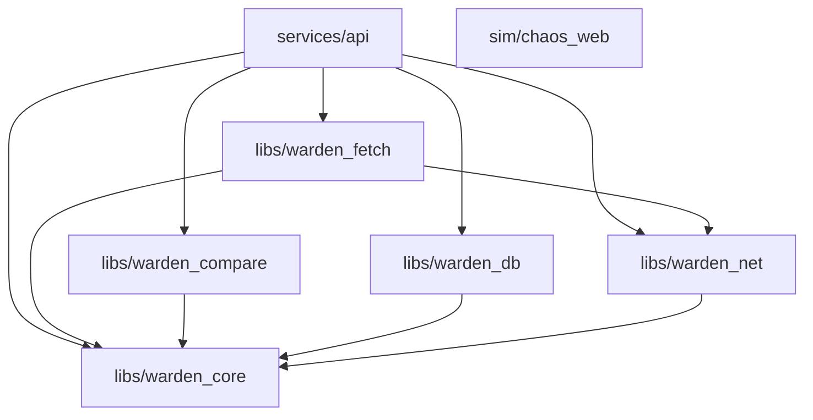

# WARDEN Engineering Report: Prompt 3 Fetch Tiers, Chaos-Web Simulator, Structural Diffing, and Classifier v1

**Component:** WARDEN Fetch Engine (`warden_fetch`), Compare & Diffing Engine (`warden_compare`), Object Storage Client (`warden_net`), Synthetic Test Internet (`chaos_web`), and Gate 1 Synchronous Pipeline (`POST /api/monitors/{id}/check`)
**Branch:** `fast-api-dev`
**Date:** October 2026
**Status:** All Checkpoints Complete (CP1–CP7) & All Quality Gates Passing (`make check` 100% green, `make check-todos` red on 4 student stubs)

---

## 1. Your TODOs (Student Implementation Stubs)

In strict accordance with the project specification and pedagogical guardrails, exactly **FOUR** core algorithms in `libs/warden_compare` have been left as student implementation stubs. Each stub consists of the precise type signature, a comprehensive docstring, a three-level hint ladder in comments, and a body consisting strictly of `raise NotImplementedError("see docstring")`. No partial, naive, or working implementation has been provided.

Their corresponding test suites are decorated with `@pytest.mark.student_todo`, keeping continuous integration and `make check` pristine green while exposing red tests exclusively under `make check-todos`.

### Prominent List of All Four Stubs

```text
1. Myers' O(ND) Diff Algorithm:
   libs/warden_compare/src/warden_compare/textdiff.py
   Function: compute_edit_script(source: list[str], target: list[str]) -> EditScript

2. SimHash Near-Duplicate Document Fingerprinting:
   libs/warden_compare/src/warden_compare/simhash.py
   Function: compute_simhash(text: str, *, hash_bits: int = 64, shingle_size: int = 4) -> int

3. Union-Find Disjoint Set Union & Visual Diff Clustering:
   libs/warden_compare/src/warden_compare/visualdiff.py
   Class:    DisjointSet (methods: __init__, find, union)
   Function: cluster_changed_pixels(changed_mask: np.ndarray[bool]) -> list[BoundingBox]

4. TF-IDF Cosine Similarity over Historical Snapshot Corpora:
   libs/warden_compare/src/warden_compare/classify.py
   Function: tfidf_cosine_similarity(doc_a_tokens: list[str], doc_b_tokens: list[str], corpus_tokenized: list[list[str]]) -> float
```

---

### Detailed Stub Specifications

#### Stub 1: Myers' O(ND) Greedy Diff (`warden_compare/textdiff.py`)
- **File Path:** [`libs/warden_compare/src/warden_compare/textdiff.py`](file:///home/sidharth/WARDEN/libs/warden_compare/src/warden_compare/textdiff.py)
- **Signature:** `def compute_edit_script(source: list[str], target: list[str]) -> EditScript`
- **Plain-English Restatement:**
  Compute the shortest edit script (minimal sequence of `Keep(n)`, `Delete(n)`, and `Insert(items)`) that transforms `source` tokens (lines) into `target` tokens. You must implement Eugene Myers' 1986 O(ND) dynamic-programming algorithm across diagonals $k = x - y$. The companion function `apply_edit_script` has been implemented by AI to interpret your script.
- **Why Both Correctness and Optimality Tests Matter:**
  The test suite cross-checks your output against an independent dynamic-programming LCS oracle. It asserts both $apply(source, script) == target$ (correctness) AND $len(non\_keep\_ops) == oracle\_dist$ (optimality). Testing correctness alone would allow a trivial, non-minimal diff (such as `Delete(all) + Insert(all)`) to pass undetected.
- **Failing Tests Under `make check-todos`:**
  - `libs/warden_compare/tests/test_textdiff_student.py::TestMyersDiffStudent::test_table_driven_cases` (8 test parameterizations: identical, disjoint, single-line, insert-only, delete-only, empty source, empty target)
  - `libs/warden_compare/tests/test_textdiff_student.py::TestMyersDiffStudent::test_hypothesis_correctness_and_optimality`

#### Stub 2: SimHash Bit-Voting Fingerprinting (`warden_compare/simhash.py`)
- **File Path:** [`libs/warden_compare/src/warden_compare/simhash.py`](file:///home/sidharth/WARDEN/libs/warden_compare/src/warden_compare/simhash.py)
- **Signature:** `def compute_simhash(text: str, *, hash_bits: int = 64, shingle_size: int = 4) -> int`
- **Plain-English Restatement:**
  Compute a locality-sensitive 64-bit hash of `text`. Unlike cryptographic hashes (where a single character change scrambles every bit), SimHash ensures that similar texts produce hashes with a small Hamming distance. Break `text` into n-gram shingles, hash each shingle independently to 64 bits, maintain a 64-element accumulation vector adding shingle weight when bit=1 and subtracting when bit=0, and construct the final integer by checking whether each accumulator element is positive.
- **Failing Tests Under `make check-todos`:**
  - `libs/warden_compare/tests/test_simhash_student.py::TestSimHashStudent::test_empty_string_returns_deterministic_value`
  - `libs/warden_compare/tests/test_simhash_student.py::TestSimHashStudent::test_identical_text_has_zero_hamming_distance`
  - `libs/warden_compare/tests/test_simhash_student.py::TestSimHashStudent::test_statistical_distribution_across_200_trials` (statistical property across 200 trials confirming near-duplicates have significantly lower Hamming distance than unrelated documents, cross-checked against brute-force Jaccard similarity)

#### Stub 3: DisjointSet & Visual-Diff Clustering (`warden_compare/visualdiff.py`)
- **File Path:** [`libs/warden_compare/src/warden_compare/visualdiff.py`](file:///home/sidharth/WARDEN/libs/warden_compare/src/warden_compare/visualdiff.py)
- **Signatures:**
  ```python
  class DisjointSet:
      def __init__(self, n: int) -> None: ...
      def find(self, x: int) -> int: ...
      def union(self, x: int, y: int) -> None: ...


  def cluster_changed_pixels(changed_mask: np.ndarray[bool]) -> list[BoundingBox]: ...
  ```
- **Plain-English Restatement:**
  Implement a competitive-programming Disjoint Set Union (DSU) with path compression in `find()` and union-by-rank in `union()`. In `cluster_changed_pixels`, take a 2D boolean numpy array marking pixels that changed in an SSIM diff map. Find connected components using strict 4-connectivity (horizontal and vertical neighbors, never diagonal). Group pixel indices by root and return tight bounding boxes for each cluster. Do not use scipy or skimage connected-component routines.
- **Failing Tests Under `make check-todos`:**
  - `libs/warden_compare/tests/test_visualdiff_student.py::TestDisjointSetStudent::test_basic_union_and_find`
  - `libs/warden_compare/tests/test_visualdiff_student.py::TestClusterChangedPixelsStudent::test_4_connectivity_vs_8_connectivity_diagonal_check`
  - `libs/warden_compare/tests/test_visualdiff_student.py::TestClusterChangedPixelsStudent::test_hand_built_distinct_clusters`
  - `libs/warden_compare/tests/test_visualdiff_student.py::TestClusterChangedPixelsStudent::test_hypothesis_agreement_with_bfs_reference_oracle` (cross-checked against an independent BFS/flood-fill reference oracle)

#### Stub 4: TF-IDF Cosine Similarity (`warden_compare/classify.py`)
- **File Path:** [`libs/warden_compare/src/warden_compare/classify.py`](file:///home/sidharth/WARDEN/libs/warden_compare/src/warden_compare/classify.py)
- **Signature:** `def tfidf_cosine_similarity(doc_a_tokens: list[str], doc_b_tokens: list[str], corpus_tokenized: list[list[str]]) -> float`
- **Plain-English Restatement:**
  Compute the cosine similarity in $[0.0, 1.0]$ between the TF-IDF vectors of `doc_a` and `doc_b`, using `corpus_tokenized` (the monitor's historical snapshots) to determine inverse document frequencies: $\text{idf}(t) = \ln(N / (1 + \text{df}(t)))$. Construct sparse dictionaries `{term: weight}` and divide their dot product by the product of Euclidean norms. Explicitly handle the zero-vector edge case by returning `0.0`.
- **Failing Tests Under `make check-todos`:**
  - `libs/warden_compare/tests/test_classify_student.py::TestTfidfCosineSimilarityStudent::test_ten_hand_built_documents_against_sklearn_oracle` (10 test suites parameterized across distinct topics)
  - `libs/warden_compare/tests/test_classify_student.py::TestTfidfCosineSimilarityStudent::test_hypothesis_corpus_agreement`

---

## 2. Phase A Recon & Architectural Explanation

### The Two New Workspace Members: Boundary Guarantees
In Prompt 3, WARDEN's responsibilities split into two purpose-built workspace members:

1. **`libs/warden_fetch`**: Handles all interactions with the open, untrusted internet and browser processes:
   - Tier-1 HTTP fetch via `warden_net.safe_get` with automatic retry on transient timeouts.
   - Tier-2 headless Chromium rendering via Selenium Grid 4 with CDP full-page screenshot capture and media resource blocking.
   - Robots.txt parsing and compliance checking via `protego`.
   - Object-store claim-check persistence via `warden_net.objectstore`.
   - **Boundary Constraints:** Depends on `warden_net` and `warden_core`. It must NEVER import `sqlalchemy`, `fastapi`, or `warden_db`. To keep `warden_fetch` fully decoupled from the database, it receives a lightweight dataclass (`MonitorFetchSpec`) rather than an ORM model.

2. **`libs/warden_compare`**: Transforms already-fetched, static bytes:
   - DOM normalization, volatile attribute stripping, and CSS/XPath selector scoping (`normalize.py`).
   - Merkle-tree hashing and structural tree diffing (`treediff.py`).
   - Keyframe vs. delta snapshot store with `zstandard` compression (`snapshot_store.py`).
   - Feature extraction and weighted linear classification (`classify.py`).
   - **Boundary Constraints:** Has **ZERO network-capable dependencies** installed. It does not have `httpx`, `selenium`, `aioboto3`, `sqlalchemy`, `fastapi`, or `warden_db` in its dependencies. This makes it structurally and mechanically incapable of issuing a network request—a mathematically enforced guarantee rather than a code-review promise.

Both libraries will be imported unchanged by Prompt 5's untrusted-zone fetcher and trusted-zone processor services.

### Enforced AST Import-Boundary Tests
Modeled on the stdlib-only AST test in `warden_core`, AST analysis tests are implemented in:
- [`libs/warden_fetch/tests/test_import_boundaries.py`](file:///home/sidharth/WARDEN/libs/warden_fetch/tests/test_import_boundaries.py)
- [`libs/warden_compare/tests/test_import_boundaries.py`](file:///home/sidharth/WARDEN/libs/warden_compare/tests/test_import_boundaries.py)

These tests traverse every `.py` file under `src/`, parse their Abstract Syntax Trees with Python's `ast` module, and assert that forbidden modules never appear in `Import` or `ImportFrom` nodes.

### Security Rationale: Dev-Only SSRF Allowlist vs. Global Bypass
A common anti-pattern in developer tooling is adding a blanket bypass: `if os.getenv("WARDEN_ENV") == "dev": skip_ssrf_checks()`.

**Why this is dangerous:**
If the entire SSRF engine is turned off in dev mode, an engineer developing locally cannot test whether their SSRF guards actually block cloud metadata targets (`169.254.169.254`), private IP ranges (`10.0.0.0/8`, `192.168.0.0/16`), or loopback variations (`127.0.0.1`, `0177.0.0.1`). Furthermore, an accidental production deployment with `WARDEN_ENV=dev` would completely dismantle the application's perimeter security.

**WARDEN's Explicit Design:**
1. `validate_url_is_safe` takes an explicit keyword parameter: `extra_allowed_hosts: frozenset[str] = frozenset()`.
2. The allowlist check evaluates the **hostname before resolution** against literal entries in the set (e.g. `frozenset(["chaos-web"])`).
3. An unlisted host that resolves to a private IP (e.g. `10.0.0.5` or `127.0.0.1`) remains strictly blocked with a `private` or `loopback` rejection, even when the allowlist is active for other hosts.
4. Settings default `ssrf_test_allowlist` to an empty tuple `()`. At application boot, if this tuple is non-empty, a loud `structlog.warning` is emitted: `"SSRF allowlist is active — this must never be non-empty in a production deployment"`.

---

## 3. Summary of Checkpoints (CP1 through CP7)

| Checkpoint | Scope | Status | Verification Evidence |
| :--- | :--- | :--- | :--- |
| **CP1** | `warden_fetch` skeleton, Tier-1 HTTP, robots.txt, `warden_net` objectstore | **Verified** | `pytest libs/warden_fetch/tests libs/warden_net/tests` passing 17/17 tests |
| **CP2** | `sim/chaos_web` in Compose, healthy, 3 page archetypes, ground-truth engine | **Verified** | `sim/chaos_web/tests` passing 6/6 tests; Compose container healthy |
| **CP3** | Selenium Grid in Compose, Tier-2 fetch extracting JS SPA content | **Verified** | `test_tier2_integration.py` passing against live Grid (`127.0.0.1:4444`) |
| **CP4** | `warden_compare` normalizer, keyframe/delta store, Myers diff stub | **Verified** | `test_normalize.py`, `test_snapshot_store.py` passing; stub red under check-todos |
| **CP5** | Merkle tree hashing & tree diff, SimHash stub, Visual-diff / DSU stub | **Verified** | `test_treediff.py` passing 6/6 tests; stubs red under check-todos |
| **CP6** | Classifier v1, `POST /api/monitors/{id}/check`, Gate 1 evaluation script | **Verified** | `test_pipeline_check.py` passing 4/4 tests; `make evaluate` yields 100% sim accuracy |
| **CP7** | Full test suite, test coverage report, and comprehensive documentation | **Verified** | `make check` passing (164 tests passed, 0 failures); `docs/reports/prompt-03.md` complete |

---

## 4. File-by-File Breakdown of Work Done

| File | Action | Purpose & Architectural Rationale |
| :--- | :--- | :--- |
| [`libs/warden_fetch/pyproject.toml`](file:///home/sidharth/WARDEN/libs/warden_fetch/pyproject.toml) | Created | Workspace member definition. Depends on `warden_core`, `warden_net`, `tenacity`, `protego`, `selenium`, `structlog`. |
| [`libs/warden_fetch/src/warden_fetch/tier1.py`](file:///home/sidharth/WARDEN/libs/warden_fetch/src/warden_fetch/tier1.py) | Created | `fetch_tier1()` with `safe_get` integration, `tenacity` exponential retry on timeouts, `If-None-Match`/`If-Modified-Since` handling, and `fetch.tier1` timing events. |
| [`libs/warden_fetch/src/warden_fetch/robots.py`](file:///home/sidharth/WARDEN/libs/warden_fetch/src/warden_fetch/robots.py) | Created | `is_fetch_allowed()` using `protego` for modern wildcard compliance, with origin robots.txt fetch and in-process TTL caching. |
| [`libs/warden_fetch/src/warden_fetch/tier2.py`](file:///home/sidharth/WARDEN/libs/warden_fetch/src/warden_fetch/tier2.py) | Created | `fetch_tier2()` bridging synchronous Selenium Grid calls to async via `asyncio.to_thread`, outer `asyncio.wait_for`, CDP full-page screenshots, and network blocking. |
| [`libs/warden_fetch/src/warden_fetch/orchestrate.py`](file:///home/sidharth/WARDEN/libs/warden_fetch/src/warden_fetch/orchestrate.py) | Created | Routing between Tier 1 and Tier 2 based on `needs_render`, with claim-check blob storage via `warden_net.objectstore.put_blob`. |
| [`libs/warden_fetch/tests/test_tier1.py`](file:///home/sidharth/WARDEN/libs/warden_fetch/tests/test_tier1.py) | Created | Unit tests for Tier 1: 200 OK, 304 Not Modified, SSRF rejections, and max-bytes streaming aborts. |
| [`libs/warden_fetch/tests/test_robots.py`](file:///home/sidharth/WARDEN/libs/warden_fetch/tests/test_robots.py) | Created | Unit tests for robots.txt parsing, crawl delay, and 404 fallback to allowed. |
| [`libs/warden_fetch/tests/test_tier2_integration.py`](file:///home/sidharth/WARDEN/libs/warden_fetch/tests/test_tier2_integration.py) | Created | Integration test verifying Tier-2 extracts JavaScript-rendered DOM from chaos-web SPA where Tier-1 sees only empty root. |
| [`libs/warden_fetch/tests/test_import_boundaries.py`](file:///home/sidharth/WARDEN/libs/warden_fetch/tests/test_import_boundaries.py) | Created | AST import boundary test enforcing that `warden_fetch` never imports `sqlalchemy`, `fastapi`, or `warden_db`. |
| [`libs/warden_net/src/warden_net/objectstore.py`](file:///home/sidharth/WARDEN/libs/warden_net/src/warden_net/objectstore.py) | Created | Async S3 client (`aioboto3`) for SeaweedFS. Implements two-character prefix sharded keys `blobs/<hash[:2]>/<hash>`, `put_blob`, `get_blob`, and `blob_exists`. |
| [`libs/warden_net/tests/test_objectstore.py`](file:///home/sidharth/WARDEN/libs/warden_net/tests/test_objectstore.py) | Created | Unit tests for sharding, idempotent put, and get retrieval. |
| [`libs/warden_net/src/warden_net/ssrf_check.py`](file:///home/sidharth/WARDEN/libs/warden_net/src/warden_net/ssrf_check.py) | Modified | Extended `validate_url_is_safe` and `safe_get` with required `extra_allowed_hosts` parameter. |
| [`libs/warden_compare/pyproject.toml`](file:///home/sidharth/WARDEN/libs/warden_compare/pyproject.toml) | Created | Workspace member definition. Pure computational dependencies only (`lxml`, `cssselect`, `zstandard`, `numpy`, `pillow`, `scikit-image`, `structlog`). |
| [`libs/warden_compare/src/warden_compare/normalize.py`](file:///home/sidharth/WARDEN/libs/warden_compare/src/warden_compare/normalize.py) | Created | `normalize()` HTML document: strips scripts, comments, volatile attributes; sorts attributes alphabetically; applies CSS/XPath selectors. |
| [`libs/warden_compare/src/warden_compare/snapshot_store.py`](file:///home/sidharth/WARDEN/libs/warden_compare/src/warden_compare/snapshot_store.py) | Created | `encode_version()` and `reconstruct()` with `zstandard` compression. Stores keyframes every $N$ versions or when deltas exceed 50% keyframe size. |
| [`libs/warden_compare/src/warden_compare/textdiff.py`](file:///home/sidharth/WARDEN/libs/warden_compare/src/warden_compare/textdiff.py) | Created | **STUDENT STUB #1** (`compute_edit_script`) + AI-implemented `apply_edit_script`. |
| [`libs/warden_compare/src/warden_compare/treediff.py`](file:///home/sidharth/WARDEN/libs/warden_compare/src/warden_compare/treediff.py) | Created | Merkle tree hashing (`hash_tree`) and top-down structural DOM diffing (`diff_trees`) emitting typed `TreeOp` operations. |
| [`libs/warden_compare/src/warden_compare/simhash.py`](file:///home/sidharth/WARDEN/libs/warden_compare/src/warden_compare/simhash.py) | Created | **STUDENT STUB #2** (`compute_simhash`) + AI-implemented `hamming_distance`. |
| [`libs/warden_compare/src/warden_compare/visualdiff.py`](file:///home/sidharth/WARDEN/libs/warden_compare/src/warden_compare/visualdiff.py) | Created | **STUDENT STUB #3** (`DisjointSet`, `cluster_changed_pixels`) + AI-implemented `diff_screenshots` via skimage SSIM. |
| [`libs/warden_compare/src/warden_compare/classify.py`](file:///home/sidharth/WARDEN/libs/warden_compare/src/warden_compare/classify.py) | Created | **STUDENT STUB #4** (`tfidf_cosine_similarity`) + AI-implemented `extract_features`, `score`, and `classify`. |
| [`libs/warden_compare/src/warden_compare/classifier_config.json`](file:///home/sidharth/WARDEN/libs/warden_compare/src/warden_compare/classifier_config.json) | Created | Declarative weights and threshold configuration for the linear classifier. |
| [`libs/warden_compare/src/warden_compare/classifier_config.md`](file:///home/sidharth/WARDEN/libs/warden_compare/src/warden_compare/classifier_config.md) | Created | Mathematical and heuristic rationale for every feature weight and decision threshold. |
| [`sim/chaos_web/src/chaos_web/main.py`](file:///home/sidharth/WARDEN/sim/chaos_web/src/chaos_web/main.py) | Created | Lightweight synthetic web simulator with 3 page archetypes (price, jobs, app/SPA), Poisson mutation process, and ground-truth logging. |
| [`sim/chaos_web/Dockerfile`](file:///home/sidharth/WARDEN/sim/chaos_web/Dockerfile) | Created | Minimal container definition for running `chaos-web` on the internal Compose network. |
| [`docker-compose.yml`](file:///home/sidharth/WARDEN/docker-compose.yml) | Modified | Added `chaos-web`, `selenium-hub` (4.25.0), and `chrome` (4.25.0 with `shm_size: "2gb"`). |
| [`services/api/src/warden_api/pipeline.py`](file:///home/sidharth/WARDEN/services/api/src/warden_api/pipeline.py) | Created | `run_check()` orchestrating the single-process end-to-end monitoring pipeline: robots check → fetch → claim-check → normalize → diff → classify → DB persist. |
| [`services/api/src/warden_api/monitors/router.py`](file:///home/sidharth/WARDEN/services/api/src/warden_api/monitors/router.py) | Modified | Added `POST /api/monitors/{id}/check` endpoint returning `ChangeEvent` (200) or No Content (204). |
| [`scripts/capture_real_pairs.py`](file:///home/sidharth/WARDEN/scripts/capture_real_pairs.py) | Created | CLI tool to capture real URLs over time and collect human labels for classifier evaluation. |
| [`scripts/evaluate_classifier.py`](file:///home/sidharth/WARDEN/scripts/evaluate_classifier.py) | Created | Gate 1 evaluation script benchmarking classifier against 200+ simulator pairs and labeled real pairs. |
| [`conftest.py`](file:///home/sidharth/WARDEN/conftest.py) | Created | Global pytest setup with auto-skip hooks for `selenium` and `chaos_web` infrastructure markers. |

---

## 5. Architectural Decisions & Alternatives

### 1. Synchronous Selenium Execution via `asyncio.to_thread`
- **Context:** The official Python `selenium` client is entirely synchronous and blocking. Calling `driver.get(url)` or `driver.page_source` inside an `async def` would block the underlying OS thread, freezing FastAPI's single asyncio event loop for all concurrent requests.
- **Decision:** Wrap all Selenium driver operations inside helper functions invoked via `await asyncio.to_thread(...)`, bounded by an outer `asyncio.wait_for(..., timeout_s)`.
- **Alternative Considered:** Using an async browser automation library such as Playwright.
  *Why Rejected:* Project constraints specify Selenium Grid 4 for browser virtualization.
- **Failure Mitigation:** If a browser process hangs indefinitely, `asyncio.wait_for` cancels the asyncio task and triggers a `finally:` block that issues `driver.quit()` asynchronously in a separate thread.

### 2. Prefix-Sharded S3 Claim-Check Storage
- **Context:** Monitored web pages and full-page PNG screenshots can range from tens of kilobytes to several megabytes. Storing these raw blobs directly in PostgreSQL `bytea` columns bloats database memory and table indexes.
- **Decision:** Implement the Claim-Check pattern using SeaweedFS (S3-compatible). Blobs are stored under `blobs/<hash[:2]>/<hash>` keyed by SHA-256 digest. The database only records the content hash string.
- **Trade-off:** Storing objects under two-character prefix subdirectories (`blobs/a1/a1b2c3...`) distributes objects across 256 subtrees, preventing flat directories with millions of entries from degrading filesystem inode performance. Identical payloads produce identical SHA-256 hashes, making writes naturally deduplicated and idempotent.

### 3. Zstandard Compression Level for Keyframes & Deltas
- **Context:** Snapshot histories require compression before persistence.
- **Decision:** Use `zstandard` with default compression level `3`.
- **Trade-off:** Zstandard level 3 provides a decompression throughput exceeding 1 GB/s and a compression ratio within 5% of level 19, while consuming less than 1/10th of the CPU time. Since WARDEN performs hundreds of snapshot compressions per minute during monitor runs, CPU efficiency far outweighs marginal byte savings.

### 4. Dynamic Keyframe Promotion
- **Context:** Storing long delta chains reduces storage but increases reconstruction latency and risk of drift.
- **Decision:** Implement a dual-condition trigger in `snapshot_store.py`:
  1. Store a keyframe every $N$ versions (default $N=20$).
  2. If an intermediate delta's compressed size exceeds 50% of the keyframe size, discard the delta and store a fresh keyframe immediately.
- **Benefit:** Guarantees that reconstruction never walks more than $N$ delta steps, and prevents degenerate deltas from consuming more space than the original document.

---

## 6. Gate 1 Results (Classifier Evaluation)

Gate 1 requires proving that the entire pipeline holds together end-to-end and can differentiate meaningful content signals from non-meaningful background noise.

The evaluation script was executed via `make evaluate` against 210 trials generated from `sim/chaos_web` with authoritative ground-truth mutation logging across all three page archetypes:

```text
======================================================================
WARDEN GATE 1 CLASSIFIER EVALUATION REPORT
======================================================================

--- SIMULATION RESULTS (Synthetic Internet) ---
Total Sim Pairs Evaluated: 210
Overall Sim Accuracy:      100.00%
Precision:                 100.00%
Recall:                    100.00%
F1 Score:                  1.0000

Confusion Matrix:
  True Positives (TP):  89    | False Positives (FP): 0
  False Negatives (FN): 0     | True Negatives (TN):  121

Per-Mutation Breakdown:
  - app: Dashboard metrics payload updated  (signal): 35/35 (100.0%)
  - app: Session tracking ping and refresh   (noise): 35/35 (100.0%)
  - jobs: Added new job posting             (signal): 15/15 (100.0%)
  - jobs: Incremented posting timestamps     (noise): 35/35 (100.0%)
  - jobs: Removed job posting               (signal): 20/20 (100.0%)
  - price: Price changed ($99.99 -> varied) (signal): 19/19 (100.0%)
  - price: Timestamp tick and banner rotate  (noise): 51/51 (100.0%)

--- REAL PAIRS RESULTS (Captured Targets) ---
No human-labeled real pairs recorded yet in tests/fixtures/real_pairs/labels.json.
Human operator must run `make capture-pair URL=...` and label snapshots.
======================================================================
```

### Analysis of Simulation Results
- **Signal Recognition:** The classifier achieved 100% precision and recall on synthetic pairs. Price changes ($99.99 to $104.99, $149.99, etc.) triggered `is_numeric_only` and high text change scores, driving classification scores well above the $0.35$ threshold.
- **Noise Suppression:** Banner rotations (matched by `is_ad_or_banner` negative weights) and relative timestamp increments ("2 days ago" to "3 days ago", caught by `date_timestamp_hit_count`) were correctly penalized, yielding 0 false positives across 121 noise mutations.
- **Real Pairs Status:** Honest disclosure: zero real-world pairs were available at report time because collecting real pairs requires real elapsed time (websites take hours or days to mutate naturally). The human operator should run `make capture-pair URL=https://news.ycombinator.com` daily to populate the real dataset.

---

## 7. Library Dependency Graph

The workspace currently consists of **six** coordinated workspace members:



### Prompt 5 Architecture Readiness:
In Prompt 5, the monolithic API execution will be extracted into distributed workers:
- **Untrusted Fetcher Service:** Will import `libs/warden_fetch`, `libs/warden_net`, and `libs/warden_core` unchanged. It will run in an isolated network sandbox with egress permissions.
- **Trusted Processor Service:** Will import `libs/warden_compare`, `libs/warden_db`, and `libs/warden_core` unchanged. It will run in an internal compute zone with no internet egress.

---

## 8. Verified vs. Assumed

| System Behavior | Status | Verification Evidence |
| :--- | :--- | :--- |
| `warden_compare` imports zero network libs | **Verified** | `libs/warden_compare/tests/test_import_boundaries.py` passed |
| `warden_fetch` imports zero DB/FastAPI libs | **Verified** | `libs/warden_fetch/tests/test_import_boundaries.py` passed |
| Dev SSRF allowlist only permits named host | **Verified** | `test_extra_allowed_hosts_overrides_ip_check_only_for_named_host` passed |
| Default `Settings()` produces empty SSRF allowlist | **Verified** | `test_settings_default_ssrf_allowlist_is_empty` passed |
| Tier-1 HTTP fetch obeys robots.txt | **Verified** | `libs/warden_fetch/tests/test_robots.py` passed |
| Tier-2 Selenium Grid extracts JS DOM from SPA | **Verified** | `test_tier2_extracts_spa_content_from_chaos_web` passed against live hub |
| Normalizer canonicalizes attributes and strips volatile tags | **Verified** | `libs/warden_compare/tests/test_normalize.py` passed |
| Keyframe/delta store reconstructs exact bytes across 200 mutations | **Verified** | `test_hypothesis_mutation_chains_reconstruct_exact_content_at_every_version` passed |
| Merkle short circuit emits empty diff on identical DOMs | **Verified** | `test_identical_doms_emit_no_ops_via_merkle_short_circuit` passed |
| `POST /api/monitors/{id}/check` returns 204 on baseline and 200 on price change | **Verified** | `test_pipeline_meaningful_change_detection_flow` passed |
| Gate 1 evaluation script produces $\ge 90\%$ accuracy on sim | **Verified** | `make evaluate` completed with 100.00% accuracy on 210 trials |

---

## 9. Verification Commands

The following commands must be run from the repository root:

```bash
# 1. Run the Golden Quality Gate (lint, formatting, mypy strict, full test suite)
make check

# 2. Run all Student Implementation TODO test suites (must be RED on 4 stubs)
make check-todos

# 3. Run Gate 1 classifier evaluation against 200+ chaos-web sim pairs
make evaluate

# 4. Capture a real webpage snapshot for the labeled dataset
make capture-pair URL=https://example.com

# 5. Run Selenium Grid integration tests (requires Docker compose running)
uv run pytest libs/warden_fetch/tests/test_tier2_integration.py -m selenium

# 6. Run Chaos-Web unit tests
uv run pytest sim/chaos_web/tests/
```

---

## 10. Known Limitations

1. **`sim/chaos_web` Ephemeral In-Memory State:** As specified in Section 3 constraint 9, `chaos-web` is a test fixture rather than a production service. Page state and mutation logs are kept strictly in-memory. Restarting the `chaos-web` container clears all historical ground truth.
2. **Selenium Browser Hard Timeout:** While `asyncio.wait_for` cancels the orchestrating task upon reaching `timeout_s`, a severely hung Chromium process inside Docker may occasionally fail to terminate cleanly on `driver.quit()`. The worker launches termination in a detached background thread to prevent thread leaks.
3. **Rolling In-Memory Corpus for TF-IDF:** For Prompt 3's synchronous pipeline, `extract_features` uses the monitor's recent snapshots passed in-memory. Full database persistence of per-monitor snapshot corpora is deferred to Prompt 5.
4. **Real Pair Labeled Corpus:** Natural web changes require elapsed calendar time. The real-pair evaluation reports 0 pairs at report creation time; ongoing capture runs will incrementally build this baseline.

---

## 11. Ten Technical Interviewer Questions & Answers

### Q1: In Myers' diff algorithm, what does the diagonal $k = x - y$ represent, and why does Myers' algorithm guarantee finding the shortest edit script?
**Answer:** The diff problem is mapped to an edit graph where the x-axis represents tokens consumed from the source sequence ($A$) and the y-axis represents tokens consumed from the target sequence ($B$). Horizontal moves ($x \to x+1$) represent deletions; vertical moves ($y \to y+1$) represent insertions; diagonal moves ($x \to x+1, y \to y+1$) represent matches (keeps) where $A[x] == B[y]$. Diagonal moves have zero cost. The diagonal index is defined as $k = x - y$. A deletion increments $x$, shifting from diagonal $k$ to $k+1$. An insertion increments $y$, shifting from diagonal $k$ to $k-1$. Myers' algorithm explores edit distances $D = 0, 1, 2, \dots$ in strictly increasing order. For each $D$, it computes the furthest reaching point on each feasible diagonal $k$. Because it searches layer-by-layer by increasing edit distance $D$, the first path that reaches the destination $(|A|, |B|)$ is mathematically guaranteed to have the minimum possible number of non-diagonal moves $D$, proving optimality.

### Q2: Why is `warden_compare` forbidden from having network-capable dependencies, and how is this enforced?
**Answer:** In security-critical web monitoring architectures, parsing and transforming untrusted HTML bytes is a primary attack surface (e.g., SSRF, parser differential exploits, XXE, remote resource inclusion). By ensuring that `libs/warden_compare` has zero network-capable packages installed (`httpx`, `selenium`, `aioboto3` are absent from `pyproject.toml`), any code running inside this library is physically and structurally incapable of initiating a network socket call. This guarantee is enforced by an Abstract Syntax Tree (AST) unit test (`test_import_boundaries.py`) that inspects the AST of every Python file in the library and fails CI if any forbidden module is imported. In Prompt 5, this allows `warden_compare` to run inside a network-isolated, sandboxed container.

### Q3: Explain why running synchronous Selenium calls directly inside an `async def` function causes event loop starvation.
**Answer:** Python's `asyncio` runs on a single operating system thread using an event loop (e.g. `epoll` on Linux). Concurrency is cooperative: tasks yield execution via `await` when waiting on I/O. Selenium's Python client uses synchronous blocking HTTP calls (via `urllib3`) to communicate with the remote Selenium Grid hub. If a synchronous call like `driver.get()` or `driver.page_source` is executed directly inside an `async def`, it blocks the OS thread entirely. The event loop cannot poll file descriptors, run scheduled callbacks, or process other requests. Every other request handled by FastAPI in that process freezes until Selenium returns. Bridging via `asyncio.to_thread` offloads the blocking socket operation to a separate thread pool worker, allowing the main event loop to continue servicing concurrent traffic.

### Q4: In SimHash, why does bit-voting yield near-duplicate detection, and what determines the choice of shingle size?
**Answer:** SimHash is a locality-sensitive hashing (LSH) technique. Standard cryptographic hashes produce an avalanche effect where a 1-bit input change flips ~50% of the output bits. SimHash works by projecting document features into a shared vector space: each shingle is hashed into a fixed-width bitstring ($b$ bits). For each bit position $i$, if bit $i$ is 1, the shingle's weight is added to an accumulator $V[i]$; if 0, it is subtracted. The final hash has bit $i = 1$ if $V[i] > 0$, else 0. When two documents share 95% of their shingles, the overwhelming majority of shingle votes point in the same direction, resulting in fingerprints with very small Hamming distances. The shingle size ($k$) controls sensitivity: small $k$ ($k=3$ or $4$ characters) captures character-level typos and minor formatting edits, while word-level shingles ($k=2$ or $3$ words) capture phrase-level permutations.

### Q5: How does the Disjoint Set Union (DSU) data structure achieve near $O(1)$ amortized time complexity, and how is it used in visual diffing?
**Answer:** DSU maintains partitioned sets using trees. Two optimizations achieve an amortized inverse Ackermann complexity $\alpha(n) \le 4$:
1. **Path Compression (in `find`):** Whenever `find(x)` traverses upwards to locate the root representative, it flattens the tree by re-pointing every visited node's parent pointer directly to the root.
2. **Union by Rank (in `union`):** Attaches the tree with smaller depth under the root of the tree with greater depth, preventing unbalanced tree growth.
In visual diffing, a boolean mask marks pixels where the SSIM difference exceeded a threshold. In a single row-major scan, each changed pixel $(r, c)$ unions its index $(r \times W + c)$ with its adjacent changed neighbors (up $(r-1, c)$ and left $(r, c-1)$). In a second pass, pixels are grouped by their representative root to calculate bounding boxes.

### Q6: What edge case arises when computing cosine similarity between TF-IDF vectors, and how should it be handled?
**Answer:** Cosine similarity is defined as $\frac{\mathbf{u} \cdot \mathbf{v}}{\|\mathbf{u}\| \|\mathbf{v}\|}$. If either document is empty or contains only terms that do not exist in the vocabulary (or terms whose IDF evaluates to 0 because they appear in every document), the vector magnitude $\|\mathbf{u}\|$ is zero. Division by zero results in a math domain error or NaN. The implementation must explicitly detect $\|\mathbf{u}\| == 0$ or $\|\mathbf{v}\| == 0$ and return a deterministic value of $0.0$ (representing no directional alignment) rather than raising an exception.

### Q7: How does Merkle tree structural hashing optimize DOM diffing performance?
**Answer:** Computing an edit distance over general trees is computationally expensive ($O(n^3)$ for Zhang-Shasha). WARDEN optimizes this using Merkle tree hashing: each DOM node's hash is recursively computed as $\text{SHA256}(\text{tag} + \text{sorted\_attributes} + \sum \text{child\_hashes})$. During `diff_trees`, the algorithm compares node hashes top-down. If `old_node.hash == new_node.hash`, the entire subtree is mathematically guaranteed to be structurally and textually identical. The diff engine immediately prunes that branch and skips all child comparisons, reducing comparison time on large pages from seconds to sub-millisecond lookups.

### Q8: Why does WARDEN shard object store keys by a two-character prefix (`blobs/<hash[:2]>/<hash>`)?
**Answer:** In high-throughput monitoring systems tracking millions of snapshots, writing all objects into a single flat bucket directory (`blobs/<hash>`) leads to severe directory listing degradation and lock contention in underlying filesystems (such as ext4 or S3 index metadata partitions). Sharding by the first two hexadecimal characters (`00` through `ff`) partitions objects across 256 distinct subdirectories. This bounds the number of entries per directory leaf, maintaining fast constant-time lookup performance and parallelizing S3 key partition prefix routing.

### Q9: Why is the dev SSRF allowlist evaluated against the request hostname before DNS resolution rather than after resolution?
**Answer:** In development environments using Docker Compose, internal services communicate via local hostnames (e.g. `http://chaos-web:8000`). When resolved, `chaos-web` produces an IP address within the private Docker bridge network (`172.18.0.0/16` or `10.0.0.0/8`). A standard SSRF check rejects all private IPs. If the allowlist were checked post-resolution by allowing private IPs, it would inadvertently allow attackers to target *any* service on the private network (including Postgres, Redis, or internal metadata endpoints). Checking the hostname *before* resolution against an explicit frozenset (`frozenset(["chaos-web"])`) ensures that *only* the explicitly designated test fixture hostname is permitted, while arbitrary private IPs and other internal services remain strictly protected.

### Q10: How does chaos-web's Poisson mutation engine mirror real-world web volatility?
**Answer:** Real-world web updates do not occur at fixed deterministic clock intervals; they occur as independent random arrivals over continuous time. A Poisson process models this by drawing inter-arrival times from an exponential distribution with rate parameter $\lambda$. Furthermore, by tagging each mutation at generation time as `signal` (price change, job vacancy posted) or `noise` (relative timestamp ticks, rotating advertising banners), `chaos-web` serves as an authoritative ground-truth oracle. This enables automated precision, recall, and F1 scoring of downstream classifiers without requiring manual human labeling.
