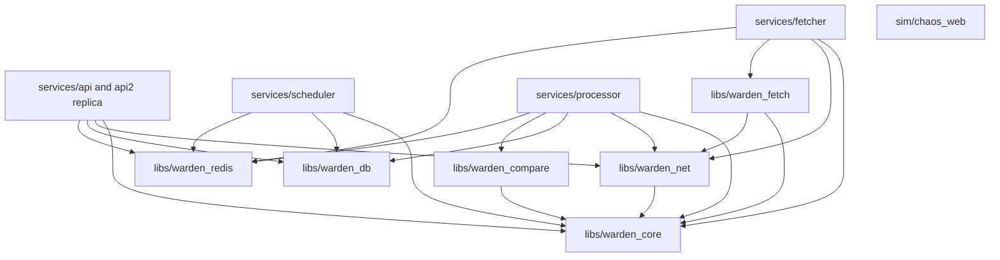

# Prompt 4 — Phase A reconnaissance

## Your TODOs: all nine student stub modules

These are **planned paths**, not implemented files. Every required student entry
point will retain its full typed signature, docstring, three levels of comment
hints, and `raise NotImplementedError("see docstring")`. Companion student tests
will be marked `student_todo`, excluded from `make check`, and selected by
`make check-todos`. A module can contain several related student entry points.

| # | Planned path | Student responsibility |
|---|---|---|
| 1 | `libs/warden_core/src/warden_core/bloomfilter.py` | `BloomFilter` and `CountingBloomFilter`: probabilistic membership, double hashing, sizing, and safe removal of previously added items. |
| 2 | `libs/warden_core/src/warden_core/timingwheel.py` | `TimingWheel`: schedule, cancel, advance, and cascade timers using hierarchical buckets and direct cancellation handles. |
| 3 | `libs/warden_core/src/warden_core/budget.py` | Both `estimate_change_rate` and `solve_crawl_intervals`: infer an interval-censored Poisson rate with a Gamma prior, then allocate bounded crawl intervals under a shared budget. |
| 4 | `libs/warden_core/src/warden_core/hashring.py` | `ConsistentHashRing`: virtual nodes, membership changes, weighted bounded loads, and reported load accounting. |
| 5 | `libs/warden_redis/src/warden_redis/cache.py` | `cache_put` and `cache_get`: namespace-bounded Redis LRU with TTL and atomic recency/eviction updates. |
| 6 | `libs/warden_redis/src/warden_redis/ratelimit.py` | `gcra_allow`: one atomic Lua operation for distributed admission and retry timing. |
| 7 | `libs/warden_redis/src/warden_redis/coordination.py` | Acquire, renew, and release fenced leadership; heartbeat members and list live members with SCAN. |
| 8 | `libs/warden_redis/src/warden_redis/queue.py` | Enqueue, claim, acknowledge, reclaim, schedule retry, and move due retries without permanently losing jobs. |
| 9 | `libs/warden_redis/src/warden_redis/eventlog.py` | Append to a replayable stream, publish live notifications, and replay after a cursor. |

## Scope and workflow

Date: 21 October 2026, Asia/Kolkata. Branch: `fast-api-dev`.

This report completes Phase A only. The supplied prompt says:
“Phase A Recon → STOP, wait for \"go\" → Phase B Build”. No service implementation,
dependency changes, migrations, container changes, or commits have been made.
After `go`, the first build scope is CP1, followed by a stop for `continue`.
Each subsequent checkpoint has the same pause. Phase C follows the authorized
build checkpoints and records actual verification results.

Read `docs/reports/prompt-01.md`, `prompt-02.md`, and `prompt-03.md`, the four
Prompt 3 stub modules, workspace manifests, Makefile, Compose files, database
models, fetch orchestration/robots code, and API pipeline/auth/test wiring.
No applicable `AGENTS.md` was found in the repository or ancestor locations
checked. The `.agents` and `.codex` directories in this workspace are empty.

The initial worktree contains an existing change to
`libs/warden_core/src/warden_core/ssrf.py` (153 insertions, 47 deletions). It has
been left untouched and must not be swept into later task commits.
The active VS Code settings file is unrelated to this task and was not edited.
`.env` was not opened or edited.

## Current repository state

| Area | Observed implementation |
|---|---|
| Workspace | Seven members: `warden_core`, `warden_db`, `warden_net`, `warden_fetch`, `warden_compare`, `api`, and `chaos_web`. |
| Scheduler | `services/scheduler/README.md` only; no runnable package. |
| Fetcher / processor | Their service directories exist but are empty. |
| Redis library / ACL | No `warden_redis`, ACL policy, or ACL bootstrap exists. Compose starts Redis 7 with AOF and unauthenticated health checks. API and migration environment use an unnamed Redis URL. |
| Login limiter | `services/api/src/warden_api/auth/limiter.py` holds process-local failure records; the auth router calls check/record/reset functions. |
| Manual check | `POST /api/monitors/{monitor_id}/check` imports `warden_api.pipeline.run_check`, fetches, compares, commits, and returns 204 or 200 synchronously. |
| Robots | `warden_fetch/robots.py` has a process-local dict with timestamp expiry; no Bloom filter or shared cache. |
| DNS | `warden_net/ssrf_check.py` resolves and checks addresses; no DNS dedup/cache exists. |
| Persistence | `Monitor.next_due_at`, `Snapshot`, `ChangeEvent`, an outbox with unique `idempotency_key`, and request idempotency records exist. No scheduler fencing state or durable worker-job receipt exists. |
| Realtime / proofs | No WebSocket gateway, queue chaos script, hash-ring proof, timing-wheel benchmark, or Numbers ledger file was found. |
| Containers | One API entry bound to `127.0.0.1:18000`; no `api2` or worker entries. Redis is not published on the host by the checked-in override. |

### Prompt 3 student work is still pending

All four groups still explicitly raise `NotImplementedError("see docstring")`:

1. `libs/warden_compare/src/warden_compare/textdiff.py`:
   `compute_edit_script`.
2. `libs/warden_compare/src/warden_compare/simhash.py`:
   `compute_simhash`.
3. `libs/warden_compare/src/warden_compare/visualdiff.py`:
   `DisjointSet.__init__`, `find`, `union`, and `cluster_changed_pixels`.
4. `libs/warden_compare/src/warden_compare/classify.py`:
   `tfidf_cosine_similarity`.

This does not block Prompt 4 scaffolding. The existing classifier has fallback
paths when these functions are unimplemented; passing its ordinary tests does
not establish that the student algorithms work. Prompt 2's Redis denylist also
remains a student stub, and the current JWT dependency explicitly bypasses
denylist checks on `NotImplementedError`. Consequently its authenticated Redis
denylist behavior cannot honestly be reported as passing yet.

## Architecture and library dependency graph

Redis operations belong in one shared library so stream payloads, key names,
ACL expectations, atomicity rules, retry ordering, and replay cursors have one
contract. Independently rebuilding these rules inside four services would
make crash recovery and cross-service compatibility harder to audit. Each
service owns its lifecycle and business orchestration and imports shared
libraries; no service imports another service package.

The fetcher processes hostile remote content and runs browser fetches. Its
image will install only its own dependency closure, with neither `warden_db`
nor SQLAlchemy/asyncpg, and receive no database URL. A startup assertion will
reject a present `WARDEN_DATABASE_URL`, even if its value is empty. Container
inspection will verify both the installed packages and environment without
printing credentials. An import boundary test alone cannot prove package
absence or network isolation. Existing use of the Compose default network is
also not a network firewall; no stronger isolation claim is made here.

Scheduler, processor, and API have different work and failure profiles. The
scheduler holds a fenced lease and tracks due work; the processor consumes
results and commits durable effects; API replicas serve requests and sockets.
Separate processes let a slow browser result, CPU-heavy comparison, scheduler
pause, or API restart be handled without tying all three lifecycles together.
Shared PostgreSQL access does not require sharing a process.

The proposed graph has **11 workspace members**: six libraries, four services,
and the simulator. This is ten application members if `chaos_web` is excluded.
The prompt's “ten workspace members” does not match its requested additions to
the seven members actually declared today. The graph below is planned, not an
assertion about installed packages:

Processor needs object-store reads through `warden_net`; the pure compare
library remains free of service, database, and network-client imports. Current
`warden_db` declares SQLAlchemy, asyncpg, and Alembic and no internal library
dependency; this corrects the older report's assumed `warden_db -> warden_core`
edge. API's fetch/compare dependencies can be removed after extraction and
updating all callers. `api2` is a second instance of the same package.

## Redis ACL design — proposed, not yet configured

The referenced “Step 0” grants are absent from the supplied attachment and
repository. The following is a least-privilege plan to turn into explicit
command/key/channel policies and positive/negative integration tests.

| Identity | Required scope | Reason |
|---|---|---|
| `api` | Its denylist keys; login GCRA buckets; append to a designated ingress jobs stream; read event replay streams and subscribe to event channels. | Serve auth, enqueue checks, and deliver authorized events. It must not claim worker jobs, manage leases, or publish processor events. |
| `scheduler` | Scheduler lease/token keys; read fetcher membership; append routed jobs; scheduler retry keys if it owns retry promotion. | Coordinate leadership and route due jobs without reading auth state. |
| `fetcher` | Its membership heartbeat; fetcher-group membership scan if needed; fetch streams and groups for claim/ack/reclaim; result-stream append; fetch retry ZSETs; robots/DNS cache namespaces as wired. | Fetch remote content and hand off results, without event-log or auth access. |
| `processor` | Result stream and consumer group; its processing retry namespace if used; event streams and publish channels; processor cache namespace if needed. | Persist results and publish changes without controlling scheduling or login state. |
| Named health identity | `PING` only, no application key/channel grants. | Redis health checks must also avoid `default`. |

Default user will be disabled; identities start with no application commands,
keys, or channels and receive explicit grants. Lua execution requires the
script commands and the commands/keys used within each script. Group creation
must belong to the identity allowed to manage that stream; the API's append-only
ingress stream will be initialized by an authorized infrastructure/worker
identity so it need not receive blanket stream administration access.

`SCAN` needs care: key patterns do not make its returned names automatically
private. Membership code must use its documented pattern, de-duplicate results,
and account for expiration, and ACL tests must not claim key-name isolation
that the Redis command does not provide. Exact grants await concrete key
contracts. No ACL-admin or broad `+@all` grants are planned for services.

Use environment-supplied secrets and authenticated test URLs without editing
`.env` or printing credentials. Existing denylist fixtures hard-code an
unauthenticated localhost client and need updating. Keep the student's denylist
entry points intact when centralizing their Redis ownership.

## Correctness decisions to preserve during build

- **Stub boundary:** do not implement any of the nine algorithms or introduce
  hidden working substitutes. Ordinary orchestration tests may inject explicit
  test doubles; they cannot stand in for a real Gate 2 run. Services that need
  unfinished primitives must report that state clearly.
- **Atomic leases:** lease acquisition and fencing-counter increment must be
  one atomic script, despite the separate-command hint. Renewal/release must
  verify ownership inside their scripts. PostgreSQL must enforce a shared
  fencing high-water mark transactionally; a token stored only per monitor
  would not fence stale writes to previously untouched monitors. Equal tokens
  must allow repeated writes by the current leader.
- **Durable scheduling:** advancing `next_due_at` before a durable enqueue can
  lose a crawl. Stage dispatch in the PostgreSQL outbox transaction with the
  fenced scheduling update, then publish. A publish-before-mark crash may
  duplicate a stable job ID, which the processor must absorb.
- **Durable processing:** use a unique durable receipt keyed by job ID in the
  same transaction as Snapshot/ChangeEvent and an event-outbox record. HTTP
  request idempotency alone does not deduplicate worker effects. Serialize
  updates to a monitor so concurrent results do not fork snapshot history.
  A crash after commit but before append must leave a publishable outbox row.
- **Queue handoff:** write a result or persist its retry before acknowledging
  the original job. Reclaim pending claims, page XAUTOCLAIM correctly, and do
  not trim away unacknowledged work. Retry promotion is XADD before ZREM:
  duplicate work is recoverable; a removed but never enqueued job is lost.
  Exhausted retries must remain durably inspectable, never silently vanish.
- **Routing:** API can append to a shared ingress stream and scheduler route
  to member streams. Fetcher death must not strand its stream; a live consumer
  must drain/reclaim orphaned member streams and pending claims. A ring change
  alone does not migrate already queued work.
- **Bloom safety:** a positive Bloom answer must still consult exact cache or
  content state. It cannot authorize a URL, skip SSRF validation, or suppress
  a distinct change. Include monitor identity in content prechecks. Robots
  cache expiry and Bloom lifetime must be coordinated; DNS reuse must retain
  validation of every resolved address and fetch-time SSRF checks.
- **Budget feasibility:** reject impossible budgets below `N / max_interval`.
  Clamping only after an unconstrained solve can exceed budget, conflicting
  with the required budget-exactness tests. Document that conflict in the
  student's contract and require a feasible final allocation. Respect each
  monitor's limits and plan floor when mapping global solver bounds.
- **Realtime:** subscribe and confirm subscription first, replay next, then
  drain buffered live events while deduplicating stream/event IDs. The later
  section's replay-then-subscribe wording conflicts with this; section 5.5's
  explicit safe order governs. Reuse JWT verification and enforce ownership
  for monitor and tag subscriptions. Define trimmed-cursor resync behavior.
- **Circuit breaker:** check after learning a claimed job's domain and before
  the network fetch. Open circuits persist a delayed retry before ack. An
  all-domain check before `claim_jobs` cannot identify the next job's domain.
  Keep closed/open/half-open state per fetcher and document that limitation.

## Checkpoint build and verification plan

| Checkpoint | Deliverable and evidence before pausing |
|---|---|
| CP1 | `warden_redis` typed package/contracts, named-client/ACL foundation, Bloom/counting stubs with student tests, exact-cache robots/DNS fast-path wiring, and staged processor content-precheck integration point. Preserve stdlib-only `warden_core`. |
| CP2 | Cache and GCRA stubs/tests; wire shared cache; replace process-local login limiter and its tests completely. Verify named-client grants and denylist tests where student work permits. |
| CP3 | Timing-wheel stub/tests and million-timer benchmark harness; scheduler package, boot rebuild, elapsed-time ticks, lease-loss handling, fencing migration/tests. |
| CP4 | Both budget stubs, independent likelihood/reference tests, configurable observation-based interval recompute and wheel rescheduling. |
| CP5 | Hash-ring stub/tests and 100,000-key measurement harness; membership stubs/tests; routing and orphan-stream recovery. |
| CP6 | Isolated fetcher image/startup assertion, queue core stubs/tests, scheduler dispatch, actual consumption when student implementations are available. |
| CP7 | Retry stubs and crash-gap tests, implemented circuit breaker, processor extraction, transactional job receipts/outbox, real snapshot/change writes; check endpoint becomes 202 and synchronous API pipeline is removed. |
| CP8 | Randomized kill-9/restart proof with stable job IDs, durable-effect checks, reclaim/retry counters, and actual elapsed time. |
| CP9 | Eventlog stubs/tests, authorized WebSocket gateway, second API replica on `127.0.0.1:18001`, cursor/race tests and actual cross-replica delivery proof. |

Each authorized build step gets focused checks and `make check` before a small
scoped commit; never weaken ruff/mypy or sweep in the pre-existing user change.
Reference oracles will be written in tests (heap timers, direct likelihood,
bounded-load arithmetic, scripted lease trace). Redis concurrency tests require
real authenticated Redis, not mocked command return values. All external
library operations must use shared libraries, never service-to-service imports.

The attachment omits the earlier human brief's dependency allowlist and complete
port/daemon rules. Use existing declared third-party dependencies and stdlib
JSON serialization/subprocess support; add no new third-party dependency on an
assumed permission. Preserve localhost-only ports, existing daemon/network
configuration, named volumes, and avoid destructive commands. No Docker
configuration, network, or daemon changes were attempted during recon.

## Verification evidence

Baseline checks and environment limitations are recorded below. No Gate 2
proof or algorithm performance number is claimed from reconnaissance.

- Ruff lint passed; formatting passed for 91 files.
- Strict mypy passed for 48 source files.
- The initial `make check` test phase failed on the read-only default
  `tldextract` cache lock path under `/home/sidharth/.cache` and later stalled;
  that run was interrupted. This was an environment/cache issue, not evidence
  of a Prompt 4 regression.
- Copied the existing public-suffix cache to `/tmp/warden-tldextract-cache` and
  used `TLDEXTRACT_CACHE` plus `UV_CACHE_DIR=/tmp/warden-uv-cache`, with
  `UV_OFFLINE=true`. No dependency installation or source change was required.
- With that cache, `uv run pytest libs/warden_net/tests -x -q --tb=short`:
  **19 passed, 1 deselected** in 0.46 seconds.
- Full cache-adjusted baseline command:
  `UV_CACHE_DIR=/tmp/warden-uv-cache TLDEXTRACT_CACHE=/tmp/warden-tldextract-cache UV_OFFLINE=true timeout 90s make check`.
  Lint, formatting, and mypy passed again; pytest advanced beyond 43% without
  printing failures, then hit the 90-second limit (exit 124; make reported its
  terminated test child as error 143). The full baseline is **not verified
  green** in this environment. No source or check configuration was changed to
  mask the timeout.
- Docker Compose CLI is present (v5.5.1). `docker compose ps --format json`
  could not access `/var/run/docker.sock` (permission denied). Running-container
  state and installed-image contents have not been verified. No escalation or
  daemon changes were attempted.
- `git diff --check` passed. The only task artifact is this report; the
  pre-existing SSRF source modification remains untouched.

## Gate 2 proof results and Numbers ledger

**Not run.** Queue/coordination/eventlog implementations do not exist, the nine
new student modules are not yet scaffolded, and container access is unavailable
in the current sandbox. A real chaos proof and live cross-replica proof require
the relevant student implementations and runnable containers. Code scaffolding,
mock tests, and skipped integration tests must never be reported as that proof.

The build will record timer throughput, hash-ring remap/load measurements, job
counts, durable effects, reclaims, retries, elapsed time, and cross-replica
delivery measurements with their exact commands and actual outputs. No values
have been invented to fill the ledger.

## Phase A stop

Await `go` before CP1 implementation. Pending algorithms do not prevent
scaffolding, but real runtime/proof checkpoints cannot be declared complete
while the required student operations still raise `NotImplementedError`.
